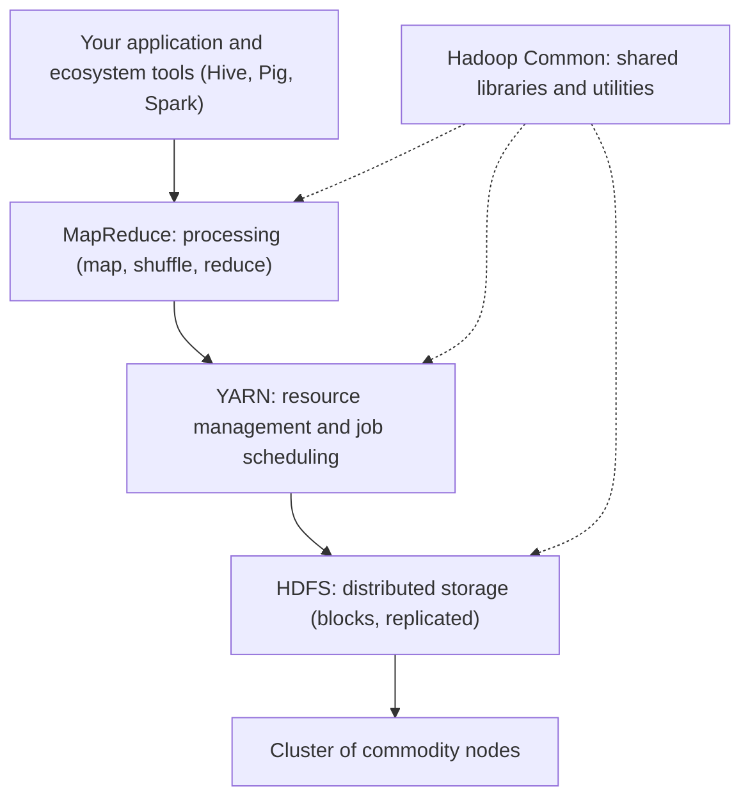
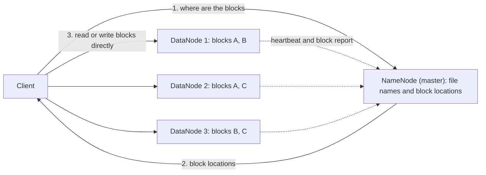
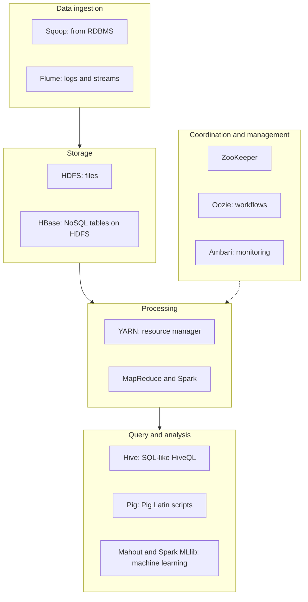

Before Hadoop itself, here are the few ideas you need. If you already know them, skip to the next section.

## The basics first

- **Big data** is data so large, so fast-growing or so varied that one normal computer and one normal database cannot store or process it. It is usually described by the "V"s: volume (size), velocity (speed of arrival) and variety (many formats).
- A **node** is one computer. A **cluster** is many nodes connected by a network and working as one system. A **rack** is a shelf of nodes that share one network switch.
- **Commodity hardware** means ordinary, cheap, off-the-shelf servers, not special expensive machines.
- **Scale up** means buying one bigger computer. **Scale out** means adding more ordinary computers. Hadoop is built for scaling out.
- **Fault tolerance** means the system keeps working when a part fails. With thousands of cheap nodes, some node is always failing, so failure must be treated as normal.
- **Structured data** fits neat rows and columns (a bank table). **Semi-structured** data has tags but no fixed table (XML, JSON, logs). **Unstructured** data has no fixed shape (text, images, video).

## What Hadoop is and why it matters

<PYQ id="2023-12/q1a" />

**What it is.** Apache Hadoop is a free, open-source framework, written in Java, for **storing** very large data sets across a cluster of commodity computers and **processing** them in parallel. It was started by Doug Cutting and Mike Cafarella and takes its design from two Google papers: the Google File System <Cite id="hadoop-ecosystem-ghemawat2003" /> and MapReduce <Cite id="hadoop-ecosystem-dean2004" />. The name came from a toy elephant. <Cite id="hadoop-ecosystem-wiki-hadoop" />

**Why it is needed.** Think of one cook who must make food for 100,000 people. Buying a faster stove (scale up) soon stops working. Hiring 1,000 ordinary cooks (scale out), each with a small share of the work, does work, as long as someone organizes them and a sick cook does not ruin the dinner. Hadoop is the organizer. Traditional systems fail on big data for three reasons:

1. **Storage:** the data does not fit on one disk or one server.
2. **Speed:** reading terabytes through one machine takes hours, because the disk and the network are the bottleneck.
3. **Failure and cost:** a big special machine is very expensive, and when it breaks everything stops.

**Why it matters.** Hadoop made big data analysis cheap and possible for ordinary companies. Its four main strengths:

- **Scalable:** add nodes to add storage and speed.
- **Cheap:** it runs on commodity hardware and is free software.
- **Fault tolerant:** data is copied, and failed work is re-run elsewhere.
- **Flexible:** it stores any kind of data (structured, semi-structured, unstructured) as it is, without a fixed table design first.

<Cite id="hadoop-ecosystem-ibm-hadoop" /> <Cite id="hadoop-ecosystem-aws-hadoop" /> <Cite id="hadoop-ecosystem-gfg-hadoop-intro" /> This is syllabus <Syl m="1" />, "Hadoop concept, core components and ecosystem".

## How Hadoop handles big data problems

<PYQ id="2024-05-ce/q1a" />

Hadoop answers each big data problem with one simple idea:

| Big data problem | How Hadoop handles it |
| --- | --- |
| Too much data for one disk (volume) | **HDFS** cuts every file into big blocks (128 MB by default) and spreads them over many nodes. Add nodes to add space. |
| Processing too slow on one machine | **MapReduce** splits the job into many small tasks that run in parallel on the nodes. |
| Moving huge data over the network is slow | **Data locality:** the program (small) is sent to the node that holds the data (big), not the other way round. |
| Machines fail often | HDFS keeps **3 copies** of every block (replication, default 3) on different nodes and racks. A failed task is simply run again on another node. |
| Many data formats (variety) | Data is stored as plain files, and the structure is applied only when the data is read ("schema on read"). |
| High cost | Commodity hardware and open-source software. |
| Data arrives fast (velocity) | **Flume** and similar tools bring streams into HDFS, and **Spark** (or Storm and others) can process them quickly. |

<Cite id="hadoop-ecosystem-apache-hdfs-design" loc="Data Replication" /> <Cite id="hadoop-ecosystem-mmds" />

### Big data enabling technologies

<PYQ id="2024-12/q2b" />

An **enabling technology** is a technology that makes big data practical. The usual list in answers is:

1. **Distributed storage and processing:** Hadoop with HDFS and MapReduce, to store and process data across many nodes.
2. **NoSQL databases:** MongoDB, Cassandra, HBase, Neo4j, which scale out and store non-tabular data.
3. **In-memory computing:** Spark, which keeps data in RAM for fast, repeated analysis.
4. **Cloud computing:** rent as many machines as needed for as long as needed (for example Amazon EMR).
5. **Stream processing and messaging:** Kafka, Storm, Flume, for data that arrives continuously.
6. **Machine learning and analytics tools:** Mahout, Spark MLlib, to find patterns and predictions.
7. **Data visualization and BI tools:** to show the results as charts and dashboards.

## Hadoop versus a traditional RDBMS

<PYQ id="2023-12-ce/q1a" />

An **RDBMS** (relational database management system, for example MySQL or Oracle) stores neat tables and answers SQL queries. It is excellent for small and medium structured data with transactions. Hadoop is a different tool for a different job.

| Point | RDBMS | Hadoop |
| --- | --- | --- |
| Data type | Structured only (tables with a fixed schema) | Structured, semi-structured and unstructured |
| Data size | Gigabytes to a few terabytes | Terabytes to petabytes |
| Schema | **Schema on write:** design the table first, then load | **Schema on read:** load any file first, give it structure when reading |
| Scaling | Mostly scale up (a bigger server), costly | Scale out (add cheap nodes), cheap |
| Hardware | Expensive high-end servers | Commodity hardware |
| Processing | SQL, quick on indexed data | Batch jobs (MapReduce, Spark), slower start but huge throughput |
| Updates | Read and write many times, in place | Write once, read many times (append only) |
| Transactions (ACID) | Fully supported | Not designed for them |
| Fault tolerance | Needs special extra setup | Built in (replication and task re-run) |
| Best for | Banking, billing, small reports | Log analysis, search indexes, recommendations, big analytics |

**Conclusion:** use an RDBMS for fast transactions on structured data, and Hadoop for analysing huge, varied data in batches. They often work together (Sqoop moves data between them). <Cite id="hadoop-ecosystem-gfg-hadoop-intro" /> <Cite id="hadoop-ecosystem-tp-hadoop-overview" />

## The core components of Hadoop

<PYQ id="2022-12-ce/q4a" /> <PYQ id="2024-12/q4a" />

The Hadoop core has four modules <Cite id="hadoop-ecosystem-apache-hadoop" />:

1. **Hadoop Common:** the shared Java libraries and utilities that all other modules use (file-system access, security, configuration).
2. **HDFS (Hadoop Distributed File System):** the **storage** layer.
3. **YARN (Yet Another Resource Negotiator):** the **resource management and scheduling** layer (from Hadoop 2 on).
4. **MapReduce:** the **processing** layer.

<Cite id="hadoop-ecosystem-gfg-hadoop-arch" loc="diagram" />

The exam question "Hadoop architectural model with both components" means the two original parts: **HDFS (storage)** and **MapReduce (processing)**. Both use a **master-slave** design: one master that coordinates, many slaves that do the work.

### HDFS: the storage component

HDFS stores a file by cutting it into **blocks** (128 MB by default in current versions) and keeping each block on several nodes. It follows a write-once, read-many model and is built for streaming big files, not for small random reads. <Cite id="hadoop-ecosystem-apache-hdfs-design" loc="Introduction" />

- **NameNode (master):** knows the file names, the folder tree and which DataNodes hold each block of each file. This information is called **metadata**. It does not store the actual data. It keeps the metadata in memory, backed by two files on disk, the **FsImage** (a snapshot) and the **EditLog** (the changes since the snapshot).
- **DataNodes (slaves):** store the actual blocks on their disks, serve read and write requests, and report to the NameNode with **heartbeats** (a "I am alive" signal every few seconds) and **block reports** (a list of the blocks they hold). If heartbeats stop, the NameNode treats the node as dead and makes new copies of its blocks on other nodes.
- **Secondary NameNode:** it is not a backup. It only merges the EditLog into the FsImage now and then (a **checkpoint**) so the EditLog does not grow too large. For real failover, Hadoop 2 added a **standby NameNode** (high availability).
- **Replication:** each block is stored 3 times by default. HDFS places the first copy on the writer's node, the second on a node in a different rack, and the third on another node in that same second rack. So losing a whole rack does not lose the data.

<Cite id="hadoop-ecosystem-apache-hdfs-design" loc="diagram" />

<Sum>

<Given>

A file of 500 MB is stored in HDFS with block size 128 MB and replication factor 3.

</Given>

<Find>

the number of blocks, the number of block copies, and the raw storage used.

</Find>

<Steps>

1. Full blocks: $500 \div 128 = 3$ remainder $116$, so 3 full blocks of 128 MB. *Reason: the file is cut into block-sized pieces.*
2. The leftover $500 - 3 \times 128 = 116$ MB becomes a 4th, smaller block. *Reason: HDFS does not pad the last block, it uses only its real size.*
3. Total blocks $= 3 + 1 = 4$.
4. Block copies $= 4 \times 3 = 12$. *Reason: every block is stored 3 times.*
5. Raw storage $= 500 \text{ MB} \times 3 = 1500$ MB. *Reason: every byte is stored 3 times.*

</Steps>

<Answer>

4 blocks, 12 block copies, 1500 MB (1.5 GB) of raw disk.

</Answer>

<Box kind="verify">

Add the block sizes: $128 + 128 + 128 + 116 = 500$ MB, the file size. Add the copies by size: $3 \times (128 \times 3 + 116) = 3 \times 500 = 1500$ MB, the same as before.

</Box>

</Sum>

### MapReduce: the processing component

MapReduce is a programming model in which you write two small functions, and the framework runs them in parallel on the cluster. <Cite id="hadoop-ecosystem-dean2004" /> <Cite id="hadoop-ecosystem-mmds" />

1. **Input split:** the input in HDFS is divided into splits, one per block, and one **map task** is started for each, preferably on a node that already holds that block (data locality).
2. **Map:** each map task reads its records and emits **key-value pairs**. For word count, the line "to be or not to be" gives (to,1), (be,1), (or,1), (not,1), (to,1), (be,1).
3. **Shuffle and sort:** the framework moves all pairs with the same key to the same reducer and sorts them by key. An optional **combiner** can add up the counts on the map side first, to send less data over the network.
4. **Reduce:** each reduce task gets a key with its list of values and combines them, for example (to, [1,1]) becomes (to, 2).
5. **Output:** the result is written back to HDFS.

Map output goes to the local disk of the node, not to HDFS, since it is temporary. <Cite id="hadoop-ecosystem-apache-mr-tutorial" loc="Overview" />

In **Hadoop 1**, one **JobTracker** ran the jobs and a **TaskTracker** on each node ran the tasks. That single JobTracker was a bottleneck, so **Hadoop 2** replaced it with YARN.

### YARN: the resource manager

YARN splits the JobTracker's two jobs, resource management and job life-cycle, into separate parts <Cite id="hadoop-ecosystem-apache-yarn" />:

- **ResourceManager (master):** one per cluster; decides which application gets how much CPU and memory.
- **NodeManager (slave):** one per node; starts **containers** (a slice of CPU and memory) and reports usage.
- **ApplicationMaster:** one per application (job); asks the ResourceManager for containers and runs the job's tasks in them.

Because YARN is separate, MapReduce is no longer the only engine: Spark, Tez and others also run on YARN over the same HDFS data.

## The Hadoop ecosystem

<PYQ id="2023-12/q2a" /> <PYQ id="2025-05/q2a" /> <PYQ id="2025-05-ce/q6a" /> <PYQ id="2024-12-ce/q4b" />

**What it is.** The **Hadoop ecosystem** is the family of tools built around the Hadoop core. The core stores and processes data, but writing raw MapReduce in Java is hard, and a real project also needs loading, querying, coordination and scheduling. Each ecosystem tool fills one such gap. <Cite id="hadoop-ecosystem-gfg-hadoop-ecosystem" /> <Cite id="hadoop-ecosystem-av-hadoop-ecosystem" />

<Cite id="hadoop-ecosystem-gfg-hadoop-ecosystem" loc="diagram" />

The components in one table (the first four in the core are explained above):

| Component | Layer | What it does, in simple words |
| --- | --- | --- |
| **HDFS** | Storage | Stores big files as replicated blocks across the cluster. |
| **YARN** | Resource management | Shares the cluster's CPU and memory between applications. |
| **MapReduce** | Processing | Batch processing in map, shuffle, reduce steps. |
| **Hive** | Query | Lets you write SQL-like queries (HiveQL) on data in HDFS; it turns them into jobs. Good for analysts. |
| **Pig** | Scripting | Lets you write a data-flow script in Pig Latin (load, filter, group, join) instead of long Java. |
| **HBase** | NoSQL database | A column-oriented database on HDFS, modelled on Google's Bigtable, for fast random read and write of single rows. |
| **Spark** | Processing | A fast engine that keeps data in memory; good for iterative jobs, machine learning and streaming. |
| **Mahout** | Machine learning | Scalable machine learning algorithms (recommendation, clustering, classification). |
| **ZooKeeper** | Coordination | A central service for configuration, naming, locks and leader election between the distributed tools. |
| **Oozie** | Scheduling | Runs a chain of jobs (a workflow) in the right order and at the right time. |
| **Sqoop** | Ingestion | Copies data between relational databases and HDFS in bulk. |
| **Ambari** | Management | A web tool to set up, monitor and manage the nodes and services of a Hadoop cluster. |
| **Flume** | Ingestion | Collects streaming data such as server logs and delivers it into HDFS. |

<Cite id="hadoop-ecosystem-apache-hive" /> <Cite id="hadoop-ecosystem-apache-pig" /> <Cite id="hadoop-ecosystem-apache-hbase" /> <Cite id="hadoop-ecosystem-apache-spark" /> <Cite id="hadoop-ecosystem-apache-zookeeper" /> <Cite id="hadoop-ecosystem-apache-oozie" /> <Cite id="hadoop-ecosystem-apache-sqoop" /> <Cite id="hadoop-ecosystem-apache-flume" />

If the question says "explain any two components", write 4 to 5 lines on each: what it is, why it is needed, how it works, one example. A safe pair is **Hive** and **HBase**, for which a good example is:

- **Hive:** *Need:* analysts know SQL, not Java. *How:* you write `SELECT city, COUNT(*) FROM users GROUP BY city`, and Hive translates it into distributed jobs that run on the cluster. *Note:* it is for batch analysis, not for quick single-row lookups.
- **HBase:** *Need:* HDFS is poor at reading one record quickly. *How:* it stores rows in tables with column families, sorted by row key, on top of HDFS. *Example:* looking up one user's profile in milliseconds.

Some tools in this list are now less used or retired by Apache (Sqoop is one); check the project page before choosing a tool for a new project. Exams still ask for the classic list above.

## Advantages and limitations of Hadoop

<PYQ id="2025-05/q1b" /> <PYQ id="2024-12/q1c" />

**Advantages**

1. **Scalable:** from a few nodes to thousands, just by adding machines.
2. **Low cost:** commodity hardware and open-source software.
3. **Fault tolerant:** block replication and automatic re-running of failed tasks.
4. **Handles all data types:** structured, semi-structured and unstructured, with schema on read.
5. **Fast on huge data:** parallel processing and data locality give high throughput.
6. **Rich ecosystem and community:** many tools, many vendors, and a big community.

**Limitations** (syllabus <Syl m="2" />, "Hadoop limitations")

1. **Not for small files:** every file, folder and block is an object in the NameNode's memory. Millions of tiny files use up that memory and make the NameNode the bottleneck.
2. **Batch only, high latency:** MapReduce jobs take seconds to minutes to start and finish. It is not for real-time answers.
3. **Slow for iterative work:** MapReduce writes results to disk between steps, so algorithms that loop many times (machine learning, graphs) are slow. Spark fixes this with memory.
4. **No in-place update or transactions:** HDFS is write-once, read-many (append only), so it is a poor fit for banking-type updates.
5. **Hard programming model:** plain MapReduce needs long Java code, and not every problem fits map and reduce easily.
6. **NameNode is a weak point:** in Hadoop 1 it was a single point of failure; Hadoop 2 added a standby NameNode, but this needs extra setup.
7. **Storage overhead:** 3 copies means 3 times the disk space.
8. **Security and administration:** basic security is weak unless Kerberos and related tools are set up, and running a big cluster needs skilled people.

<Cite id="hadoop-ecosystem-gfg-hadoop-intro" /> <Cite id="hadoop-ecosystem-ibm-hadoop" />

**Conclusion:** Hadoop is a low-cost, scalable and fault-tolerant platform for batch analysis of very large, varied data. Its ecosystem fills the gaps (Hive for SQL, HBase for fast access, Spark for speed), but it should not be used for small data, real-time answers or transactions. <Cite id="hadoop-ecosystem-wiki-hadoop" /> <Cite id="hadoop-ecosystem-aws-hadoop" />
