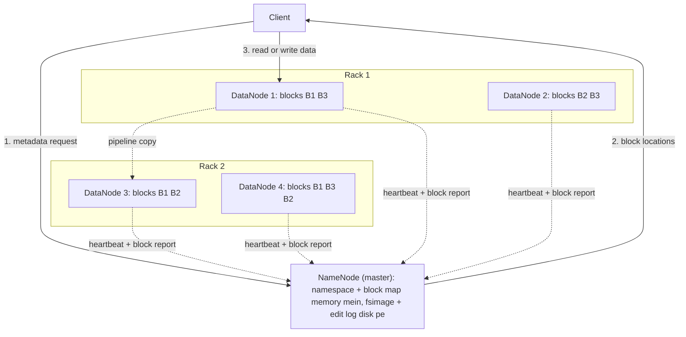
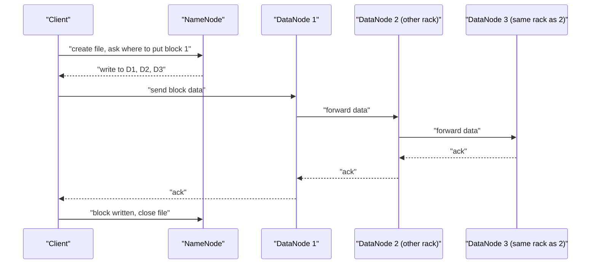
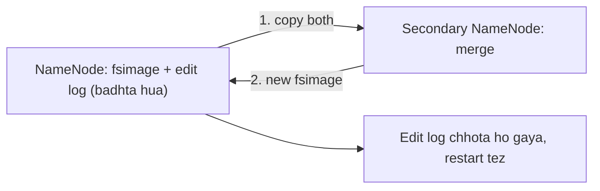
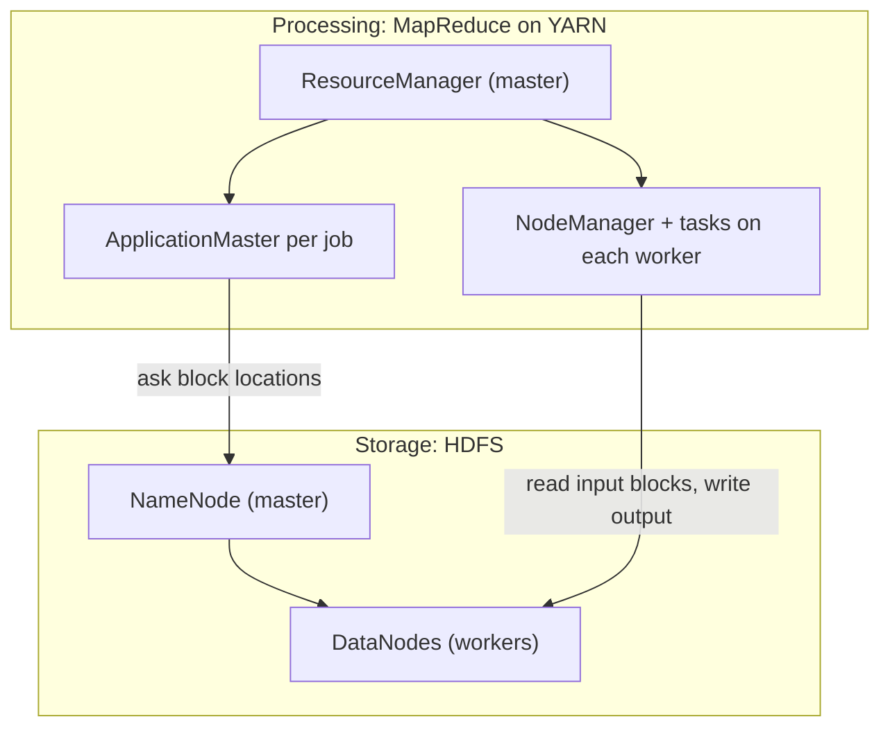

## Pehle basics

- **File system** computer ka woh hissa hai jo files store karta hai aur yaad rakhta hai ki har file kahan rakhi hai.
- **Node** ek machine hai. **Cluster** kai nodes ka group hai jo network se jude hain. **Rack** nodes ki ek shelf hai jo ek hi network switch share karti hai.
- **Commodity hardware** ka matlab hai aam, sasti servers, koi special mehengi nahi. Sasti machines aksar fail hoti hain, isliye software ko failures expect karne chahiye.
- **Metadata** data ke baare mein data hai: file ka naam, size aur uske pieces kahan hain. Asli content ko **data** kehte hain.
- **Block** file ka ek fixed-size piece hai.

## Distributed file system kya hota hai

**Ye kya hai.** **Distributed file system (DFS)** files ko kai machines pe store karta hai, lekin user ko ek normal folder tree dikhata hai. Ye syllabus <Syl m="2" /> hai, "Distributed file systems and large-scale file-system organization".

**Ye kyun zaroori hai.** Big data ek disk mein fit nahi hota, aur ek disk bahut slow read karti hai. 1 TB file ko ek machine pe 100 MB/s se read karo to lagbhag 3 ghante lagte hain; 100 machines ek saath padhein to kuch minutes. Aur ek machine kabhi na kabhi fail hogi, isliye important data ki copies doosri machines pe chahiye.

**Everyday analogy.** Ek library jiski kai branches hain. Ek central catalogue (index) batata hai ki kitab ka kaun sa hissa kis branch mein hai. Har hisse ki ek spare copy doosri branch mein hai, to ek branch band ho jaye tab bhi kitab nahi jaati.

**Large-scale file-system organization.** Google ke GFS aur HDFS dono mein wahi teen ideas hote hain: <Cite id="hdfs-gfs-paper" /> <Cite id="hdfs-wiki-gfs" />

1. Files bahut badi hoti hain, isliye unhe bade fixed-size pieces mein kaata jaata hai (GFS inhe chunks kehta hai, 64 MB; HDFS inhe blocks kehta hai, default 128 MB).
2. Har piece kai nodes pe **replicate** hota hai, behtar hai alag racks pe.
3. Ek **master** metadata rakhta hai (kaun se pieces se file bani hai, har piece kahan hai). Kai **workers** pieces store karte hain. Data client aur workers ke beech seedha jaata hai, master se hokar kabhi nahi.

| GFS term | HDFS term | Kaam |
|---|---|---|
| Master | NameNode | Metadata rakhta hai, decide karta hai blocks kahan jayenge |
| Chunkserver | DataNode | Blocks store karta hai, reads aur writes serve karta hai |
| Chunk (64 MB) | Block (128 MB) | Storage aur replication ki unit |

## HDFS kya hai

<Box kind="definition">

**HDFS (Hadoop Distributed File System)** Hadoop ka storage part hai. Ye ek distributed, fault-tolerant file system hai jo commodity hardware pe chalta hai aur bahut badi files ke liye bana hai jo ek baar likhi jaati hain aur kai baar read hoti hain.

</Box>

<Cite id="hdfs-apache-design" /> <Cite id="hdfs-gfg" /> <Cite id="hdfs-tp" />

**Design goals** (official design page se): <Cite id="hdfs-apache-design" />

- **Hardware failure normal hai**, isliye use detect karo aur automatically recover karo.
- **Streaming, high-throughput access**, low-latency access nahi.
- **Badi files** (gigabytes se terabytes) aur bahut bade clusters.
- **Write-once-read-many:** file banti hai, likhi jaati hai, close hoti hai aur phir sirf read hoti hai. Append allowed hai; beech mein edit allowed nahi.
- **Computation ko data ke paas le jao:** task ko usi node pe chalao jahan block hai, kyunki program ko le jaana terabytes le jaane se sasta hai.

## HDFS architecture

HDFS **master-slave** hai. Ek NameNode master hai; kai DataNodes slaves hain. <Cite id="hdfs-apache-design" /> <Cite id="hdfs-ibm" />

Official docs ki standard HDFS architecture picture se redraw kiya gaya. <Cite id="hdfs-apache-design" loc="diagram" /> <Cite id="hdfs-gfg" loc="diagram" />

### NameNode

- Akela master. Ye **namespace** (folder aur file tree) manage karta hai, client access control karta hai, aur har block ko uske DataNodes se map karta hai. User data kabhi isse hokar nahi jaata. <Cite id="hdfs-apache-design" />
- Poora namespace aur block map speed ke liye **RAM mein** rakhta hai.
- Metadata disk pe do files mein save karta hai: **fsimage** (namespace ka snapshot) aur **edit log** (us snapshot ke baad ka har change). Restart pe fsimage load karta hai aur edit log replay karta hai. <Cite id="hdfs-apache-design" />
- Replication aur block placement decide karta hai; file content store nahi karta.

### DataNode

- Aam taur pe har worker node pe ek. Ye blocks ko local disks pe normal files ki tarah store karta hai aur clients ke reads aur writes serve karta hai. <Cite id="hdfs-apache-design" /> <Cite id="hdfs-tp" />
- Blocks tabhi banata, delete karta ya copy karta hai jab NameNode bole.
- Regularly (default mein har 3 second) **heartbeat** bhejta hai "main zinda hoon", aur apne saare blocks ki list wala **block report** bhejta hai. <Cite id="hdfs-apache-design" />

### NameNode versus DataNode

| Point | NameNode | DataNode |
|---|---|---|
| Role | Master | Slave (worker) |
| Number | Ek active (HA mein plus standby) | Kai, sau ya hazaar |
| Stores | Metadata: names, block lists, block locations | Actual data blocks |
| Memory need | High RAM (saara metadata rakhta hai) | Bade disks |
| Talks to | Clients (metadata) aur DataNodes | Clients (data), NameNode (reports) |
| If it fails | Recover ya failover hone tak poora file system unavailable | Cluster chalta rehta hai; blocks doosri replicas se dobara copy hote hain |

<PYQ id="2023-05-ce/q1a" />

### Blocks

- File blocks mein split hoti hai. Default block size **128 MB** hai (purana Hadoop 1.x 64 MB use karta tha). Ek file ke saare blocks same size ke hote hain sirf last block ko chhodkar, jo bacha hua data jitna hi bada hota hai. <Cite id="hdfs-apache-design" /> <Cite id="hdfs-ibm" />
- Blocks jaanbujhkar bade rakhe jaate hain: kam blocks matlab NameNode ke liye kam metadata, aur data transfer ke time ke mukable seek mein kam time barbaad.
- 128 MB se chhota last block disk pe poora 128 MB **nahi** khata; sirf apni asli size leta hai.

### Replication aur rack awareness

- Har block ki copy banti hai. **Replication factor** per file set hota hai aur default **3** hai. <Cite id="hdfs-ibm" /> <Cite id="hdfs-wiki-hadoop" />
- **Factor 3 ke saath placement policy:** pehli replica writer ke node pe (ya writer ke rack ke kisi random node pe), doosri **alag rack** ke ek node pe, teesri usi remote rack ke doosre node pe. <Cite id="hdfs-apache-design" />
- **Rack awareness** ka matlab NameNode ko pata hai ki har DataNode kis rack mein hai, taaki rack ke switch ya power failure mein bhi ek copy bach jaye. Rack script ke bina saare nodes ek hi rack (`/default-rack`) lagte hain aur off-rack placement nahi ho paata. <Cite id="hdfs-apache-rack" />
- Reads **sabse paas wali** replica se hote hain. <Cite id="hdfs-apache-design" />

## Read aur write flow

<Cite id="hdfs-apache-design" /> <Cite id="hdfs-gfg" loc="diagram" />

**Write steps:**

1. Client NameNode se file create karne ko kehta hai. NameNode permissions check karke use record kar leta hai.
2. Har block ke liye NameNode DataNodes ki list deta hai (default 3).
3. Client block pehle DataNode ko bhejta hai, jo use doosre ko forward karta hai, jo teesre ko (**replication pipeline**). <Cite id="hdfs-apache-design" />
4. Acknowledgements pipeline mein wapas aate hain. Client agla block repeat karta hai aur aakhir mein file close karta hai.

**Read steps:**

1. Client NameNode se file ke block locations maangta hai.
2. NameNode har block ke liye woh DataNodes batata hai jinke paas woh hai, sabse paas wala pehle.
3. Client har block seedha sabse paas wale DataNode se read karta hai aur use apne **checksum** se check karta hai. Match na ho to client doosri replica read karta hai. <Cite id="hdfs-apache-design" />

## Secondary NameNode

Naam gumrah karne wala hai. **Secondary NameNode backup ya standby NameNode nahi hai.** NameNode mar jaye to ye uski jagah nahi le sakta. <Cite id="hdfs-wiki-hadoop" /> <Cite id="hdfs-apache-guide" />

**Asal mein ye kya karta hai (checkpointing).** Edit log badhta hi rehta hai; bahut bada ho jaye to NameNode ka restart bahut slow ho jaata hai. Isliye har kuch der baad (default mein har ghante ya 1 million transactions ke baad) Secondary NameNode: <Cite id="hdfs-apache-guide" />

1. NameNode se current fsimage aur edit log download karta hai.
2. Dono ko merge karke naya fsimage banata hai.
3. Naya fsimage wapas bhejta hai, taaki edit log chhota kiya ja sake.

**"Secondary NameNode is a backup of NameNode" ka answer: False.** Ye checkpoint helper hai. Iske paas metadata ki ek purani merged copy hoti hai jo files recover karne mein madad kar sakti hai, lekin phir bhi downtime hoga aur last checkpoint ke baad ke changes kho jayenge. <PYQ id="2024-12-ce/q1b" />

| Node | Kya karta hai | Kya takeover kar sakta hai? |
|---|---|---|
| Secondary NameNode | Fsimage aur edit log ko periodically merge karta hai | No |
| Checkpoint Node | Wahi checkpointing karta hai (Secondary NameNode ka alternative) | No |
| Backup Node | Checkpointing plus namespace ki up-to-date in-memory copy | Docs ise failover nahi kehte |
| Standby NameNode (HA) | Hot standby, shared edit log continuously padhta hai | Yes |

<Cite id="hdfs-apache-guide" /> <Cite id="hdfs-apache-ha" />

## HDFS failure kaise handle karta hai

Failures expected hain, isliye HDFS unhe layers mein handle karta hai. <PYQ id="2023-12-ce/q1c" />

| Failure | HDFS ko kaise pata chalta hai | Kya karta hai |
|---|---|---|
| DataNode ya disk mar jaye | Heartbeats band; timeout ke baad (official docs mein default 10 minute se zyada) node dead mark hota hai | NameNode use kaam bhejna band karta hai aur uske blocks ki nayi copies doosre nodes pe banwata hai jab tak har block ki phir se 3 replicas na ho jayein |
| Block corrupt ho | Client ka checksum match nahi karta | Client doosri replica read karta hai; kharab copy ki jagah nayi copy aati hai |
| Poora rack fail ho | Kai DataNodes ek saath chup | Doosre rack pe rakhi copy serve karti hai; missing replicas dobara bante hain |
| NameNode mar jaye | Clients use reach nahi kar paate | HA ke bina cluster restart tak down (single point of failure). HA ke saath Standby NameNode Active ban jaata hai |
| Cluster abhi start hua | NameNode **Safemode** mein hai, read-only, block reports ka wait kar raha hai | Jab kaafi blocks report kar dein to Safemode chhodta hai, phir under-replicated blocks copy karta hai |

<Cite id="hdfs-apache-design" /> <Cite id="hdfs-apache-guide" />

(Kuch websites kehti hain ki DataNode 2 minute baad dead declare hota hai; official documentation kehti hai default timeout 10 minute se zyada hai, aur use tune kiya ja sakta hai. <Cite id="hdfs-wiki-hadoop" />)

**NameNode high availability.** Hadoop 2.0 se pehle NameNode ek **single point of failure** tha. Ab do NameNodes chalte hain, ek Active aur ek Standby. Active har change **JournalNodes** ke group (kam se kam 3) ko likhta hai; Standby wahi edits padhta hai, isliye jaldi takeover kar sakta hai. **Fencing** pakka karti hai ki purana Active likhna band kare, taaki do masters ("split brain") na ho jayein. <Cite id="hdfs-apache-ha" />

**Doosre safety tools:** **Balancer** naye DataNodes judne ke baad data ko barabar failata hai, aur **fsck** missing ya under-replicated blocks report karta hai (report karta hai; fix nahi karta). <Cite id="hdfs-apache-guide" />

## HDFS bade datasets ke liye kyun theek hai aur small files ke liye kyun nahi

<Box kind="key">

HDFS **kam lekin bahut badi files jo badi sequential streams mein read hoti hain** ke liye bana hai. Iska NameNode har file, directory aur block ke liye RAM mein ek object rakhta hai, isliye lakhon chhoti files NameNode ko overload kar deti hain, aur har chhoti file phir bhi apna block, apna seek aur apna task leti hai.

</Box>

**Badi files kyun fit hain:**

- Badi file bahut saare blocks ban jaati hai jinhe kai machines **parallel mein** read karti hain, isliye total read speed jud jaati hai.
- Bade blocks matlab per terabyte kam metadata aur kam seeks. <Cite id="hdfs-apache-design" />
- Write-once-read-many aur streaming access batch jobs jaise MapReduce ke liye theek hain, jo tasks ko blocks ke paas chalate hain. <Cite id="hdfs-apache-mr" />

**Small files kyun problem hain:**

- Har file, directory aur block NameNode memory mein ek object hai, rule of thumb se lagbhag 150 bytes har ek. 10 million one-block files ko lagbhag 3 GB NameNode RAM chahiye, aur ek billion files practical nahi hai. <Cite id="hdfs-cloudera-small" />
- 1 MB ki file 128 MB ke block ko disk pe nahi bharti (sirf 1 MB leti hai) lekin phir bhi ek block entry aur ek NameNode record leti hai.
- Bahut saari tiny files padhne ka matlab bahut saare NameNode requests aur bahut saare chhote tasks, isliye job kaam karne se zyada time start hone mein lagati hai.
- Fixes: chhoti files ko badi files mein pack karo (SequenceFile, HAR archives, ya load karne se pehle merge karo).

<PYQ id="2022-12-ce/q1c" />

**HDFS ki limitations (short mein):**

| Limitation | Kyun |
|---|---|
| Bahut saari small files ke liye kharab | NameNode memory aur per-file overhead |
| Low-latency access ke liye nahi | Throughput ke liye bana hai; har read pehle NameNode se poochta hai |
| Random edits nahi | Write-once-read-many; sirf append |
| NameNode single point of failure (HA ke bina) | Ek master saara metadata rakhta hai |
| 3x storage overhead | Replication se raw disk teen guna lagti hai |

## Hadoop architectural model: dono components

<PYQ id="2024-12/q4a" />

Hadoop ke do main components hain: storage ke liye **HDFS** aur processing ke liye **MapReduce**, jisme resources **YARN** manage karta hai (Hadoop 2 aur baad mein) aur **Hadoop Common** shared libraries hain. <Cite id="hdfs-gfg-arch" /> <Cite id="hdfs-aws" />

<Cite id="hdfs-apache-yarn" loc="diagram" /> <Cite id="hdfs-gfg-arch" loc="diagram" />

| Component | Master | Worker | Kaam |
|---|---|---|---|
| HDFS | NameNode | DataNode | Data store aur replicate karna |
| MapReduce (on YARN) | ResourceManager (aur per-job ApplicationMaster) | NodeManager jo map aur reduce tasks chalata hai | Data parallel mein process karna: Map input ko key-value pairs mein badalta hai, Reduce unhe key ke hisaab se combine karta hai |

**Dono saath mein kaise kaam karte hain.**

1. Client data HDFS mein daalta hai, jahan woh replicated blocks ban jaata hai.
2. Client job YARN ResourceManager ko submit karta hai.
3. Ek ApplicationMaster start hota hai; woh NameNode se poochta hai blocks kahan hain aur YARN se un nodes pe ya unke paas containers maangta hai (**data locality**). <Cite id="hdfs-apache-yarn" /> <Cite id="hdfs-apache-mr" />
4. Map tasks apne blocks locally read karte hain, shuffle results ko Reduce tasks tak le jaata hai, aur output HDFS mein likha jaata hai.
5. Fail hua task doosre node pe dobara chalta hai; fail hue DataNode ke blocks doosri replicas se read hote hain.

MapReduce ke liye MapReduce note dekho; poora ecosystem Hadoop note mein hai.

## Worked examples

<Sum>

<Given>

500 MB ki file HDFS mein store hai, block size 128 MB aur replication factor 3.

</Given>

<Find>

blocks ki sankhya, last block ki size, total block copies aur use hui raw disk space.

</Find>

<Steps>

1. **Blocks ki sankhya.** $500 \div 128 = 3.9$, aur adhura bhara block bhi gina jaata hai, isliye round up: 4 blocks. *Reason: file ko poore blocks chahiye, last adhura bhara ho sakta hai.*
2. **Full blocks.** 128 MB ke 3 blocks $3 \times 128 = 384$ MB rakhte hain.
3. **Last block.** $500 - 384 = 116$ MB. *Reason: last block utna hi bada hai jitna data bacha hai.*
4. **Block copies.** $4 \times 3 = 12$ replicas DataNodes pe.
5. **Raw disk space.** $500 \times 3 = 1500$ MB. *Reason: HDFS last block ke liye poora 128 MB nahi, asli size store karta hai, aur har byte 3 baar rakhi jaati hai.*

</Steps>

<Answer>

4 blocks (128, 128, 128 aur 116 MB); 12 block copies; 1500 MB raw disk use hui.

</Answer>

<Box kind="verify">

Copies ko doosre tareeke se jodo: 9 full replicas $\times$ 128 = 1152 MB aur last block ki 3 replicas $\times$ 116 = 348 MB, aur $1152 + 348 = 1500$ MB. Ye step 5 se match karta hai.

</Box>

</Sum>

<Sum>

<Given>

NameNode memory cost har file, directory aur block object ke liye lagbhag 150 bytes hai. 1 TB ($1{,}048{,}576$ MB) ko 128 MB files mein (har file ek block) store karne ki 1 MB files mein (har file ek block) store karne se tulna karo. Directories ignore karo.

</Given>

<Find>

dono cases mein NameNode memory.

</Find>

<Steps>

1. **Case A, 128 MB files.** Files ki sankhya $= 1{,}048{,}576 \div 128 = 8192$. *Reason: total size ko file size se divide karo.*
2. Objects: 8192 files + 8192 blocks $= 16{,}384$. *Reason: har file aur har block ek object hai.*
3. Memory: $16{,}384 \times 150 = 2{,}457{,}600$ bytes, lagbhag 2.3 MB.
4. **Case B, 1 MB files.** Files ki sankhya $= 1{,}048{,}576 \div 1 = 1{,}048{,}576$.
5. Objects: $1{,}048{,}576 + 1{,}048{,}576 = 2{,}097{,}152$.
6. Memory: $2{,}097{,}152 \times 150 = 314{,}572{,}800$ bytes, jo ($1{,}048{,}576$ se divide karne par) theek 300 MB hai.
7. Ratio: $2{,}097{,}152 \div 16{,}384 = 128$.

</Steps>

<Answer>

Case A ko lagbhag 2.3 MB NameNode RAM chahiye. Case B ko lagbhag 300 MB chahiye, jo 128 guna zyada hai, wahi 1 TB data ke liye.

</Answer>

<Box kind="verify">

Files ki counts ka ratio $1{,}048{,}576 \div 8192 = 128$ hai, jo $128 \text{ MB} \div 1 \text{ MB}$ ke barabar hai, isliye memory 128 guna scale honi chahiye. Answers ka ratio $314{,}572{,}800 \div 2{,}457{,}600 = 128$ bhi match karta hai. 150-byte figure <Cite id="hdfs-cloudera-small" /> ka rule of thumb hai, exact number nahi.

</Box>

</Sum>

<Sum>

<Given>

Cluster mein 10 DataNodes hain, har ek mein 12 TB disk. Replication factor 3 hai. OS aur temporary space ignore karo.

</Given>

<Find>

cluster maximum kitna unique user data rakh sakta hai, aur 30 TB user data store karne ke baad kitna bachta hai.

</Find>

<Steps>

1. **Raw capacity.** $10 \times 12 = 120$ TB. *Reason: saari disks jodo.*
2. **Usable capacity.** Har byte 3 baar store hoti hai, isliye $120 \div 3 = 40$ TB unique data.
3. **30 TB store karna.** Ye $30 \times 3 = 90$ TB raw leta hai.
4. **Bacha hua raw space.** $120 - 90 = 30$ TB raw, jisme $30 \div 3 = 10$ TB aur unique data aa sakta hai.

</Steps>

<Answer>

Cluster zyada se zyada 40 TB unique data rakh sakta hai. 30 TB ke baad 10 TB unique data aur fit hota hai (30 TB raw disk bachi).

</Answer>

<Box kind="verify">

$30 + 10 = 40$ TB unique data, aur $40 \times 3 = 120$ TB raw, jo poori raw capacity hai.

</Box>

</Sum>

## Exam-ready comparisons

| Point | Traditional (single-server) file system | HDFS |
|---|---|---|
| Storage | Ek machine ki disks | Kai commodity machines |
| File size | Chhoti se medium | Bahut badi (GB se TB) |
| Failure | Disk failure se data jaata hai | Replication (3 copies) data bachati hai |
| Access | Random read aur write | Streaming read, write once, sirf append |
| Scaling | Bada machine kharido | Aur nodes jodo |
| Processing | Data program ke paas jaata hai | Program data ke paas jaata hai |

<Box kind="exam">

Exam mein English mein likho: "HDFS is a master-slave distributed file system. The NameNode stores metadata and the DataNodes store replicated blocks. Files are split into 128 MB blocks, each replicated three times across racks. DataNodes send heartbeats; when one fails, the NameNode re-replicates its blocks. The Secondary NameNode only checkpoints the fsimage and edit log; it is not a backup."

</Box>

**Explain HDFS architecture** (10 marks): <PYQ id="2024-05/q2a" /> architecture diagram use karo, phir is note se NameNode, DataNode, blocks, replication aur rack awareness, read aur write flow, Secondary NameNode, aur failure handling likho.

## Conclusion

HDFS big data ko sasta, scalable aur fault-tolerant storage deta hai: files ko bade replicated blocks mein todkar, ek NameNode ke saath jo jaanta hai sab kuch kahan hai aur kai DataNodes ke saath jo data rakhte hain. Ye badi files ko bulk mein padhne ke liye best hai, aur small files aur tez random updates ke liye kharab.
