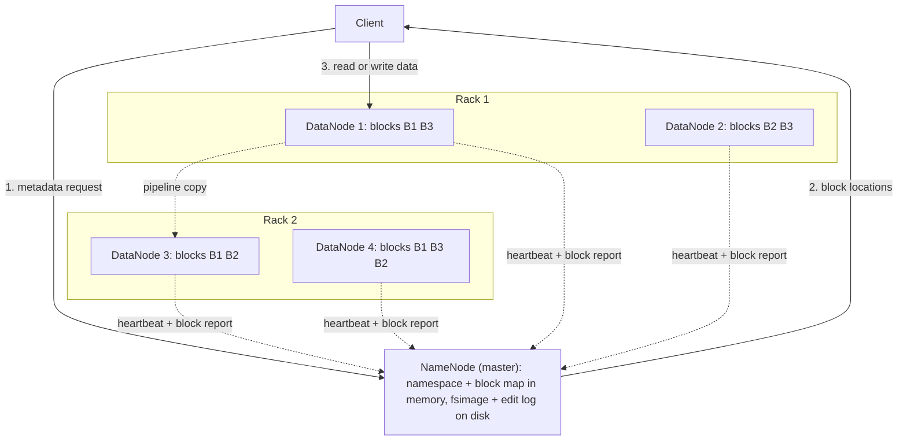
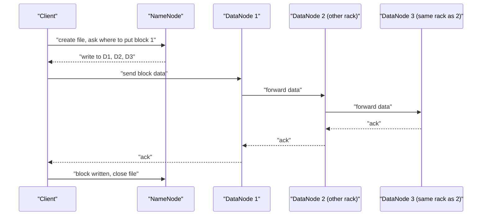
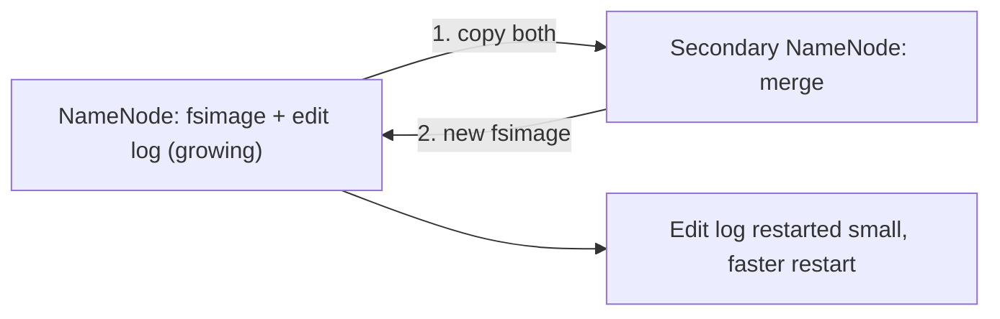
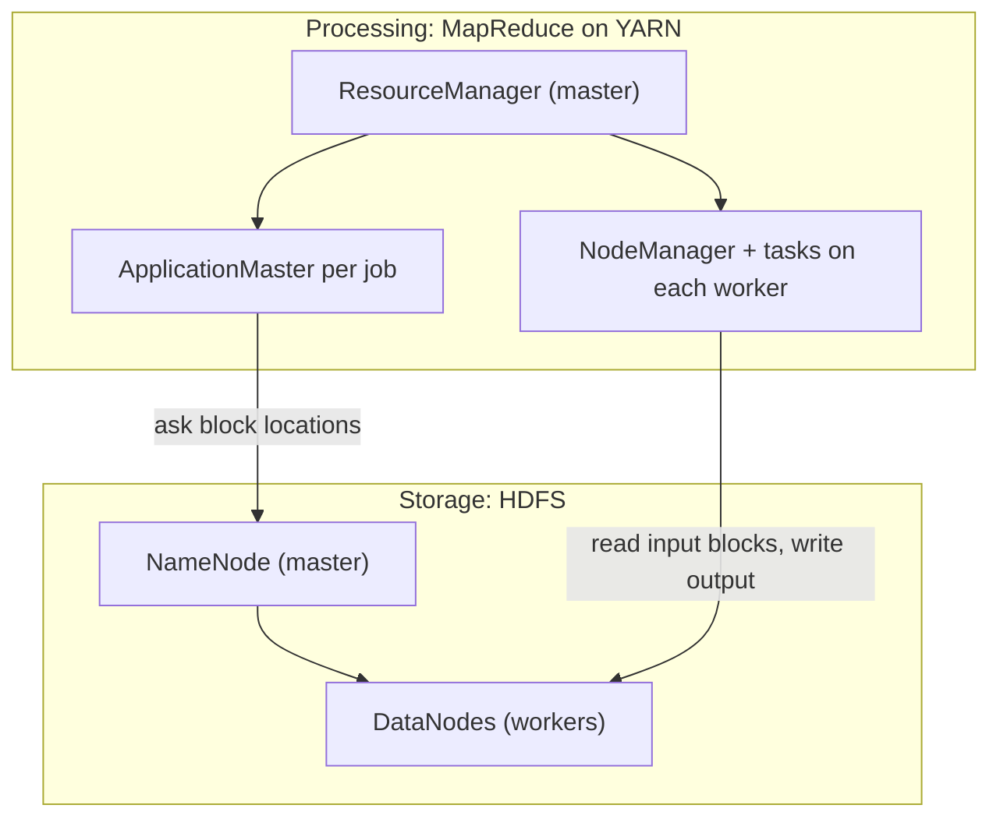

## The basics first

- A **file system** is the part of a computer that stores files and remembers where each one is kept.
- A **node** is one machine. A **cluster** is many nodes joined by a network. A **rack** is a shelf of nodes that share one network switch.
- **Commodity hardware** means ordinary, cheap servers, not special expensive ones. Cheap machines fail often, so software must expect failures.
- **Metadata** is data about data: a file's name, size and where its pieces are. The real content is the **data**.
- A **block** is one fixed-size piece of a file.

## What a distributed file system is

**What it is.** A **distributed file system (DFS)** stores files across many machines but shows the user one normal-looking folder tree. This is syllabus <Syl m="2" />, "Distributed file systems and large-scale file-system organization".

**Why it is needed.** Big data does not fit on one disk, and one disk reads too slowly. A 1 TB file read at 100 MB/s on one machine takes about 3 hours; spread over 100 machines reading together it takes minutes. Also, one machine will eventually fail, so important data needs copies on other machines.

**Everyday analogy.** A library with many branches. One central catalogue (the index) says which branch has which part of a book. Every part has a spare copy in another branch, so if one branch closes, nobody loses the book.

**Large-scale file-system organization.** The usual design has the same three ideas, used by Google's GFS and by HDFS: <Cite id="hdfs-gfs-paper" /> <Cite id="hdfs-wiki-gfs" />

1. Files are huge, so they are cut into big fixed-size pieces (GFS calls them chunks, 64 MB; HDFS calls them blocks, 128 MB by default).
2. Every piece is **replicated** on several nodes, ideally on different racks.
3. One **master** keeps the metadata (which pieces make a file, where each piece is). Many **workers** store the pieces. Data flows directly between client and workers, never through the master.

| GFS term | HDFS term | Job |
|---|---|---|
| Master | NameNode | Keeps metadata, decides where blocks go |
| Chunkserver | DataNode | Stores blocks, serves reads and writes |
| Chunk (64 MB) | Block (128 MB) | Unit of storage and replication |

## What HDFS is

<Box kind="definition">

**HDFS (Hadoop Distributed File System)** is the storage part of Hadoop. It is a distributed, fault-tolerant file system that runs on commodity hardware and is built for very large files that are written once and read many times.

</Box>

<Cite id="hdfs-apache-design" /> <Cite id="hdfs-gfg" /> <Cite id="hdfs-tp" />

**Design goals** (from the official design page): <Cite id="hdfs-apache-design" />

- **Hardware failure is normal**, so detect it and recover automatically.
- **Streaming, high-throughput access** to data, not low-latency access.
- **Large files** (gigabytes to terabytes) and very large clusters.
- **Write-once-read-many:** a file is created, written, closed and then only read. Appending is allowed; editing the middle is not.
- **Move computation to the data:** run the task on the node that holds the block, because moving the program is cheaper than moving terabytes.

## HDFS architecture

HDFS is **master-slave**. One NameNode is the master; many DataNodes are the slaves. <Cite id="hdfs-apache-design" /> <Cite id="hdfs-ibm" />

Redrawn from the standard HDFS architecture picture in the official docs. <Cite id="hdfs-apache-design" loc="diagram" /> <Cite id="hdfs-gfg" loc="diagram" />

### NameNode

- The single master. It manages the **namespace** (the folder and file tree), controls client access, and maps every block to the DataNodes holding it. User data never passes through it. <Cite id="hdfs-apache-design" />
- Keeps the whole namespace and block map **in RAM** for speed.
- Saves metadata on disk in two files: the **fsimage** (a snapshot of the namespace) and the **edit log** (every change since that snapshot). On restart it loads the fsimage and replays the edit log. <Cite id="hdfs-apache-design" />
- Decides replication and block placement; it does not store file content.

### DataNode

- Usually one per worker node. It stores blocks as ordinary files on its local disks and serves read and write requests from clients. <Cite id="hdfs-apache-design" /> <Cite id="hdfs-tp" />
- Creates, deletes and copies blocks only when the NameNode tells it to.
- Sends a **heartbeat** regularly (every 3 seconds by default) to say "I am alive", and a **block report** listing all its blocks. <Cite id="hdfs-apache-design" />

### NameNode versus DataNode

| Point | NameNode | DataNode |
|---|---|---|
| Role | Master | Slave (worker) |
| Number | One active (plus standby in HA) | Many, hundreds or thousands |
| Stores | Metadata: names, block lists, block locations | Actual data blocks |
| Memory need | High RAM (holds all metadata) | Large disks |
| Talks to | Clients (metadata) and DataNodes | Clients (data), NameNode (reports) |
| If it fails | Whole file system unavailable until recovered or failed over | Cluster continues; blocks re-copied from other replicas |

<PYQ id="2023-05-ce/q1a" />

### Blocks

- A file is split into blocks. The default block size is **128 MB** (older Hadoop 1.x used 64 MB). All blocks of a file are the same size except the last, which is only as big as the data left. <Cite id="hdfs-apache-design" /> <Cite id="hdfs-ibm" />
- Blocks are big on purpose: fewer blocks means less metadata for the NameNode and less time lost in seeking compared to the time spent transferring data.
- A last block smaller than 128 MB does **not** waste a full 128 MB of disk; it uses only its real size.

### Replication and rack awareness

- Every block is copied. The **replication factor** is set per file and defaults to **3**. <Cite id="hdfs-ibm" /> <Cite id="hdfs-wiki-hadoop" />
- **Placement policy with factor 3:** the first replica on the writer's node (or a random node in the writer's rack), the second on a node in a **different rack**, the third on another node in that same remote rack. <Cite id="hdfs-apache-design" />
- **Rack awareness** is the NameNode knowing which rack each DataNode is in, so that one copy survives a rack switch or power failure. Without a rack script, all nodes look like one rack (`/default-rack`) and off-rack placement cannot happen. <Cite id="hdfs-apache-rack" />
- Reads go to the **closest** replica. <Cite id="hdfs-apache-design" />

## Read and write flow

<Cite id="hdfs-apache-design" /> <Cite id="hdfs-gfg" loc="diagram" />

**Write steps:**

1. The client asks the NameNode to create the file. The NameNode checks permissions and records it.
2. For each block, the NameNode returns a list of DataNodes (3 by default).
3. The client sends the block to the first DataNode, which forwards it to the second, which forwards it to the third (**replication pipeline**). <Cite id="hdfs-apache-design" />
4. Acknowledgements travel back along the pipeline. The client repeats for the next block and finally closes the file.

**Read steps:**

1. The client asks the NameNode for the block locations of the file.
2. The NameNode returns, for each block, the DataNodes holding it, nearest first.
3. The client reads each block directly from the nearest DataNode and checks it against its **checksum**. If it does not match, the client reads another replica. <Cite id="hdfs-apache-design" />

## Secondary NameNode

The name is misleading. The **Secondary NameNode is not a backup or standby NameNode.** It cannot take over when the NameNode dies. <Cite id="hdfs-wiki-hadoop" /> <Cite id="hdfs-apache-guide" />

**What it really does (checkpointing).** The edit log grows forever; if it gets huge, the NameNode restart is very slow. So, at intervals (by default every hour or after 1 million transactions), the Secondary NameNode: <Cite id="hdfs-apache-guide" />

1. Downloads the current fsimage and edit log from the NameNode.
2. Merges them into a new fsimage.
3. Sends the new fsimage back, so the edit log can be cut short.

**Answer to "Secondary NameNode is a backup of NameNode": False.** It is a checkpoint helper. It holds an older merged copy of the metadata, which can help recovery of the files, but there would still be downtime and the changes since the last checkpoint would be lost. <PYQ id="2024-12-ce/q1b" />

| Node | What it does | Can it take over? |
|---|---|---|
| Secondary NameNode | Merges fsimage and edit log periodically | No |
| Checkpoint Node | Does the same checkpointing (an alternative to the Secondary NameNode) | No |
| Backup Node | Checkpointing plus an up-to-date in-memory copy of the namespace | Not described as failover in the docs |
| Standby NameNode (HA) | Hot standby, reads the shared edit log continuously | Yes |

<Cite id="hdfs-apache-guide" /> <Cite id="hdfs-apache-ha" />

## How HDFS handles failure

Failures are expected, so HDFS handles them in layers. <PYQ id="2023-12-ce/q1c" />

| Failure | How HDFS notices | What it does |
|---|---|---|
| DataNode or disk dies | Heartbeats stop; after the timeout (over 10 minutes by default in the official docs) the node is marked dead | NameNode stops sending it work and orders new copies of its blocks on other nodes until each block again has 3 replicas |
| A block is corrupt | Client checksum does not match | Client reads another replica; the bad copy is replaced by a fresh copy |
| Whole rack fails | Many DataNodes silent together | The copy kept on another rack still serves; missing replicas are rebuilt |
| NameNode dies | Clients cannot reach it | Without HA the cluster is down until restart (a single point of failure). With HA, the Standby NameNode becomes Active |
| Cluster just started | NameNode is in **Safemode**, read-only, waiting for block reports | Leaves Safemode when enough blocks have reported, then copies any under-replicated block |

<Cite id="hdfs-apache-design" /> <Cite id="hdfs-apache-guide" />

(Some websites say a DataNode is declared dead after 2 minutes; the official documentation says the default timeout is more than 10 minutes, and it can be tuned. <Cite id="hdfs-wiki-hadoop" />)

**NameNode high availability.** Before Hadoop 2.0 the NameNode was a **single point of failure**. Now two NameNodes run, one Active and one Standby. The Active writes every change to a group of **JournalNodes** (at least 3); the Standby reads the same edits, so it can take over quickly. **Fencing** makes sure the old Active stops writing, avoiding two masters ("split brain"). <Cite id="hdfs-apache-ha" />

**Other safety tools:** the **Balancer** spreads data evenly after new DataNodes are added, and **fsck** reports missing or under-replicated blocks (it reports; it does not fix). <Cite id="hdfs-apache-guide" />

## Why HDFS suits large datasets and not small files

<Box kind="key">

HDFS is built for **few huge files read in big sequential streams**. Its NameNode holds one object in RAM for every file, directory and block, so millions of tiny files overload the NameNode, and each tiny file still costs its own block, its own seek and its own task.

</Box>

**Why large files are a good fit:**

- A big file becomes many blocks that many machines read **in parallel**, so total read speed adds up.
- Big blocks mean little metadata per terabyte and few seeks. <Cite id="hdfs-apache-design" />
- Write-once-read-many and streaming access suit batch jobs like MapReduce, which run tasks next to the blocks. <Cite id="hdfs-apache-mr" />

**Why small files are a problem:**

- Each file, directory and block is an object in NameNode memory, about 150 bytes each as a rule of thumb. 10 million one-block files need roughly 3 GB of NameNode RAM, and a billion files is not practical. <Cite id="hdfs-cloudera-small" />
- A 1 MB file does not fill a 128 MB block on disk (it takes only 1 MB) but it still takes one block entry and one NameNode record.
- Reading many tiny files means many NameNode requests and many short tasks, so the job spends more time starting than working.
- Fixes: pack small files into bigger ones (SequenceFile, HAR archives, or merge them before loading).

<PYQ id="2022-12-ce/q1c" />

**Limitations of HDFS (in short):**

| Limitation | Why |
|---|---|
| Poor for many small files | NameNode memory and per-file overhead |
| Not for low-latency access | Built for throughput; each read first asks the NameNode |
| No random edits | Write-once-read-many; only append |
| NameNode single point of failure (without HA) | One master holds the metadata |
| Storage overhead of 3x | Replication triples the raw disk needed |

## The Hadoop architectural model: both components

<PYQ id="2024-12/q4a" />

Hadoop has two main components: **HDFS** for storage and **MapReduce** for processing, with **YARN** managing resources (in Hadoop 2 and later) and **Hadoop Common** as shared libraries. <Cite id="hdfs-gfg-arch" /> <Cite id="hdfs-aws" />

<Cite id="hdfs-apache-yarn" loc="diagram" /> <Cite id="hdfs-gfg-arch" loc="diagram" />

| Component | Master | Worker | Job |
|---|---|---|---|
| HDFS | NameNode | DataNode | Store and replicate data |
| MapReduce (on YARN) | ResourceManager (and a per-job ApplicationMaster) | NodeManager running map and reduce tasks | Process data in parallel: Map turns input into key-value pairs, Reduce combines them by key |

**How they work together.**

1. The client puts data into HDFS, where it becomes replicated blocks.
2. The client submits a job to the YARN ResourceManager.
3. An ApplicationMaster is started; it asks the NameNode where the blocks are and asks YARN for containers on or near those nodes (**data locality**). <Cite id="hdfs-apache-yarn" /> <Cite id="hdfs-apache-mr" />
4. Map tasks read their blocks locally, a shuffle moves results to Reduce tasks, and the output is written to HDFS.
5. A failed task is run again on another node; a failed DataNode's blocks are read from other replicas.

For MapReduce itself see the MapReduce note; the full ecosystem is in the Hadoop note.

## Worked examples

<Sum>

<Given>

A file of 500 MB is stored in HDFS with block size 128 MB and replication factor 3.

</Given>

<Find>

the number of blocks, the size of the last block, the total block copies and the raw disk space used.

</Find>

<Steps>

1. **Number of blocks.** $500 \div 128 = 3.9$, and a partly filled block still counts, so round up: 4 blocks. *Reason: a file needs whole blocks, the last may be partly filled.*
2. **Full blocks.** 3 blocks of 128 MB hold $3 \times 128 = 384$ MB.
3. **Last block.** $500 - 384 = 116$ MB. *Reason: the last block is only as big as the data left.*
4. **Block copies.** $4 \times 3 = 12$ replicas spread over DataNodes.
5. **Raw disk space.** $500 \times 3 = 1500$ MB. *Reason: HDFS stores the real size, not a full 128 MB, for the last block, and every byte is kept 3 times.*

</Steps>

<Answer>

4 blocks (128, 128, 128 and 116 MB); 12 block copies; 1500 MB of raw disk used.

</Answer>

<Box kind="verify">

Add the copies another way: 9 full replicas $\times$ 128 = 1152 MB and 3 replicas of the last block $\times$ 116 = 348 MB, and $1152 + 348 = 1500$ MB. It matches step 5.

</Box>

</Sum>

<Sum>

<Given>

NameNode memory cost is about 150 bytes for every file, directory and block object. Compare storing 1 TB ($1{,}048{,}576$ MB) as 128 MB files, each file one block, against storing it as 1 MB files, each file one block. Ignore directories.

</Given>

<Find>

the NameNode memory needed in each case.

</Find>

<Steps>

1. **Case A, 128 MB files.** Number of files $= 1{,}048{,}576 \div 128 = 8192$. *Reason: total size divided by file size.*
2. Objects: 8192 files + 8192 blocks $= 16{,}384$. *Reason: each file and each block is one object.*
3. Memory: $16{,}384 \times 150 = 2{,}457{,}600$ bytes, about 2.3 MB.
4. **Case B, 1 MB files.** Number of files $= 1{,}048{,}576 \div 1 = 1{,}048{,}576$.
5. Objects: $1{,}048{,}576 + 1{,}048{,}576 = 2{,}097{,}152$.
6. Memory: $2{,}097{,}152 \times 150 = 314{,}572{,}800$ bytes, which is exactly 300 MB (dividing by $1{,}048{,}576$).
7. Ratio: $2{,}097{,}152 \div 16{,}384 = 128$.

</Steps>

<Answer>

Case A needs about 2.3 MB of NameNode RAM. Case B needs about 300 MB, which is 128 times more, for the same 1 TB of data.

</Answer>

<Box kind="verify">

The ratio of file counts is $1{,}048{,}576 \div 8192 = 128$, which equals $128 \text{ MB} \div 1 \text{ MB}$, so memory must scale by 128. The ratio of the answers, $314{,}572{,}800 \div 2{,}457{,}600 = 128$, agrees. The 150-byte figure is a rule of thumb from <Cite id="hdfs-cloudera-small" />, not an exact number.

</Box>

</Sum>

<Sum>

<Given>

A cluster has 10 DataNodes with 12 TB of disk each. Replication factor is 3. Ignore OS and temporary space.

</Given>

<Find>

the largest amount of unique user data the cluster can hold, and how many TB are left after storing 30 TB of user data.

</Find>

<Steps>

1. **Raw capacity.** $10 \times 12 = 120$ TB. *Reason: add all the disks.*
2. **Usable capacity.** Every byte is stored 3 times, so $120 \div 3 = 40$ TB of unique data.
3. **Storing 30 TB.** It uses $30 \times 3 = 90$ TB raw.
4. **Raw space left.** $120 - 90 = 30$ TB raw, which can hold $30 \div 3 = 10$ TB more unique data.

</Steps>

<Answer>

The cluster holds at most 40 TB of unique data. After 30 TB, 10 TB more of unique data fits (30 TB of raw disk left).

</Answer>

<Box kind="verify">

$30 + 10 = 40$ TB of unique data, and $40 \times 3 = 120$ TB raw, which is the full raw capacity.

</Box>

</Sum>

## Exam-ready comparisons

| Point | Traditional (single-server) file system | HDFS |
|---|---|---|
| Storage | One machine's disks | Many commodity machines |
| File size | Small to medium | Very large (GB to TB) |
| Failure | Disk failure loses data | Replication (3 copies) keeps data |
| Access | Random read and write | Streaming read, write once, append only |
| Scaling | Buy a bigger machine | Add more nodes |
| Processing | Data moves to the program | Program moves to the data |

<Box kind="exam">

Exam mein English mein likho: "HDFS is a master-slave distributed file system. The NameNode stores metadata and the DataNodes store replicated blocks. Files are split into 128 MB blocks, each replicated three times across racks. DataNodes send heartbeats; when one fails, the NameNode re-replicates its blocks. The Secondary NameNode only checkpoints the fsimage and edit log; it is not a backup."

</Box>

**Explain HDFS architecture** (10 marks): <PYQ id="2024-05/q2a" /> use the architecture diagram, then NameNode, DataNode, blocks, replication and rack awareness, read and write flow, Secondary NameNode, and failure handling from this note.

## Conclusion

HDFS gives big data cheap, scalable and fault-tolerant storage by splitting files into large replicated blocks, with one NameNode that knows where everything is and many DataNodes that hold the data. It works best for big files read in bulk, and badly for small files and quick random updates.
