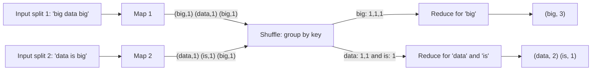
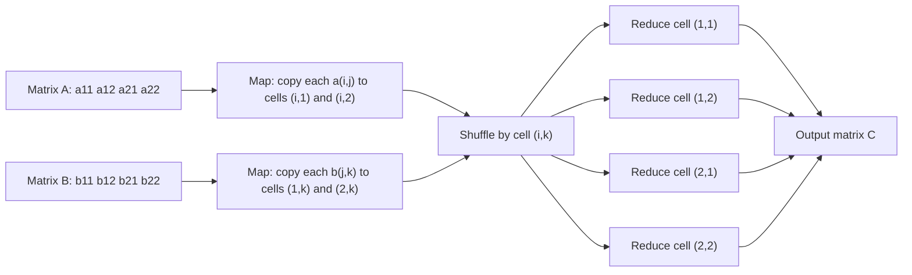
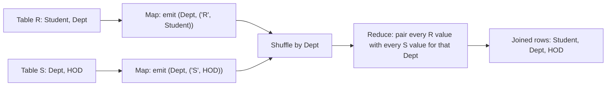
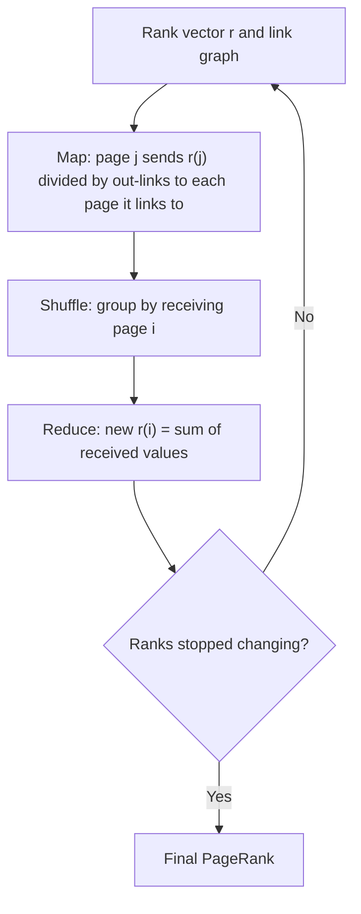

## Pehle basics

- **Key-value pair** ek label (key) hai jiske saath kuch data (value) hai, aise likhte hain (key, value). Example: ("apple", 1).
- **Map** ek function hai jo ek baar mein ek input record padhta hai aur zero ya zyada key-value pairs emit karta hai. Map tasks bahut saari machines pe parallel chalte hain, har ek apne data piece pe.
- **Shuffle (group by key)** map aur reduce ke beech framework khud karta hai. Ye same key wale saare pairs ko ek jagah jama karke ek reducer ko bhejta hai. Ise tumhe likhna nahi padta.
- **Reduce** ek function hai jise ek key aur uski saari values ki list milti hai, aur woh us key ka final result emit karta hai.
- **Combiner** ek optional chhota reducer hai jo map machine pe hi chalta hai aur network pe bhejne se pehle values ko local add kar deta hai. Ye tabhi chalta hai jab reduce operation associative aur commutative ho (jaise sum, max, min), taki answer order pe depend na kare.
- **Matrix** numbers ki table hai rows aur columns ke saath. $m_{ij}$ matlab row $i$, column $j$ ka number. **Vector** ek column wala matrix hai.
- **Relation** ek table hai, **tuple** ek row, aur **attribute** ek column. Relational algebra chhote operations ka set hai (selection, projection, join, union...) jis par SQL bana hai.

Agar ye clear hain, to aage ke sections mein ek hi pattern baar baar dikhega.

## Har MapReduce algorithm ke peeche ek hi idea

**Ye kya hai.** Ye note syllabus <Syl m="2" /> "Algorithms using MapReduce" cover karta hai: matrix-vector multiplication, relational-algebra operations, selection, projection, union, intersection aur difference. Wahi idea word count, matrix-matrix multiplication, natural join, grouping aur PageRank bhi deta hai. <Cite id="hadoop-ecosystem-mmds" />

**Ye kyun zaroori hai.** Data ek machine ke liye bahut bada hai, isliye har machine apne piece pe akeli kaam karti hai. Pieces sirf shuffle mein mil sakte hain, aur shuffle **same key** wali cheezein milata hai. To MapReduce algorithm design karne ke liye ek sawal pucho: "kaun si values ek saath dikhni chahiye, aur kaun si key unhe milayegi?"

**Everyday analogy.** Election ke baad vote counting. Har booth (map) har vote ke liye candidate ke naam ki ek parchi likhta hai. Ek candidate ki saari parchiyan ek box mein jaati hain (key se shuffle). Har box ka ek counter (reduce) parchiyan gintaa hai. Kisi ko poora election dekhna nahi padta.

**Kaise kaam karta hai.** Original design Google ka hai. <Cite id="hadoop-ecosystem-dean2004" />

1. Input pieces mein bant jaata hai; har map task ek piece padhta hai aur (key, value) pairs emit karta hai.
2. Optional combiner same machine pe pairs ko local add karta hai.
3. Framework pairs ko key se partition karta hai, network pe bhejta hai, aur sort karta hai taki har reducer ko ek key aur uski saari values dikhein.
4. Reduce har key ke liye ek baar chalta hai aur output likhta hai.



Standard MapReduce data-flow pictures se redraw kiya. <Cite id="mapreduce-algorithms-gfg-dataflow" loc="diagram" /> <Cite id="mapreduce-gfg-mr" loc="diagram" />

<Box kind="key">

Yaad rakhne ka pattern: **Map key decide karta hai. Shuffle equal keys ko saath laata hai. Reduce ek key ki values ko combine karta hai.** Neeche ka har algorithm bas alag key aur alag reduce hai.

</Box>

## Word count

**Ye kya hai.** Document mein har word kitni baar aaya ye ginna. Ye MapReduce ka "hello world" hai. <Cite id="mapreduce-gfg-wordcount" /> <Cite id="mapreduce-tpoint" /> <Cite id="mapreduce-av" />

**Key choice.** Key word hai; value har occurrence ke liye 1.

**Pseudocode.**

```text
map(offset, line):
    for each word w in line:           # lowercase it and strip punctuation
        emit(w, 1)

reduce(word, counts):
    total = 0
    for c in counts:
        total = total + c
    emit(word, total)

combiner = same as reduce             # safe, because addition is associative
```

<Sum>

<Given>

Document: "This is an apple. Apple is red in color". Upper aur lower case ko same word maano aur full stop ignore karo.

</Given>

<Find>

har word ka count, map output, shuffle aur reduce output ke saath.

</Find>

<Steps>

1. **Text clean karo.** Lowercase karo aur punctuation hatao: `this is an apple apple is red in color` (9 words). *Reason: "Apple" aur "apple" same key hone chahiye.*
2. **Map.** Har word (word, 1) ban jaata hai:

   | Position | Word | Map output |
   |---|---|---|
   | 1 | this | (this, 1) |
   | 2 | is | (is, 1) |
   | 3 | an | (an, 1) |
   | 4 | apple | (apple, 1) |
   | 5 | apple | (apple, 1) |
   | 6 | is | (is, 1) |
   | 7 | red | (red, 1) |
   | 8 | in | (in, 1) |
   | 9 | color | (color, 1) |

3. **Shuffle (group by key).** Equal keys jama hoti hain:

   | Key | List of values |
   |---|---|
   | this | [1] |
   | is | [1, 1] |
   | an | [1] |
   | apple | [1, 1] |
   | red | [1] |
   | in | [1] |
   | color | [1] |

4. **Reduce.** Har list add karo: this 1, is 2, an 1, apple 2, red 1, in 1, color 1. *Reason: reduce ek key ke 1s ka sum karta hai.*

</Steps>

<Answer>

(this, 1), (is, 2), (an, 1), (apple, 2), (red, 1), (in, 1), (color, 1)

</Answer>

<Box kind="verify">

Counts ka total: $1 + 2 + 1 + 2 + 1 + 1 + 1 = 9$, jo cleaned text ke 9 words ke barabar hai. Kuch miss ya extra nahi hua.

</Box>

</Sum>

Papers ke baaki word-count questions isi method se hote hain: "This is NoSQL. NoSQL handles complex data." ka answer this 1, is 1, nosql 2, handles 1, complex 1, data 1 (7 words). "Big data is powerful. Big data drives decisions." ka answer big 2, data 2, is 1, powerful 1, drives 1, decisions 1 (8 words).

**Combiner ke saath.** Agar dono lines alag map machines pe hain, to har machine pehle local add karti hai. Jis machine ko "big" do baar dikhta hai woh (big, 2) ek baar bhejti hai. Final answer same, network traffic kam. <Cite id="hadoop-ecosystem-apache-mr-tutorial" />

<Box kind="exam">

PYQ: <PYQ id="2022-12-ce/q2b" /> <PYQ id="2024-05-ce/q2b" /> <PYQ id="2024-12-ce/q2b" /> <PYQ id="2025-05-ce/q4a" /> sab word-count pseudocode aur traced example maangte hain. Pehle pseudocode likho, phir teen tables (map output, shuffle, reduce output), phir total check.

</Box>

## Matrix-vector multiplication

**Ye kya hai.** $n \times n$ matrix $M$ ko length $n$ ke vector $v$ se multiply karna. Result $x$ ke $n$ entries hote hain, jahan
$x_i = \sum_j m_{ij} v_j$. Words mein: har row ke liye, har matrix number ko same column ke vector number se multiply karo aur sab add karo. <Cite id="hadoop-ecosystem-mmds" /> <Cite id="mapreduce-algorithms-wiki-matmul" />

**Ye kyun important hai.** Bade matrices (web graph, ratings) matrix-vector problems hain, aur PageRank (neeche) baar baar matrix-vector multiplication hai.

**Kaise kaam karta hai.** Maan lo vector $v$ har map task ki memory mein fit hota hai.

- **Map.** Har matrix element $m_{ij}$ ke liye $(i, \; m_{ij} \cdot v_j)$ emit karo. Key row number $i$ hai kyunki ek row ke saare products add karne hain.
- **Reduce.** Key $i$ ke liye saari values add karo. $(i, x_i)$ emit karo.

```text
map(i, j, m_ij):             # v is loaded in memory
    emit(i, m_ij * v[j])

reduce(i, products):
    emit(i, sum(products))
```

**Agar vector memory mein fit na ho.** Matrix ko vertical stripes mein aur vector ko matching horizontal stripes mein kaato. Tab map task ko memory mein sirf vector ki ek stripe chahiye aur woh matrix ki matching stripe handle karta hai; keys aur reduce same rehte hain. <Cite id="hadoop-ecosystem-mmds" />

<Sum>

<Given>

$$
M = \begin{bmatrix} 1 & 2 & 3 \\ 4 & 5 & 6 \\ 7 & 8 & 9 \end{bmatrix}, \quad v = \begin{bmatrix} 1 \\ 2 \\ 3 \end{bmatrix}
$$

</Given>

<Find>

MapReduce se $x = Mv$.

</Find>

<Steps>

1. **Map.** Har element ke liye $(i, m_{ij} \cdot v_j)$ emit karo, $v_1 = 1$, $v_2 = 2$, $v_3 = 3$ ke saath:

   | Element | Calculation | Map output |
   |---|---|---|
   | $m_{11} = 1$ | $1 \times 1$ | (1, 1) |
   | $m_{12} = 2$ | $2 \times 2$ | (1, 4) |
   | $m_{13} = 3$ | $3 \times 3$ | (1, 9) |
   | $m_{21} = 4$ | $4 \times 1$ | (2, 4) |
   | $m_{22} = 5$ | $5 \times 2$ | (2, 10) |
   | $m_{23} = 6$ | $6 \times 3$ | (2, 18) |
   | $m_{31} = 7$ | $7 \times 1$ | (3, 7) |
   | $m_{32} = 8$ | $8 \times 2$ | (3, 16) |
   | $m_{33} = 9$ | $9 \times 3$ | (3, 27) |

2. **Shuffle.** Row se group karo: 1 ko [1, 4, 9]; 2 ko [4, 10, 18]; 3 ko [7, 16, 27] milta hai. *Reason: ek row ke saare products ko milna hai.*
3. **Reduce.** Har list add karo: $1 + 4 + 9 = 14$; $4 + 10 + 18 = 32$; $7 + 16 + 27 = 50$.

</Steps>

<Answer>

$x = (14, 32, 50)^T$, yaani (1, 14), (2, 32), (3, 50).

</Answer>

<Box kind="verify">

Column sums se check: $M$ ke columns ka sum $12, 15, 18$ hai, to $x$ ke saare entries ka total $12 \times 1 + 15 \times 2 + 18 \times 3 = 12 + 30 + 54 = 96$ hona chahiye. Aur $14 + 32 + 50 = 96$. Match karta hai.

</Box>

</Sum>

<Box kind="exam">

PYQ: <PYQ id="2023-12-ce/q2b" /> bilkul ye 3 by 3 times 3 by 1 multiplication maangta hai. Syllabus point "Matrix-Vector Multiplication by MapReduce".

</Box>

## Matrix-matrix multiplication

**Ye kya hai.** $A$ (size $I \times J$) ko $B$ (size $J \times K$) se multiply karna. Output cell $(i,k)$ hai $c_{ik} = \sum_j a_{ij} b_{jk}$: $A$ ki row $i$ times $B$ ke column $k$. <Cite id="mapreduce-algorithms-gfg-matmul" /> <Cite id="mapreduce-algorithms-wiki-matmul" />

**Ye mushkil kyun hai.** Har output cell ko $A$ ki poori row aur $B$ ka poora column chahiye, aur har input number bahut saare output cells use karte hain. To map ko har input number ko un sab cells ke liye copy karna padta hai.

**One-step method (exam wala).** Key output cell $(i, k)$ hai.

- **Map.** Har $a_{ij}$ ke liye $B$ ke har column $k$ ke liye $((i, k), (A, j, a_{ij}))$ emit karo. Har $b_{jk}$ ke liye $A$ ki har row $i$ ke liye $((i, k), (B, j, b_{jk}))$ emit karo. Tag $A$ ya $B$ batata hai value kahan se aayi, aur $j$ common index hai.
- **Reduce.** Key $(i,k)$ ke liye: same $j$ wali A-value aur B-value ko pair karo, multiply karo, aur saare products add karo. $((i,k), c_{ik})$ emit karo.

```text
map(matrix, row, col, value):
    if matrix == A:                       # value is a[i][j], row=i, col=j
        for k in 1..K:
            emit((row, k), ('A', col, value))
    else:                                 # value is b[j][k], row=j, col=k
        for i in 1..I:
            emit((i, col), ('B', row, value))

reduce((i, k), values):
    a = dict of j -> value for tags 'A'
    b = dict of j -> value for tags 'B'
    emit((i, k), sum(a[j] * b[j] for j in a))
```

**Two-step method.** Jab matrices bade aur sparse (bahut zeros) hon tab kaam aata hai. <Cite id="hadoop-ecosystem-mmds" />

1. Job 1: key common index $j$ hai. Map $(j, (A, i, a_{ij}))$ aur $(j, (B, k, b_{jk}))$ emit karta hai. Har $j$ ka reduce har product $a_{ij} b_{jk}$ banata hai aur $((i,k), a_{ij} b_{jk})$ emit karta hai.
2. Job 2: map kuch nahi karta (identity). Key $(i,k)$ ka reduce saare products add karta hai.



Standard one-step picture se redraw kiya. <Cite id="mapreduce-algorithms-gfg-matmul" loc="diagram" />

<Sum>

<Given>

$$
A = \begin{bmatrix} 1 & 2 \\ 3 & 4 \end{bmatrix}, \quad B = \begin{bmatrix} 6 & 7 \\ 8 & 9 \end{bmatrix}
$$

</Given>

<Find>

one-step MapReduce method se $C = AB$.

</Find>

<Steps>

1. **A ke liye Map.** Har $a_{ij}$ apni row $i$ ke dono cells ko jaata hai (columns $k = 1, 2$), $j$ ke tag ke saath:

   | $a_{ij}$ | Map output |
   |---|---|
   | $a_{11} = 1$ | ((1,1), (A,1,1)), ((1,2), (A,1,1)) |
   | $a_{12} = 2$ | ((1,1), (A,2,2)), ((1,2), (A,2,2)) |
   | $a_{21} = 3$ | ((2,1), (A,1,3)), ((2,2), (A,1,3)) |
   | $a_{22} = 4$ | ((2,1), (A,2,4)), ((2,2), (A,2,4)) |

2. **B ke liye Map.** Har $b_{jk}$ apne column $k$ ke dono cells ko jaata hai (rows $i = 1, 2$), $j$ ke tag ke saath:

   | $b_{jk}$ | Map output |
   |---|---|
   | $b_{11} = 6$ | ((1,1), (B,1,6)), ((2,1), (B,1,6)) |
   | $b_{12} = 7$ | ((1,2), (B,1,7)), ((2,2), (B,1,7)) |
   | $b_{21} = 8$ | ((1,1), (B,2,8)), ((2,1), (B,2,8)) |
   | $b_{22} = 9$ | ((1,2), (B,2,9)), ((2,2), (B,2,9)) |

3. **Shuffle aur reduce.** Har cell ko do A-values aur do B-values milti hain. $j$ se match karo, multiply karo, add karo:

   | Cell | A-values (j: value) | B-values (j: value) | Sum of products | Result |
   |---|---|---|---|---|
   | (1,1) | 1: 1, 2: 2 | 1: 6, 2: 8 | $1 \times 6 + 2 \times 8 = 6 + 16$ | 22 |
   | (1,2) | 1: 1, 2: 2 | 1: 7, 2: 9 | $1 \times 7 + 2 \times 9 = 7 + 18$ | 25 |
   | (2,1) | 1: 3, 2: 4 | 1: 6, 2: 8 | $3 \times 6 + 4 \times 8 = 18 + 32$ | 50 |
   | (2,2) | 1: 3, 2: 4 | 1: 7, 2: 9 | $3 \times 7 + 4 \times 9 = 21 + 36$ | 57 |

</Steps>

<Answer>

$$
C = \begin{bmatrix} 22 & 25 \\ 50 & 57 \end{bmatrix}
$$

</Answer>

<Box kind="verify">

Two-step method se check. Job 1 key $j = 1$, $A$ ke column 1 (1, 3) ko $B$ ki row 1 (6, 7) se pair karta hai: cells (1,1) 6, (1,2) 7, (2,1) 18, (2,2) 21. Key $j = 2$, $A$ ke column 2 (2, 4) ko $B$ ki row 2 (8, 9) se pair karta hai: products 16, 18, 32, 36. Job 2 har cell ke liye add karta hai: $6 + 16 = 22$, $7 + 18 = 25$, $18 + 32 = 50$, $21 + 36 = 57$. Same matrix. Saare entries ka sum bhi: $22 + 25 + 50 + 57 = 154$, aur ($A$ ke column sums) times ($B$ ke row sums) $(4 \times 13) + (6 \times 17) = 52 + 102 = 154$.

</Box>

</Sum>

| Method | Jobs | Map output size | Kab prefer karein |
|---|---|---|---|
| One-step | 1 | Har element $K$ ya $I$ baar copy hota hai | Chhote ya medium matrices; exam answer |
| Two-step | 2 | Har element ek baar copy hota hai, par products jobs ke beech likhe jaate hain | Bade sparse matrices |

<Box kind="exam">

PYQ: <PYQ id="2023-05-ce/q2b" /> (2 by 2 times 2 by 2, upar wala matrix wahi hai) aur <PYQ id="2024-05/q3a" /> (koi bhi example, saare steps). Pehle pseudocode likho, phir map table, phir check ke saath reduce table.

</Box>

## MapReduce se relational-algebra operations

**Ye kya hai.** Relational database data ko tables mein rakhta hai aur kuch operations se sawalon ke jawab deta hai. Bada table kai machines pe phaila ho sakta hai, aur har operation map aur reduce mein likha ja sakta hai. Ye syllabus ka "Relational-Algebra Operations" hai. <Cite id="mapreduce-algorithms-wiki-relalg" /> <Cite id="mapreduce-algorithms-gfg-relalg" /> <Cite id="mapreduce-algorithms-tp-relalg" />

**Everyday analogy.** School register. Selection Class 7 ki rows chunta hai. Projection sirf Name column copy karta hai. Join class number se students ko unke class teacher se match karta hai.

**MapReduce kyun.** Tables ek machine ke liye bahut bade hain. Hive aur Pig andar se yahi operations chalate hain (Hive SQL ko MapReduce jobs mein badalta hai). <Cite id="mapreduce-algorithms-pig-basic" />

| Operation | Symbol | Meaning |
|---|---|---|
| Selection | $\sigma_C(R)$ | Woh rows rakho jo condition $C$ satisfy karti hain |
| Projection | $\pi_S(R)$ | Sirf list $S$ ke columns rakho, duplicates hatao |
| Union | $R \cup S$ | $R$ ya $S$ (ya dono) ki rows |
| Intersection | $R \cap S$ | $R$ aur $S$ dono mein rows |
| Difference | $R - S$ | $R$ ki woh rows jo $S$ mein nahi hain |
| Natural join | $R \bowtie S$ | $R$ aur $S$ ki woh rows jodo jo common columns pe agree karti hain |
| Grouping and aggregation | $\gamma_{X, \theta(Y)}(R)$ | Rows ko $X$ se group karo aur $Y$ pe aggregate (SUM, COUNT, AVG, MAX, MIN) lagao |

Saare examples in do chhoti relations se hain.

Student $R$(Id, Name, Dept):

| Id | Name | Dept |
|---|---|---|
| 1 | Asha | CSE |
| 2 | Ravi | IT |
| 3 | Meena | CSE |
| 4 | Kiran | IT |
| 5 | Sara | ECE |

### Selection

**Ye kya karta hai.** Sirf woh tuples rakho jo condition satisfy karte hain, jaise `WHERE Dept = 'CSE'`. <Cite id="hadoop-ecosystem-mmds" />

**Map.** Har tuple $t$ test karo. Agar woh $C$ satisfy karta hai to $(t, t)$ emit karo; warna kuch nahi.
**Reduce.** Identity: value ko bas likh do. Selection ko reduce step ki zaroorat hi nahi, isliye ye map-only job ho sakti hai. Har tuple akela check hota hai, to kisi ko kisi se milna nahi padta.

```text
map(t):  if t satisfies C: emit(t, t)
reduce(t, values): emit(t)       # identity, can be skipped
```

<Sum>

<Given>

Upar wali relation $R$ aur condition Dept = CSE.

</Given>

<Find>

$\sigma_{Dept = CSE}(R)$.

</Find>

<Steps>

1. **Map.** Har tuple test karo:

   | Tuple | Dept = CSE? | Map output |
   |---|---|---|
   | (1, Asha, CSE) | yes | ((1,Asha,CSE), (1,Asha,CSE)) |
   | (2, Ravi, IT) | no | nothing |
   | (3, Meena, CSE) | yes | ((3,Meena,CSE), (3,Meena,CSE)) |
   | (4, Kiran, IT) | no | nothing |
   | (5, Sara, ECE) | no | nothing |

2. **Reduce.** Identity: har key ek baar output karo. *Reason: tuple ek hi baar aata hai, combine karne ko kuch nahi.*

</Steps>

<Answer>

$\{(1, Asha, CSE), (3, Meena, CSE)\}$

</Answer>

<Box kind="verify">

Count: $R$ mein 2 CSE rows (Id 1 aur 3), aur answer mein 2 tuples. Har output row mein Dept = CSE hai aur koi CSE row chhooti nahi.

</Box>

</Sum>

### Projection

**Ye kya karta hai.** Sirf kuch columns rakho, jaise `SELECT DISTINCT Dept`. Columns hatane ke baad do alag rows ek jaisi ban sakti hain, aur relation ek set hai, isliye duplicates hatane padte hain. Isi wajah se projection ko reduce chahiye.

**Map.** Har tuple $t$ ke liye sirf chune hue columns wala $t'$ banao aur $(t', t')$ emit karo.
**Reduce.** Key $t'$ aur list $[t', t', \ldots]$ ke liye $t'$ ek hi baar emit karo. <Cite id="hadoop-ecosystem-mmds" />

```text
map(t):  t2 = keep columns S of t;  emit(t2, t2)
reduce(t2, values): emit(t2)       # many copies become one
```

<Sum>

<Given>

Upar wali relation $R$, Dept pe project ki gayi.

</Given>

<Find>

$\pi_{Dept}(R)$.

</Find>

<Steps>

1. **Map.** Sirf Dept rakho: Id 1 se (CSE, CSE), Id 2 se (IT, IT), Id 3 se (CSE, CSE), Id 4 se (IT, IT), Id 5 se (ECE, ECE).
2. **Shuffle.** CSE: [CSE, CSE]; IT: [IT, IT]; ECE: [ECE].
3. **Reduce.** Har key ek baar output karo. *Reason: isse duplicates hat jaate hain.*

</Steps>

<Answer>

$\{CSE, IT, ECE\}$

</Answer>

<Box kind="verify">

5 input rows, 3 distinct Dept values (CSE do baar, IT do baar, ECE ek baar: $2 + 2 + 1 = 5$ rows accounted). Answer mein 3 values hain, koi repeat nahi.

</Box>

</Sum>

Combiner bhi locally duplicates hata sakta hai, taki network traffic kam ho.

<Box kind="exam">

PYQ: <PYQ id="2024-05-ce/q4a" /> aur <PYQ id="2025-05/q3a" /> (selection aur projection), aur <PYQ id="2024-12/q2a" /> (relational-algebra operations examples ke saath illustrate karo). Har ek ke liye map output, shuffle aur reduce dikhao.

</Box>

### Union, intersection aur difference

**Ye kya karte hain.** Ye same columns wali do relations pe kaam karte hain. Maan lo $R = \{Asha, Ravi, Meena\}$ aur $S = \{Ravi, Meena, Kiran\}$ (sirf names). Key **poora tuple** hai, to dono relations ke equal tuples ek reducer pe milte hain. Har tuple pe uski source relation ka tag bhi lagta hai. <Cite id="hadoop-ecosystem-mmds" />

| Operation | Map | Reduce rule |
|---|---|---|
| Union | har tuple $t$: $(t, t)$ emit | key $t$ ke liye $t$ ek baar emit, list kuch bhi ho |
| Intersection | har tuple $t$: $(t, t)$ emit | $t$ tabhi emit jab list mein do copies hon (ek $R$ se, ek $S$ se) |
| Difference $R - S$ | $R$ ka tuple: $(t, R)$ emit; $S$ ka tuple: $(t, S)$ emit | $t$ tabhi emit jab list bilkul [R] ho |

<Sum>

<Given>

$R = \{Asha, Ravi, Meena\}$ aur $S = \{Ravi, Meena, Kiran\}$.

</Given>

<Find>

$R \cup S$, $R \cap S$ aur $R - S$.

</Find>

<Steps>

1. **Map.** Har tuple ko key banakar uske source tag ke saath emit karo. *Reason: tag reducer ko batata hai ki har copy kis relation se aayi.*
2. **Shuffle.**

   | Key | Values (source tags) |
   |---|---|
   | Asha | [R] |
   | Ravi | [R, S] |
   | Meena | [R, S] |
   | Kiran | [S] |

3. **Reduce, union.** Har key output karo: Asha, Ravi, Meena, Kiran.
4. **Reduce, intersection.** Woh keys jinki list mein R aur S dono hain: Ravi, Meena.
5. **Reduce, difference $R - S$.** Woh keys jinki list sirf [R] hai: Asha.

</Steps>

<Answer>

$R \cup S = \{Asha, Ravi, Meena, Kiran\}$; $R \cap S = \{Ravi, Meena\}$; $R - S = \{Asha\}$.

</Answer>

<Box kind="verify">

Count rule: $|R \cup S| = |R| + |S| - |R \cap S| = 3 + 3 - 2 = 4$, match karta hai. Aur $|R - S| = |R| - |R \cap S| = 3 - 2 = 1$, match karta hai.

</Box>

</Sum>

### Natural join

**Ye kya karta hai.** $R(A, B)$ ki har row ko $S(B, C)$ ki us har row se jodo jiski common column $B$ mein same value ho. Ye shared column pe SQL ka `JOIN` hai. <Cite id="mapreduce-algorithms-wiki-join" /> <Cite id="mapreduce-algorithms-gfg-join" />

**Key choice.** Join attribute $B$. Jin rows ko match hona hai unka $B$ same hota hai, to woh same reducer pe milti hain.

- **Map.** $R$ tuple $(a, b)$ ke liye $(b, (R, a))$ emit karo. $S$ tuple $(b, c)$ ke liye $(b, (S, c))$ emit karo. Tag batata hai kaun si relation.
- **Reduce.** Key $b$ ke liye list ko R-values aur S-values mein baanto, aur ek R-value aur ek S-value ke har pair ke liye $(a, b, c)$ output karo.

```text
map(tuple from R(A,B)):  emit(B, ('R', A))
map(tuple from S(B,C)):  emit(B, ('S', C))
reduce(b, values):
    As = [x for (tag, x) in values if tag == 'R']
    Cs = [x for (tag, x) in values if tag == 'S']
    for a in As: for c in Cs: emit((a, b, c))
```



<Sum>

<Given>

$R$(Student, Dept): (Asha, CSE), (Ravi, IT), (Meena, CSE). $S$(Dept, HOD): (CSE, Rao), (IT, Shah), (ECE, Iyer).

</Given>

<Find>

Dept pe $R \bowtie S$.

</Find>

<Steps>

1. **Map.** Key Dept hai:

   | From | Map output |
   |---|---|
   | R | (CSE, (R, Asha)), (IT, (R, Ravi)), (CSE, (R, Meena)) |
   | S | (CSE, (S, Rao)), (IT, (S, Shah)), (ECE, (S, Iyer)) |

2. **Shuffle.**

   | Dept | Values |
   |---|---|
   | CSE | (R, Asha), (R, Meena), (S, Rao) |
   | IT | (R, Ravi), (S, Shah) |
   | ECE | (S, Iyer) |

3. **Reduce.** CSE: 2 R-values times 1 S-value se 2 rows. IT: 1 times 1 se 1 row. ECE: 0 R-values times 1 se kuch nahi. *Reason: jis key ki values sirf ek relation se hain uska koi partner nahi.*

</Steps>

<Answer>

$\{(Asha, CSE, Rao), (Meena, CSE, Rao), (Ravi, IT, Shah)\}$

</Answer>

<Box kind="verify">

Row count: har Dept ke liye (R mein number) times (S mein number): $2 \times 1 + 1 \times 1 + 0 \times 1 = 3$. Answer mein 3 rows hain. ECE mein koi student nahi, isliye woh sahi mein nahi aaya.

</Box>

</Sum>

### Grouping aur aggregation

**Ye kya karta hai.** Grouping column ki same value wali rows ko ek group mein daalo aur har group ke liye ek number nikalo, jaise `SELECT Dept, AVG(Marks) FROM R GROUP BY Dept`. <Cite id="hadoop-ecosystem-mmds" />

**Key choice.** Grouping attribute.

- **Map.** Har tuple ke liye (grouping value, aggregate hone wali value) emit karo.
- **Reduce.** Ek group ke liye list pe SUM, COUNT, AVG, MAX ya MIN lagao aur (group, result) emit karo.

SUM, COUNT, MAX aur MIN ke liye combiner safe hai. AVG ke liye combiner ko (sum, count) pairs bhejne chahiye, partial averages nahi, kyunki groups ke sizes alag hon to average ka average galat hota hai.

<Sum>

<Given>

Marks relation (Dept, Marks): (CSE, 70), (IT, 60), (CSE, 80), (IT, 90), (ECE, 50). Dept se group karo, Marks ka SUM aur AVG nikalo.

</Given>

<Find>

har Dept ka SUM aur AVG.

</Find>

<Steps>

1. **Map.** (Dept, Marks) emit karo: (CSE,70), (IT,60), (CSE,80), (IT,90), (ECE,50).
2. **Shuffle.** CSE: [70, 80]; IT: [60, 90]; ECE: [50].
3. **Reduce.**

   | Dept | Marks list | SUM | COUNT | AVG |
   |---|---|---|---|---|
   | CSE | [70, 80] | 150 | 2 | 75 |
   | IT | [60, 90] | 150 | 2 | 75 |
   | ECE | [50] | 50 | 1 | 50 |

</Steps>

<Answer>

CSE: SUM 150, AVG 75. IT: SUM 150, AVG 75. ECE: SUM 50, AVG 50.

</Answer>

<Box kind="verify">

Saare marks ka total: $70 + 60 + 80 + 90 + 50 = 350$. Group sums ka total: $150 + 150 + 50 = 350$. Match karta hai.

</Box>

</Sum>

<Box kind="exam">

PYQ: <PYQ id="2023-05-ce/q4a" /> aur <PYQ id="2025-05-ce/q3b" /> MapReduce se natural join aur grouping with aggregation explain karne ko kehte hain. Har ek ke liye key choice, map aur reduce rules, aur ek chhota traced example do (upar wale do).

</Box>

## MapReduce se PageRank

**Ye kya hai.** PageRank har web page ko ek score deta hai ki woh kitna important hai: page important hai agar important pages usse link karte hain. Ek random surfer socho jo har step pe ek random outgoing link follow karta hai; page ka PageRank woh fraction hai jitna time surfer lambe time mein us page pe bitata hai. Ise Page aur Brin ne introduce kiya. <Cite id="mapreduce-algorithms-wiki-pagerank" /> <Cite id="mapreduce-algorithms-gfg-pagerank" />

**MapReduce mein kyun fit hota hai.** $r$ ranks ka vector hai aur $M$ **transition matrix**: $m_{ij} = 1/n_j$ agar page $j$ page $i$ ko link karta hai ($n_j$ matlab $j$ ke out-links ki sankhya), warna 0. Ranks $r \leftarrow M r$ baar baar karke milte hain jab tak badalna band na ho. Ye matrix-vector product hai, jo hum pehle se jaante hain. (PageRank model ka poora treatment PageRank note mein hai; yahan sirf MapReduce form aur do problems hain.)

**Ek iteration MapReduce job ki tarah.**

- **Map.** Har page $j$ ke liye jiska rank $r_j$ hai aur $n_j$ out-links hain, har us page $i$ ke liye $(i, r_j / n_j)$ emit karo jisko $j$ link karta hai. Ye $(i, m_{ij} \cdot r_j)$ emit karne ke barabar hai.
- **Reduce.** Page $i$ ke liye aayi saari values add karo. Ye sum uska naya rank hai.

Graph (kaun kisko link karta hai) har iteration mein dobara padha jaata hai. Agar vector memory mein fit na ho to matrix-vector multiplication wali stripe method use hoti hai. Combiner jo per key partial sums add karta hai network pe data ghatata hai. <Cite id="hadoop-ecosystem-mmds" />



Usual PageRank iteration pictures se redraw kiya. <Cite id="mapreduce-algorithms-gfg-pagerank" loc="diagram" />

<Sum>

<Given>

Teen pages. A, B aur C ko link karta hai; B, C ko link karta hai; C, A ko link karta hai. Shuruat $r = (1/3, 1/3, 1/3)$.

</Given>

<Find>

map aur reduce se do iterations ke baad ranks.

</Find>

<Steps>

1. **Iteration 1, map.** A ke 2 out-links hain, to woh B aur C ko $\frac{1}{3} \div 2 = \frac{1}{6}$ bhejta hai. B ka 1 out-link hai, to woh C ko $\frac{1}{3}$ bhejta hai. C ka 1 out-link hai, to woh A ko $\frac{1}{3}$ bhejta hai. *Reason: har page apna rank apne out-links mein barabar baant deta hai.*
2. **Iteration 1, reduce.** A ko $\frac{1}{3}$ milta hai. B ko $\frac{1}{6}$. C ko $\frac{1}{6} + \frac{1}{3} = \frac{1}{2}$. To $r_1 = (\frac{1}{3}, \frac{1}{6}, \frac{1}{2})$.
3. **Iteration 2, map.** A (rank $\frac{1}{3}$) B aur C ko $\frac{1}{6}$ bhejta hai. B (rank $\frac{1}{6}$) C ko $\frac{1}{6}$ bhejta hai. C (rank $\frac{1}{2}$) A ko $\frac{1}{2}$ bhejta hai.
4. **Iteration 2, reduce.** A ko $\frac{1}{2}$ milta hai. B ko $\frac{1}{6}$. C ko $\frac{1}{6} + \frac{1}{6} = \frac{1}{3}$.

</Steps>

<Answer>

$r_1 = (\frac{1}{3}, \frac{1}{6}, \frac{1}{2})$ aur $r_2 = (\frac{1}{2}, \frac{1}{6}, \frac{1}{3})$.

</Answer>

<Box kind="verify">

Ranks ka sum hamesha 1 hona chahiye. $r_1$: $\frac{2}{6} + \frac{1}{6} + \frac{3}{6} = 1$. $r_2$: $\frac{3}{6} + \frac{1}{6} + \frac{2}{6} = 1$. Dono sum 1 hain, to koi rank na bana na khoya.

</Box>

</Sum>

### Dead ends

**Ye kya hai.** **Dead end** woh page hai jiska koi out-link nahi. $M$ mein uska column poora zero hota hai, to jo rank usse milta hai woh kahin nahi jaata aur gayab ho jaata hai. Bahut iterations ke baad total rank zero ki taraf leak ho jaata hai. <Cite id="mapreduce-algorithms-wiki-pagerank" /> <Cite id="hadoop-ecosystem-mmds" />

**Fixes.** (1) Dead ends ko graph se hatao (aur woh pages bhi jo uske baad dead end ban jaate hain), ranks nikalo, phir wapas jodo. (2) Teleport: dead end ko aisa maano jaise woh har page ko equal probability se link karta hai. (3) Taxation use karo (neeche).

<Sum>

<Given>

Wahi graph, par C ka koi out-link nahi: A, B aur C ko link karta hai; B, C ko link karta hai. Shuruat $r_0 = (\frac{1}{3}, \frac{1}{3}, \frac{1}{3})$.

</Given>

<Find>

iterations 1, 2 aur 3 ke baad ranks.

</Find>

<Steps>

1. **Iteration 1.** A, B aur C ko $\frac{1}{6}$ bhejta hai. B, C ko $\frac{1}{3}$ bhejta hai. C kuch nahi bhejta. A ko kuch nahi milta. B ke paas $\frac{1}{6}$. C ke paas $\frac{1}{6} + \frac{1}{3} = \frac{1}{2}$. To $r_1 = (0, \frac{1}{6}, \frac{1}{2})$, total $\frac{2}{3}$.
2. **Iteration 2.** A ka rank 0 hai, to woh kuch nahi bhejta. B (rank $\frac{1}{6}$) C ko $\frac{1}{6}$ bhejta hai. C kuch nahi bhejta. To $r_2 = (0, 0, \frac{1}{6})$, total $\frac{1}{6}$.
3. **Iteration 3.** Rank sirf C ke paas hai, aur C kuch nahi bhejta. To $r_3 = (0, 0, 0)$.

</Steps>

<Answer>

Total rank 1 se $\frac{2}{3}$, phir $\frac{1}{6}$, phir 0 tak gir jaata hai. Saara rank dead end C se leak ho jaata hai.

</Answer>

<Box kind="verify">

Har step mein khoya hua rank: iteration 0 se 1 tak, C ka apna $\frac{1}{3}$ khoya, $1 - \frac{1}{3} = \frac{2}{3}$. 1 se 2 tak, C ka $\frac{1}{2}$ khoya: $\frac{2}{3} - \frac{1}{2} = \frac{1}{6}$. 2 se 3 tak, C ka $\frac{1}{6}$ khoya: $\frac{1}{6} - \frac{1}{6} = 0$. Har total match karta hai.

</Box>

</Sum>

### Spider traps

**Ye kya hai.** **Spider trap** pages ka woh set hai jiske saare links set ke andar hi rehte hain (sabse simple: ek page jo sirf khud ko link karta hai). Rank trap mein aata hai par bahar nahi jaata, to aakhir mein trap saara rank absorb kar leta hai aur baaki sab pages ko 0 milta hai. Kuch leak nahi hota, par answer bekaar hai. <Cite id="hadoop-ecosystem-mmds" /> <Cite id="mapreduce-algorithms-wiki-pagerank" />

**Fix: taxation (teleportation).** Har step pe probability $\beta$ (aam taur pe 0.8 se 0.9) se surfer link follow karta hai; probability $1 - \beta$ se woh random page pe kood jaata hai. Update ban jaata hai
$r' = \beta M r + \frac{1 - \beta}{n}\mathbf{e}$,
jahan $n$ pages ki sankhya hai aur $\mathbf{e}$ ones ka vector hai. Har reducer apne sum mein bas constant $\frac{1 - \beta}{n}$ jodta hai. Rank ab trap nahi ho sakta, kyunki har round uska ek hissa har page mein baant diya jaata hai. <Cite id="hadoop-ecosystem-mmds" /> (Wikipedia batata hai ki damping factor aam taur pe 0.85 ke aas paas rakha jaata hai.)

<Sum>

<Given>

A, B aur C ko link karta hai; B, C ko link karta hai; C sirf khud ko link karta hai (spider trap). $r_0 = (\frac{1}{3}, \frac{1}{3}, \frac{1}{3})$. Part (a): taxation nahi. Part (b): $\beta = 0.8$ ke saath taxation, ek iteration.

</Given>

<Find>

(a) taxation ke bina $r_1$ aur $r_2$. (b) taxation ke saath $r_1$.

</Find>

<Steps>

1. **(a) Iteration 1.** A, B aur C ko $\frac{1}{6}$ bhejta hai. B, C ko $\frac{1}{3}$ bhejta hai. C, C ko $\frac{1}{3}$ bhejta hai. To A ko 0, B ko $\frac{1}{6}$, C ko $\frac{1}{6} + \frac{1}{3} + \frac{1}{3} = \frac{5}{6}$ milta hai. $r_1 = (0, \frac{1}{6}, \frac{5}{6})$.
2. **(a) Iteration 2.** A ka 0 hai. B (rank $\frac{1}{6}$) C ko $\frac{1}{6}$ bhejta hai. C (rank $\frac{5}{6}$) C ko $\frac{5}{6}$ bhejta hai. To A ko 0, B ko 0 (A ne kuch nahi bheja), C ko $\frac{1}{6} + \frac{5}{6} = 1$ milta hai. $r_2 = (0, 0, 1)$. Trap C ke paas saara rank hai.
3. **(b) $r_0$ se taxed map aur reduce.** Plain sums $(0, \frac{1}{6}, \frac{5}{6})$ hain. $\beta = 0.8$ se multiply karo: $(0, \frac{2}{15}, \frac{2}{3})$. Har entry mein $\frac{1 - \beta}{n} = \frac{0.2}{3} = \frac{1}{15}$ jodo: A $= \frac{1}{15}$, B $= \frac{2}{15} + \frac{1}{15} = \frac{3}{15}$, C $= \frac{10}{15} + \frac{1}{15} = \frac{11}{15}$.

</Steps>

<Answer>

(a) $r_1 = (0, \frac{1}{6}, \frac{5}{6})$, $r_2 = (0, 0, 1)$: trap sab le leta hai. (b) Taxation ke saath $r_1 = (\frac{1}{15}, \frac{3}{15}, \frac{11}{15}) \approx (0.067, 0.200, 0.733)$: A aur B ke paas kuch rank bacha rehta hai.

</Answer>

<Box kind="verify">

(a) $r_1$ ka sum $0 + \frac{1}{6} + \frac{5}{6} = 1$ aur $r_2$ ka sum 1: koi leak nahi. (b) $\frac{1}{15} + \frac{3}{15} + \frac{11}{15} = \frac{15}{15} = 1$. Taxation total ko 1 rakhta hai aur A ko non-zero rank deta hai.

</Box>

</Sum>

| Problem | Kya galat hota hai | Wajah | Fix |
|---|---|---|---|
| Dead end | Total rank 0 ki taraf leak hota hai | Bina out-links ka page | Dead ends hatao, ya sab pages ko link karne wala maano, ya tax lagao |
| Spider trap | Ek group saara rank le leta hai, baaki ko 0 | Pages ka group jiske links andar hi rehte hain | Taxation: probability $1 - \beta$ se teleport |

<Box kind="exam">

PYQ: <PYQ id="2024-12/q5b" /> aur <PYQ id="2025-05/q5a" /> MapReduce se PageRank, spider traps aur dead ends ke saath explain karne ko kehte hain. Likho: PageRank ka idea, matrix form $r = Mr$, ek iteration ka map aur reduce, ek traced example (upar ke teen-page graphs), dead ends aur spider traps kya karte hain, aur taxation fix.

</Box>

## In algorithms ke advantages aur limitations

| Advantages | Limitations |
|---|---|
| Wahi simple pattern sasti machines pe terabytes tak scale hota hai | Har job disk padhta aur likhta hai, isliye PageRank jaise iterative jobs slow hain |
| Framework parallelism, shuffling aur failures sambhalta hai | Joins aur matrix products bahut shuffled data banate hain |
| Wahi operations Pig aur Hive deta hai, to haath se kam likhne padte hain | Chhote data ya low-latency queries ke liye theek nahi |

Repeat jobs ke disk cost ki wajah se Spark jaise naye engines iterations ke beech data memory mein rakhte hain. <Cite id="mapreduce-algorithms-spark-rdd" /> <Cite id="mapreduce-gfg-proscons" />

## Keys ka quick comparison

| Algorithm | Map key | Map value | Reduce kya karta hai |
|---|---|---|---|
| Word count | word | 1 | sum |
| Matrix-vector | row $i$ | $m_{ij} v_j$ | sum |
| Matrix-matrix (one step) | cell $(i,k)$ | (tag, $j$, element) | $j$ se multiply, sum |
| Selection | tuple | tuple | identity |
| Projection | projected tuple | same | duplicates hatao |
| Union | tuple | tuple | ek baar output |
| Intersection | tuple | tuple | do copies hon to output |
| Difference $R - S$ | tuple | source tag | sirf R ho to output |
| Natural join | join attribute | (tag, other columns) | R aur S values pair karo |
| Grouping | group attribute | value | SUM, COUNT, AVG... |
| PageRank | target page | rank share | sum (taxation ke saath) |

## Exam summary

- Hamesha key se shuru karo: "kya milna chahiye?" ka jawab.
- Map aur reduce ka pseudocode likho, phir example teen tables mein trace karo: map output, shuffle, reduce output.
- Har numeric answer ke end mein quick check likho (totals match, ya doosra method).
- Jahan reduce associative ho wahan combiner mention karo, aur jab vector memory mein fit na ho to stripe method mention karo.
- Related: MapReduce execution note, Hadoop limitations (syllabus point 2.4), aur PageRank note.

Exam mein English mein likho: "Every MapReduce algorithm is a choice of the key: the map emits (key, value) pairs so that all values that must be combined share one key, and the reduce combines them."

Streaming aur scripting bhi possible hai: Hadoop Streaming mein map aur reduce koi bhi program ho sakta hai jo standard input padhe aur standard output likhe. <Cite id="mapreduce-algorithms-hadoop-streaming" /> <Cite id="hadoop-ecosystem-apache-mr-tutorial" /> <Cite id="mapreduce-tp" /> <Cite id="mapreduce-ibm" /> <Cite id="mapreduce-algorithms-wiki-mr" />
