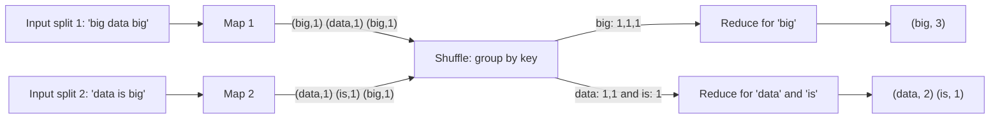
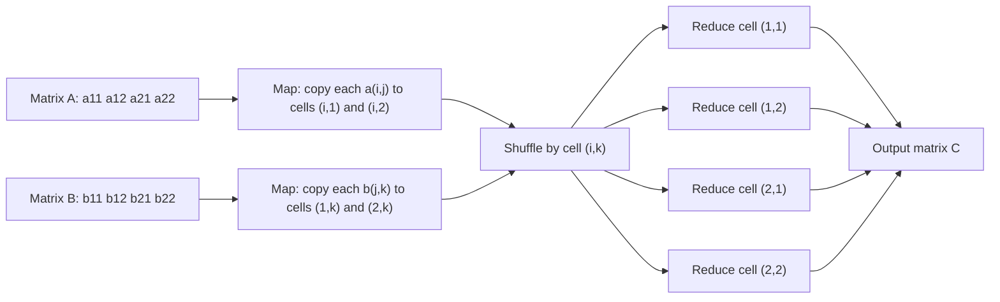
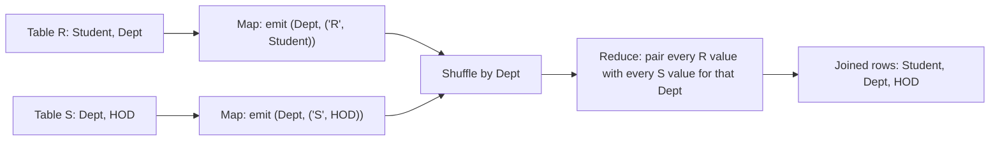
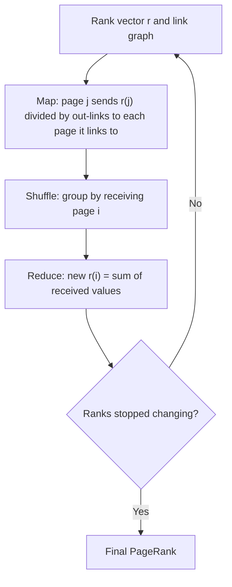

## The basics first

- A **key-value pair** is a label (the key) with some data (the value), written (key, value). Example: ("apple", 1).
- **Map** is a function that reads one input record at a time and emits zero or more key-value pairs. Map tasks run in parallel on many machines, each on its own piece of the data.
- **Shuffle (group by key)** is done by the framework between map and reduce. It collects all pairs with the same key together and sends them to one reducer. You do not write it.
- **Reduce** is a function that receives one key with the list of all its values, and emits the final result for that key.
- **Combiner** is an optional mini-reducer that runs on the map machine to add up values locally before they cross the network. It only works when the reduce operation is associative and commutative (for example sum, max, min), so the answer does not depend on the order.
- A **matrix** is a table of numbers with rows and columns. $m_{ij}$ means the number in row $i$, column $j$. A **vector** is a matrix with one column.
- A **relation** is a table, a **tuple** is one row, and an **attribute** is one column. Relational algebra is the small set of operations (selection, projection, join, union...) that SQL is built on.

If these are clear, the next sections show one pattern repeated again and again.

## The one idea behind every MapReduce algorithm

**What it is.** This note covers syllabus <Syl m="2" />, "Algorithms using MapReduce": matrix-vector multiplication, relational-algebra operations, selection, projection, union, intersection and difference. The same idea also gives word count, matrix-matrix multiplication, natural join, grouping and PageRank. <Cite id="hadoop-ecosystem-mmds" />

**Why it is needed.** The data is too big for one machine, so each machine must work on its own piece alone. The only place where pieces can meet is the shuffle, and the shuffle meets things that have the **same key**. So to design a MapReduce algorithm you ask one question: "which values must be seen together, and what key makes them meet?"

**Everyday analogy.** Counting votes after an election. Each booth (map) writes one slip per vote with the candidate's name. All slips of one candidate are put in one box (shuffle by key). One counter per box (reduce) counts the slips. Nobody needs to see the whole election.

**How it works.** The original design is from Google. <Cite id="hadoop-ecosystem-dean2004" />

1. Input is split into pieces; each map task reads one piece and emits (key, value) pairs.
2. Optional combiner adds up pairs locally on the same machine.
3. The framework partitions pairs by key, sends them over the network, and sorts them so each reducer sees one key with all its values.
4. Reduce runs once per key and writes the output.



Redrawn from the standard MapReduce data-flow pictures. <Cite id="mapreduce-algorithms-gfg-dataflow" loc="diagram" /> <Cite id="mapreduce-gfg-mr" loc="diagram" />

<Box kind="key">

Pattern to remember: **Map decides the key. Shuffle brings equal keys together. Reduce combines the values of one key.** Every algorithm below is a different choice of key and a different reduce.

</Box>

## Word count

**What it is.** Count how many times each word appears in a document. It is the "hello world" of MapReduce. <Cite id="mapreduce-gfg-wordcount" /> <Cite id="mapreduce-tpoint" /> <Cite id="mapreduce-av" />

**Key choice.** Key is the word; value is 1 for each occurrence.

**Pseudocode.**

```text
map(offset, line):
    for each word w in line:           # lowercase it and strip punctuation
        emit(w, 1)

reduce(word, counts):
    total = 0
    for c in counts:
        total = total + c
    emit(word, total)

combiner = same as reduce             # safe, because addition is associative
```

<Sum>

<Given>

Document: "This is an apple. Apple is red in color". Treat upper and lower case as the same word and ignore the full stop.

</Given>

<Find>

the count of every word, with the map output, the shuffle and the reduce output.

</Find>

<Steps>

1. **Clean the text.** Lowercase and drop punctuation: `this is an apple apple is red in color` (9 words). *Reason: "Apple" and "apple" must be the same key.*
2. **Map.** Each word becomes (word, 1):

   | Position | Word | Map output |
   |---|---|---|
   | 1 | this | (this, 1) |
   | 2 | is | (is, 1) |
   | 3 | an | (an, 1) |
   | 4 | apple | (apple, 1) |
   | 5 | apple | (apple, 1) |
   | 6 | is | (is, 1) |
   | 7 | red | (red, 1) |
   | 8 | in | (in, 1) |
   | 9 | color | (color, 1) |

3. **Shuffle (group by key).** Equal keys are gathered:

   | Key | List of values |
   |---|---|
   | this | [1] |
   | is | [1, 1] |
   | an | [1] |
   | apple | [1, 1] |
   | red | [1] |
   | in | [1] |
   | color | [1] |

4. **Reduce.** Add each list: this 1, is 2, an 1, apple 2, red 1, in 1, color 1. *Reason: reduce sums the 1s of one key.*

</Steps>

<Answer>

(this, 1), (is, 2), (an, 1), (apple, 2), (red, 1), (in, 1), (color, 1)

</Answer>

<Box kind="verify">

Total of the counts: $1 + 2 + 1 + 2 + 1 + 1 + 1 = 9$, the same as the 9 words in the cleaned text. Nothing was lost or added.

</Box>

</Sum>

The same method solves the other word-count questions in the papers: "This is NoSQL. NoSQL handles complex data." gives this 1, is 1, nosql 2, handles 1, complex 1, data 1 (7 words). "Big data is powerful. Big data drives decisions." gives big 2, data 2, is 1, powerful 1, drives 1, decisions 1 (8 words).

**With a combiner.** If both lines sit on different map machines, each machine first adds locally. A machine holding "big data is powerful" would send (big,1), (data,1), (is,1), (powerful,1) as before, but a machine that sees "big" twice sends (big, 2) once. The final answer is the same, with less network traffic. <Cite id="hadoop-ecosystem-apache-mr-tutorial" />

<Box kind="exam">

PYQ: <PYQ id="2022-12-ce/q2b" /> <PYQ id="2024-05-ce/q2b" /> <PYQ id="2024-12-ce/q2b" /> <PYQ id="2025-05-ce/q4a" /> all ask for word-count pseudocode plus a traced example. Write the pseudocode, then the three tables (map output, shuffle, reduce output), then the total check.

</Box>

## Matrix-vector multiplication

**What it is.** Multiply an $n \times n$ matrix $M$ by a vector $v$ of length $n$. The result $x$ has $n$ entries, where
$x_i = \sum_j m_{ij} v_j$. In words: for each row, multiply each matrix number by the vector number in the same column, and add them up. <Cite id="mapreduce-algorithms-wiki-matmul" />

**Why it matters.** Huge matrices (web graph, ratings) are matrix-vector problems, and PageRank (below) is repeated matrix-vector multiplication.

**How it works.** Assume the vector $v$ fits in the memory of every map task.

- **Map.** For each matrix element $m_{ij}$ emit $(i, \; m_{ij} \cdot v_j)$. The key is the row number $i$ because all products of one row must be added.
- **Reduce.** For key $i$, add all values. Emit $(i, x_i)$.

```text
map(i, j, m_ij):             # v is loaded in memory
    emit(i, m_ij * v[j])

reduce(i, products):
    emit(i, sum(products))
```

**If the vector does not fit in memory.** Cut the matrix into vertical stripes and the vector into matching horizontal stripes. A map task then needs only one stripe of the vector in memory and handles only the matching stripe of the matrix; the keys and the reduce stay the same. <Cite id="hadoop-ecosystem-mmds" />

<Sum>

<Given>

$$
M = \begin{bmatrix} 1 & 2 & 3 \\ 4 & 5 & 6 \\ 7 & 8 & 9 \end{bmatrix}, \quad v = \begin{bmatrix} 1 \\ 2 \\ 3 \end{bmatrix}
$$

</Given>

<Find>

$x = Mv$ using MapReduce.

</Find>

<Steps>

1. **Map.** For each element emit $(i, m_{ij} \cdot v_j)$, with $v_1 = 1$, $v_2 = 2$, $v_3 = 3$:

   | Element | Calculation | Map output |
   |---|---|---|
   | $m_{11} = 1$ | $1 \times 1$ | (1, 1) |
   | $m_{12} = 2$ | $2 \times 2$ | (1, 4) |
   | $m_{13} = 3$ | $3 \times 3$ | (1, 9) |
   | $m_{21} = 4$ | $4 \times 1$ | (2, 4) |
   | $m_{22} = 5$ | $5 \times 2$ | (2, 10) |
   | $m_{23} = 6$ | $6 \times 3$ | (2, 18) |
   | $m_{31} = 7$ | $7 \times 1$ | (3, 7) |
   | $m_{32} = 8$ | $8 \times 2$ | (3, 16) |
   | $m_{33} = 9$ | $9 \times 3$ | (3, 27) |

2. **Shuffle.** Group by row: 1 gets [1, 4, 9]; 2 gets [4, 10, 18]; 3 gets [7, 16, 27]. *Reason: all products of one row must meet.*
3. **Reduce.** Add each list: $1 + 4 + 9 = 14$; $4 + 10 + 18 = 32$; $7 + 16 + 27 = 50$.

</Steps>

<Answer>

$x = (14, 32, 50)^T$, that is (1, 14), (2, 32), (3, 50).

</Answer>

<Box kind="verify">

Check by column sums: the columns of $M$ add to $12, 15, 18$, so the total of all entries of $x$ must be $12 \times 1 + 15 \times 2 + 18 \times 3 = 12 + 30 + 54 = 96$. And $14 + 32 + 50 = 96$. They match.

</Box>

</Sum>

<Box kind="exam">

PYQ: <PYQ id="2023-12-ce/q2b" /> asks exactly this 3 by 3 times 3 by 1 multiplication. Syllabus point "Matrix-Vector Multiplication by MapReduce".

</Box>

## Matrix-matrix multiplication

**What it is.** Multiply $A$ (size $I \times J$) by $B$ (size $J \times K$). Output cell $(i,k)$ is $c_{ik} = \sum_j a_{ij} b_{jk}$: row $i$ of $A$ times column $k$ of $B$. <Cite id="mapreduce-algorithms-gfg-matmul" /> <Cite id="mapreduce-algorithms-wiki-matmul" />

**Why it is harder.** Each output cell needs a whole row of $A$ and a whole column of $B$, and each input number is used by many output cells. So map must copy each input number to every cell that needs it.

**One-step method (the one asked in exams).** Key is the output cell $(i, k)$.

- **Map.** For each $a_{ij}$ emit $((i, k), (A, j, a_{ij}))$ for every column $k$ of $B$. For each $b_{jk}$ emit $((i, k), (B, j, b_{jk}))$ for every row $i$ of $A$. The tag $A$ or $B$ says where the value came from, and $j$ is the common index.
- **Reduce.** For key $(i,k)$: pair the A-value and B-value that have the same $j$, multiply them, and add all the products. Emit $((i,k), c_{ik})$.

```text
map(matrix, row, col, value):
    if matrix == A:                       # value is a[i][j], row=i, col=j
        for k in 1..K:
            emit((row, k), ('A', col, value))
    else:                                 # value is b[j][k], row=j, col=k
        for i in 1..I:
            emit((i, col), ('B', row, value))

reduce((i, k), values):
    a = dict of j -> value for tags 'A'
    b = dict of j -> value for tags 'B'
    emit((i, k), sum(a[j] * b[j] for j in a))
```

**Two-step method.** Useful when matrices are large and sparse (many zeros). <Cite id="hadoop-ecosystem-mmds" />

1. Job 1: key is the common index $j$. Map emits $(j, (A, i, a_{ij}))$ and $(j, (B, k, b_{jk}))$. Reduce for each $j$ makes every product $a_{ij} b_{jk}$ and emits $((i,k), a_{ij} b_{jk})$.
2. Job 2: map does nothing (identity). Reduce for key $(i,k)$ adds all the products.



Redrawn from the standard one-step picture. <Cite id="mapreduce-algorithms-gfg-matmul" loc="diagram" />

<Sum>

<Given>

$$
A = \begin{bmatrix} 1 & 2 \\ 3 & 4 \end{bmatrix}, \quad B = \begin{bmatrix} 6 & 7 \\ 8 & 9 \end{bmatrix}
$$

</Given>

<Find>

$C = AB$ with the one-step MapReduce method.

</Find>

<Steps>

1. **Map for A.** Each $a_{ij}$ goes to both cells of its row $i$ (columns $k = 1, 2$), tagged with $j$:

   | $a_{ij}$ | Map output |
   |---|---|
   | $a_{11} = 1$ | ((1,1), (A,1,1)), ((1,2), (A,1,1)) |
   | $a_{12} = 2$ | ((1,1), (A,2,2)), ((1,2), (A,2,2)) |
   | $a_{21} = 3$ | ((2,1), (A,1,3)), ((2,2), (A,1,3)) |
   | $a_{22} = 4$ | ((2,1), (A,2,4)), ((2,2), (A,2,4)) |

2. **Map for B.** Each $b_{jk}$ goes to both cells of its column $k$ (rows $i = 1, 2$), tagged with $j$:

   | $b_{jk}$ | Map output |
   |---|---|
   | $b_{11} = 6$ | ((1,1), (B,1,6)), ((2,1), (B,1,6)) |
   | $b_{12} = 7$ | ((1,2), (B,1,7)), ((2,2), (B,1,7)) |
   | $b_{21} = 8$ | ((1,1), (B,2,8)), ((2,1), (B,2,8)) |
   | $b_{22} = 9$ | ((1,2), (B,2,9)), ((2,2), (B,2,9)) |

3. **Shuffle and reduce.** Each cell gets two A-values and two B-values. Match them by $j$, multiply, and add:

   | Cell | A-values (j: value) | B-values (j: value) | Sum of products | Result |
   |---|---|---|---|---|
   | (1,1) | 1: 1, 2: 2 | 1: 6, 2: 8 | $1 \times 6 + 2 \times 8 = 6 + 16$ | 22 |
   | (1,2) | 1: 1, 2: 2 | 1: 7, 2: 9 | $1 \times 7 + 2 \times 9 = 7 + 18$ | 25 |
   | (2,1) | 1: 3, 2: 4 | 1: 6, 2: 8 | $3 \times 6 + 4 \times 8 = 18 + 32$ | 50 |
   | (2,2) | 1: 3, 2: 4 | 1: 7, 2: 9 | $3 \times 7 + 4 \times 9 = 21 + 36$ | 57 |

</Steps>

<Answer>

$$
C = \begin{bmatrix} 22 & 25 \\ 50 & 57 \end{bmatrix}
$$

</Answer>

<Box kind="verify">

Check with the two-step method. Job 1 key $j = 1$ pairs column 1 of $A$ (1, 3) with row 1 of $B$ (6, 7): products to cells (1,1) 6, (1,2) 7, (2,1) 18, (2,2) 21. Key $j = 2$ pairs column 2 of $A$ (2, 4) with row 2 of $B$ (8, 9): products 16, 18, 32, 36. Job 2 adds per cell: $6 + 16 = 22$, $7 + 18 = 25$, $18 + 32 = 50$, $21 + 36 = 57$. Same matrix. Also the sum of all entries: $22 + 25 + 50 + 57 = 154$, and (column sums of $A$) times (row sums of $B$) is $(4 \times 13) + (6 \times 17) = 52 + 102 = 154$.

</Box>

</Sum>

| Method | Jobs | Map output size | When to prefer |
|---|---|---|---|
| One-step | 1 | Each element copied $K$ or $I$ times | Small or medium matrices; the exam answer |
| Two-step | 2 | Each element copied once, but products are written between jobs | Large sparse matrices |

<Box kind="exam">

PYQ: <PYQ id="2023-05-ce/q2b" /> (2 by 2 times 2 by 2, the matrix above is the same one) and <PYQ id="2024-05/q3a" /> (any example, all steps). Write the pseudocode first, then the map table, then the reduce table with the check.

</Box>

## Relational-algebra operations with MapReduce

**What it is.** A relational database stores data in tables and answers questions with a few operations. A big table can be spread over many machines, and each operation can be written as a map and a reduce. This is syllabus "Relational-Algebra Operations". <Cite id="mapreduce-algorithms-wiki-relalg" /> <Cite id="mapreduce-algorithms-gfg-relalg" /> <Cite id="mapreduce-algorithms-tp-relalg" />

**Everyday analogy.** A school register. Selection picks the rows of Class 7. Projection copies only the Name column. Join matches students with their class teacher using the class number.

**Why use MapReduce.** The tables are too large for one machine. The same operations are what Hive and Pig run underneath (Hive turns SQL into MapReduce jobs). <Cite id="mapreduce-algorithms-pig-basic" />

| Operation | Symbol | Meaning |
|---|---|---|
| Selection | $\sigma_C(R)$ | Keep the rows that satisfy condition $C$ |
| Projection | $\pi_S(R)$ | Keep only the columns in list $S$, drop duplicates |
| Union | $R \cup S$ | Rows in $R$ or $S$ (or both) |
| Intersection | $R \cap S$ | Rows in both $R$ and $S$ |
| Difference | $R - S$ | Rows in $R$ that are not in $S$ |
| Natural join | $R \bowtie S$ | Combine rows of $R$ and $S$ that agree on the common columns |
| Grouping and aggregation | $\gamma_{X, \theta(Y)}(R)$ | Group rows by $X$ and apply an aggregate (SUM, COUNT, AVG, MAX, MIN) to $Y$ |

All examples use these two small relations.

Student $R$(Id, Name, Dept):

| Id | Name | Dept |
|---|---|---|
| 1 | Asha | CSE |
| 2 | Ravi | IT |
| 3 | Meena | CSE |
| 4 | Kiran | IT |
| 5 | Sara | ECE |

### Selection

**What it does.** Keep only the tuples that satisfy a condition, like `WHERE Dept = 'CSE'`. <Cite id="hadoop-ecosystem-mmds" />

**Map.** Test each tuple $t$. If it satisfies $C$, emit $(t, t)$; otherwise emit nothing.
**Reduce.** Identity: just write out the value. Selection does not need the reduce step at all, so it can be a map-only job. Each tuple is checked on its own, so nothing has to meet anything else.

```text
map(t):  if t satisfies C: emit(t, t)
reduce(t, values): emit(t)       # identity, can be skipped
```

<Sum>

<Given>

Relation $R$ above and the condition Dept = CSE.

</Given>

<Find>

$\sigma_{Dept = CSE}(R)$.

</Find>

<Steps>

1. **Map.** Test each tuple:

   | Tuple | Dept = CSE? | Map output |
   |---|---|---|
   | (1, Asha, CSE) | yes | ((1,Asha,CSE), (1,Asha,CSE)) |
   | (2, Ravi, IT) | no | nothing |
   | (3, Meena, CSE) | yes | ((3,Meena,CSE), (3,Meena,CSE)) |
   | (4, Kiran, IT) | no | nothing |
   | (5, Sara, ECE) | no | nothing |

2. **Reduce.** Identity: output each key once. *Reason: a tuple appears once, so there is nothing to combine.*

</Steps>

<Answer>

$\{(1, Asha, CSE), (3, Meena, CSE)\}$

</Answer>

<Box kind="verify">

Count: 2 CSE rows in $R$ (Ids 1 and 3), and 2 tuples in the answer. Every output row has Dept = CSE and no CSE row was missed.

</Box>

</Sum>

### Projection

**What it does.** Keep only some columns, like `SELECT DISTINCT Dept`. After dropping columns, two different rows can become identical, and a relation is a set, so the duplicates must be removed. That is why projection needs a reduce.

**Map.** For each tuple $t$, build $t'$ with only the chosen columns and emit $(t', t')$.
**Reduce.** For key $t'$ with the list $[t', t', \ldots]$, emit $t'$ once. <Cite id="hadoop-ecosystem-mmds" />

```text
map(t):  t2 = keep columns S of t;  emit(t2, t2)
reduce(t2, values): emit(t2)       # many copies become one
```

<Sum>

<Given>

Relation $R$ above, projected on Dept.

</Given>

<Find>

$\pi_{Dept}(R)$.

</Find>

<Steps>

1. **Map.** Keep only Dept: Id 1 gives (CSE, CSE), Id 2 gives (IT, IT), Id 3 gives (CSE, CSE), Id 4 gives (IT, IT), Id 5 gives (ECE, ECE).
2. **Shuffle.** CSE: [CSE, CSE]; IT: [IT, IT]; ECE: [ECE].
3. **Reduce.** Output each key once. *Reason: this removes duplicates.*

</Steps>

<Answer>

$\{CSE, IT, ECE\}$

</Answer>

<Box kind="verify">

5 input rows, 3 distinct Dept values (CSE twice, IT twice, ECE once: $2 + 2 + 1 = 5$ rows accounted for). The answer has 3 values with no repeats.

</Box>

</Sum>

A combiner can also remove duplicates locally, to reduce network traffic.

<Box kind="exam">

PYQ: <PYQ id="2024-05-ce/q4a" /> and <PYQ id="2025-05/q3a" /> (selection and projection), and <PYQ id="2024-12/q2a" /> (illustrate the relational-algebra operations with examples). Show map output, shuffle and reduce for each.

</Box>

### Union, intersection and difference

**What they do.** These work on two relations with the same columns. Let $R = \{Asha, Ravi, Meena\}$ and $S = \{Ravi, Meena, Kiran\}$ (names only). The key is the **whole tuple**, so equal tuples from the two relations meet at one reducer. Each tuple is also tagged with the relation it came from. <Cite id="hadoop-ecosystem-mmds" />

| Operation | Map | Reduce rule |
|---|---|---|
| Union | each tuple $t$: emit $(t, t)$ | for key $t$ emit $t$ once, whatever the list holds |
| Intersection | each tuple $t$: emit $(t, t)$ | emit $t$ only if the list has two copies (one from $R$, one from $S$) |
| Difference $R - S$ | tuple from $R$: emit $(t, R)$; tuple from $S$: emit $(t, S)$ | emit $t$ only if the list is exactly [R] |

<Sum>

<Given>

$R = \{Asha, Ravi, Meena\}$ and $S = \{Ravi, Meena, Kiran\}$.

</Given>

<Find>

$R \cup S$, $R \cap S$ and $R - S$.

</Find>

<Steps>

1. **Map.** Emit each tuple as key with its source tag. *Reason: the tag tells the reducer which relation each copy came from.*
2. **Shuffle.**

   | Key | Values (source tags) |
   |---|---|
   | Asha | [R] |
   | Ravi | [R, S] |
   | Meena | [R, S] |
   | Kiran | [S] |

3. **Reduce, union.** Output every key: Asha, Ravi, Meena, Kiran.
4. **Reduce, intersection.** Output keys whose list has both R and S: Ravi, Meena.
5. **Reduce, difference $R - S$.** Output keys whose list is only [R]: Asha.

</Steps>

<Answer>

$R \cup S = \{Asha, Ravi, Meena, Kiran\}$; $R \cap S = \{Ravi, Meena\}$; $R - S = \{Asha\}$.

</Answer>

<Box kind="verify">

Count rule: $|R \cup S| = |R| + |S| - |R \cap S| = 3 + 3 - 2 = 4$, which matches. And $|R - S| = |R| - |R \cap S| = 3 - 2 = 1$, which matches.

</Box>

</Sum>

### Natural join

**What it does.** Combine every row of $R(A, B)$ with every row of $S(B, C)$ that has the same value in the common column $B$. This is the SQL `JOIN` on a shared column. <Cite id="mapreduce-algorithms-wiki-join" /> <Cite id="mapreduce-algorithms-gfg-join" />

**Key choice.** The join attribute $B$. Rows that must be matched have the same $B$, so they meet at the same reducer.

- **Map.** For $R$ tuple $(a, b)$ emit $(b, (R, a))$. For $S$ tuple $(b, c)$ emit $(b, (S, c))$. The tag says which relation.
- **Reduce.** For key $b$, split the list into R-values and S-values and output $(a, b, c)$ for every pair of one R-value and one S-value.

```text
map(tuple from R(A,B)):  emit(B, ('R', A))
map(tuple from S(B,C)):  emit(B, ('S', C))
reduce(b, values):
    As = [x for (tag, x) in values if tag == 'R']
    Cs = [x for (tag, x) in values if tag == 'S']
    for a in As: for c in Cs: emit((a, b, c))
```



<Sum>

<Given>

$R$(Student, Dept): (Asha, CSE), (Ravi, IT), (Meena, CSE). $S$(Dept, HOD): (CSE, Rao), (IT, Shah), (ECE, Iyer).

</Given>

<Find>

$R \bowtie S$ on Dept.

</Find>

<Steps>

1. **Map.** Key is Dept:

   | From | Map output |
   |---|---|
   | R | (CSE, (R, Asha)), (IT, (R, Ravi)), (CSE, (R, Meena)) |
   | S | (CSE, (S, Rao)), (IT, (S, Shah)), (ECE, (S, Iyer)) |

2. **Shuffle.**

   | Dept | Values |
   |---|---|
   | CSE | (R, Asha), (R, Meena), (S, Rao) |
   | IT | (R, Ravi), (S, Shah) |
   | ECE | (S, Iyer) |

3. **Reduce.** CSE: 2 R-values times 1 S-value gives 2 rows. IT: 1 times 1 gives 1 row. ECE: 0 R-values times 1 gives nothing. *Reason: a key with values from only one relation has no partner.*

</Steps>

<Answer>

$\{(Asha, CSE, Rao), (Meena, CSE, Rao), (Ravi, IT, Shah)\}$

</Answer>

<Box kind="verify">

Row count: for each Dept, (number in R) times (number in S): $2 \times 1 + 1 \times 1 + 0 \times 1 = 3$. The answer has 3 rows. ECE has no student, so it correctly does not appear.

</Box>

</Sum>

### Grouping and aggregation

**What it does.** Put rows with the same value of the grouping column into a group and compute one number per group, like `SELECT Dept, AVG(Marks) FROM R GROUP BY Dept`.

**Key choice.** The grouping attribute. <Cite id="hadoop-ecosystem-mmds" />

- **Map.** For each tuple emit (grouping value, the value to be aggregated).
- **Reduce.** For one group, apply SUM, COUNT, AVG, MAX or MIN to the list and emit (group, result).

For SUM, COUNT, MAX and MIN a combiner is safe. For AVG a combiner must send (sum, count) pairs, not partial averages, because an average of averages is wrong when the groups differ in size.

<Sum>

<Given>

Marks relation (Dept, Marks): (CSE, 70), (IT, 60), (CSE, 80), (IT, 90), (ECE, 50). Group by Dept, find SUM and AVG of Marks.

</Given>

<Find>

SUM and AVG per Dept.

</Find>

<Steps>

1. **Map.** Emit (Dept, Marks): (CSE,70), (IT,60), (CSE,80), (IT,90), (ECE,50).
2. **Shuffle.** CSE: [70, 80]; IT: [60, 90]; ECE: [50].
3. **Reduce.**

   | Dept | Marks list | SUM | COUNT | AVG |
   |---|---|---|---|---|
   | CSE | [70, 80] | 150 | 2 | 75 |
   | IT | [60, 90] | 150 | 2 | 75 |
   | ECE | [50] | 50 | 1 | 50 |

</Steps>

<Answer>

CSE: SUM 150, AVG 75. IT: SUM 150, AVG 75. ECE: SUM 50, AVG 50.

</Answer>

<Box kind="verify">

Total of all marks: $70 + 60 + 80 + 90 + 50 = 350$. Total of the group sums: $150 + 150 + 50 = 350$. They match.

</Box>

</Sum>

<Box kind="exam">

PYQ: <PYQ id="2023-05-ce/q4a" /> and <PYQ id="2025-05-ce/q3b" /> ask to explain natural join and grouping with aggregation using MapReduce. Give the key choice, the map and reduce rules for each, and one small traced example each (the two above).

</Box>

## PageRank using MapReduce

**What it is.** PageRank gives each web page a score for how important it is: a page is important if important pages link to it. Think of a random surfer who follows a random outgoing link at each step; the PageRank of a page is the fraction of time the surfer spends on it in the long run. It was introduced by Page and Brin. <Cite id="mapreduce-algorithms-wiki-pagerank" /> <Cite id="mapreduce-algorithms-gfg-pagerank" />

**Why it fits MapReduce.** Let $r$ be the vector of ranks and $M$ the **transition matrix**: $m_{ij} = 1/n_j$ if page $j$ links to page $i$ (where $n_j$ is the number of out-links of $j$), else 0. The ranks are found by repeating $r \leftarrow M r$ until they stop changing. That is a matrix-vector product, which we already know how to do. (A full treatment of the PageRank model is in the PageRank note; here only the MapReduce form and the two problems are covered.)

**One iteration as a MapReduce job.**

- **Map.** For each page $j$ with rank $r_j$ and $n_j$ out-links, emit $(i, r_j / n_j)$ for every page $i$ that $j$ links to. This is the same as emitting $(i, m_{ij} \cdot r_j)$.
- **Reduce.** For page $i$, add all received values. The sum is its new rank.

The graph itself (who links to whom) is read again in every iteration. If the vector is too large for memory, the stripe method from matrix-vector multiplication is used. A combiner that adds partial sums per key shrinks the data sent over the network.



Redrawn from the usual PageRank iteration pictures. <Cite id="mapreduce-algorithms-gfg-pagerank" loc="diagram" />

<Sum>

<Given>

Three pages. A links to B and C; B links to C; C links to A. Start with $r = (1/3, 1/3, 1/3)$.

</Given>

<Find>

the ranks after two iterations, using map and reduce.

</Find>

<Steps>

1. **Iteration 1, map.** A has 2 out-links, so it sends $\frac{1}{3} \div 2 = \frac{1}{6}$ to B and to C. B has 1 out-link, so it sends $\frac{1}{3}$ to C. C has 1 out-link, so it sends $\frac{1}{3}$ to A. *Reason: each page splits its rank equally among its out-links.*
2. **Iteration 1, reduce.** A gets $\frac{1}{3}$. B gets $\frac{1}{6}$. C gets $\frac{1}{6} + \frac{1}{3} = \frac{1}{2}$. So $r_1 = (\frac{1}{3}, \frac{1}{6}, \frac{1}{2})$.
3. **Iteration 2, map.** A (rank $\frac{1}{3}$) sends $\frac{1}{6}$ to B and $\frac{1}{6}$ to C. B (rank $\frac{1}{6}$) sends $\frac{1}{6}$ to C. C (rank $\frac{1}{2}$) sends $\frac{1}{2}$ to A.
4. **Iteration 2, reduce.** A gets $\frac{1}{2}$. B gets $\frac{1}{6}$. C gets $\frac{1}{6} + \frac{1}{6} = \frac{1}{3}$.

</Steps>

<Answer>

$r_1 = (\frac{1}{3}, \frac{1}{6}, \frac{1}{2})$ and $r_2 = (\frac{1}{2}, \frac{1}{6}, \frac{1}{3})$.

</Answer>

<Box kind="verify">

Ranks must always add to 1. $r_1$: $\frac{2}{6} + \frac{1}{6} + \frac{3}{6} = 1$. $r_2$: $\frac{3}{6} + \frac{1}{6} + \frac{2}{6} = 1$. Both sums are 1, so no rank was created or lost.

</Box>

</Sum>

### Dead ends

**What it is.** A **dead end** is a page with no out-links. Its column in $M$ is all zeros, so the rank it receives has nowhere to go and disappears. After many iterations the total rank leaks away towards zero. <Cite id="mapreduce-algorithms-wiki-pagerank" />

**Fixes.** (1) Drop dead ends from the graph (and the pages that become dead ends after that), compute ranks, then add them back. (2) Teleport: treat a dead end as linking to every page with equal probability. (3) Use taxation (below).

<Sum>

<Given>

Same graph, but C has no out-links: A links to B and C; B links to C. Start with $r_0 = (\frac{1}{3}, \frac{1}{3}, \frac{1}{3})$.

</Given>

<Find>

the ranks after iterations 1, 2 and 3.

</Find>

<Steps>

1. **Iteration 1.** A sends $\frac{1}{6}$ to B and $\frac{1}{6}$ to C. B sends $\frac{1}{3}$ to C. C sends nothing. A receives nothing. B has $\frac{1}{6}$. C has $\frac{1}{6} + \frac{1}{3} = \frac{1}{2}$. So $r_1 = (0, \frac{1}{6}, \frac{1}{2})$, total $\frac{2}{3}$.
2. **Iteration 2.** A has rank 0, so it sends nothing. B (rank $\frac{1}{6}$) sends $\frac{1}{6}$ to C. C sends nothing. So $r_2 = (0, 0, \frac{1}{6})$, total $\frac{1}{6}$.
3. **Iteration 3.** Only C holds rank, and C sends nothing. So $r_3 = (0, 0, 0)$.

</Steps>

<Answer>

The total rank falls from 1 to $\frac{2}{3}$ to $\frac{1}{6}$ to 0. All rank leaks out through the dead end C.

</Answer>

<Box kind="verify">

Rank lost per step: from iteration 0 to 1, C's own $\frac{1}{3}$ is lost, $1 - \frac{1}{3} = \frac{2}{3}$. From 1 to 2, C's $\frac{1}{2}$ is lost: $\frac{2}{3} - \frac{1}{2} = \frac{1}{6}$. From 2 to 3, C's $\frac{1}{6}$ is lost: $\frac{1}{6} - \frac{1}{6} = 0$. Each total matches.

</Box>

</Sum>

### Spider traps

**What it is.** A **spider trap** is a set of pages whose links all stay inside the set (the simplest is one page that links only to itself). Rank enters the trap but never leaves, so in the end the trap absorbs all the rank and every other page gets 0. Nothing leaks, but the answer is useless. <Cite id="mapreduce-algorithms-wiki-pagerank" />

**Fix: taxation (teleportation).** At each step, with probability $\beta$ (usually 0.8 to 0.9) the surfer follows a link; with probability $1 - \beta$ the surfer jumps to a random page. The update becomes
$r' = \beta M r + \frac{1 - \beta}{n}\mathbf{e}$,
where $n$ is the number of pages and $\mathbf{e}$ is a vector of ones. Each reducer simply adds the constant $\frac{1 - \beta}{n}$ to its sum. Rank can no longer be trapped, because a part of it is redistributed to every page each round. <Cite id="hadoop-ecosystem-mmds" /> (Wikipedia notes the damping factor is generally set around 0.85.)

<Sum>

<Given>

A links to B and C; B links to C; C links only to itself (a spider trap). $r_0 = (\frac{1}{3}, \frac{1}{3}, \frac{1}{3})$. Part (a): no taxation. Part (b): taxation with $\beta = 0.8$, one iteration.

</Given>

<Find>

(a) $r_1$ and $r_2$ without taxation. (b) $r_1$ with taxation.

</Find>

<Steps>

1. **(a) Iteration 1.** A sends $\frac{1}{6}$ to B and C. B sends $\frac{1}{3}$ to C. C sends $\frac{1}{3}$ to C. So A gets 0, B gets $\frac{1}{6}$, C gets $\frac{1}{6} + \frac{1}{3} + \frac{1}{3} = \frac{5}{6}$. $r_1 = (0, \frac{1}{6}, \frac{5}{6})$.
2. **(a) Iteration 2.** A has 0. B (rank $\frac{1}{6}$) sends $\frac{1}{6}$ to C. C (rank $\frac{5}{6}$) sends $\frac{5}{6}$ to C. So A gets 0, B gets 0 (A sent nothing), C gets $\frac{1}{6} + \frac{5}{6} = 1$. $r_2 = (0, 0, 1)$. The trap C has all the rank.
3. **(b) Taxed map and reduce from $r_0$.** The plain sums are $(0, \frac{1}{6}, \frac{5}{6})$. Multiply by $\beta = 0.8$: $(0, \frac{2}{15}, \frac{2}{3})$. Add $\frac{1 - \beta}{n} = \frac{0.2}{3} = \frac{1}{15}$ to each entry: A $= \frac{1}{15}$, B $= \frac{2}{15} + \frac{1}{15} = \frac{3}{15}$, C $= \frac{10}{15} + \frac{1}{15} = \frac{11}{15}$.

</Steps>

<Answer>

(a) $r_1 = (0, \frac{1}{6}, \frac{5}{6})$, $r_2 = (0, 0, 1)$: the trap takes everything. (b) With taxation $r_1 = (\frac{1}{15}, \frac{3}{15}, \frac{11}{15}) \approx (0.067, 0.200, 0.733)$: A and B keep some rank.

</Answer>

<Box kind="verify">

(a) $r_1$ sums to $0 + \frac{1}{6} + \frac{5}{6} = 1$ and $r_2$ sums to 1: no leak. (b) $\frac{1}{15} + \frac{3}{15} + \frac{11}{15} = \frac{15}{15} = 1$. Taxation keeps the total at 1 and gives A a non-zero rank.

</Box>

</Sum>

| Problem | What goes wrong | Cause | Fix |
|---|---|---|---|
| Dead end | Total rank leaks towards 0 | Page with no out-links | Remove dead ends, or treat as linking to all pages, or tax |
| Spider trap | One group takes all rank, others get 0 | Group of pages whose links stay inside | Taxation: teleport with probability $1 - \beta$ |

<Box kind="exam">

PYQ: <PYQ id="2024-12/q5b" /> and <PYQ id="2025-05/q5a" /> ask to explain PageRank using MapReduce with spider traps and dead ends. Write: the idea of PageRank, the matrix form $r = Mr$, map and reduce of one iteration, a traced example (the three-page graphs above), what dead ends and spider traps do, and the taxation fix.

</Box>

## Advantages and limitations of these algorithms

| Advantages | Limitations |
|---|---|
| The same simple pattern scales to terabytes on cheap machines | Every job reads and writes disk, so iterative jobs such as PageRank are slow |
| The framework handles parallelism, shuffling and failures | Joins and matrix products create a lot of shuffled data |
| The same operations are exposed by Pig and Hive, so you rarely write them by hand | Not a good fit for small data or low-latency queries |

Because of the disk cost of repeating jobs, newer engines such as Spark keep data in memory between iterations. <Cite id="mapreduce-algorithms-spark-rdd" /> <Cite id="mapreduce-gfg-proscons" />

## Quick comparison of keys

| Algorithm | Map key | Map value | Reduce does |
|---|---|---|---|
| Word count | word | 1 | sum |
| Matrix-vector | row $i$ | $m_{ij} v_j$ | sum |
| Matrix-matrix (one step) | cell $(i,k)$ | (tag, $j$, element) | multiply by $j$, sum |
| Selection | tuple | tuple | identity |
| Projection | projected tuple | same | remove duplicates |
| Union | tuple | tuple | output once |
| Intersection | tuple | tuple | output if two copies |
| Difference $R - S$ | tuple | source tag | output if only R |
| Natural join | join attribute | (tag, other columns) | pair R and S values |
| Grouping | group attribute | value | SUM, COUNT, AVG... |
| PageRank | target page | rank share | sum (plus taxation) |

## Exam summary

- Always start with the key: the answer to "what must meet?"
- Write the pseudocode for the map and the reduce, then trace the example in three tables: map output, shuffle, reduce output.
- End every numeric answer with a quick check (totals match, or a second method).
- Mention combiners wherever the reduce is associative, and mention the stripe method when the vector does not fit in memory.
- Related: the MapReduce execution note, Hadoop limitations (syllabus point 2.4), and the PageRank note.

Streaming and scripting are also possible: Hadoop Streaming lets the map and reduce be any program that reads standard input and writes standard output. <Cite id="mapreduce-algorithms-hadoop-streaming" /> <Cite id="hadoop-ecosystem-apache-mr-tutorial" /> <Cite id="mapreduce-tp" /> <Cite id="mapreduce-ibm" /> <Cite id="mapreduce-algorithms-wiki-mr" />
