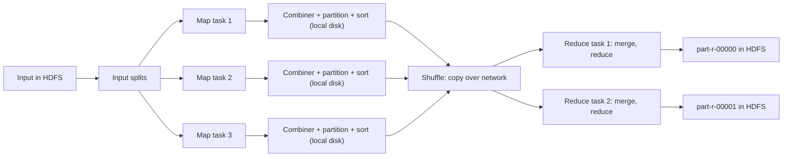
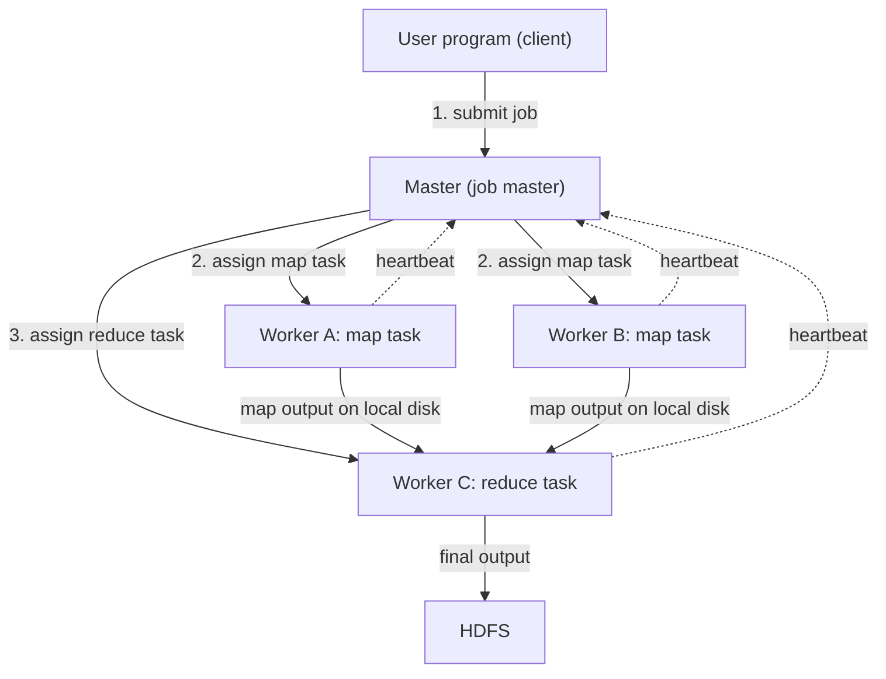
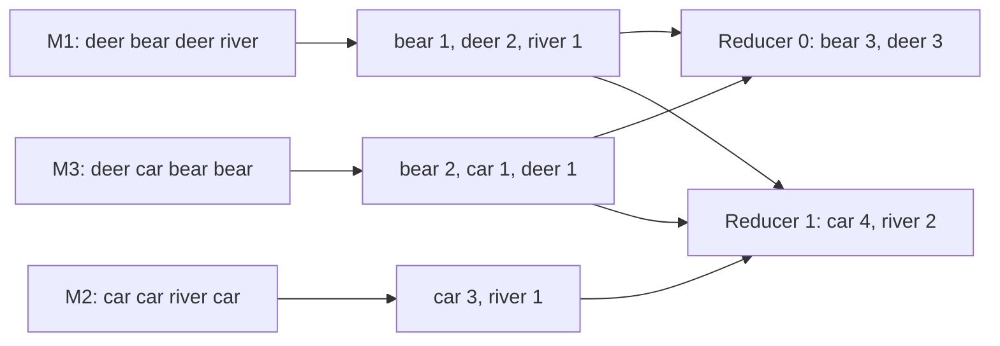
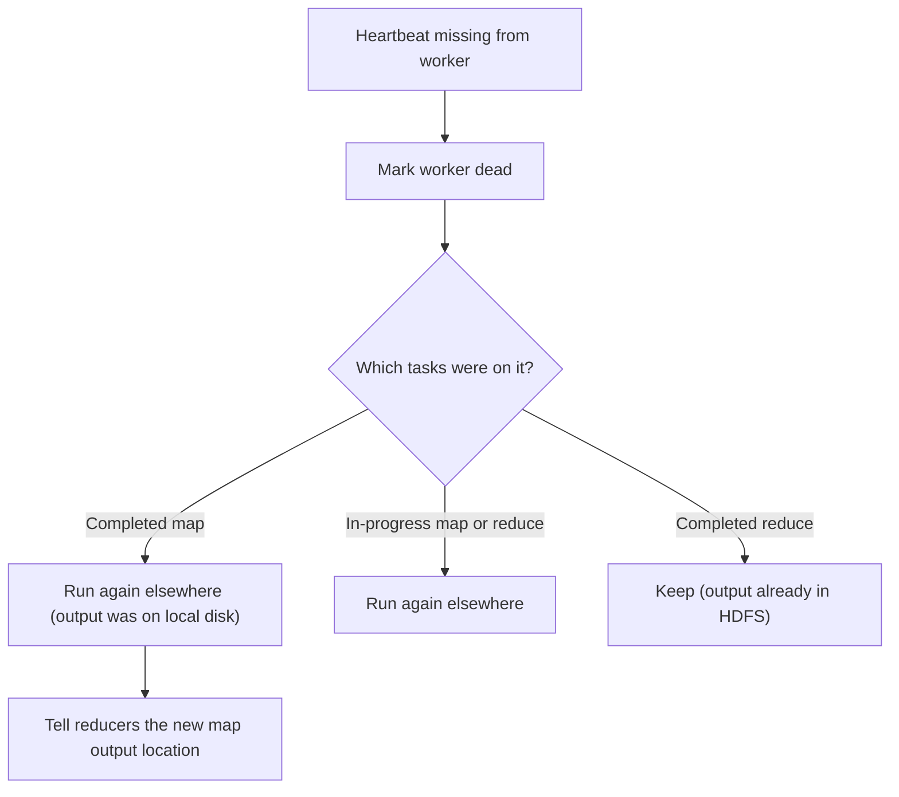

Ye note syllabus <Syl m="2" /> ka hai: "MapReduce: the map tasks, grouping by key, the reduce tasks, combiners, details of MapReduce execution, coping with node failures" aur "Hadoop limitations". Matrix aur relational algorithms agle note mein hain.

## Pehle basics

- **Key-value pair** matlab do cheezein ek saath: ek label (key) aur uske saath ka number ya text (value). Example: (`"car"`, 1) ka matlab "maine word car ek baar dekha".
- **Cluster** matlab bahut saare computers jo ek system ki tarah kaam karte hain. **Node** usme ek computer hai.
- **Parallel** matlab bahut saare nodes ek saath, har ek chhota hissa karta hai. Jaise 100 answer sheets ek teacher ke bajay das teachers mein 10-10 baant dena.
- **HDFS** ek bada file ko blocks (default 128 MB) mein tod kar kai nodes par rakhta hai. MapReduce apna input HDFS se padhta hai aur result HDFS mein likhta hai. HDFS note dekho.
- **Data locality** matlab "program ko data ke paas bhejo, data ko program ke paas nahi". Program kuch KB ka hota hai. Data terabytes ka.

## MapReduce kya hai aur kyun chahiye

**Definition.** MapReduce ek programming model aur framework hai jo bahut bade data sets ko ordinary computers ke cluster par parallel mein process karta hai. Programmer do functions likhta hai, **Map** aur **Reduce**. Baaki sab framework karta hai. <Cite id="hadoop-ecosystem-dean2004" /> <Cite id="hadoop-ecosystem-wiki-rdbms-hadoop-mr" /> <Cite id="hadoop-ecosystem-mmds" loc="§2.2" />

**Kyun chahiye.** Parallel program haath se likhne ka matlab hai data splitting, scheduling, machines ke beech data bhejna aur machine failure se recover karna, ye sab khud solve karna. Ye mushkil aur baar-baar repeat hone wala kaam hai. Google ke engineers ne dekha ki bahut saari jobs ek jaisi hoti hain (har record dekho, phir group karo aur combine karo), isliye unhone saara mushkil kaam ek library mein chhupa diya. Ab user sirf do functions likhta hai. <Cite id="hadoop-ecosystem-dean2004" loc="§1" />

**Roz ki analogy.** 1,000 ballot boxes ke votes gino. Har helper kuch boxes leta hai aur chhote piles banata hai, har candidate ka ek pile (ye **map** hai). Ek candidate ke saare piles ek table par le jaye jaate hain (ye **shuffle** hai). Har table par ek aadmi piles ko jod deta hai (ye **reduce** hai).

**Ek line mein idea:** `map: record -> list of (key, value)`, phir key se group, phir `reduce: (key, list of values) -> result`.

## Map task

<PYQ id="2022-12-ce/q1a" /> <PYQ id="2024-05/q1c" />

Input ko tukdon mein kaata jata hai jinhe **input splits** kehte hain (aam taur par ek HDFS block = ek split). Ek **map task** ek split par kaam karta hai. Task ke andar **RecordReader** split ko records mein badalta hai (text ke liye ek record = ek line). Programmer ka **map function** har record ke liye ek baar bulaya jata hai aur wo **zero, ek ya bahut saare** (key, value) pairs emit kar sakta hai. <Cite id="hadoop-ecosystem-mmds" loc="§2.2.1" /> <Cite id="hadoop-ecosystem-apache-mr-tutorial" />

- Map function **ek time par ek record** dekhta hai, baaki records nahi dekhta. Isliye bahut saare map tasks alag nodes par ek saath chal sakte hain.
- Output key aur value ka type input jaisa hona zaroori nahi. Yahan keys unique nahi hoti: same key bahut baar aa sakti hai, ek ya kai map tasks se.
- Framework har map task ko us **node par chalane ki koshish karta hai jisme uska block hai** (data locality), ya kam se kam same rack mein, taaki bada data network par na jaye. <Cite id="hadoop-ecosystem-dean2004" loc="§3.4" />
- Map ka output us node ki **local disk** par likha jata hai, HDFS mein nahi, kyunki ye temporary hai.

**Example (word count).** Input line `deer bear deer river`. Map function emit karta hai (deer, 1), (bear, 1), (deer, 1), (river, 1): har word ke liye ek pair.

## Grouping by key (partition, sort, shuffle)

<PYQ id="2025-05-ce/q1b" />

Map tasks ke baad, same key wale saare pairs ek jagah aane chahiye. Framework ye khud karta hai. Programmer sirf reduce tasks ki sankhya $R$ chunta hai. <Cite id="hadoop-ecosystem-mmds" loc="§2.2.2" />

1. **Partition.** Har map task apne output ko key par **partition function** laga kar $R$ buckets mein baantta hai. Default `hash(key) mod R` hai. Same key ka bucket number har jagah same hota hai, isliye ek key kabhi do reducers mein nahi bat sakti. <Cite id="hadoop-ecosystem-dean2004" loc="§4.1" />
2. **Sort.** Har bucket ke andar pairs key se sort hote hain (sorting map side par hoti hai jab buffer likha jata hai).
3. **Shuffle.** Har reduce task har map task se apna bucket **copy** karta hai network par. Job mein yehi akela bada network movement hai.
4. **Merge.** Reducer sorted pieces ko merge karta hai taaki barabar keys paas-paas aa jaye, aur har key ke liye uski saari values ki list banata hai: (key, [v1, v2, ...]).

Isliye reduce side ko apni keys **sorted order** mein milti hain, har key ke saath uski poori values ki list. <Cite id="hadoop-ecosystem-dean2004" loc="§4.2" /> <Cite id="mapreduce-gfg-mr" />

## Reduce task

<PYQ id="2025-05-ce/q1b" /> <PYQ id="2024-05/q1c" />

**Reduce task** apne bucket ki keys ke groups leta hai. Programmer ka **reduce function** har key ke liye ek baar bulaya jata hai, key aur uski values ki list ke saath. Wo unhe combine karta hai (add, count, max, join, waghera) aur final (key, result) pairs emit karta hai. Reducer ka output **HDFS** mein likha jata hai, har reduce task ki ek file, naam `part-r-00000`, `part-r-00001`, aise. <Cite id="hadoop-ecosystem-mmds" loc="§2.2.3" /> <Cite id="hadoop-ecosystem-apache-mr-tutorial" />

**Example.** Reduce ko (car, [3, 1]) milta hai aur wo (car, 4) emit karta hai.

## Combiners

Jab ek key map task mein bahut baar aati hai, to hum bahut saare (car, 1) pairs network par bhejte hain sirf baad mein unhe add karne ke liye. **Combiner** ek chhota reduce function hai jo **mapper ki node par, mapper ke apne output par**, shuffle se pehle chalta hai. Wo (car, 1), (car, 1), (car, 1) ko locally (car, 3) bana deta hai, to kam data move hota hai. <Cite id="hadoop-ecosystem-mmds" loc="§2.2.4" /> <Cite id="hadoop-ecosystem-dean2004" loc="§4.3" />

- Ye sirf **performance ki madad** hai. Combiner ke saath ya bina answer same hona chahiye, aur Hadoop use zero, ek ya kai baar chala sakta hai.
- Ye tabhi kaam karta hai jab reduce operation **associative aur commutative** ho (order aur grouping se farq na pade): sum, count, max, min. **Average ke liye galat hai**, jab tak (sum, count) pairs na bhejo (neeche worked example dekho).
- Aksar combiner wahi code hota hai jo reducer ka hai (word count). Wo key ya value ka type nahi badal sakta.

## MapReduce execution ki details (pipeline)

<PYQ id="2023-12/q4a" /> <PYQ id="2024-05/q4a" /> <PYQ id="2023-12-ce/q4a" /> <PYQ id="2024-12-ce/q3a" /> <PYQ id="2024-12/q4b" /> <PYQ id="2025-05/q2b" />

Components aur har ek kya karta hai (sawal "write the functions of the components"):

| Component | Function |
|---|---|
| Client | Map aur Reduce code (JAR) pack karta hai, input aur output paths batata hai, aur job submit karta hai. |
| Resource manager (YARN ResourceManager; Hadoop 1 mein JobTracker) | Cluster resources deta hai aur free nodes dhoondta hai, data ke paas wale ko prefer karke. |
| Job master (Hadoop 2 mein MRAppMaster; book mein "master controller") | Ek job chalata hai: map aur reduce tasks banata hai, workers ko deta hai, progress track karta hai aur fail hue tasks dobara chalata hai. |
| Workers (NodeManager apne containers ke saath; Hadoop 1 mein TaskTracker) | Map aur reduce tasks chalate hain aur heartbeats bhejte hain. |
| InputFormat, InputSplit, RecordReader | Input ko splits mein kaatte hain aur har split ko map ke liye (key, value) records mein badalte hain. |
| Mapper | Har record par user ka map function chalata hai. |
| Combiner (optional) | Map output par mini reduce, use chhota karne ke liye. |
| Partitioner | Har key ke liye reducer chunta hai (`hash(key) mod R`). |
| Shuffle and sort | Buckets ko reducers tak copy karta hai aur sorted groups mein merge karta hai. |
| Reducer | Har key group par user ka reduce function chalata hai. |
| OutputFormat and HDFS | Result files likhte hain (har reducer ki ek). |

<Cite id="hadoop-ecosystem-apache-yarn" /> <Cite id="hadoop-ecosystem-gfg-hadoop-arch" /> <Cite id="mapreduce-gfg-mr" /> <Cite id="mapreduce-tp" />

**Execution steps.**

1. **Submit.** Client job code aur settings cluster par copy karke job submit karta hai.
2. **Split.** Input splits mein bata jata hai. Map tasks $M$ = splits ki sankhya. $R$ user set karta hai.
3. **Schedule.** Job master resources maangta hai aur map tasks start karta hai, un nodes ko prefer karke jinke paas block hai (locality). Reduce tasks thodi der baad start hote hain.
4. **Map.** Har map task apna split padhta hai aur har record par map call karta hai. Output memory buffer (default 100 MB) mein jama hota hai. Jab buffer lagbhag 80% bhar jata hai to wo local disk par **spill** hota hai, pehle se partitioned aur sorted (aur combiner ho to combined). Spill files end mein merge hoti hain. <Cite id="mapreduce-apache-mapred-default" /> <Cite id="hadoop-ecosystem-apache-mr-tutorial" />
5. **Shuffle.** Jaise-jaise map tasks khatam hote hain, reducers apne buckets copy karna shuru kar dete hain. Copying jaldi shuru ho sakti hai, par reduce function khud tab shuru hota hai jab **saare** maps ho chuke hon, kyunki ek key abhi tak unfinished map mein aa sakti hai.
6. **Sort and merge.** Har reducer apni copies ko sorted key groups mein merge karta hai.
7. **Reduce.** Reduce function har key par chalta hai aur HDFS mein likhta hai.
8. **Finish.** Job master job ko successful mark karta hai aur client ko output files dikhti hain.

<Cite id="mapreduce-gfg-mr" loc="diagram" /> <Cite id="mapreduce-tpoint" loc="diagram" />

<Cite id="hadoop-ecosystem-dean2004" loc="Figure 1" /> <Cite id="hadoop-ecosystem-mmds" loc="§2.2.5" />

## Worked sums

### Sum 1. Word count haath se: map, combiner, shuffle, reduce

<Sum>

<Given>

Teen map tasks ye teen splits padhte hain. Reduce tasks $R = 2$. Partition function (haath se karne ke liye ek toy function): `hash(word)` = word ke letters ki sankhya, phir `hash mod R`.

| Map task | Input split |
|---|---|
| M1 | deer bear deer river |
| M2 | car car river car |
| M3 | deer car bear bear |

</Given>

<Find>

map output, combiner ke baad ka output, har reducer ko dikhne wale groups, final counts, aur combiner ne shuffle se kitne pairs bachaye.

</Find>

<Steps>

**Step 1. Map.** Har word ke liye ek (word, 1) pair. *Reason: map har dekhe gaye word par ek 1 emit karta hai.*

| Map task | Map output (har ek ke 4 pairs, kul 12) |
|---|---|
| M1 | (deer,1) (bear,1) (deer,1) (river,1) |
| M2 | (car,1) (car,1) (river,1) (car,1) |
| M3 | (deer,1) (car,1) (bear,1) (bear,1) |

**Step 2. Combiner** (reduce wala hi code, har mapper par). *Reason: barabar keys ko locally add karke data chhota karna.*

| Map task | Combiner ke baad |
|---|---|
| M1 | (bear,1) (deer,2) (river,1) |
| M2 | (car,3) (river,1) |
| M3 | (bear,2) (car,1) (deer,1) |

Shuffle hone wale pairs: $3 + 2 + 3 = 8$, 12 ke bajay.

**Step 3. Partition.** Letters: deer 4, bear 4, river 5, car 3. Mod 2: deer 0, bear 0, river 1, car 1. *Reason: same key ko hamesha same bucket milta hai.* To Reducer 0 ko bear aur deer milte hain. Reducer 1 ko car aur river.

**Step 4. Shuffle and sort.** Har reducer har mapper se apna bucket copy karta hai aur key se group karta hai, sorted order mein.

| Reducer | Key | Grouped values (aur kahan se) |
|---|---|---|
| 0 | bear | [1 from M1, 2 from M3] |
| 0 | deer | [2 from M1, 1 from M3] |
| 1 | car | [3 from M2, 1 from M3] |
| 1 | river | [1 from M1, 1 from M2] |

**Step 5. Reduce.** Har key ki values add karo. *Reason: word count ka reduce function sum hai.*

| Reducer | Output |
|---|---|
| 0 (file part-r-00000) | (bear,3) (deer,3) |
| 1 (file part-r-00001) | (car,4) (river,2) |

</Steps>

<Answer>

bear 3, deer 3, car 4, river 2. Combiner ne shuffle hone wale pairs 12 se 8 kar diye (4 bache).

</Answer>

<Box kind="verify">

Input mein kul words $4 + 4 + 4 = 12$ hain. Counts ka jod $3 + 3 + 4 + 2 = 12$ hai, to koi word nahi khoya.

Har word ko input mein seedha gino: deer M1 mein 2 baar aur M3 mein 1 baar, to 3. bear: M1 mein 1 aur M3 mein 2, to 3. car: M2 mein 3 aur M3 mein 1, to 4. river: M1 mein 1 aur M2 mein 1, to 2. Sab match karte hain.

Bache pairs: M1 ke 4 the ab 3 (1 bacha, do deer mil gaye), M2 ke 4 the ab 2 (2 bache), M3 ke 4 the ab 3 (1 bacha, do bear mil gaye). $1 + 2 + 1 = 4$, aur $12 - 8 = 4$.

</Box>

</Sum>

<Cite id="mapreduce-gfg-wordcount" loc="diagram" /> <Cite id="mapreduce-av" loc="diagram" />

### Sum 2. Kitne map aur reduce tasks, aur kitni output files

<Sum>

<Given>

HDFS mein 1,300 MB ki input file, block size 128 MB, ek block par ek split. User $R = 3$ reduce tasks set karta hai.

</Given>

<Find>

map tasks ki sankhya, last split ka size, aur output files ki sankhya.

</Find>

<Steps>

1. **Map tasks.** $1300 \div 128 = 10.16$, aur adha bhara block bhi ek task maangta hai, to upar round karo: 11. *Reason: ek split par ek map task.*
2. **Last split.** 10 poore splits mein $10 \times 128 = 1280$ MB aata hai, to last mein $1300 - 1280 = 20$ MB. *Reason: jo bacha.*
3. **Output files.** Har reduce task ki ek, to 3 (`part-r-00000` se `part-r-00002`). *Reason: har reducer apni file likhta hai.*

</Steps>

<Answer>

11 map tasks (last 20 MB par), 3 reduce tasks, 3 output files.

</Answer>

<Box kind="verify">

$11 \times 128 = 1408 \ge 1300$ lekin $10 \times 128 = 1280 < 1300$, to 11 sabse chhoti splits ki sankhya hai jo file ko cover kare. Hadoop ke FileInputFormat mein chhota bacha hua hissa pichhle split mein tabhi jodte hain jab jodne ke baad split block se zyada se zyada 10% bada ho (140.8 MB tak). Yahan jodne par $128 + 20 = 148$ MB banta, jo is limit se upar hai, isliye 20 MB alag split hi rehta hai.

</Box>

</Sum>

### Sum 3. Average ke liye combiner galat kyun hai (aur fix)

<Sum>

<Given>

Ek key ki values: map task A ke paas 1, 2, 3 hain aur map task B ke paas 10.

</Given>

<Find>

asli average, wo average agar har mapper andha-dhund apna average reducer ko bheje, aur combiner ke saath sahi tareeka.

</Find>

<Steps>

1. **Asli average.** $(1+2+3+10) \div 4 = 16 \div 4 = 4$.
2. **Galat combiner (averages ka average).** A average 2 bhejta hai, B average 10. Reducer: $(2 + 10) \div 2 = 6$. *Reason: isme A (3 values) aur B (1 value) ko barabar weight mil gaya.* Ye 4 nahi hai.
3. **Sahi tareeka.** Combiners (sum, count) bhejte hain: A (6, 3) bhejta hai, B (10, 1). *Reason: sums aur counts kisi bhi order mein add ho sakte hain.*
4. **Reducer** dono parts add karta hai: sum $6 + 10 = 16$, count $3 + 1 = 4$, aur divide: $16 \div 4 = 4$.

</Steps>

<Answer>

asli average 4; averages ka average 6 deta hai (galat); (sum, count) tareeka 4 deta hai (sahi).

</Answer>

<Box kind="verify">

(sum, count) ka result seedhe result ke barabar hai (16 aur 4 poore data ke totals hain), isliye isse farq nahi padta ki values mappers mein kaise baanti gayi. (1, 2) aur (3, 10) mein baant kar dekho: sums 3 aur 13, counts 2 aur 2, total 16 aur 4, average phir 4. Averages ka average yahan $(1.5 + 6.5) \div 2 = 4$ de deta hai, ittefaq se, lekin upar wale split par fail hota hai, isliye safe nahi hai.

</Box>

</Sum>

### Sum 4. Node failure ke baad kitne tasks dobara chalane padenge

<Sum>

<Given>

Ek job mein 11 map tasks aur 3 reduce tasks hain. Ek worker node crash ho jati hai. Usme tha: 2 map tasks **completed**, 1 map task **in progress**, 1 reduce task **completed** aur 1 reduce task **in progress**.

</Given>

<Find>

kitne tasks dobara chalane padenge.

</Find>

<Steps>

1. **Completed map tasks: 2 dobara.** Unka output mari hui node ki local disk par tha aur kho gaya. *Reason: map output HDFS mein nahi rakha jata.*
2. **In-progress map task: 1 dobara.** Kaam poora nahi hua tha. *Reason: adhura output bekaar hai.*
3. **In-progress reduce task: 1 dobara.** Kaam poora nahi hua tha.
4. **Completed reduce task: 0 dobara.** Uska output pehle se HDFS mein hai (doosri nodes par copies ke saath). *Reason: HDFS use replicate karta hai.*
5. Total $2 + 1 + 1 + 0 = 4$.

</Steps>

<Answer>

4 tasks doosri nodes par dobara chalenge. Completed reduce task dobara nahi chalega.

</Answer>

<Box kind="verify">

Doosre tareeke se gino: node par kul 5 tasks the (2 + 1 + 1 + 1), aur sirf wo ek rakha jata hai jiska output HDFS mein safe hai, to $5 - 1 = 4$. Saath hi, jo reducers pehle se kho gaye map outputs padh rahe the unhe maps dobara chalne par naya location bata diya jata hai. <Cite id="hadoop-ecosystem-dean2004" loc="§3.3" />

</Box>

</Sum>

## Node failures se kaise nipatna hai

<PYQ id="2024-12/q1d" /> <PYQ id="2023-12-ce/q1c" />

Hazaaron sasti machines mein koi na koi machine hamesha fail hoti rehti hai, isliye framework failure ko normal maanta hai. <Cite id="hadoop-ecosystem-mmds" loc="§2.2.6" />

**1. Compute node (worker) fail ho jaye.**

- Master ko pata chalta hai kyunki worker **heartbeats** bhejna band kar deta hai (har kuch seconds mein ek chhota "main zinda hoon" message). <Cite id="hadoop-ecosystem-dean2004" loc="§3.3" />
- Us node ke saare map tasks, **finished ho ya nahi**, idle mark hote hain aur doosri nodes ko diye jaate hain. Unka output mari hui local disk par tha.
- Uske unfinished reduce tasks reschedule hote hain. Finished reduce tasks repeat nahi hote kyunki output HDFS mein hai.
- Jin reducers ne abhi tak kho gaya map output fetch nahi kiya, unhe re-run copy ka location bata diya jata hai.
- Data khud safe hai kyunki HDFS har block ki 3 copies rakhta hai, to re-run map task doosri copy padhta hai. <Cite id="hadoop-ecosystem-apache-hdfs-design" />

**2. Ek task fail ho jaye (code error, kharab record, out of memory).** Task dobara try hota hai, aam taur par doosri node par. Allowed attempts ke baad (map ya reduce task ke liye default 4) poori job fail declare ho jati hai. Jo task 10 minute (default timeout) tak koi progress nahi bhejta use hung maan kar kill kar diya jata hai. <Cite id="mapreduce-apache-mapred-default" />

**3. Slow node (straggler).** Kharab disk wali machine task ko bahut dheere chala sakti hai aur poori job ko late kar sakti hai. Job ke end ke paas master slow tasks ki **backup copies** doosri nodes par shuru karta hai; jo copy pehle khatam ho wo jeet jati hai aur doosri kill ho jati hai. Isse **speculative execution** kehte hain. Ye default se on hai. <Cite id="hadoop-ecosystem-dean2004" loc="§3.6" /> <Cite id="mapreduce-apache-mapred-default" />

**4. Master fail ho jaye.**

- Hadoop 1: JobTracker ek hi machine thi; wo mar jaye to saari chalti jobs kho jati thi.
- Hadoop 2 aur baad mein YARN ke saath: har job ka apna ApplicationMaster hota hai; wo fail ho to YARN use restart karta hai (default 2 attempts) aur finished tasks dobara nahi chalane padte. ResourceManager ko highly available banaya ja sakta hai. <Cite id="hadoop-ecosystem-apache-yarn" /> <Cite id="mapreduce-apache-mapred-default" />
- Original paper mein master checkpoints likhta hai, to naya master last checkpoint se shuru ho sakta hai; master sirf ek hai, isliye uska fail hona unlikely hai aur implementation job abort kar deti hai aur client dobara try karta hai. <Cite id="hadoop-ecosystem-dean2004" loc="§3.3" />

<Cite id="mapreduce-gfg-mr" loc="diagram" />

| Failure | Detected by | Action |
|---|---|---|
| Task fails | exception ya exit code | retry, 4 attempts tak, phir job fail |
| Task hangs | 10 minute tak progress nahi | kill karke retry |
| Worker node dies | heartbeats missing | uske saare map tasks aur unfinished reduce tasks dobara chalao |
| Slow worker | progress doosron se bahut kam | speculative backup copy |
| Job master dies | YARN | ApplicationMaster restart (Hadoop 2+) |

## Hadoop limitations

<PYQ id="2024-12/q1c" />

<Cite id="mapreduce-gfg-proscons" /> <Cite id="hadoop-ecosystem-wiki-hadoop" /> <Cite id="hadoop-ecosystem-ibm-hadoop" />

- **Sirf batch.** Job ko start aur finish hone mein hi seconds se minutes lagte hain. Hadoop MapReduce real-time answers ya streams ke liye nahi hai.
- **Disk heavy, iterative kaam ke liye slow.** Har MapReduce job apna output disk par likhti hai aur agli job use dobara padhti hai. Machine learning aur graph algorithms jo bahut baar repeat hote hain, bahut slow ho jaate hain. Spark data ko memory mein rakh kar ye fix karta hai. <Cite id="hadoop-ecosystem-apache-spark" />
- **Small files problem.** NameNode har file ka metadata memory mein rakhta hai, aur har small file ko apna map task milta hai, isliye lakhon small files NameNode par bojh daalti hain aur task start-up time waste karti hain. <Cite id="hdfs-cloudera-small" />
- **Sirf do stages, code likhna mushkil.** Sab kuch map aur reduce mein fit karna padta hai. Join jaisi simple job bhi lamba Java code maangti hai. Hive aur Pig isse chhupane ke liye bane.
- **Low-latency ya random access ke liye nahi, transactions nahi.** HDFS write-once aur append hai; random updates nahi hote.
- **Security aur administration.** Skilled setup chahiye (Kerberos, bahut saari config files), aur clusters bahut bijli khaate hain.
- **Hadoop 1 mein single master ki kamzori** (NameNode aur JobTracker), baad mein HA aur YARN se solve hui.
- **Shuffle mehnga hai.** Intermediate data ko network par bhejna kai jobs ka sabse slow hissa hai.

## Real-life uses

Words ginna aur search index banana (Google ka original use), web logs mein page visits ginna, bahut bada data sort karna, sales data mein frequent items dhoondhna, aur PageRank ke liye link table banana. <Cite id="hadoop-ecosystem-dean2004" loc="§2.3" /> <Cite id="mapreduce-ibm" />

## Exam-ready comparison

| Point | Map task | Reduce task |
|---|---|---|
| Input | ek input split (records) | shuffle se aaye (key, list of values) groups |
| Function | har record par ek baar | har key par ek baar |
| Output | koi bhi sankhya ke (key, value) pairs | final (key, result) pairs |
| Output kahan | node ki local disk | HDFS |
| Number | ek per split (file size / block size) | user chunta hai ($R$) |
| Node failure ke baad | finished ho tab bhi dobara | sirf unfinished ho to dobara |

| Point | Combiner | Reducer |
|---|---|---|
| Kahan chalta hai | mapper ki node par, uske apne output par | reducer node par, ek key ke saare data par |
| Purpose | network par jane wala data kam karna | final result banana |
| Required? | nahi, optional aur chalne ki guarantee nahi | haan |
| Condition | operation associative aur commutative ho | koi nahi |

| Point | Hadoop 1 | Hadoop 2 aur baad |
|---|---|---|
| Resource aur job control | JobTracker (ek, sab kuch ke liye) | YARN ResourceManager plus har job ka ApplicationMaster |
| Worker daemon | TaskTracker (fixed map aur reduce slots) | NodeManager (flexible containers) |
| Master failure | poori job kho jati hai | ApplicationMaster restart, ResourceManager HA ho sakta hai |

## Conclusion

MapReduce se programmer sirf map function (record se key-value pairs) aur reduce function (key aur uski values se result) likh kar terabytes process kar sakta hai, jabki framework input split karta hai, tasks ko data ke paas chalata hai, partition-sort-shuffle se key ke hisaab se group karta hai, aur failures se tasks dobara chala kar, slow tasks ki backup bana kar aur masters restart karke recover karta hai. Iski kamzoriyan hain sirf batch operation, baar-baar disk writes aur small files problem.

Exam mein English mein likho: "MapReduce is a programming model in which the Map function converts input records into intermediate key-value pairs, the framework groups them by key (shuffle and sort), and the Reduce function combines the values of each key into the final output."
