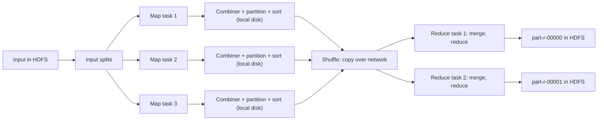
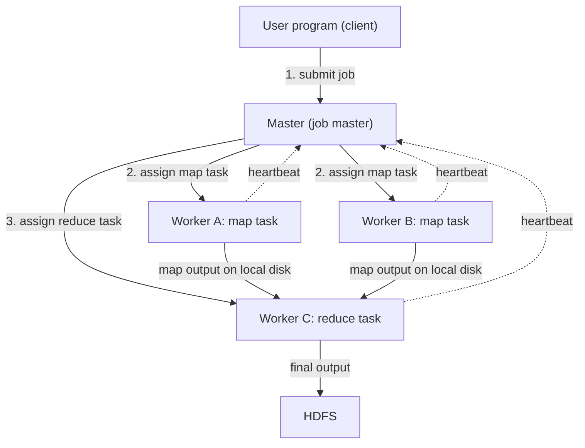
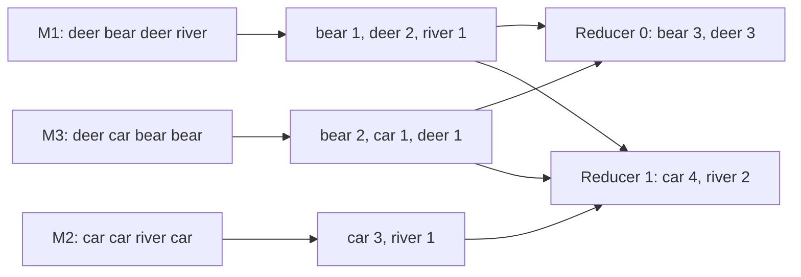
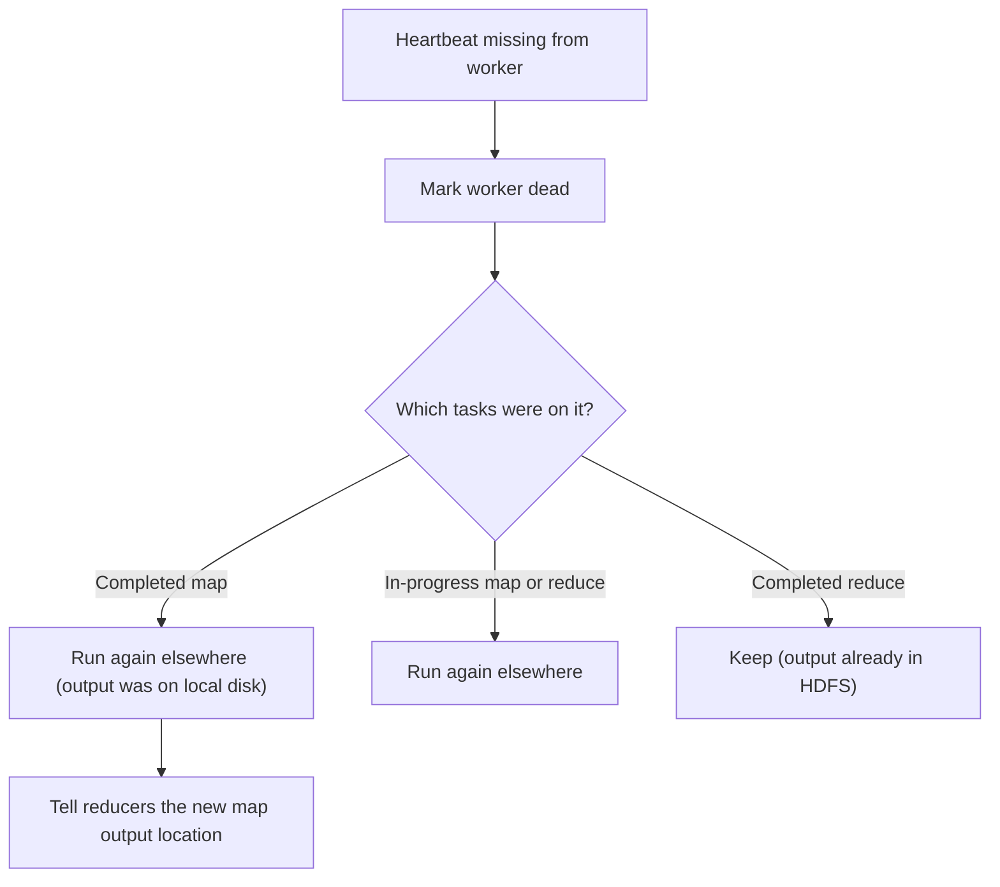

This note is syllabus <Syl m="2" />, "MapReduce: the map tasks, grouping by key, the reduce tasks, combiners, details of MapReduce execution, coping with node failures" and "Hadoop limitations". Matrix and relational algorithms are in the next note.

## The basics first

- A **key-value pair** is two things stuck together: a label (the key) and a number or text that goes with it (the value). Example: (`"car"`, 1) means "I saw the word car once".
- A **cluster** is many computers working as one. A **node** is one computer in it.
- **Parallel** means many nodes each doing a small part at the same time. It is like ten teachers each checking 10 answer sheets instead of one teacher checking 100.
- **HDFS** stores a big file as blocks (128 MB each by default) on many nodes. MapReduce reads its input from HDFS and writes its result to HDFS. See the HDFS note.
- **Data locality** means "send the program to the data, not the data to the program". A program is a few KB. The data is terabytes.

## What MapReduce is and why we need it

**Definition.** MapReduce is a programming model and framework for processing very large data sets in parallel on a cluster of ordinary computers. The programmer writes two functions, **Map** and **Reduce**. The framework does everything else. <Cite id="hadoop-ecosystem-dean2004" /> <Cite id="hadoop-ecosystem-wiki-rdbms-hadoop-mr" /> <Cite id="hadoop-ecosystem-mmds" loc="§2.2" />

**Why it is needed.** Writing a parallel program by hand means solving splitting of data, scheduling, moving data between machines, and recovering from machine failures. These are hard and repetitive. Google engineers noticed that many jobs have the same shape (look at every record, then group and combine), so they hid all the hard parts inside a library. Users then write only the two functions. <Cite id="hadoop-ecosystem-dean2004" loc="§1" />

**Everyday analogy.** Count votes from 1,000 ballot boxes. Each helper takes some boxes and makes small piles, one pile per candidate (this is **map**). All piles for the same candidate are carried to one table (this is **shuffle**). One person at each table adds up the piles (this is **reduce**).

**The idea in one line:** `map: record -> list of (key, value)`, then group by key, then `reduce: (key, list of values) -> result`.

## The map task

<PYQ id="2022-12-ce/q1a" /> <PYQ id="2024-05/q1c" />

The input is cut into pieces called **input splits** (usually one split per HDFS block). One **map task** works on one split. Inside the task, a **RecordReader** turns the split into records (for text, one record is one line). The programmer's **map function** is called once for every record and may emit **zero, one or many** (key, value) pairs. <Cite id="hadoop-ecosystem-mmds" loc="§2.2.1" /> <Cite id="hadoop-ecosystem-apache-mr-tutorial" />

- The map function looks at **one record at a time** and does not see other records. This is why many map tasks can run at the same time on different nodes.
- The output key and value need not have the same type as the input. The keys here are not unique: the same key can be produced many times, by one or many map tasks.
- The framework tries to run each map task **on the node that holds its block** (data locality), or at least in the same rack, so the big data does not cross the network. <Cite id="hadoop-ecosystem-dean2004" loc="§3.4" />
- The output of map is written to the **local disk of that node**, not to HDFS, because it is temporary.

**Example (word count).** Input line `deer bear deer river`. The map function emits (deer, 1), (bear, 1), (deer, 1), (river, 1): one pair for every word.

## Grouping by key (partition, sort, shuffle)

<PYQ id="2025-05-ce/q1b" />

After the map tasks, all pairs with the same key must come together at one place. The framework does this alone. The programmer only chooses the number of reduce tasks, $R$. <Cite id="hadoop-ecosystem-mmds" loc="§2.2.2" />

1. **Partition.** Each map task splits its output into $R$ buckets by applying a **partition function** to the key. The default is `hash(key) mod R`. Same key means same bucket number everywhere, so one key can never be split between two reducers. <Cite id="hadoop-ecosystem-dean2004" loc="§4.1" />
2. **Sort.** Inside each bucket the pairs are sorted by key (the sorting is done on the map side as the buffer is written out).
3. **Shuffle.** Every reduce task **copies** its own bucket from every map task over the network. This is the only big network movement in the job.
4. **Merge.** The reducer merges the sorted pieces so equal keys are next to each other, and builds for each key a list of all its values: (key, [v1, v2, ...]).

So the reduce side receives its keys in **sorted order**, each with the whole list of its values. <Cite id="hadoop-ecosystem-dean2004" loc="§4.2" /> <Cite id="mapreduce-gfg-mr" />

## The reduce task

<PYQ id="2025-05-ce/q1b" /> <PYQ id="2024-05/q1c" />

A **reduce task** takes the groups for the keys of its bucket. The programmer's **reduce function** is called once per key with the key and the list of its values. It combines them (add, count, max, join, and so on) and emits the final (key, result) pairs. Reducer output is written to **HDFS**, one file per reduce task, named `part-r-00000`, `part-r-00001`, and so on. <Cite id="hadoop-ecosystem-mmds" loc="§2.2.3" /> <Cite id="hadoop-ecosystem-apache-mr-tutorial" />

**Example.** Reduce receives (car, [3, 1]) and emits (car, 4).

## Combiners

When one key appears many times in a map task, we send a lot of (car, 1) pairs over the network just to add them later. A **combiner** is a small reduce function that is run **on the mapper's node, on the mapper's own output**, before the shuffle. It adds up (car, 1), (car, 1), (car, 1) to (car, 3) locally, so less data moves. <Cite id="hadoop-ecosystem-mmds" loc="§2.2.4" /> <Cite id="hadoop-ecosystem-dean2004" loc="§4.3" />

- It is a **performance help only**. The answer must be the same with or without it, and Hadoop may run it zero, one or more times.
- It works only when the reduce operation is **associative and commutative** (order and grouping do not matter): sum, count, max, min. It is **wrong for average** unless you pass (sum, count) pairs (see the worked example below).
- Often the combiner is the same code as the reducer (word count). It cannot change the key or value type.

## Details of MapReduce execution (the pipeline)

<PYQ id="2023-12/q4a" /> <PYQ id="2024-05/q4a" /> <PYQ id="2023-12-ce/q4a" /> <PYQ id="2024-12-ce/q3a" /> <PYQ id="2024-12/q4b" /> <PYQ id="2025-05/q2b" />

Components and what each does (the question "write the functions of the components"):

| Component | Function |
|---|---|
| Client | Packages the Map and Reduce code (a JAR), names the input and output paths, and submits the job. |
| Resource manager (YARN ResourceManager; JobTracker in Hadoop 1) | Gives out cluster resources and finds free nodes, preferably near the data. |
| Job master (MRAppMaster in Hadoop 2; the "master controller" in the book) | Runs one job: creates map and reduce tasks, assigns them to workers, tracks their progress and restarts failed ones. |
| Workers (NodeManager with its containers; TaskTracker in Hadoop 1) | Run the map and reduce tasks and send heartbeats. |
| InputFormat, InputSplit, RecordReader | Cut the input into splits and turn each into (key, value) records for map. |
| Mapper | Runs the user's map function on each record. |
| Combiner (optional) | Mini reduce on the map output to shrink it. |
| Partitioner | Chooses the reducer for each key (`hash(key) mod R`). |
| Shuffle and sort | Copies the buckets to the reducers and merges them into sorted groups. |
| Reducer | Runs the user's reduce function on each key group. |
| OutputFormat and HDFS | Write the result files (one per reducer). |

<Cite id="hadoop-ecosystem-apache-yarn" /> <Cite id="hadoop-ecosystem-gfg-hadoop-arch" /> <Cite id="mapreduce-gfg-mr" /> <Cite id="mapreduce-tp" />

**Execution steps.**

1. **Submit.** The client copies the job code and settings to the cluster and submits the job.
2. **Split.** The input is divided into splits. Number of map tasks $M$ = number of splits. The user sets $R$.
3. **Schedule.** The job master asks for resources and starts map tasks, preferring nodes that hold the block (locality). Reduce tasks are started a little later.
4. **Map.** Each map task reads its split and calls map on every record. The output is collected in a memory buffer (100 MB by default). When the buffer is about 80% full it is **spilled** to local disk, already partitioned and sorted (and combined if there is a combiner). The spill files are merged at the end. <Cite id="mapreduce-apache-mapred-default" /> <Cite id="hadoop-ecosystem-apache-mr-tutorial" />
5. **Shuffle.** As map tasks finish, the reducers start copying their buckets. Copying may begin early, but the reduce function itself starts only after **all** maps are done, because a key may still appear in an unfinished map.
6. **Sort and merge.** Each reducer merges its copies into sorted key groups.
7. **Reduce.** The reduce function runs per key and writes to HDFS.
8. **Finish.** The job master marks the job successful and the client sees the output files.

<Cite id="mapreduce-gfg-mr" loc="diagram" /> <Cite id="mapreduce-tpoint" loc="diagram" />

<Cite id="hadoop-ecosystem-dean2004" loc="Figure 1" /> <Cite id="hadoop-ecosystem-mmds" loc="§2.2.5" />

## Worked sums

### Sum 1. Word count by hand: map, combiner, shuffle, reduce

<Sum>

<Given>

Three map tasks read these three splits. Reduce tasks $R = 2$. Partition function (a toy one, to keep it by hand): `hash(word)` = number of letters in the word, then `hash mod R`.

| Map task | Input split |
|---|---|
| M1 | deer bear deer river |
| M2 | car car river car |
| M3 | deer car bear bear |

</Given>

<Find>

the map output, the output after the combiner, the groups seen by each reducer, the final counts, and how many pairs the combiner saved from the shuffle.

</Find>

<Steps>

**Step 1. Map.** One (word, 1) pair for each word. *Reason: map emits a 1 per word seen.*

| Map task | Map output (4 pairs each, 12 in all) |
|---|---|
| M1 | (deer,1) (bear,1) (deer,1) (river,1) |
| M2 | (car,1) (car,1) (river,1) (car,1) |
| M3 | (deer,1) (car,1) (bear,1) (bear,1) |

**Step 2. Combiner** (same code as reduce, run per mapper). *Reason: add equal keys locally to shrink the data.*

| Map task | After combiner |
|---|---|
| M1 | (bear,1) (deer,2) (river,1) |
| M2 | (car,3) (river,1) |
| M3 | (bear,2) (car,1) (deer,1) |

Pairs to shuffle: $3 + 2 + 3 = 8$ instead of 12.

**Step 3. Partition.** Letters: deer 4, bear 4, river 5, car 3. Mod 2: deer 0, bear 0, river 1, car 1. *Reason: same key always gets the same bucket.* So Reducer 0 gets bear and deer. Reducer 1 gets car and river.

**Step 4. Shuffle and sort.** Each reducer copies its bucket from every mapper and groups by key, in sorted order.

| Reducer | Key | Grouped values (and where from) |
|---|---|---|
| 0 | bear | [1 from M1, 2 from M3] |
| 0 | deer | [2 from M1, 1 from M3] |
| 1 | car | [3 from M2, 1 from M3] |
| 1 | river | [1 from M1, 1 from M2] |

**Step 5. Reduce.** Add the values of each key. *Reason: the reduce function for word count is a sum.*

| Reducer | Output |
|---|---|
| 0 (file part-r-00000) | (bear,3) (deer,3) |
| 1 (file part-r-00001) | (car,4) (river,2) |

</Steps>

<Answer>

bear 3, deer 3, car 4, river 2. The combiner cut the shuffled pairs from 12 to 8 (saved 4).

</Answer>

<Box kind="verify">

Total words in the input are $4 + 4 + 4 = 12$. The counts add to $3 + 3 + 4 + 2 = 12$, so no word was lost.

Count each word directly in the input: deer appears 2 times in M1 and 1 in M3, so 3. bear: 1 in M1 and 2 in M3, so 3. car: 3 in M2 and 1 in M3, so 4. river: 1 in M1 and 1 in M2, so 2. All match.

Pairs saved: M1 had 4 and now 3 (saved 1, the two deers merged), M2 had 4 and now 2 (saved 2), M3 had 4 and now 3 (saved 1, the two bears merged). $1 + 2 + 1 = 4$, and $12 - 8 = 4$.

</Box>

</Sum>

<Cite id="mapreduce-gfg-wordcount" loc="diagram" /> <Cite id="mapreduce-av" loc="diagram" />

### Sum 2. How many map and reduce tasks, and how many output files

<Sum>

<Given>

An input file of 1,300 MB in HDFS, block size 128 MB, one split per block. The user sets $R = 3$ reduce tasks.

</Given>

<Find>

the number of map tasks, the size of the last split, and the number of output files.

</Find>

<Steps>

1. **Map tasks.** $1300 \div 128 = 10.16$, and a partly filled block still needs a task, so round up: 11. *Reason: one map task per split.*
2. **Last split.** 10 full splits hold $10 \times 128 = 1280$ MB, so the last has $1300 - 1280 = 20$ MB. *Reason: what is left over.*
3. **Output files.** One per reduce task, so 3 (`part-r-00000` to `part-r-00002`). *Reason: each reducer writes its own file.*

</Steps>

<Answer>

11 map tasks (the last on 20 MB), 3 reduce tasks, 3 output files.

</Answer>

<Box kind="verify">

$11 \times 128 = 1408 \ge 1300$ but $10 \times 128 = 1280 < 1300$, so 11 is the smallest number of splits that covers the file. In Hadoop's FileInputFormat a small leftover is merged into the previous split only if the merged split would be at most 10% bigger than a block (up to 140.8 MB). Here the merged split would be $128 + 20 = 148$ MB, which is over that limit, so the 20 MB stays a separate split.

</Box>

</Sum>

### Sum 3. Why a combiner is wrong for average (and the fix)

<Sum>

<Given>

Values for one key: map task A has 1, 2, 3 and map task B has 10.

</Given>

<Find>

the true average, the average if each mapper blindly sends its own average to the reducer, and the correct way with a combiner.

</Find>

<Steps>

1. **True average.** $(1+2+3+10) \div 4 = 16 \div 4 = 4$.
2. **Wrong combiner (average of averages).** A sends average 2, B sends average 10. Reducer: $(2 + 10) \div 2 = 6$. *Reason: it gives A (3 values) and B (1 value) equal weight.* This is not 4.
3. **Correct way.** Combiners send (sum, count): A sends (6, 3), B sends (10, 1). *Reason: sums and counts can be added in any order.*
4. **Reducer** adds both parts: sum $6 + 10 = 16$, count $3 + 1 = 4$, and divides: $16 \div 4 = 4$.

</Steps>

<Answer>

true average 4; the average-of-averages gives 6 (wrong); the (sum, count) method gives 4 (right).

</Answer>

<Box kind="verify">

The (sum, count) result equals the direct result (16 and 4 are the totals of the whole data), so it does not depend on how the values were split between mappers. Try splitting as (1, 2) and (3, 10): sums 3 and 13, counts 2 and 2, total 16 and 4, average 4 again. The average-of-averages would give $(1.5 + 6.5) \div 2 = 4$ here by luck, but it fails for the split above, so it is not safe.

</Box>

</Sum>

### Sum 4. How many tasks must run again after a node failure

<Sum>

<Given>

A job has 11 map tasks and 3 reduce tasks. One worker node crashes. It had: 2 map tasks that were **completed**, 1 map task **in progress**, 1 reduce task **completed** and 1 reduce task **in progress**.

</Given>

<Find>

how many tasks must be run again.

</Find>

<Steps>

1. **Completed map tasks: 2 re-run.** Their output was on the dead node's local disk and is lost. *Reason: map output is not stored in HDFS.*
2. **In-progress map task: 1 re-run.** The work was not finished. *Reason: partial output is useless.*
3. **In-progress reduce task: 1 re-run.** The work was not finished.
4. **Completed reduce task: 0 re-run.** Its output is already in HDFS (with copies on other nodes). *Reason: HDFS replicates it.*
5. Total $2 + 1 + 1 + 0 = 4$.

</Steps>

<Answer>

4 tasks are re-run on other nodes. The completed reduce task is not re-run.

</Answer>

<Box kind="verify">

Count the other way: the node ran 5 tasks in all (2 + 1 + 1 + 1), and only the one whose output sits safely in HDFS is kept, so $5 - 1 = 4$. Also, the reducers that were already reading the lost map outputs are told the new location when the maps run again. <Cite id="hadoop-ecosystem-dean2004" loc="§3.3" />

</Box>

</Sum>

## Coping with node failures

<PYQ id="2024-12/q1d" /> <PYQ id="2023-12-ce/q1c" />

With thousands of cheap machines, some machine is always failing, so the framework treats failure as normal. <Cite id="hadoop-ecosystem-mmds" loc="§2.2.6" />

**1. Compute node (worker) fails.**

- The master notices because the worker stops sending **heartbeats** (a small "I am alive" message every few seconds). <Cite id="hadoop-ecosystem-dean2004" loc="§3.3" />
- All map tasks of that node, **finished or not**, are marked idle and given to other nodes. Their output was on the dead local disk.
- Its unfinished reduce tasks are rescheduled. Finished reduce tasks are not repeated because the output is in HDFS.
- Reducers that have not yet fetched a lost map output are told where the re-run copy is.
- The data itself is safe because HDFS keeps 3 copies of every block, so the re-run map task reads another copy. <Cite id="hadoop-ecosystem-apache-hdfs-design" />

**2. A task fails (code error, bad record, out of memory).** The task is retried, usually on another node. After the allowed number of attempts (4 for a map or reduce task by default) the whole job is declared failed. A task that sends no progress for 10 minutes (the default timeout) is treated as hung and killed. <Cite id="mapreduce-apache-mapred-default" />

**3. Slow node (straggler).** A machine with a bad disk may run a task very slowly and delay the whole job. Near the end of the job the master starts **backup copies** of the slow tasks on other nodes; the first copy to finish wins and the other is killed. This is **speculative execution**. It is on by default. <Cite id="hadoop-ecosystem-dean2004" loc="§3.6" /> <Cite id="mapreduce-apache-mapred-default" />

**4. The master fails.**

- Hadoop 1: the JobTracker was one machine; if it died all running jobs were lost.
- Hadoop 2 and later with YARN: each job has its own ApplicationMaster; if it fails YARN restarts it (2 attempts by default) and finished tasks need not be redone. The ResourceManager can be made highly available. <Cite id="hadoop-ecosystem-apache-yarn" /> <Cite id="mapreduce-apache-mapred-default" />
- In the original paper the master writes checkpoints, so a new master can start from the last one; since there is only one master, failure is unlikely and the implementation simply aborts the job and lets the client retry. <Cite id="hadoop-ecosystem-dean2004" loc="§3.3" />

<Cite id="mapreduce-gfg-mr" loc="diagram" />

| Failure | Detected by | Action |
|---|---|---|
| Task fails | exception or exit code | retry, up to 4 attempts, then job fails |
| Task hangs | no progress for 10 minutes | kill and retry |
| Worker node dies | missing heartbeats | re-run its map tasks (all) and its unfinished reduce tasks |
| Slow worker | progress much slower than others | speculative backup copy |
| Job master dies | YARN | restart the ApplicationMaster (Hadoop 2+) |

## Hadoop limitations

<PYQ id="2024-12/q1c" />

<Cite id="mapreduce-gfg-proscons" /> <Cite id="hadoop-ecosystem-wiki-hadoop" /> <Cite id="hadoop-ecosystem-ibm-hadoop" />

- **Batch only.** A job takes seconds to minutes just to start and finish. Hadoop MapReduce is not for real-time answers or streams.
- **Disk heavy, slow for iterative work.** Each MapReduce job writes its output to disk and the next job reads it again. Machine learning and graph algorithms that repeat many times become very slow. Spark keeps data in memory to fix this. <Cite id="hadoop-ecosystem-apache-spark" />
- **Small files problem.** The NameNode keeps every file's metadata in memory, and each small file gets its own map task, so millions of small files overload the NameNode and waste task start-up time. <Cite id="hdfs-cloudera-small" />
- **Only two stages, hard to code.** Everything must be forced into map and reduce. Even simple jobs like a join take long Java code. Hive and Pig were made to hide this.
- **Not for low-latency or random access, and no transactions.** HDFS writes once and appends; there are no random updates.
- **Security and administration.** Needs skilled setup (Kerberos, many config files), and clusters use a lot of power.
- **Single master weakness in Hadoop 1** (NameNode and JobTracker), solved later by HA and YARN.
- **Shuffle is costly.** Moving the intermediate data over the network is the slowest part of many jobs.

## Real-life uses

Counting words and building a search index (the original use at Google), counting page visits in web logs, sorting huge data, finding frequent items in sales data, and building the link table for PageRank. <Cite id="hadoop-ecosystem-dean2004" loc="§2.3" /> <Cite id="mapreduce-ibm" />

## Exam-ready comparison

| Point | Map task | Reduce task |
|---|---|---|
| Input | one input split (records) | groups of (key, list of values) from the shuffle |
| Function | called once per record | called once per key |
| Output | any number of (key, value) pairs | final (key, result) pairs |
| Output stored | local disk of the node | HDFS |
| Number | one per split (file size / block size) | chosen by the user ($R$) |
| After node failure | re-run even if finished | re-run only if not finished |

| Point | Combiner | Reducer |
|---|---|---|
| Runs on | the mapper's node, on its own output | the reducer node, on all data for a key |
| Purpose | reduce data sent through the network | produce the final result |
| Required? | no, optional and not guaranteed to run | yes |
| Condition | operation must be associative and commutative | none |

| Point | Hadoop 1 | Hadoop 2 and later |
|---|---|---|
| Resource and job control | JobTracker (one, for everything) | YARN ResourceManager plus a per-job ApplicationMaster |
| Worker daemon | TaskTracker (fixed map and reduce slots) | NodeManager (flexible containers) |
| Master failure | whole job lost | ApplicationMaster restarted, ResourceManager can be HA |

## Conclusion

MapReduce lets a programmer process terabytes by writing only a map function (record to key-value pairs) and a reduce function (key and its values to a result), while the framework splits the input, runs tasks near the data, groups by key through partition-sort-shuffle, and recovers from failures by re-running tasks, backing up slow ones and restarting masters. Its weaknesses are batch-only operation, repeated disk writes and the small files problem.
