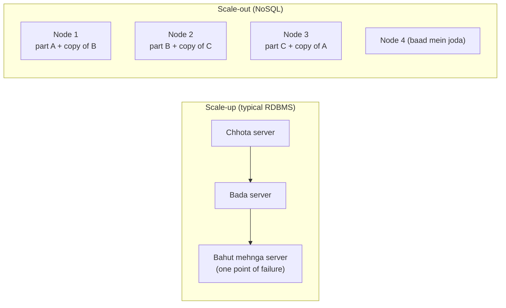
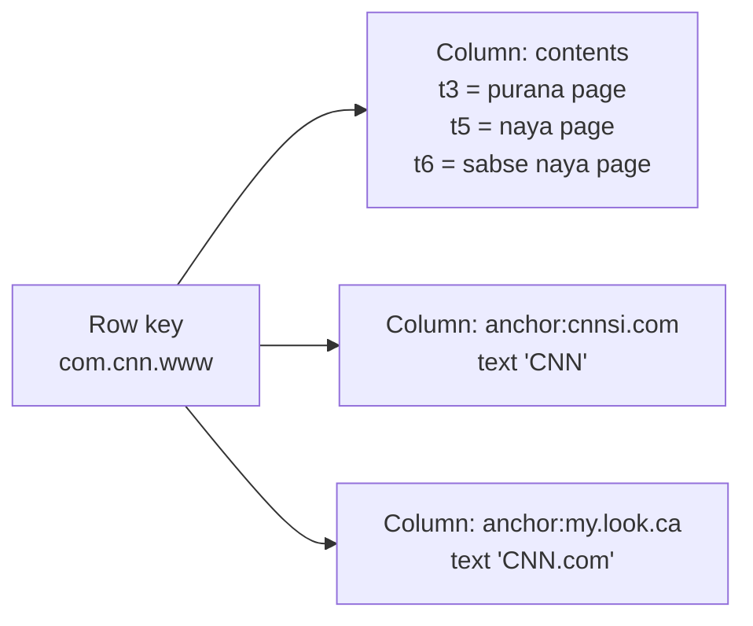
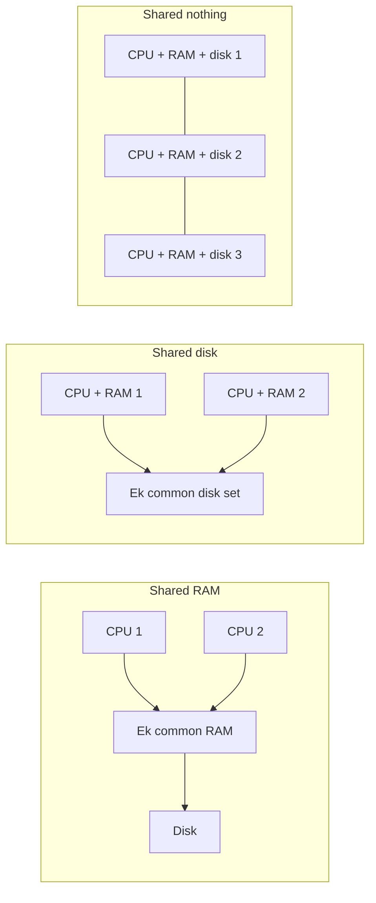
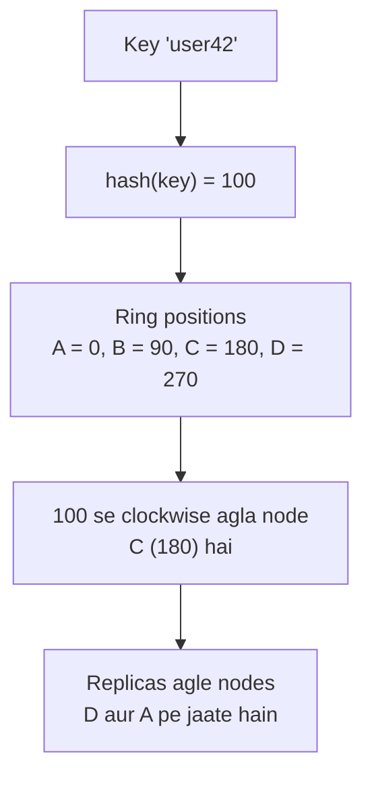
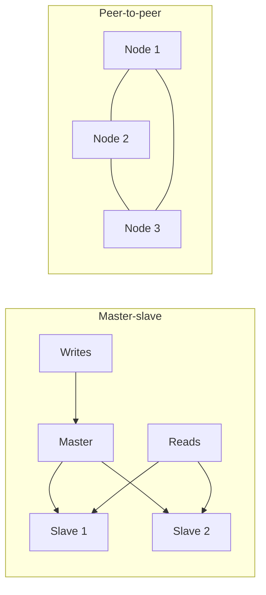
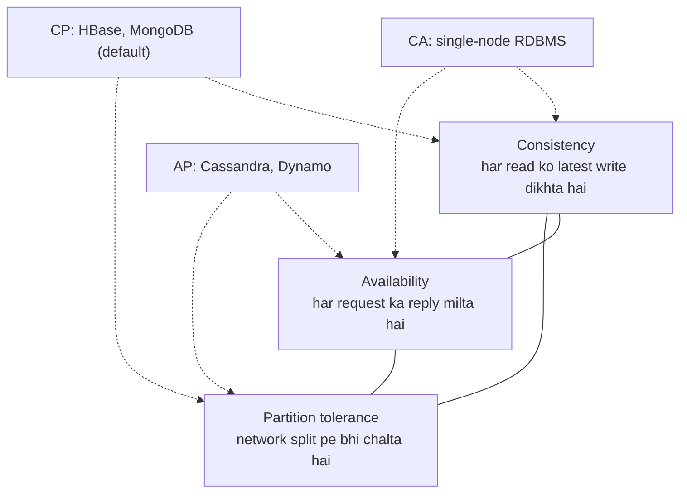

## Pehle basics

- **Relational database (RDBMS)** data ko **tables** mein rakhta hai jisme rows aur columns hote hain. Columns pehle se **schema** se fixed hote hain. Sawaal **SQL** mein poochte hain aur tables ko **join** se milate hain.
- **Transaction** steps ka ek group hai jo ya to sab hote hain ya koi nahi (paise bhejna: ek account se ghatao aur doosre mein badhao).
- **Node** ek machine hai. **Cluster** network se jude kai nodes hain jo saath kaam karte hain.
- **Scale-up (vertical)** matlab ek badi single machine khareedna. **Scale-out (horizontal)** matlab zyada ordinary machines jodna. <Cite id="big-data-intro-nosql" />
- **Replication** matlab same data ki copies kai nodes pe rakhna. **Sharding** matlab data ko hisson mein kaatna aur har hissa alag node pe rakhna. <Cite id="nosql-intro-wiki-sharding" />

## NoSQL kya hai

**Ye kya hai.** NoSQL ko "Not only SQL" padhte hain. Ye databases ka ek group hai jo RDBMS ka fixed table-aur-join model use nahi karte. Ye data ko key-value pairs, documents, wide columns ya graphs mein rakhte hain, aur sasti machines ke cluster pe chalne ke liye bane hain. Ye syllabus <Syl m="3" /> hai, "Introduction to NoSQL". <Cite id="big-data-intro-wiki-nosql" /> <Cite id="nosql-intro-ibm-nosql" /> <Cite id="nosql-intro-gfg-intro" />

**Ye kyun zaroori hai.** RDBMS us zamane mein bana jab saara data ek server pe hota tha. Ye paise, orders aur marks ke liye bahut accha hai, jahan data neat hota hai aur correctness sabse important hai. Par jab data terabytes tak badh jaye, tez aaye, aur har record alag dikhe, to ek server nahi sambhal paata, aur RDBMS ko kai servers pe todna mushkil aur mehnga hai. NoSQL kuch RDBMS features (joins, strict transactions) chhodkar easy scale-out aur flexible data deta hai. <Cite id="big-data-intro-nosql" /> <Cite id="nosql-intro-aws-nosql" />

**Roz ki analogy.** Ek single dukaan jisme ek bahut bada counter hai (RDBMS scale-up) versus kai chhoti dukaanon ki chain jo apna apna area sambhalti hain (NoSQL scale-out). Customers double hon to chain bas nayi chhoti dukaanein kholti hai; single dukaan ko apna counter dobara banana padta hai.

**Chaar main types** (details agle note mein): key-value (jaise Redis), document (MongoDB), column-family (Bigtable, HBase, Cassandra) aur graph (Neo4j). <Cite id="nosql-intro-redis" /> <Cite id="big-data-intro-mongo" /> <Cite id="nosql-intro-hbase" /> <Cite id="nosql-intro-neo4j" />

### SQL versus NoSQL

<PYQ id="2024-12/q1b" /> <PYQ id="2025-05/q1c" />

| Point | SQL (relational) | NoSQL |
|---|---|---|
| Data model | Rows aur columns wali tables | Key-value, document, column family ya graph |
| Schema | Pehle se fixed; badalna slow | Flexible ya schema-less; har record alag ho sakta hai |
| Query language | SQL, sab products mein same | Common language nahi; har product ka apna API |
| Scaling | Mostly scale-up (badi machine); scale-out mushkil | Kai sasti servers pe scale-out |
| Transactions | Poora ACID | Aksar limited ACID; kai BASE (eventual consistency) use karte hain |
| Joins | Strong support | Kamzor ya nahi; data saath rakhte hain isliye joins ki zarurat nahi |
| Best for | Structured data jahan correctness strict ho (banking, ERP) | Bahut bada, tez, alag-alag data (social media, logs, catalogues) |
| Examples | MySQL, Oracle, PostgreSQL | MongoDB, Cassandra, Redis, Neo4j |

Dono mein se koi bhi har case mein "better" nahi hai. Kai real systems dono use karte hain, ise **polyglot persistence** kehte hain: application ka har hissa wo database use karta hai jo uske data ko suit kare. <Cite id="nosql-intro-fowler-poly" /> <Cite id="nosql-intro-gfg-sqlvs" /> <Cite id="nosql-intro-aws-nosql" />

Study sites ki SQL-versus-NoSQL pictures se redraw kiya. <Cite id="nosql-intro-gfg-sqlvs" loc="diagram" /> <Cite id="nosql-intro-aws-nosql" loc="diagram" />

## NoSQL business drivers

<PYQ id="2023-05-ce/q1b" /> <PYQ id="2024-05-ce/q1c" /> <PYQ id="2024-12-ce/q1c" />

McCreary aur Kelly NoSQL movement ke peeche chaar business drivers batate hain. **Business driver** ek business need hai jo company ko apni technology badalne pe majboor karti hai. <Cite id="big-data-intro-nosql" />

| Driver | Business need | RDBMS ko kyun dikkat hoti hai | NoSQL kya karta hai |
|---|---|---|---|
| **Volume** | Data gigabytes se terabytes aur usse bhi zyada ho jata hai (clicks, sensors, posts) | Ek server ki limit hoti hai; bada server bahut mehnga | Kai sasti nodes pe scale out |
| **Velocity** | Bahut tez reads aur writes, aur achanak users ka bhaari load (sale, viral post) | Heavy load mein strict locking aur joins slow ho jaate hain | Key se simple access, data nodes pe failaya hua, relaxed consistency |
| **Variability** | Alag-alag shape ka data: kuch records mein wo fields hain jo doosron mein nahi, aur nayi fields aati rehti hain | Har row ko fixed schema mein fit hona padta hai; bahut saare empty (NULL) columns; schema badalna dard hai | Flexible, schema-less records |
| **Agility** | Teams ko features jaldi release karne hain aur data layout aksar badalna hai | Code ke objects ko tables mein map karna (object-relational mismatch) aur schema badalna developers ko slow karta hai | Object ko jaisa hai waisa store karo (jaise JSON document) |

**Short mein.** Volume aur velocity speed aur size ke baare mein hain; variability aur agility change ke baare mein. Saath mein inhone kaha: "data model simple rakho, data ko paas-paas store karo, aur machines jodkar badho." <Cite id="big-data-intro-nosql" /> <Cite id="nosql-intro-fowler-agg" />

<Box kind="exam">

Exam mein English mein likho: "The core business drivers of NoSQL are volume, velocity, variability and agility. Relational databases scale up and have a rigid schema, whereas NoSQL scales out and is flexible." Phir table do, har driver ki ek line ke saath.

</Box>

## Case studies: NoSQL-style systems ne business problems kaise solve ki

<PYQ id="2022-12-ce/q1b" /> <PYQ id="2025-05-ce/q1c" />

Dono questions wahi chaar cheezein poochte hain: business **problem**, **driver**, use kaise faster, cheaper aur zyada effectively **solve** kiya, aur **findings**.

### Google ka MapReduce

- **Problem.** Google ko bahut bada crawled data process karna tha (web index ke raw documents 20 terabytes se zyada the). Purana code parallel kaam ad-hoc tareeke se karta tha, aur har programmer ko failures aur data distribution khud sambhalna padta tha. <Cite id="big-data-intro-mapreduce" />
- **Drivers.** Volume (har job mein terabytes), velocity (results jaldi chahiye) aur cost (special hardware ki jagah sasti machines).
- **Solution.** MapReduce: programmer sirf ek **map** function aur ek **reduce** function likhta hai. Library input ko split karti hai, kai machines pe map tasks chalati hai, results ko key se group karti hai, reduce tasks chalati hai, aur failures aur distribution chhupa leti hai. Ye commodity PCs ke bade clusters pe chalta hai aur computation ko wahan le jaata hai jahan data stored hai. <Cite id="big-data-intro-mapreduce" /> <Cite id="big-data-intro-gfs" />
- **Findings** (paper se).
  - Faster: lagbhag 1 TB pe search mein lagbhag 150 seconds aur lagbhag 1 TB ke sort mein 891 seconds lage, lagbhag 1800 machines ke cluster pe.
  - Simpler aur cheaper: indexing code ka ek phase lagbhag 3800 lines C++ se ghatkar lagbhag 700 reh gaya. Jo change purane system mein mahino leta tha wo kuch dinon mein ho gaya.
  - Zyada effective: machine failures aur slow machines apne aap handle hote hain, aur machines jodne se hi performance badh jaati hai.
  - Widely used: sau-do-sau programs, us waqt Google mein roz ek hazaar se zyada jobs. <Cite id="big-data-intro-mapreduce" loc="§5, §6.1" />

### Google ka Bigtable

- **Problem.** Google ke kai products (web indexing, Google Earth, Google Finance, Analytics) ko alag-alag size ka structured data store karna tha, chhote URLs se satellite images tak, aur kuch ko fast serving chahiye thi jabki doosron ko bulk processing. RDBMS petabytes tak scale nahi kar sakta tha. <Cite id="nosql-intro-bigtable" />
- **Drivers.** Volume (petabytes), velocity (real-time serving), variability (har product ka data alag shape ka) aur agility (kai teams ke liye ek flexible store).
- **Solution.** Bigtable, ek distributed storage system jo hazaaron commodity servers pe scale karta hai. Iska data model ek sparse, distributed, sorted map hai jo **row key, column key aur timestamp** se index hota hai. Ye apni files GFS pe rakhta hai aur master chunne ke liye lock service (Chubby) use karta hai. <Cite id="nosql-intro-bigtable" /> <Cite id="nosql-intro-wiki-bigtable" />
- **Findings.** August 2006 tak sixty se zyada Google projects ise use kar rahe the; users ko iski performance aur high availability pasand aayi; capacity bas machines jodkar badh jaati hai; aur clients ko data layout pe control milta hai. Isi se open-source HBase aur Cassandra ko inspiration mila. <Cite id="nosql-intro-bigtable" /> <Cite id="nosql-intro-hbase" />

Bigtable paper ki Figure 1 se redraw kiya. <Cite id="nosql-intro-bigtable" loc="diagram" /> <Cite id="nosql-intro-wiki-bigtable" loc="diagram" />

## Big data handle karna: pehle problem samjho

Har big data problem same nahi hoti, isliye database ko kaam ke hisaab se chunna padta hai. Common groups hain: read-mostly lookups (product catalogue), write-heavy streams (logs aur sensor events), text search, aur bade data sets ka analysis. Har group ko speed, consistency aur storage ka alag mix chahiye. Isiliye ek NoSQL product sab pe fit nahi hota, aur agla note patterns padhta hai. <Cite id="big-data-intro-nosql" /> <Cite id="nosql-intro-fowler-poly" />

## Resources share karne ke teen tareeke, aur shared-nothing

<PYQ id="2022-12-ce/q2a" />

Computer system ke teen main resources hain: **RAM**, **disk** aur **CPU**. Jab kai processors saath kaam karte hain to ye teen tareeke se share kar sakte hain: <Cite id="big-data-intro-nosql" /> <Cite id="nosql-intro-wiki-sn" />

1. **Shared RAM (shared memory).** Kai CPUs ek common memory aur ek operating system use karte hain (bada multiprocessor machine). Simple hai, par memory bus bottleneck banta hai aur machine mehngi hoti hai.
2. **Shared disk.** Har CPU ki apni RAM hai par sab ek common disks ka set use karte hain (storage network). Disk bottleneck aur single point of failure ban jaata hai.
3. **Shared nothing.** Har node ka apna CPU, RAM aur disk hai aur doosron se sirf network pe baat karta hai. Koi common resource nahi, to kisi ka intezaar nahi.

**Big data solutions ka architecture shared-nothing hai.** Kyunki har node independent hai: <Cite id="big-data-intro-nosql" /> <Cite id="nosql-intro-wiki-sn" />

- Data nodes ke beech split (shard) hota hai, aur har node apne hisse ke sawaalon ka jawab deta hai.
- Nodes jodne se capacity aur speed lagbhag seedhi line mein badhti hai.
- Ek node fail ho to baaki nahi rukte; uske data ki copies kahin aur hoti hain.
- Sasti commodity machines use ho sakti hain, isliye cost kam. Hadoop, Cassandra, MongoDB aur Bigtable sab ise use karte hain. <Cite id="big-data-intro-mapreduce" /> <Cite id="nosql-intro-dynamo" />

**Disadvantage.** Joins aur transactions jo kai nodes ko chhute hain wo slow aur complex hote hain, isliye NoSQL related data ko saath rakhta hai.

<Sum>

<Given>

Ek file 1 TB ki (1 TB ko $1{,}000{,}000$ MB maan lo). Ek disk $100$ MB per second padhti hai. Shared-nothing cluster mein file 50 nodes pe barabar split hai, har node ki apni disk hai, aur sab ek saath padhte hain.

</Given>

<Find>

ek machine pe read time, cluster pe read time, aur speed-up.

</Find>

<Steps>

1. Ek machine: time $= 1{,}000{,}000 \div 100 = 10{,}000$ seconds. *Reason: time = data divided by speed.*
2. Hours mein: $10{,}000 \div 3600 \approx 2.78$ hours.
3. Har node ka hissa: $1{,}000{,}000 \div 50 = 20{,}000$ MB. *Reason: file barabar split hai.*
4. Har node apna hissa $20{,}000 \div 100 = 200$ seconds mein padhta hai, aur sab ek saath kaam karte hain, to cluster time 200 seconds (lagbhag 3.3 minutes) hai.
5. Speed-up $= 10{,}000 \div 200 = 50$.

</Steps>

<Answer>

ek machine 10,000 s (lagbhag 2.78 h); cluster 200 s; speed-up 50 guna.

</Answer>

<Box kind="verify">

Cluster har second mein kul $50 \times 100 = 5{,}000$ MB padhta hai, aur $1{,}000{,}000 \div 5{,}000 = 200$ s, wahi answer. Speed-up nodes ki sankhya ke barabar hai, jaisa expected hai jab kuch share nahi hota. Real life mein network aur start-up cost ki wajah se thoda kam hota hai.

</Box>

</Sum>

## NoSQL systems big data problems ko handle karne ke chaar tareeke

<PYQ id="2023-12-ce/q2a" /> <PYQ id="2025-05/q6d" />

McCreary aur Kelly chaar tareeke batate hain jinse NoSQL systems big data sambhalte hain: <Cite id="big-data-intro-nosql" />

1. **Query ko data ke paas bhejo, data ko query ke paas nahi.** Terabytes ko network pe bhejna slow hai. Iski jagah chhoti query har node ko bhejo, wo apne local data mein dhoondhe, aur sirf chhote answers wapas aayein. MapReduce yahi karta hai jab wo task ko usi node pe chalata hai jahan block stored hai. <Cite id="big-data-intro-mapreduce" /> <Cite id="nosql-intro-wiki-sharding" />
2. **Data ko cluster mein barabar baantne ke liye hash rings use karo.** Hash function key ko number mein badalta hai. Numbers ek circle (ring) pe rakhe jaate hain aur har node ring ka ek hissa own karta hai. Key us pehle node pe store hoti hai jo uski hash value se ghoomte hue milta hai. Nodes aa-ja sakte hain aur data ka sirf chhota hissa hilta hai. <Cite id="nosql-intro-dynamo" /> <Cite id="nosql-intro-cassandra-dynamo" />
3. **Reads scale karne ke liye replication use karo.** Data ke har tukde ki kai copies alag nodes pe rakho. Reads kisi bhi copy pe ja sakte hain, to zyada copies matlab zyada reads per second, aur copies node failure se bhi bachati hain. <Cite id="nosql-intro-mongo-repl" /> <Cite id="big-data-intro-cassandra" />
4. **Database queries ko data nodes pe barabar baante.** Ek router ya nodes khud har request ko aise node pe bhejte hain jiske paas data hai aur jo busy nahi hai, to koi node hot spot nahi banta. <Cite id="nosql-intro-mongo-shard" />

Dynamo paper aur Cassandra docs ki hash-ring pictures se redraw kiya. <Cite id="nosql-intro-dynamo" loc="diagram" /> <Cite id="nosql-intro-cassandra-dynamo" loc="diagram" />

**Hash ring kyun, `hash mod N` kyun nahi?** `hash mod N` mein nodes ki sankhya N badalte hi lagbhag har key ka ghar badal jaata hai. Ring mein sirf kuch hi hilti hain. Agla sum ye dikhata hai.

<Sum>

<Given>

Case 1: aath keys, hash values $4, 5, 6, 7, 8, 9, 10, 11$, `hash mod N` se rakhi gayi hain. Cluster $N=3$ se $N=4$ nodes ho jaata hai.

Case 2: ring jisme nodes A $=0$, B $=90$, C $=180$, D $=270$. Key hash se clockwise pehle node pe jaati hai jo hash ke barabar ya uske baad ho (270 ke baad A pe wrap hota hai). Keys: k1 $=50$, k2 $=100$, k3 $=200$, k4 $=300$, k5 $=130$. Naya node E $150$ pe joda jaata hai.

</Given>

<Find>

dono cases mein kitni keys apna node badalti hain.

</Find>

<Steps>

1. Case 1, $N=3$: $4,5,\dots,11$ ko 3 se divide karne ke remainders $1,2,0,1,2,0,1,2$ hain.
2. Case 1, $N=4$: $4,5,\dots,11$ ko 4 se divide karne ke remainders $0,1,2,3,0,1,2,3$ hain.
3. Har pair compare karo: $1\ne0$, $2\ne1$, $0\ne2$, $1\ne3$, $2\ne0$, $0\ne1$, $1\ne2$, $2\ne3$. Aathon alag hain, to aathon keys hilti hain.
4. Case 2, E se pehle: k1 $=50\to$ B (90); k2 $=100\to$ C (180); k3 $=200\to$ D (270); k4 $=300\to$ wrap hoke A (0); k5 $=130\to$ C (180).
5. Case 2, E (150) ke baad: k1 $\to$ B; k2 $=100\to$ E (150); k3 $\to$ D; k4 $\to$ A; k5 $=130\to$ E (150). *Reason: ab 100 aur 130 ke baad pehla node E hai.*
6. Sirf k2 aur k5 badli (dono C se E pe). Yaani 5 mein se 2.

</Steps>

<Answer>

`hash mod N`: 8 mein se 8 keys hilti hain (100%). Hash ring: 5 mein se 2 keys hilti hain, aur sirf wahi jinki hash 91 aur 150 ke beech hai, jo C ki thi.

</Answer>

<Box kind="verify">

Ring pe naya node E (150) sirf wahi keys le sakta hai jinki hash $(90, 150]$ mein ho, B aur E ke beech ka hissa jo pehle C ka tha. Humari keys mein sirf 100 aur 130 is range mein hain, aur 50, 200 aur 300 bahar hain, jo result se match karta hai.

</Box>

</Sum>

## Distribution models: master-slave versus peer-to-peer

Jab data kai nodes pe copy hota hai, to system ko tay karna padta hai ki writes kaun lega. <Syl m="3" /> do models batata hai. <Cite id="nosql-intro-fowler-agg" /> <Cite id="big-data-intro-nosql" />

| Point | Master-slave | Peer-to-peer |
|---|---|---|
| Idea | Ek **master** (primary) saari writes leta hai aur **slaves** (secondaries) ko copy karta hai | Saare nodes barabar hain aur har node reads aur writes le sakta hai |
| Reads | Slaves se (reads scale hote hain) | Kisi bhi node se |
| Writes | Sirf master se, isliye writes achhe se scale nahi hote | Kisi bhi node pe, to writes bhi scale hote hain |
| Failure | Writes ke liye master single point of failure hai; naya master chunna padta hai | Single point of failure nahi |
| Consistency | Easy: ek jagah order tay karti hai | Mushkil: do nodes conflicting writes le sakte hain jo baad mein resolve karne padte hain |
| Examples | MongoDB replica set, HBase, HDFS NameNode | Cassandra, Amazon Dynamo |

MongoDB replica sets mein ek primary saari writes leta hai aur secondaries usse copy karti hain. Cassandra aur Dynamo masterless hain: saare nodes barabar. <Cite id="nosql-intro-mongo-repl" /> <Cite id="nosql-intro-cassandra-dynamo" /> <Cite id="nosql-intro-dynamo" />

## CAP theorem aur ACID se difference

<PYQ id="2023-12/q1c" /> <PYQ id="2024-12-ce/q1a" />

**Pehle ACID.** ACID batata hai ki ek single-database transaction se kya promise milta hai: <Cite id="nosql-intro-wiki-acid" />

- **Atomicity**: saare steps hote hain ya koi nahi.
- **Consistency**: data ek valid state se doosri valid state mein jaata hai (rules jaise "balance negative nahi hoga" hamesha sahi rehte hain).
- **Isolation**: saath chalti transactions ek doosre ko disturb nahi karti.
- **Durability**: ek baar save hone ke baad result crash ke baad bhi bacha rehta hai.

**CAP theorem.** Eric Brewer ka CAP theorem kehta hai ki jab network toot jaye to distributed data store ye teeno ek saath nahi de sakta. <Cite id="nosql-intro-wiki-cap" /> <Cite id="nosql-intro-brewer-cap12" /> <Cite id="nosql-intro-gfg-cap" />

- **Consistency (C)**: har read ko latest write dikhta hai (saare nodes same data dikhate hain).
- **Availability (A)**: chalte hue node ko bheji har request ka jawab milta hai.
- **Partition tolerance (P)**: network split hone par bhi system chalta rehta hai, jab nodes aapas mein baat nahi kar paate.

Cluster mein partitions honge hi, isliye P asal mein optional nahi hai. Partition hone par chunna padta hai: correct rehne ke liye kuch requests mana karo (**CP**) ya up rehne ke liye shayad purane data ke saath jawab do (**AP**). Partition na ho to dono mil sakte hain. Brewer khud kehte hain ki "teen mein se do chuno" ek bhramak simplification hai. <Cite id="nosql-intro-brewer-cap12" />

GeeksforGeeks ke CAP triangle se redraw kiya. <Cite id="nosql-intro-gfg-cap" loc="diagram" /> <Cite id="nosql-intro-mongo-cap" /> <Cite id="nosql-intro-ibm-cap" />

**Kai NoSQL systems ACID ki jagah BASE follow karte hain**: **B**asically **A**vailable, **S**oft state, **E**ventually consistent. Thodi der ke liye saari copies alag ho sakti hain, par nayi writes na aayein to sab agree kar jaati hain. <Cite id="nosql-intro-wiki-ec" />

### CAP versus ACID

| Point | ACID | CAP |
|---|---|---|
| Kis baare mein | Database ke andar transactions | Network fail hone par distributed system |
| Properties | Atomicity, Consistency, Isolation, Durability | Consistency, Availability, Partition tolerance |
| "Consistency" ka matlab | Data rules follow karta hai (valid state) | Saare nodes latest value dete hain |
| Goal | Correct transactions | Correctness aur uptime ke beech trade-off |
| Typical systems | RDBMS | Distributed NoSQL stores |
| Style | Pessimistic aur strict | BASE: available, eventually consistent |

<Box kind="pitfall">

ACID ka "C" aur CAP ka "C" alag cheezein hain. ACID consistency matlab rules aur constraints bane rehte hain. CAP consistency matlab saare nodes ko same latest value dikhti hai.

</Box>

**Replicas se consistency tune karna.** Dynamo-style stores $N$ copies rakhte hain. Write ko $W$ copies confirm karti hain aur read $R$ copies se poochta hai. Agar $R + W > N$ ho, to har read set har write set se overlap karta hai, to read ko latest write dikhti hai. <Cite id="nosql-intro-dynamo" /> <Cite id="nosql-intro-cassandra-dynamo" />

<Sum>

<Given>

Ek store har item ki $N = 3$ copies rakhta hai. Teen settings compare karo: (a) $W=2, R=2$; (b) $W=1, R=1$; (c) $W=3, R=1$.

</Given>

<Find>

kaun si settings hamesha latest write return karti hain, aur kiski writes sabse fast hain.

</Find>

<Steps>

1. Rule: read ko latest write zaroor milti hai agar $R + W > N$, kyunki dono sets mein kam se kam $R + W - N$ nodes common hone chahiye.
2. (a) $2 + 2 = 4 > 3$. Overlap kam se kam $4 - 3 = 1$ node. Consistent.
3. (b) $1 + 1 = 2 \not> 3$. Overlap $0$ ho sakta hai: write node 1 pe ho sakti hai aur read node 2 se pooch sakta hai. Guarantee nahi (eventual consistency).
4. (c) $3 + 1 = 4 > 3$. Overlap $= 1$. Consistent.
5. Writes $W$ replies ka intezaar karti hain, to sabse fast writes (b) hain jisme $W=1$, par koi guarantee nahi. Consistent options mein (a) reads aur writes ko balance karta hai; (c) sabse fast reads deta hai par koi ek node down ho to write fail ho jaati hai.

</Steps>

<Answer>

(a) aur (c) hamesha latest write read karte hain; (b) nahi. (b) ki writes sabse fast hain par sirf eventually consistent hai.

</Answer>

<Box kind="verify">

(b) haath se try karo: write sirf node 1 pe gayi, read node 3 se pooche. Node 3 ke paas purani value hai, to read stale hai. (a) try karo: 3 mein se koi bhi 2 nodes likhe aur koi bhi 2 nodes padhe, to unme ek node common hona hi hai (teen cheezon mein se do pairs hamesha overlap karte hain), to read ko nayi value dikhti hai.

</Box>

</Sum>

## NoSQL ke advantages aur limitations

| Advantages | Limitations |
|---|---|
| Sasti machines pe scale out | Joins kamzor ya nahi; related data saath store karna padta hai |
| Flexible schema; badalna fast | Aksar sirf eventual consistency |
| Key se simple reads aur writes fast | Standard query language nahi; har product seekhna padta hai |
| Built-in replication, high availability | SQL ke muqable tools kam mature aur experts kam |
| JSON, graphs aur wide data ko naturally fit karta hai | Data duplicate ho sakta hai, storage zyada lagta hai |

<Cite id="nosql-intro-ibm-nosql" /> <Cite id="nosql-intro-aws-nosql" /> <Cite id="nosql-intro-gfg-intro" />

## Applications

Social media feeds aur likes, product catalogues aur shopping carts, real-time logs aur sensor data, recommendation aur fraud graphs, caching aur session stores, aur bade web indexes (Google ka apna Bigtable use). <Cite id="nosql-intro-bigtable" /> <Cite id="big-data-intro-mongo" /> <Cite id="nosql-intro-neo4j" /> <Cite id="nosql-intro-redis" />

## Conclusion

NoSQL isliye aaya kyunki volume, velocity, variability aur agility single-server relational model se bahar nikal gaye. Shared-nothing clusters, hash rings, replication aur query-to-data processing se wo big data ko sasta sambhalta hai, aur price ye hai ki CAP ki wajah se kuch ACID guarantees chhodni padti hain.
