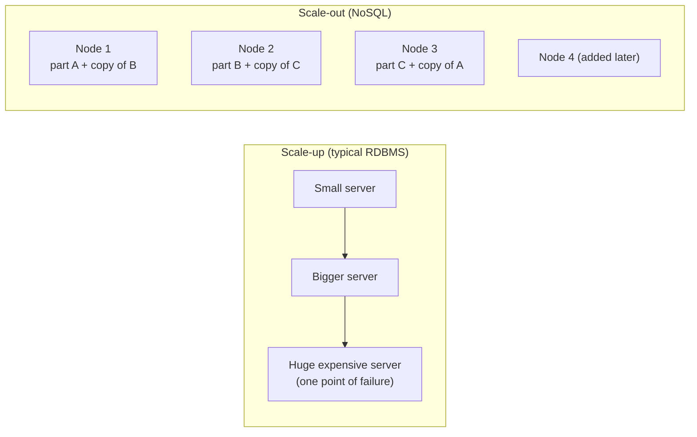
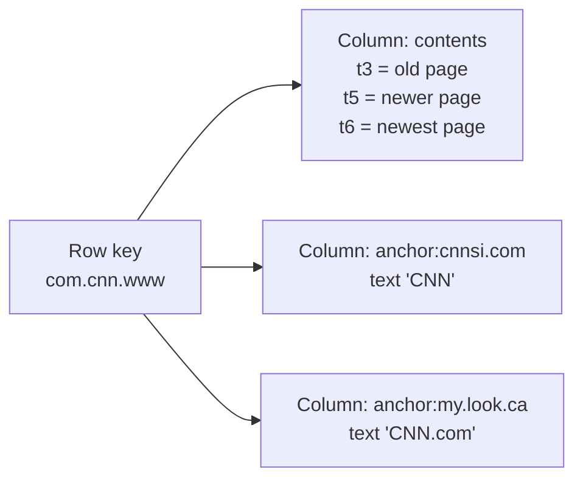
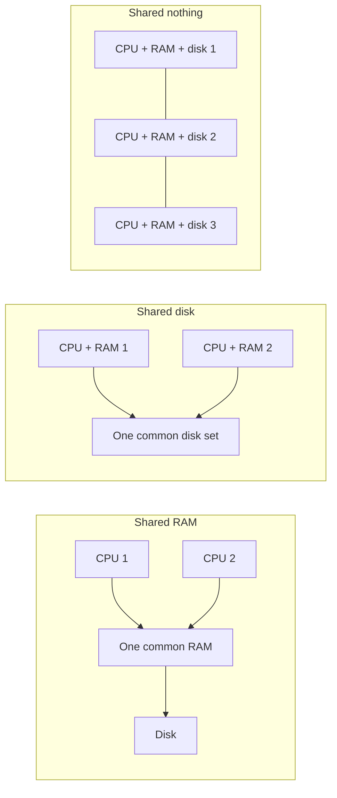
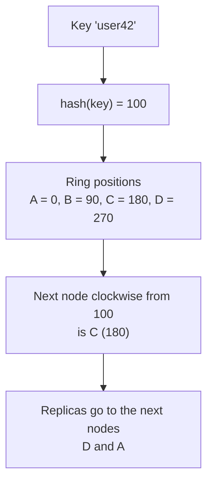
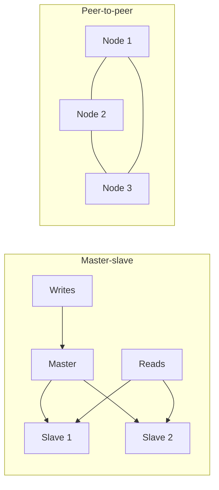
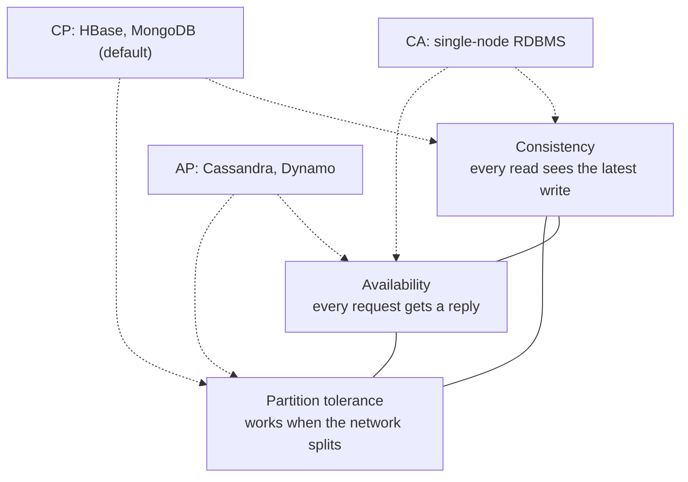

## The basics first

- A **relational database (RDBMS)** keeps data in **tables** of rows and columns. The columns are fixed in advance by a **schema**. You ask questions in **SQL** and combine tables with a **join**.
- A **transaction** is a group of steps that must all happen or none (moving money: subtract from one account and add to another).
- A **node** is one machine. A **cluster** is many nodes working together over a network.
- **Scale-up (vertical)** means buying a bigger single machine. **Scale-out (horizontal)** means adding more ordinary machines. <Cite id="big-data-intro-nosql" />
- **Replication** means keeping copies of the same data on several nodes. **Sharding** means cutting the data into parts and putting each part on a different node. <Cite id="nosql-intro-wiki-sharding" />

## What NoSQL is

**What it is.** NoSQL is read as "Not only SQL". It is a group of databases that do not use the fixed table-and-join model of an RDBMS. They store data as key-value pairs, documents, wide columns or graphs, and they are built to run on a cluster of cheap machines. This is syllabus <Syl m="3" />, "Introduction to NoSQL". <Cite id="big-data-intro-wiki-nosql" /> <Cite id="nosql-intro-ibm-nosql" /> <Cite id="nosql-intro-gfg-intro" />

**Why it is needed.** An RDBMS was designed when one server held all the data. It works very well for money, orders and marks, where the data is neat and correctness matters most. But when data grows to terabytes, arrives fast, and looks different from record to record, one server cannot cope, and splitting an RDBMS over many servers is hard and costly. NoSQL gives up some RDBMS features (joins, strict transactions) to gain easy scale-out and flexible data. <Cite id="big-data-intro-nosql" /> <Cite id="nosql-intro-aws-nosql" />

**Everyday analogy.** A single shop with one huge counter (RDBMS scale-up) versus a chain of many small shops, each serving its own area (NoSQL scale-out). When customers double, the chain just opens new small shops; the single shop must rebuild its counter.

**The four main types** (details are in the next note): key-value (for example Redis), document (MongoDB), column-family (Bigtable, HBase, Cassandra) and graph (Neo4j). <Cite id="nosql-intro-redis" /> <Cite id="big-data-intro-mongo" /> <Cite id="nosql-intro-hbase" /> <Cite id="nosql-intro-neo4j" />

### SQL versus NoSQL

<PYQ id="2024-12/q1b" /> <PYQ id="2025-05/q1c" />

| Point | SQL (relational) | NoSQL |
|---|---|---|
| Data model | Tables with rows and columns | Key-value, document, column family or graph |
| Schema | Fixed in advance; changing it is slow | Flexible or schema-less; each record can differ |
| Query language | SQL, same for all products | No common language; each product has its own API |
| Scaling | Mainly scale-up (bigger server); scale-out is hard | Scale-out over many cheap servers |
| Transactions | Full ACID | Often limited ACID; many use BASE (eventual consistency) |
| Joins | Strong support | Weak or none; data is kept together so joins are not needed |
| Best for | Structured data with strict correctness (banking, ERP) | Huge, fast, varied data (social media, logs, catalogues) |
| Examples | MySQL, Oracle, PostgreSQL | MongoDB, Cassandra, Redis, Neo4j |

Neither is "better" in every case. Many real systems use both, which is called **polyglot persistence**: each part of the application uses the database that suits its data. <Cite id="nosql-intro-fowler-poly" /> <Cite id="nosql-intro-gfg-sqlvs" /> <Cite id="nosql-intro-aws-nosql" />

Redrawn from the SQL-versus-NoSQL pictures on the study sites. <Cite id="nosql-intro-gfg-sqlvs" loc="diagram" /> <Cite id="nosql-intro-aws-nosql" loc="diagram" />

## NoSQL business drivers

<PYQ id="2023-05-ce/q1b" /> <PYQ id="2024-05-ce/q1c" /> <PYQ id="2024-12-ce/q1c" />

McCreary and Kelly name four business drivers behind the NoSQL movement. A **business driver** is a business need that pushes a company to change its technology. <Cite id="big-data-intro-nosql" />

| Driver | The business need | Why a relational database struggles | What NoSQL does |
|---|---|---|---|
| **Volume** | Data grows from gigabytes to terabytes and beyond (clicks, sensors, posts) | One server has a limit; a bigger one costs far more | Scale out over many cheap nodes |
| **Velocity** | Very fast reads and writes, and sudden bursts of users (a sale, a viral post) | Strict locking and joins slow down under heavy load | Simple access by key, data spread over nodes, relaxed consistency |
| **Variability** | Data of many shapes: some records have fields others do not, and new fields appear often | Every row must fit the fixed schema; many empty (NULL) columns; schema changes are painful | Flexible, schema-less records |
| **Agility** | Teams must release features quickly and change the data layout often | Mapping objects in code to tables (the object-relational mismatch) and changing the schema slows developers | Store the object as it is (for example a JSON document) |

**In short.** Volume and velocity are about speed and size; variability and agility are about change. Together they said: "keep the data model simple, store data close together, and grow by adding machines." <Cite id="big-data-intro-nosql" /> <Cite id="nosql-intro-fowler-agg" />

<Box kind="exam">

Exam mein English mein likho: "The core business drivers of NoSQL are volume, velocity, variability and agility. Relational databases scale up and have a rigid schema, whereas NoSQL scales out and is flexible." Then give the table with one line per driver.

</Box>

## Case studies: how NoSQL-style systems solved business problems

<PYQ id="2022-12-ce/q1b" /> <PYQ id="2025-05-ce/q1c" />

Both questions ask the same four things: the business **problem**, the **driver**, how it was **solved** faster, cheaper and more effectively, and the **findings**.

### Google's MapReduce

- **Problem.** Google had to process huge crawled data (the raw documents for its web index were more than 20 terabytes). The old code did parallel work in ad-hoc ways, and every programmer had to handle failures and data distribution. <Cite id="big-data-intro-mapreduce" />
- **Drivers.** Volume (terabytes per job), velocity (results needed quickly) and cost (use cheap machines instead of special hardware).
- **Solution.** MapReduce: the programmer writes only a **map** function and a **reduce** function. The library splits the input, runs map tasks on many machines, groups the results by key, runs reduce tasks, and hides failures and distribution. It runs on large clusters of commodity PCs and moves computation to where the data is stored. <Cite id="big-data-intro-mapreduce" /> <Cite id="big-data-intro-gfs" />
- **Findings** (from the paper).
  - Faster: a search over about 1 TB took about 150 seconds and a sort of about 1 TB took 891 seconds, on a cluster of about 1800 machines.
  - Simpler and cheaper: one phase of the indexing code shrank from about 3800 lines of C++ to about 700. A change that took months in the old system took days.
  - More effective: machine failures and slow machines are handled automatically, and performance improves just by adding machines.
  - Widely used: hundreds of programs, over a thousand jobs a day at Google at the time. <Cite id="big-data-intro-mapreduce" loc="§5, §6.1" />

### Google's Bigtable

- **Problem.** Many Google products (web indexing, Google Earth, Google Finance, Analytics) needed to store structured data of very different sizes, from small URLs to satellite images, and some needed fast serving while others needed bulk processing. An RDBMS could not scale to petabytes. <Cite id="nosql-intro-bigtable" />
- **Drivers.** Volume (petabytes), velocity (real-time serving), variability (different shapes of data per product) and agility (one flexible store for many teams).
- **Solution.** Bigtable, a distributed storage system that scales over thousands of commodity servers. Its data model is a sparse, distributed, sorted map indexed by **row key, column key and timestamp**. It stores its files on GFS and uses a lock service (Chubby) to elect the master. <Cite id="nosql-intro-bigtable" /> <Cite id="nosql-intro-wiki-bigtable" />
- **Findings.** By August 2006 more than sixty Google projects used it; users liked its performance and high availability; capacity grows by simply adding machines; and clients get control over the data layout. It also inspired open-source HBase and Cassandra. <Cite id="nosql-intro-bigtable" /> <Cite id="nosql-intro-hbase" />

Redrawn from Figure 1 of the Bigtable paper. <Cite id="nosql-intro-bigtable" loc="diagram" /> <Cite id="nosql-intro-wiki-bigtable" loc="diagram" />

## Handling big data: understanding the problem first

Not every big data problem is the same, so the database must be matched to the job. Typical groups are: read-mostly lookups (a product catalogue), write-heavy streams (logs and sensor events), searching text, and analysing huge data sets. Each group needs a different mix of speed, consistency and storage. This is why one NoSQL product does not fit all, and why the next note studies the patterns. <Cite id="big-data-intro-nosql" /> <Cite id="nosql-intro-fowler-poly" />

## Three ways to share resources, and shared-nothing

<PYQ id="2022-12-ce/q2a" />

A computer system has three main resources: **RAM**, **disk** and **CPU**. When many processors work together, they can share these in three ways: <Cite id="big-data-intro-nosql" /> <Cite id="nosql-intro-wiki-sn" />

1. **Shared RAM (shared memory).** Many CPUs use one common memory and one operating system (a big multiprocessor machine). Simple, but the memory bus is a bottleneck and the machine is costly.
2. **Shared disk.** Each CPU has its own RAM but all use one common set of disks (a storage network). The disk becomes the bottleneck and a single point of failure.
3. **Shared nothing.** Every node has its own CPU, RAM and disk and talks to others only over the network. No common resource, so nothing to wait for.

**The architecture of big data solutions is shared-nothing.** Because each node is independent: <Cite id="big-data-intro-nosql" /> <Cite id="nosql-intro-wiki-sn" />

- Data is split (sharded) across nodes, and each node answers questions about its own part.
- Capacity and speed grow almost in a straight line as nodes are added.
- One node failing does not stop the others; copies of its data live elsewhere.
- Cheap commodity machines can be used, so it costs less. Hadoop, Cassandra, MongoDB and Bigtable all use it. <Cite id="big-data-intro-mapreduce" /> <Cite id="nosql-intro-dynamo" />

**Disadvantage.** Joins and transactions that touch many nodes are slow and complex, which is why NoSQL keeps related data together.

<Sum>

<Given>

One file of 1 TB (take 1 TB as $1{,}000{,}000$ MB). One disk reads $100$ MB per second. In a shared-nothing cluster the file is split evenly over 50 nodes, each with its own disk, and all read at the same time.

</Given>

<Find>

the read time on one machine, the read time on the cluster, and the speed-up.

</Find>

<Steps>

1. One machine: time $= 1{,}000{,}000 \div 100 = 10{,}000$ seconds. *Reason: time is data divided by speed.*
2. In hours: $10{,}000 \div 3600 \approx 2.78$ hours.
3. Each node's share: $1{,}000{,}000 \div 50 = 20{,}000$ MB. *Reason: the file is split evenly.*
4. Each node reads its share in $20{,}000 \div 100 = 200$ seconds, and all nodes work at once, so the cluster time is 200 seconds (about 3.3 minutes).
5. Speed-up $= 10{,}000 \div 200 = 50$.

</Steps>

<Answer>

one machine 10,000 s (about 2.78 h); cluster 200 s; speed-up 50 times.

</Answer>

<Box kind="verify">

Total data read per second by the cluster is $50 \times 100 = 5{,}000$ MB/s, and $1{,}000{,}000 \div 5{,}000 = 200$ s, the same answer. The speed-up equals the number of nodes, as expected when nothing is shared. In real life it is a little less because of network and start-up costs.

</Box>

</Sum>

## Four ways NoSQL systems handle big data problems

<PYQ id="2023-12-ce/q2a" /> <PYQ id="2025-05/q6d" />

McCreary and Kelly describe four ways that NoSQL systems deal with big data: <Cite id="big-data-intro-nosql" />

1. **Move the query to the data, not the data to the query.** Sending terabytes over the network is slow. Instead, send the small query to each node, let it search its own local data, and return only the small answers. This is what MapReduce does when it runs a task on the node that stores the block. <Cite id="big-data-intro-mapreduce" /> <Cite id="nosql-intro-wiki-sharding" />
2. **Use hash rings to distribute data evenly across a cluster.** A hash function turns a key into a number. The numbers are arranged on a circle (a ring) and each node owns a part of the ring. A key is stored on the first node found going round from its hash value. Nodes can join or leave and only a small part of the data moves. <Cite id="nosql-intro-dynamo" /> <Cite id="nosql-intro-cassandra-dynamo" />
3. **Use replication to scale reads.** Keep several copies of each piece of data on different nodes. Reads can go to any copy, so more copies means more reads per second, and copies also protect against node failure. <Cite id="nosql-intro-mongo-repl" /> <Cite id="big-data-intro-cassandra" />
4. **Let the database distribute queries evenly to the data nodes.** A router or the nodes themselves send each request to a node that holds the data and is not busy, so no node becomes a hot spot. <Cite id="nosql-intro-mongo-shard" />

Redrawn from the hash-ring pictures in the Dynamo paper and Cassandra docs. <Cite id="nosql-intro-dynamo" loc="diagram" /> <Cite id="nosql-intro-cassandra-dynamo" loc="diagram" />

**Why a hash ring and not `hash mod N`?** With `hash mod N`, changing the number of nodes N changes the home of almost every key. A ring moves only a few. The next sum shows this.

<Sum>

<Given>

Case 1: eight keys with hash values $4, 5, 6, 7, 8, 9, 10, 11$ are placed by `hash mod N`. The cluster grows from $N=3$ to $N=4$ nodes.

Case 2: a ring with nodes A $=0$, B $=90$, C $=180$, D $=270$. A key goes to the first node at or after its hash going clockwise (after 270 it wraps to A). Keys: k1 $=50$, k2 $=100$, k3 $=200$, k4 $=300$, k5 $=130$. A new node E is added at $150$.

</Given>

<Find>

how many keys change node in each case.

</Find>

<Steps>

1. Case 1, $N=3$: remainders of $4,5,\dots,11$ divided by 3 are $1,2,0,1,2,0,1,2$.
2. Case 1, $N=4$: remainders of $4,5,\dots,11$ divided by 4 are $0,1,2,3,0,1,2,3$.
3. Compare each pair: $1\ne0$, $2\ne1$, $0\ne2$, $1\ne3$, $2\ne0$, $0\ne1$, $1\ne2$, $2\ne3$. All 8 differ, so all 8 keys move.
4. Case 2, before E: k1 $=50\to$ B (90); k2 $=100\to$ C (180); k3 $=200\to$ D (270); k4 $=300\to$ wraps to A (0); k5 $=130\to$ C (180).
5. Case 2, after E at 150: k1 $\to$ B; k2 $=100\to$ E (150); k3 $\to$ D; k4 $\to$ A; k5 $=130\to$ E (150). *Reason: E is now the first node at or after 100 and 130.*
6. Only k2 and k5 changed (both from C to E). That is 2 of 5.

</Steps>

<Answer>

`hash mod N`: 8 of 8 keys move (100%). Hash ring: 2 of 5 keys move, and only keys with hash between 91 and 150, which were C's, are affected.

</Answer>

<Box kind="verify">

On the ring, a new node E at 150 can only take keys with hashes in $(90, 150]$, the stretch between B and E that used to belong to C. Of our keys only 100 and 130 are in that range, and 50, 200 and 300 are outside it, which matches the result.

</Box>

</Sum>

## Distribution models: master-slave versus peer-to-peer

When data is copied over many nodes, the system must decide who accepts writes. <Syl m="3" /> names two models. <Cite id="nosql-intro-fowler-agg" /> <Cite id="big-data-intro-nosql" />

| Point | Master-slave | Peer-to-peer |
|---|---|---|
| Idea | One **master** (primary) takes all writes and copies them to **slaves** (secondaries) | All nodes are equal and every node can take reads and writes |
| Reads | Served by slaves (scales reads) | Served by any node |
| Writes | Only through the master, so writes do not scale well | Any node, so writes scale too |
| Failure | Master is a single point of failure for writes; a new master must be elected | No single point of failure |
| Consistency | Easy: one place decides the order | Harder: two nodes may accept conflicting writes that must be resolved later |
| Examples | MongoDB replica set, HBase, HDFS NameNode | Cassandra, Amazon Dynamo |

MongoDB replica sets have one primary that receives all writes and secondaries that copy from it. Cassandra and Dynamo are masterless: all nodes are equal. <Cite id="nosql-intro-mongo-repl" /> <Cite id="nosql-intro-cassandra-dynamo" /> <Cite id="nosql-intro-dynamo" />

## CAP theorem and how it differs from ACID

<PYQ id="2023-12/q1c" /> <PYQ id="2024-12-ce/q1a" />

**ACID first.** ACID describes what a good single-database transaction promises: <Cite id="nosql-intro-wiki-acid" />

- **Atomicity**: all steps happen or none.
- **Consistency**: the data moves from one valid state to another valid state (rules such as "balance is not negative" always hold).
- **Isolation**: transactions running together do not disturb each other.
- **Durability**: once saved, the result survives a crash.

**CAP theorem.** Eric Brewer's CAP theorem says a distributed data store cannot give all three of these at the same time when the network breaks. <Cite id="nosql-intro-wiki-cap" /> <Cite id="nosql-intro-brewer-cap12" /> <Cite id="nosql-intro-gfg-cap" />

- **Consistency (C)**: every read sees the latest write (all nodes show the same data).
- **Availability (A)**: every request to a working node gets an answer.
- **Partition tolerance (P)**: the system keeps working even when the network splits and nodes cannot talk to each other.

In a cluster, partitions will happen, so P is not really optional. When a partition happens you must choose: refuse some requests to stay correct (**CP**) or answer with possibly old data to stay up (**AP**). When there is no partition you can have both. Brewer himself says "pick two of three" is a misleading simplification. <Cite id="nosql-intro-brewer-cap12" />

Redrawn from the CAP triangle on GeeksforGeeks. <Cite id="nosql-intro-gfg-cap" loc="diagram" /> <Cite id="nosql-intro-mongo-cap" /> <Cite id="nosql-intro-ibm-cap" />

**Many NoSQL systems follow BASE** instead of ACID: **B**asically **A**vailable, **S**oft state, **E**ventually consistent. All copies may differ for a short time but will agree if no new writes arrive. <Cite id="nosql-intro-wiki-ec" />

### CAP versus ACID

| Point | ACID | CAP |
|---|---|---|
| About | Transactions inside a database | A distributed system when the network fails |
| Properties | Atomicity, Consistency, Isolation, Durability | Consistency, Availability, Partition tolerance |
| Meaning of "consistency" | Data obeys the rules (valid state) | All nodes return the latest value |
| Goal | Correct transactions | Trade-off between correctness and uptime |
| Typical systems | RDBMS | Distributed NoSQL stores |
| Style | Pessimistic and strict | BASE: available, eventually consistent |

<Box kind="pitfall">

The "C" of ACID and the "C" of CAP are different things. ACID consistency means rules and constraints are kept. CAP consistency means all nodes see the same latest value.

</Box>

**Tuning consistency with replicas.** Dynamo-style stores keep $N$ copies. A write must be confirmed by $W$ copies and a read asks $R$ copies. If $R + W > N$, every read set overlaps every write set, so a read sees the latest write. <Cite id="nosql-intro-dynamo" /> <Cite id="nosql-intro-cassandra-dynamo" />

<Sum>

<Given>

A store keeps $N = 3$ copies of each item. Compare three settings: (a) $W=2, R=2$; (b) $W=1, R=1$; (c) $W=3, R=1$.

</Given>

<Find>

which settings always return the latest write, and which gives the fastest writes.

</Find>

<Steps>

1. Rule: a read is sure to meet the latest write if $R + W > N$, because the sets must share at least $R + W - N$ nodes.
2. (a) $2 + 2 = 4 > 3$. Overlap $= 4 - 3 = 1$ node at least. Consistent.
3. (b) $1 + 1 = 2 \not> 3$. Overlap can be $0$: the write may sit on node 1 and the read may ask node 2. Not guaranteed (eventual consistency).
4. (c) $3 + 1 = 4 > 3$. Overlap $= 1$. Consistent.
5. Writes wait for $W$ replies, so the fastest writes are (b) with $W=1$, but it gives no guarantee. Among the consistent ones, (a) balances reads and writes; (c) gives the fastest reads but a write fails if any one node is down.

</Steps>

<Answer>

(a) and (c) always read the latest write; (b) does not. (b) has the fastest writes but is only eventually consistent.

</Answer>

<Box kind="verify">

Try (b) by hand: write goes to node 1 only, read asks node 3. Node 3 has the old value, so the read is stale. Try (a): any 2 nodes written and any 2 nodes read out of 3 must share a node (two pairs from three items always overlap), so the read sees the new value.

</Box>

</Sum>

## Advantages and limitations of NoSQL

| Advantages | Limitations |
|---|---|
| Scales out on cheap machines | Weak or no joins; related data must be stored together |
| Flexible schema; fast to change | Often only eventual consistency |
| Fast for simple reads and writes by key | No standard query language; learning each product |
| Built-in replication, high availability | Less mature tools and fewer experts than SQL |
| Fits JSON, graphs and wide data naturally | Data may be duplicated, using more storage |

<Cite id="nosql-intro-ibm-nosql" /> <Cite id="nosql-intro-aws-nosql" /> <Cite id="nosql-intro-gfg-intro" />

## Applications

Social media feeds and likes, product catalogues and shopping carts, real-time logs and sensor data, recommendation and fraud graphs, caching and session stores, and big web indexes (Google's own use of Bigtable). <Cite id="nosql-intro-bigtable" /> <Cite id="big-data-intro-mongo" /> <Cite id="nosql-intro-neo4j" /> <Cite id="nosql-intro-redis" />

## Conclusion

NoSQL appeared because volume, velocity, variability and agility outgrew the single-server relational model. By using shared-nothing clusters, hash rings, replication and query-to-data processing, it handles big data cheaply, at the price of giving up some ACID guarantees as CAP requires.
