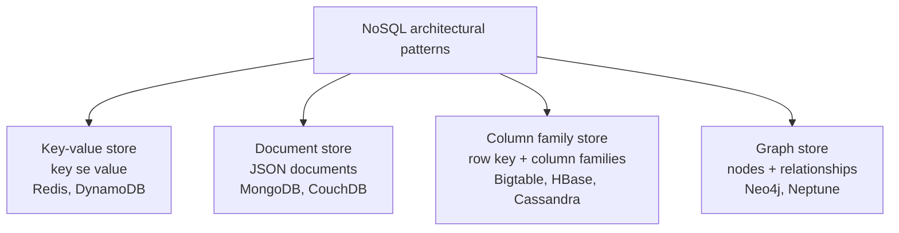
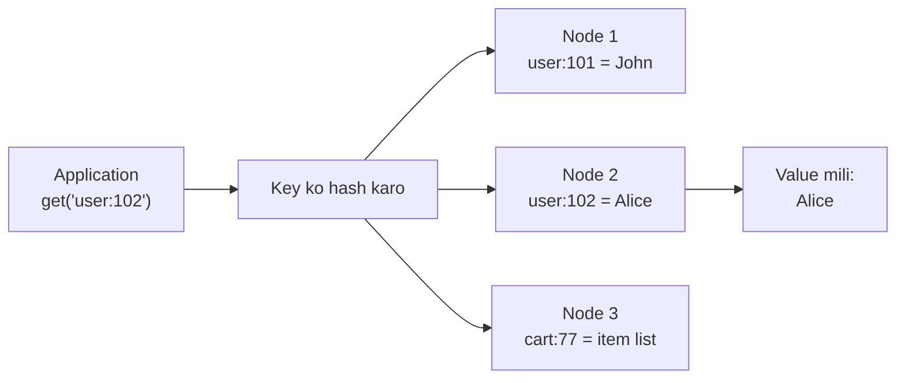
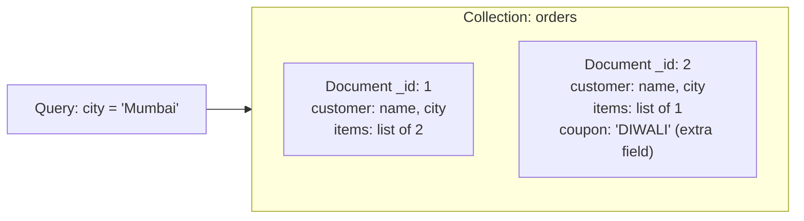
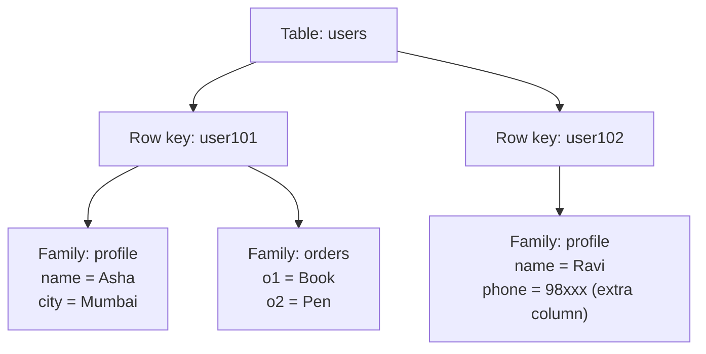
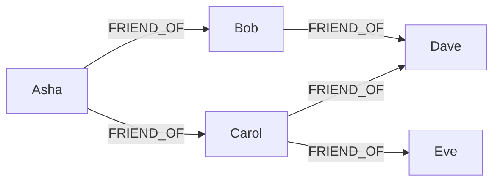

## Pehle basics

- **Pattern.** Is note mein "NoSQL architectural pattern" ka matlab hai woh basic shape jisme database data store karta hai. Ye syllabus <Syl m="3" />, "NoSQL Data Architecture Patterns" hai. <Cite id="big-data-intro-nosql" />
- **Relational shape.** RDBMS data ko rows aur columns ke tables mein rakhta hai, har row ke columns same hote hain, aur sawaal ka jawab dene ke liye tables ko join karta hai.
- **Aggregate.** **Aggregate** related data ka bundle hai jo saath mein read aur write hota hai, jaise ek customer apne saare addresses aur orders ke saath. Key-value, document aur column family stores ek aggregate ko ek node pe rakhte hain, isliye query ko kam hi kai machines se baat karni padti hai. <Cite id="nosql-intro-fowler-agg" />
- **Scale-out aur sharding.** NoSQL stores aggregates ko kai sasti nodes pe failate hain (sharding) aur safety ke liye copies rakhte hain. Pichhla note ye samjhata hai <Cite id="nosql-intro-wiki-sharding" />; yahan hum sirf data ki shape dekhenge.
- **Polyglot persistence.** Ek application kai databases use kar sakti hai, har ek us data ke liye jo usse suit kare (sessions ke liye key-value, products ke liye document, recommendations ke liye graph). <Cite id="nosql-intro-fowler-poly" />



Study sites ki NoSQL-types pictures se redraw kiya. <Cite id="nosql-patterns-gfg-types" loc="diagram" /> <Cite id="nosql-intro-ibm-nosql" loc="diagram" />

## Key-value store

<PYQ id="2023-05-ce/q2a" /> <PYQ id="2024-12-ce/q2a" /> <PYQ id="2025-05/q3b" />

**Ye kya hai.** Key-value store sabse simple NoSQL pattern hai. Ye ek bade dictionary ya hash table jaisa hai jo disk pe rakha hai aur kai machines pe failaa hua hai. Har item ki ek **unique key** aur ek **value** hoti hai. Aap key dete ho aur value wapas milti hai. Database value ke andar nahi dekhta: uske liye value bas ek blob hai (text, number, JSON string, image). <Cite id="nosql-patterns-wiki-kv" /> <Cite id="nosql-patterns-aws-kv" />

**Roz ki analogy.** Cloakroom. Aap bag dete ho aur token number (key) milta hai. Baad mein token dikhate ho aur wahi bag (value) wapas milta hai. Cloakroom bag kholta nahi aur "neeli umbrella wala bag" nahi dhoondh sakta; sirf "bag number 102" dhoondh sakta hai.

**Basic operations.** Sirf teen chahiye: `put(key, value)`, `get(key)` aur `delete(key)`. <Cite id="nosql-patterns-gfg-kv" /> <Cite id="nosql-patterns-redis-data" />

**Ye kaise kaam karta hai.**

1. Application ek key chunti hai, jaise `session:8f3a`.
2. Database key pe hash function chalata hai ye decide karne ke liye ki kaunsi node pe rakhna hai, isliye saari nodes mein search nahi karni padti.
3. Wo node value store karti hai, aur safety ke liye copies dusri nodes pe jaati hain.
4. `get` wahi key hash karta hai aur seedha sahi node pe jaata hai, jo value return karti hai.




Study sites ki key-value pictures se redraw kiya. <Cite id="nosql-patterns-gfg-kv" loc="diagram" /> <Cite id="nosql-patterns-redis-kv" loc="diagram" />

**Benefits** ("key-value store ke benefits" ka usual answer). <Cite id="nosql-patterns-aws-kv" /> <Cite id="nosql-patterns-redis-kv" />

- **Bahut fast aur simple.** Key se ek lookup, na join, na query planning.
- **Scale-out aasan.** Hashing se keys nodes pe barabar bat jaati hain, isliye node badhane se capacity badhti hai.
- **High availability.** Data kai nodes pe copy hota hai, isliye ek node fail ho to bhi store chalta rehta hai (Dynamo isi ke liye bana tha). <Cite id="nosql-intro-dynamo" />
- **Fixed schema nahi.** Har value ki shape alag ho sakti hai, isliye changes sasta hai.
- **Kam cost.** Commodity machines pe chalta hai; kuch stores sab kuch memory mein rakhte hain aur aur bhi fast hote hain.

**Limitations.**

- Data sirf key se mil sakta hai. "Mumbai ke saare users" jaisi query nahi ho sakti jab tak aap khud index na banao.
- Items ke beech relationships ya joins nahi.
- Database value ka ek hissa check ya update nahi kar sakta, isliye application ko poori value read aur write karni padti hai.

**Use cases.** Web sessions, shopping carts, user preferences, web pages ki caching, leaderboards aur counters. **Examples:** Redis, Amazon DynamoDB, Riak, Memcached. <Cite id="nosql-patterns-aws-dynamo" /> <Cite id="nosql-intro-redis" />

| Key | Value |
|---|---|
| `session:8f3a` | `{user: 101, login: "10:42"}` |
| `cart:77` | `[book-12, pen-3]` |
| `user:102:theme` | `dark` |

## Document store

<PYQ id="2024-12-ce/q2a" /> <PYQ id="2025-05/q3b" /> <PYQ id="2023-12/q2b" />

**Ye kya hai.** Document store har record ko ek **document** ki tarah rakhta hai, aam taur pe JSON (ya XML) mein. Document self-describing hota hai: usme apne field names hote hain, aur usme nested fields aur lists ho sakti hain. Key-value store se alag, database document ke **andar dekh sakta hai**, isliye aap kisi bhi field se search aur update kar sakte ho. Documents ka group **collection** kehlata hai, jo table ke lagbhag barabar hai, lekin collection ke documents ke fields same hone zaroori nahi. <Cite id="nosql-patterns-wiki-doc" /> <Cite id="nosql-patterns-mongo-doc" /> <Cite id="nosql-patterns-aws-doc" />

**Roz ki analogy.** Folders ki filing cabinet. Har folder (document) ke andar apne sheets (fields) hain, ek folder mein extra sheets ho sakti hain jo dusre mein nahi, aur phir bhi clerk se pooch sakte ho "jis folder mein city Mumbai hai wo sab dikhao".

**Ye kyun zaroori hai.** RDBMS mein ek customer kai tables mein bikhra hota hai (customer, address, orders) aur aap join karke wapas jodte ho. Document poore customer ko ek jagah rakhta hai, jo application ke object se match karta hai, isliye reads fast hain aur join nahi chahiye. <Cite id="nosql-intro-fowler-agg" />




Study sites ki document-database pictures se redraw kiya. <Cite id="nosql-patterns-gfg-doc" loc="diagram" /> <Cite id="nosql-patterns-aws-doc" loc="diagram" />

Ek example document (MongoDB style): <Cite id="nosql-patterns-tp-mongo" />

```json
{
  "_id": 1,
  "customer": { "name": "Asha", "city": "Mumbai" },
  "items": [
    { "product": "Book", "qty": 2 },
    { "product": "Pen", "qty": 5 }
  ]
}
```

**Characteristics.**

- Flexible schema: ek collection ke documents mein alag fields ho sakte hain.
- Ek document ke andar nested data aur arrays.
- Kisi bhi field pe query aur index ho sakta hai, aur document ka ek hissa update ho sakta hai.
- Document hi woh unit hai jo store, copy aur shard hota hai. <Cite id="nosql-patterns-mongo-model" />

**Advantages.** Code ke objects se match; common case mein join nahi; structure badalna aasan; sharding se scale-out.

**Disadvantages.** Jo data kai documents mein repeat hota hai (denormalised) use har jagah update karna padta hai; joins aur multi-document transactions RDBMS se kamzor hain; documents ki size limit hoti hai (MongoDB mein 16 MB).

**Use cases.** Product catalogues, user profiles, content management, blogs, mobile app back ends. **Examples:** MongoDB, CouchDB, Amazon DocumentDB.

### Key-value versus document

| Point | Key-value | Document |
|---|---|---|
| Value | Opaque blob; database andar nahi dekhta | Structured JSON/XML; database samajhta hai |
| Query | Sirf key se | Key se aur kisi bhi field se; indexes |
| Update | Poori value replace | Ek field update |
| Complexity | Sabse simple | Zyada features |
| Best for | Sessions, cache, carts | Catalogues, profiles, content |

## Column family store

<PYQ id="2024-05/q2b" />

**Ye kya hai.** Column family store (wide-column store bhi kehte hain) data ko tables mein rakhta hai, lekin RDBMS se alag ye **column families** ke around bana hai: columns ke groups jo saath store aur read hote hain. Har **row** ek **row key** se milti hai, aur ek family ke andar alag rows mein alag columns ho sakte hain, isliye table bahut **sparse** (zyadatar khali) ho sakta hai bina jagah waste kiye. Google ka **Bigtable** (2006) original hai; **HBase** aur **Cassandra** uske baad aaye. <Cite id="nosql-intro-bigtable" /> <Cite id="nosql-patterns-wiki-wide" /> <Cite id="nosql-patterns-gfg-col" />

**Column-oriented analytic database se confuse mat karo.** Column-oriented DBMS normal table ke har column ko saath store karta hai taaki reports fast hon. Column family store alag idea hai: row key aur column se value tak ka sparse, distributed map. <Cite id="nosql-patterns-wiki-wide" />

**Data model.** Bigtable mein data ek sparse, distributed, sorted map hai jo **(row key, column key, timestamp)** se value tak jaata hai. Column key `family:qualifier` likhi jaati hai. Rows row key ke hisab se sorted rehti hain, **timestamp** value ke kai versions rakhta hai, aur column families pehle se fixed hoti hain jabki unke andar columns kabhi bhi add ho sakte hain. <Cite id="nosql-intro-bigtable" /> <Cite id="nosql-intro-hbase" />



Study sites ki column-family pictures se redraw kiya. <Cite id="nosql-patterns-gfg-col" loc="diagram" /> <Cite id="nosql-patterns-tp-cass" loc="diagram" />

| Row key | profile:name | profile:city | profile:phone | orders:o1 | orders:o2 |
|---|---|---|---|---|---|
| user101 | Asha | Mumbai | (khali, jagah nahi lagti) | Book | Pen |
| user102 | Ravi | (khali) | 98xxx | (khali) | (khali) |

**Ye scale kaise karta hai.** Rows ko row key ki ranges mein baanta jaata hai (Bigtable inhe tablets, HBase regions kehta hai) aur har range ek node serve karti hai. Cassandra mein rows partition key ko hash karke nodes pe rakhi jaati hain, aur data kai nodes pe copy hota hai, bina master ke. Writes fast hote hain kyunki pehle log aur memory mein jaate hain aur baad mein disk pe merge hote hain. <Cite id="nosql-intro-bigtable" /> <Cite id="nosql-patterns-cass-model" /> <Cite id="nosql-intro-dynamo" />

**Characteristics.** Sparse aur wide tables (lakhon columns allowed); flexible columns lekin fixed families; timestamp se versions; un queries ke hisab se design karo jo chalaoge, kyunki joins nahi hote. <Cite id="nosql-patterns-cass-model" />

**Advantages.** Hazaaron commodity nodes pe petabytes handle karta hai; bahut high write speed; khali cells pe jagah waste nahi; time series aur logs ke liye accha.

**Disadvantages.** Ad-hoc queries aur joins ke liye kamzor; table apni queries ke hisab se design karna padta hai; documents se kam flexible; kuch systems mein consistency kamzor.

**Use cases.** Web indexing, messaging inboxes, sensor aur log data, time series, Google, Facebook aur Netflix scale ka analytics. **Examples:** Bigtable, HBase, Cassandra, Hypertable.

## Graph store

<PYQ id="2024-05-ce/q2a" /> <PYQ id="2024-05/q2b" />

**Ye kya hai.** Graph store data ko **graph** ki tarah rakhta hai: **nodes** (cheezein, jaise log ya products), **relationships** ya **edges** (wo kaise jude hain, jaise FRIEND_OF ya BOUGHT) aur **properties** (nodes aur edges ki details, jaise name ya date). Relationships asli links ki tarah store hoti hain, isliye database joins compute karne ki jagah unhe seedha follow karta hai. Zyadatar graph stores **property graph** model use karte hain. <Cite id="nosql-patterns-wiki-graph" /> <Cite id="nosql-patterns-neo4j-model" /> <Cite id="nosql-patterns-aws-graph" />

**Roz ki analogy.** Shehar ka road map. Sawaal shayad hi "is junction ke baare mein batao" hota hai, zyada "yahan se wahan kaise jaaun, aur dono ke paas kaun rehta hai?" hota hai. Jawab roads follow karne se milta hai.

**Ye kyun zaroori hai.** RDBMS mein "friends of friends of friends" ke liye har hop pe ek join chahiye, aur data badhne pe har join slow hota hai. Graph store mein har hop starting node ke stored links follow karta hai, isliye cost is pe depend karti hai ki aap graph ka kitna hissa touch karte ho, total data size pe nahi. <Cite id="nosql-patterns-ibm-graph" /> <Cite id="nosql-intro-neo4j" />




Study sites ki graph-database pictures se redraw kiya. <Cite id="nosql-patterns-gfg-graph" loc="diagram" /> <Cite id="nosql-patterns-neo4j-model" loc="diagram" />

**Business problem jo solve hota hai: social network mein friend suggestions.** Business chahta hai ki "people you may know" suggest ho. Friendship ko two-way maano. Asha se shuru karo aur FRIEND_OF pe do hops lo: Asha se Bob se Dave, Asha se Carol se Dave, aur Asha se Carol se Eve. Jinhe Asha pehle se jaanti hai (Bob, Carol) unhe hata do. Dave do paths se aata hai (2 mutual friends) aur Eve ek se, isliye pehle Dave suggest karo, phir Eve. Graph store mein ye ek chhoti traversal query hai; RDBMS mein har hop ke liye friendship table ka self-join chahiye. Yahi walk fraud rings (accounts jo phone ya address share karte hain), product recommendations ("jinhone ye kharida unhone ye bhi kharida") aur shortest routes bhi dhoondhta hai. <Cite id="nosql-patterns-aws-graph" /> <Cite id="nosql-patterns-ibm-graph" />

**Characteristics.** Relationships first-class hain aur data ke saath store hoti hain; flexible schema (naye node ya edge kinds add ho sakte hain); traversal queries (Neo4j mein Cypher); Neo4j mein aam taur pe ACID transactions. <Cite id="nosql-patterns-neo4j-model" />

**Advantages.** Deep, connected queries pe fast; model asli duniya se match karta hai; naye relationship types add karna aasan.

**Disadvantages.** Kai machines pe split (shard) karna mushkil kyunki sab kuch linked hai; simple bulk storage ya poore data pe aggregate reports ke liye accha nahi; skill base aur tools kam.

**Use cases.** Social networks, recommendation engines, fraud detection, network aur IT dependency maps, knowledge graphs, route finding. **Examples:** Neo4j, Amazon Neptune, JanusGraph.

## Variations of NoSQL architectural patterns

<PYQ id="2025-05-ce/q2b" />

Chaar patterns rigid nahi hain; products unhe mix aur stretch karte hain. Common variations: <Cite id="big-data-intro-nosql" /> <Cite id="nosql-patterns-wiki-kv" />

- **Key-value variations.** In-memory stores aur caches (Redis, Memcached) durability ke badle speed lete hain; persistent stores (DynamoDB, Riak) disk pe likhte hain; **ordered** key-value stores keys ko sorted rakhte hain taaki range scans chalein (yahi idea Bigtable use karta hai). Redis aur aage jaake value ko list, set ya hash banne deta hai, jo use document store ke kareeb le aata hai. <Cite id="nosql-patterns-redis-data" /> <Cite id="nosql-patterns-aws-dynamo" />
- **Document variations.** JSON stores (MongoDB, CouchDB) aur native XML stores; woh stores jo multi-document transactions ya search add karte hain. <Cite id="nosql-patterns-mongo-model" />
- **Column family variations.** Master wale Bigtable-style tables (HBase) aur tunable consistency wale peer-to-peer Dynamo-style rings (Cassandra). <Cite id="nosql-intro-hbase" /> <Cite id="nosql-patterns-cass-model" />
- **Graph variations.** Property graphs (Neo4j) versus **RDF triple stores**, jo facts ko subject-predicate-object triples mein rakhte hain aur semantic web ke liye use hote hain. <Cite id="nosql-patterns-wiki-graph" />
- **Multi-model databases.** Ek product kai patterns deta hai (jaise key-value, document aur graph saath), isliye team ek hi system use kar sakti hai. <Cite id="nosql-intro-ibm-nosql" />
- **Mixed (polyglot) use.** Application har zaroorat ke liye alag store chunti hai aur results code mein jodti hai. <Cite id="nosql-intro-fowler-poly" />

## Comparing the patterns

<PYQ id="2024-12/q3b" />

| Point | Key-value | Document | Column family | Graph |
|---|---|---|---|---|
| Data shape | Key se opaque value | Self-describing JSON/XML document | Row key, column families, timestamped cells | Nodes, edges, properties |
| Query by | Sirf key | Key aur kisi bhi field se | Row key (aur column ranges) | Relationships pe traversal |
| Schema | Nahi | Flexible | Families fixed, columns flexible | Flexible |
| Relationships | Nahi | Nested data ya references | Nahi (queries ke hisab se design) | First-class aur fast |
| Scales out | Bahut aasani se | Aasani se (sharding) | Bahut aasani se | Mushkil |
| Best for | Cache, sessions, carts | Catalogues, profiles, content | Huge sparse data, time series, logs | Social, fraud, recommendations |
| Weak at | Values ke andar search | Joins, heavy transactions | Ad-hoc queries | Bulk aggregate storage |
| Examples | Redis, DynamoDB, Riak | MongoDB, CouchDB | Bigtable, HBase, Cassandra | Neo4j, Neptune |

<Cite id="nosql-patterns-gfg-types" /> <Cite id="nosql-patterns-tp-cass" /> <Cite id="nosql-patterns-aws-graph" />

**Kaise chunein.** Pucho ki main sawaal kya hai. "Is id ka item do", bahut fast: key-value. "In fields se match karte records do": document. "Bahut bada sparse data kai nodes pe store aur write karo": column family. "Ye cheezein kaise jude hain?": graph. <Cite id="nosql-intro-fowler-poly" />

**Case study.** Syllabus mein ek NoSQL case study bhi hai. Google ka MapReduce aur Bigtable, aur unhone kya solve kiya, pichhle note mein hai (<Cite id="nosql-intro-bigtable" />).

**Conclusion.** Chaaron patterns query power aur scale ko alag tareeke se trade karte hain. Key-value sabse simple aur fast hai, document structure aur field queries jodta hai, column family clusters pe bahut bada sparse data sambhalta hai, aur graph relationships ko main cheez banata hai. Access pattern dekh ke chuno, aur jab ek kaafi na ho to combine karo.

<Box kind="exam">

Exam mein English mein likho: "NoSQL architectural patterns are key-value, document, column family and graph stores. A key-value store maps a unique key to an opaque value; a document store keeps self-describing JSON documents; a column family store groups columns into families under a row key; a graph store keeps nodes and relationships." Phir har pattern ke liye definition, diagram, use case aur ek example likho, aur last mein comparison table.

</Box>
