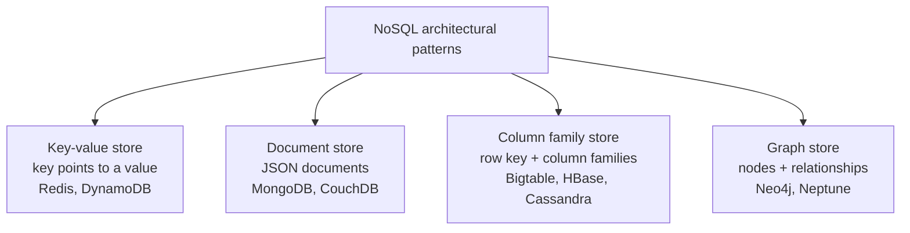
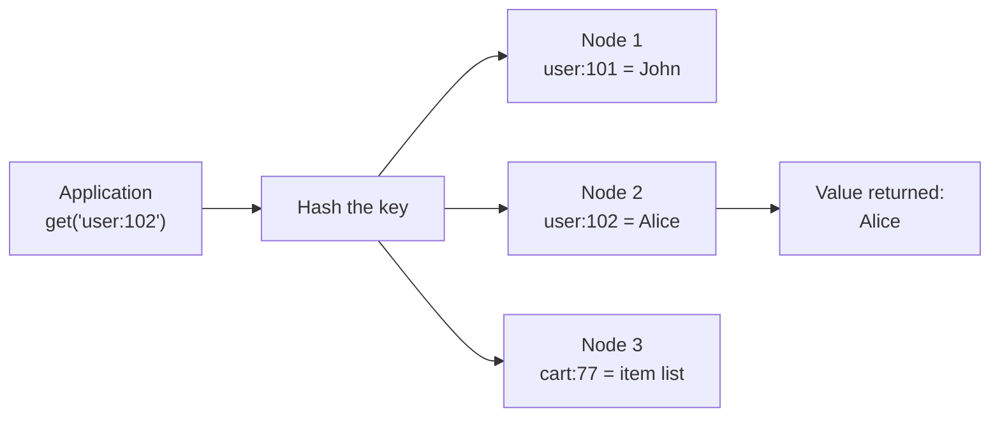
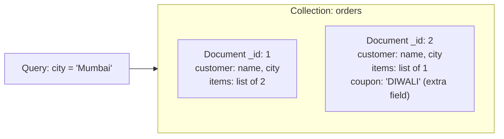
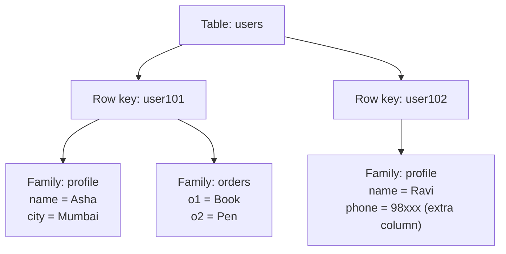
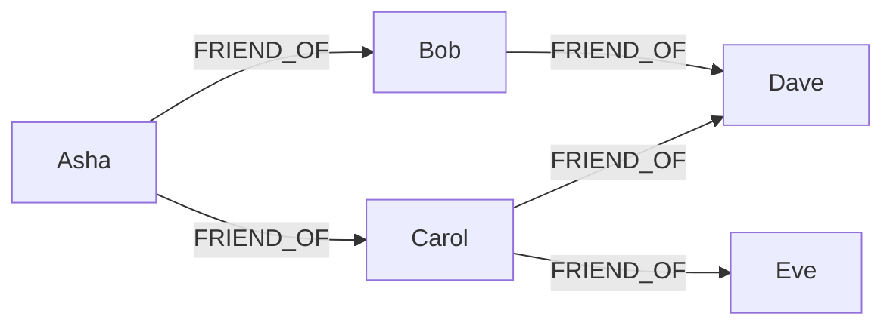

## The basics first

- **Pattern.** In this note a "NoSQL architectural pattern" means the basic shape in which a database stores data. It is syllabus <Syl m="3" />, "NoSQL Data Architecture Patterns". <Cite id="big-data-intro-nosql" />
- **Relational shape.** An RDBMS keeps data in tables of rows and columns, with the same columns for every row, and joins tables to answer questions.
- **Aggregate.** An **aggregate** is a bundle of related data that is read and written together, such as one customer with all of their addresses and orders. Key-value, document and column family stores all keep one aggregate on one node, so a query rarely needs to talk to many machines. <Cite id="nosql-intro-fowler-agg" />
- **Scale-out and sharding.** NoSQL stores spread aggregates over many cheap nodes (sharding) and keep copies for safety (replication). The previous note explains this <Cite id="nosql-intro-wiki-sharding" />; here we only look at the shape of the data.
- **Polyglot persistence.** One application can use several databases, each for the data it suits best (a key-value store for sessions, a document store for products, a graph store for recommendations). <Cite id="nosql-intro-fowler-poly" />



Redrawn from the NoSQL-types pictures on the study sites. <Cite id="nosql-patterns-gfg-types" loc="diagram" /> <Cite id="nosql-intro-ibm-nosql" loc="diagram" />

## Key-value store

<PYQ id="2023-05-ce/q2a" /> <PYQ id="2024-12-ce/q2a" /> <PYQ id="2025-05/q3b" />

**What it is.** A key-value store is the simplest NoSQL pattern. It is like a giant dictionary or a hash table kept on disk and spread over many machines. Every item has a **unique key** and a **value**. You give the key and you get the value back. The database does not look inside the value: to it, the value is just a blob (text, a number, a JSON string, an image). <Cite id="nosql-patterns-wiki-kv" /> <Cite id="nosql-patterns-aws-kv" />

**Everyday analogy.** A cloakroom. You hand in a bag and get a token number (the key). Later you show the token and get the same bag (the value). The cloakroom never opens the bag and cannot find "the bag with the blue umbrella"; it only finds "bag number 102".

**Basic operations.** Only three are needed: `put(key, value)`, `get(key)` and `delete(key)`. <Cite id="nosql-patterns-gfg-kv" /> <Cite id="nosql-patterns-redis-data" />

**How it works.**

1. The application picks a key, for example `session:8f3a`.
2. The database runs a hash function on the key to decide which node holds it, so it does not need to search all nodes.
3. That node stores the value, and copies go to other nodes for safety.
4. A `get` hashes the same key and goes straight to the right node, which returns the value.




Redrawn from the key-value pictures on the study sites. <Cite id="nosql-patterns-gfg-kv" loc="diagram" /> <Cite id="nosql-patterns-redis-kv" loc="diagram" />

**Benefits** (the usual answer to "benefits of a key-value store"). <Cite id="nosql-patterns-aws-kv" /> <Cite id="nosql-patterns-redis-kv" />

- **Very fast and simple.** One lookup by key, no joins, no query planning.
- **Easy to scale out.** Keys spread evenly over nodes with hashing, so adding nodes adds capacity.
- **High availability.** Data is copied to several nodes, so the store keeps working if one node fails (Dynamo was built for this). <Cite id="nosql-intro-dynamo" />
- **No fixed schema.** Each value can have a different shape, so changes are cheap.
- **Low cost.** Runs on commodity machines; some stores keep everything in memory for even more speed.

**Limitations.**

- You can only find data by its key. There is no query like "all users in Mumbai" unless you build your own index.
- No relationships or joins between items.
- The database cannot check or update a part of the value, so the application must read and write the whole value.

**Use cases.** Web sessions, shopping carts, user preferences, caching of web pages, leaderboards and counters. **Examples:** Redis, Amazon DynamoDB, Riak, Memcached. <Cite id="nosql-patterns-aws-dynamo" /> <Cite id="nosql-intro-redis" />

| Key | Value |
|---|---|
| `session:8f3a` | `{user: 101, login: "10:42"}` |
| `cart:77` | `[book-12, pen-3]` |
| `user:102:theme` | `dark` |

## Document store

<PYQ id="2024-12-ce/q2a" /> <PYQ id="2025-05/q3b" /> <PYQ id="2023-12/q2b" />

**What it is.** A document store keeps each record as a **document**, usually in JSON (or XML). A document is self-describing: it carries its own field names, and it can hold nested fields and lists. Unlike a key-value store, the database **can look inside** the document, so you can search and update by any field. A group of documents is a **collection**, the rough match of a table, but the documents in it need not have the same fields. <Cite id="nosql-patterns-wiki-doc" /> <Cite id="nosql-patterns-mongo-doc" /> <Cite id="nosql-patterns-aws-doc" />

**Everyday analogy.** A filing cabinet of folders. Each folder (document) has its own sheets inside (fields), one folder can have extra sheets that another has not, and you can still ask the clerk "show me every folder where the city is Mumbai".

**Why it is needed.** In an RDBMS one customer is spread over many tables (customer, address, orders) and you join them back. A document keeps the whole customer in one place, which matches how the application sees the object, so reads are fast and there is no join. <Cite id="nosql-intro-fowler-agg" />




Redrawn from the document-database pictures on the study sites. <Cite id="nosql-patterns-gfg-doc" loc="diagram" /> <Cite id="nosql-patterns-aws-doc" loc="diagram" />

An example document (MongoDB style): <Cite id="nosql-patterns-tp-mongo" />

```json
{
  "_id": 1,
  "customer": { "name": "Asha", "city": "Mumbai" },
  "items": [
    { "product": "Book", "qty": 2 },
    { "product": "Pen", "qty": 5 }
  ]
}
```

**Characteristics.**

- Flexible schema: documents in one collection can have different fields.
- Nested data and arrays inside one document.
- Can be queried and indexed on any field, and a part of a document can be updated.
- A document is the unit that is stored, copied and sharded. <Cite id="nosql-patterns-mongo-model" />

**Advantages.** Matches objects in code; no joins for the common case; easy to change the structure; scales out by sharding.

**Disadvantages.** Data that is repeated in many documents (denormalised) must be updated everywhere; joins and multi-document transactions are weaker than in an RDBMS; documents have a size limit (16 MB in MongoDB).

**Use cases.** Product catalogues, user profiles, content management, blogs, mobile app back ends. **Examples:** MongoDB, CouchDB, Amazon DocumentDB.

### Key-value versus document

| Point | Key-value | Document |
|---|---|---|
| Value | Opaque blob; database does not look inside | Structured JSON/XML; database understands it |
| Query | Only by key | By key and by any field; indexes |
| Update | Replace the whole value | Update a single field |
| Complexity | Simplest | More features |
| Best for | Sessions, cache, carts | Catalogues, profiles, content |

## Column family store

<PYQ id="2024-05/q2b" />

**What it is.** A column family store (also called a wide-column store) keeps data in tables, but unlike an RDBMS it is organised around **column families**: groups of columns that are stored and read together. Each **row** is found by a **row key**, and different rows may have different columns inside a family, so the table can be very **sparse** (mostly empty) without wasting space. Google's **Bigtable** (2006) is the original; **HBase** and **Cassandra** follow it. <Cite id="nosql-intro-bigtable" /> <Cite id="nosql-patterns-wiki-wide" /> <Cite id="nosql-patterns-gfg-col" />

**Do not confuse it with a column-oriented analytic database.** A column-oriented DBMS stores each column of a normal table together to speed up reports. A column family store is a different idea: a sparse, distributed map from row key and column to value. <Cite id="nosql-patterns-wiki-wide" />

**The data model.** In Bigtable the data is a sparse, distributed, sorted map from **(row key, column key, timestamp)** to a value. The column key is written `family:qualifier`. Rows are kept sorted by row key, a **timestamp** keeps several versions of a value, and the column families are fixed in advance while the columns inside them can be added at any time. <Cite id="nosql-intro-bigtable" /> <Cite id="nosql-intro-hbase" />



Redrawn from the column-family pictures on the study sites. <Cite id="nosql-patterns-gfg-col" loc="diagram" /> <Cite id="nosql-patterns-tp-cass" loc="diagram" />

| Row key | profile:name | profile:city | profile:phone | orders:o1 | orders:o2 |
|---|---|---|---|---|---|
| user101 | Asha | Mumbai | (empty, no space used) | Book | Pen |
| user102 | Ravi | (empty) | 98xxx | (empty) | (empty) |

**How it scales.** Rows are split by row key into ranges (Bigtable calls them tablets, HBase calls them regions) and each range is served by one node. In Cassandra, rows are placed on nodes by hashing the partition key, and data is copied to several nodes, with no master. Writes are fast because they go first to a log and to memory and are merged to disk later. <Cite id="nosql-intro-bigtable" /> <Cite id="nosql-patterns-cass-model" /> <Cite id="nosql-intro-dynamo" />

**Characteristics.** Sparse and wide tables (millions of columns allowed); flexible columns but fixed families; versions by timestamp; designed around the queries you will run, since there are no joins. <Cite id="nosql-patterns-cass-model" />

**Advantages.** Handles petabytes over thousands of commodity nodes; very high write speed; no wasted space for empty cells; good for time series and logs.

**Disadvantages.** Poor for ad-hoc queries and joins; you must design the table for your queries; less flexible than documents; weaker consistency in some systems.

**Use cases.** Web indexing, messaging inboxes, sensor and log data, time series, analytics at Google, Facebook and Netflix scale. **Examples:** Bigtable, HBase, Cassandra, Hypertable.

## Graph store

<PYQ id="2024-05-ce/q2a" /> <PYQ id="2024-05/q2b" />

**What it is.** A graph store keeps data as a **graph**: **nodes** (the things, such as people or products), **relationships** or **edges** (how they are connected, such as FRIEND_OF or BOUGHT) and **properties** (details on nodes and edges, such as name or date). Relationships are stored as real links, so the database follows them directly instead of computing joins. Most graph stores use the **property graph** model. <Cite id="nosql-patterns-wiki-graph" /> <Cite id="nosql-patterns-neo4j-model" /> <Cite id="nosql-patterns-aws-graph" />

**Everyday analogy.** A map of a city with roads. The question is rarely "tell me about this junction" but "how do I get from here to there, and who lives near both?". The answer comes by following the roads.

**Why it is needed.** In an RDBMS, "friends of friends of friends" needs a join for every hop, and each join gets slower as data grows. In a graph store, each hop just follows stored links from the starting node, so the cost depends on how much of the graph you touch, not on the total data size. <Cite id="nosql-patterns-ibm-graph" /> <Cite id="nosql-intro-neo4j" />




Redrawn from the graph-database pictures on the study sites. <Cite id="nosql-patterns-gfg-graph" loc="diagram" /> <Cite id="nosql-patterns-neo4j-model" loc="diagram" />

**Business problem solved: friend suggestions in a social network.** The business wants to suggest people you may know. Treat friendship as two-way. Start at Asha and take two hops along FRIEND_OF: Asha to Bob to Dave, Asha to Carol to Dave, and Asha to Carol to Eve. Remove people Asha already knows (Bob, Carol). Dave appears through two paths (2 mutual friends) and Eve through one, so suggest Dave first, then Eve. In a graph store this is one short traversal query; in an RDBMS it needs a self-join of the friendship table for each hop. The same walk finds fraud rings (accounts sharing a phone or address), product recommendations ("people who bought this also bought") and shortest routes. <Cite id="nosql-patterns-aws-graph" /> <Cite id="nosql-patterns-ibm-graph" />

**Characteristics.** Relationships are first-class and stored with the data; flexible schema (new node or edge kinds can be added); traversal queries (Cypher in Neo4j); usually ACID transactions in Neo4j. <Cite id="nosql-patterns-neo4j-model" />

**Advantages.** Fast on deep, connected queries; the model matches the real world; easy to add new kinds of relationships.

**Disadvantages.** Hard to split (shard) across many machines because everything is linked; not good for simple bulk storage or aggregate reports over all data; a smaller skill base and fewer tools.

**Use cases.** Social networks, recommendation engines, fraud detection, network and IT dependency maps, knowledge graphs, route finding. **Examples:** Neo4j, Amazon Neptune, JanusGraph.

## Variations of NoSQL architectural patterns

<PYQ id="2025-05-ce/q2b" />

The four patterns are not rigid; products mix and stretch them. Common variations: <Cite id="big-data-intro-nosql" /> <Cite id="nosql-patterns-wiki-kv" />

- **Key-value variations.** In-memory stores and caches (Redis, Memcached) trade durability for speed; persistent stores (DynamoDB, Riak) write to disk; **ordered** key-value stores keep keys sorted so range scans work (the idea Bigtable builds on). Redis goes further and lets the value be a list, set or hash, which makes it closer to a document store. <Cite id="nosql-patterns-redis-data" /> <Cite id="nosql-patterns-aws-dynamo" />
- **Document variations.** JSON stores (MongoDB, CouchDB) and native XML stores; stores that add multi-document transactions or search. <Cite id="nosql-patterns-mongo-model" />
- **Column family variations.** Bigtable-style tables with a master (HBase) and peer-to-peer Dynamo-style rings with tunable consistency (Cassandra). <Cite id="nosql-intro-hbase" /> <Cite id="nosql-patterns-cass-model" />
- **Graph variations.** Property graphs (Neo4j) versus **RDF triple stores**, which store facts as subject-predicate-object triples and are used for the semantic web. <Cite id="nosql-patterns-wiki-graph" />
- **Multi-model databases.** One product offers several patterns (for example key-value, document and graph together), so a team can use one system. <Cite id="nosql-intro-ibm-nosql" />
- **Mixed (polyglot) use.** An application picks a different store for each need and joins the results in code. <Cite id="nosql-intro-fowler-poly" />

## Comparing the patterns

<PYQ id="2024-12/q3b" />

| Point | Key-value | Document | Column family | Graph |
|---|---|---|---|---|
| Data shape | Key to opaque value | Self-describing JSON/XML document | Row key, column families, timestamped cells | Nodes, edges, properties |
| Query by | Key only | Key and any field | Row key (and column ranges) | Traversal along relationships |
| Schema | None | Flexible | Families fixed, columns flexible | Flexible |
| Relationships | None | Nested data or references | None (design for queries) | First-class and fast |
| Scales out | Very easily | Easily (sharding) | Very easily | Hard |
| Best for | Cache, sessions, carts | Catalogues, profiles, content | Huge sparse data, time series, logs | Social, fraud, recommendations |
| Weak at | Searching in values | Joins, heavy transactions | Ad-hoc queries | Bulk aggregate storage |
| Examples | Redis, DynamoDB, Riak | MongoDB, CouchDB | Bigtable, HBase, Cassandra | Neo4j, Neptune |

<Cite id="nosql-patterns-gfg-types" /> <Cite id="nosql-patterns-tp-cass" /> <Cite id="nosql-patterns-aws-graph" />

**How to choose.** Ask what the main question is. "Give me the thing for this id", very fast: key-value. "Give me records that match these fields": document. "Store and write enormous sparse data over many nodes": column family. "How are these things connected?": graph. <Cite id="nosql-intro-fowler-poly" />

**Case study.** The syllabus also lists a NoSQL case study. Google's MapReduce and Bigtable, and what they solved, are in the previous note (<Cite id="nosql-intro-bigtable" />).

**Conclusion.** The four patterns trade query power for scale in different ways. Key-value is the simplest and fastest, document adds structure and field queries, column family handles huge sparse data across clusters, and graph makes relationships the main thing. Pick by the access pattern, and combine them when one is not enough.

<Box kind="exam">

Exam mein English mein likho: "NoSQL architectural patterns are key-value, document, column family and graph stores. A key-value store maps a unique key to an opaque value; a document store keeps self-describing JSON documents; a column family store groups columns into families under a row key; a graph store keeps nodes and relationships." Phir har pattern ke liye definition, diagram, use case aur ek example likho, aur last mein comparison table.

</Box>
