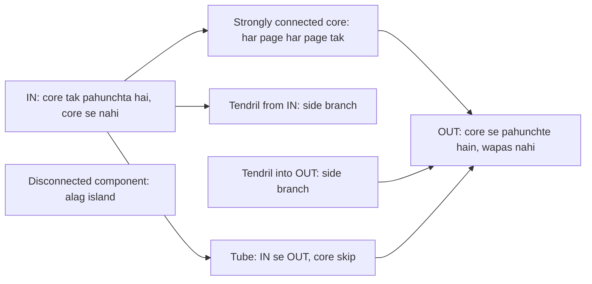
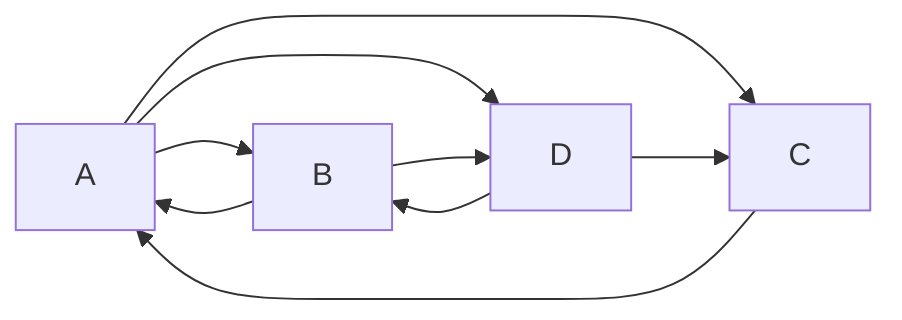
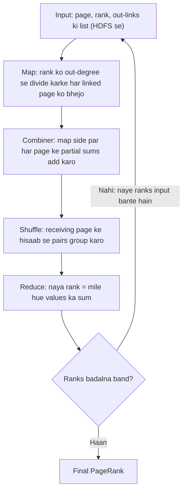
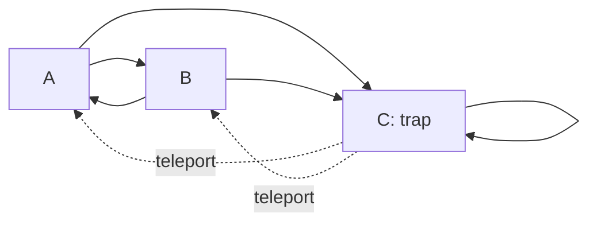

## Pehle basics

- **Graph** nodes ka set hai jo edges se jude hote hain. **Directed graph** mein har edge ki direction hoti hai, jaise one-way street.
- Web par **page** ek node hai aur page X se page Y ka **hyperlink** edge X to Y hai. Page se bahar jaate links uske **out-links** hain; andar aate links **in-links**. Page $j$ ke out-links ki ginti $n_j$ likhte hain.
- **Vector** numbers ki list hai, yahan har page ke liye ek rank. **Matrix** numbers ka table hai. Matrix ko vector se multiply karne ka matlab: har naya entry matrix ki ek row ko vector ke saath entry-by-entry multiply karke add karne se banta hai.
- **Probability** 0 se 1 ke beech ka number hai. Saari possibilities ki probabilities ka sum 1 hota hai.

## PageRank ki zaroorat kyun

**Problem.** Purane search engines page ko is hisaab se rank karte the ki search words page par kitni baar aaye. Log cheating karte the: invisible words baar baar likh dete the (**term spam**), to top results kachra hote the. <Cite id="hadoop-ecosystem-mmds" loc="§5.1.1" />

**Idea.** Page apne baare mein kya kehta hai us par bharosa mat karo; dusre pages uske baare mein kya kehte hain us par bharosa karo. Ek link ek vote hai. Important page ka vote anjaan page ke vote se zyada kimat rakhta hai. Larry Page aur Sergey Brin ne isi idea par Google banaya, aur Stanford ke paas iska patent hai. <Cite id="pagerank-patent" /> <Cite id="mapreduce-algorithms-wiki-pagerank" />

**Roz ki analogy.** Research paper tab important hota hai jab bahut saare important papers use cite karein. Citations votes hain, aur famous paper ka citation zyada count hota hai.

Ye note syllabus <Syl m="6" /> cover karta hai: "PageRank overview, efficient computation of PageRank, PageRank iteration using MapReduce, use of combiners to consolidate the result vector".

## Structure of the web

**Ye kya hai.** Web ek bahut bada **directed graph** hai: har page ek node aur har hyperlink ek directed edge. Studies se pata chala ki web random uljhan nahi hai balki uska ek saaf shape hai, jise aksar **bow-tie** ki tarah banate hain. <Cite id="hadoop-ecosystem-mmds" loc="§5.1.3" /> <Cite id="pagerank-wiki-webgraph" />

**Bow-tie ke parts.**

- **Strongly connected core (SCC).** Pages ka bada set jisme links follow karke kisi bhi page se kisi bhi dusre page tak pahunch sakte ho. Ye web ka dil hai.
- **IN.** Wo pages jinse core tak pahunch sakte ho, par core wapas unhe nahi pahunchta (jaise naya page jo popular pages ko link karta hai par us par abhi koi link nahi karta).
- **OUT.** Wo pages jinhe core pahunchta hai par wo core tak wapas nahi pahunch sakte (jaise company sites jinke links sirf apne hi pages ki taraf jaate hain).
- **Tendrils.** IN ya OUT se latke hue pages: IN se pahunche ja sakte hain par core mein nahi jaate, ya OUT mein jaate hain par core se pahunche nahi ja sakte.
- **Tubes.** IN se seedha OUT tak jaane wale raste jo core se nahi guzarte.
- **Disconnected components.** Chhote islands jinka main web se aane-jaane ka koi link path nahi hai.

Usual bow-tie pictures se dobara banaya gaya. <Cite id="pagerank-cs246-pagerank" loc="diagram" />

**PageRank ke liye ye kyun matter karta hai.** Rank sirf links ke saath bah sakta hai, isliye OUT aur dead-end tendrils mein rank jama hota hai ya leak hota hai, aur IN ko bahut kam milta hai. Yahi wo problems hain jinhe neeche dead ends aur spider traps kehte hain.

<Box kind="exam">

PYQ: <PYQ id="2023-12/q6b" /> web ka structure diagram ke saath explain karne ko kehta hai. Likho: web = directed graph, upar wala bow-tie diagram, chhe parts mein se har ek par ek line, aur last mein ek line ki links decide karte hain ki rank kaise bahta hai.

Exam mein English mein likho: "The web is a directed graph with a bow-tie structure: a strongly connected core, IN, OUT, tendrils, tubes and disconnected components."

</Box>

## PageRank: idea

**Definition.** Kisi page ka **PageRank** ek number hai jo batata hai wo kitna important hai, jo poore web ke link structure se nikalta hai. Ya aise: ye us **random surfer** ke us page par hone ki long-run chance hai, jo kahin se bhi shuru karta hai aur har step par current page ke out-links mein se ek random click karta hai. <Cite id="mapreduce-algorithms-wiki-pagerank" /> <Cite id="pagerank-neo4j-pagerank" />

**Surfer wali picture kyun kaam karti hai.** Jis page ko busy pages se bahut in-links milte hain wahan surfer aksar aata hai, to uska PageRank high hota hai. Jo page bahut pages ko link karta hai wo apni visits baant deta hai, to har target ko chhota hissa milta hai.

**Rank kaise baantta hai.** Agar page $j$ ka rank $r_j$ hai aur $n_j$ out-links hain, to wo har linked page ko $r_j / n_j$ deta hai. Kisi page ka naya rank wo total hai jo use mila.

**Transition matrix.** Pages ko $1 \ldots n$ number do. **Transition matrix** $M$ mein $m_{ij} = 1/n_j$ hota hai agar page $j$ page $i$ ko link karta hai, warna $0$. $M$ ka har column 1 ke barabar add hota hai (out-links wala page apna poora rank de deta hai). $r$ rank vector ho to surfer rule kehta hai
$r = M r$.
Seedhi baat: jo rank aakhir mein hai wahi ek aur step ke baad bhi milta hai. Iska matlab ye bhi hai ki $r$, $M$ ka **principal eigenvector** hai (wo vector jise $M$ sirf stretch karta hai, yahan exactly 1 se), aur surfer ki Markov chain ka stationary distribution bhi. <Cite id="hadoop-ecosystem-mmds" loc="§5.1.2" /> <Cite id="pagerank-wiki-markov" /> <Cite id="pagerank-wiki-eigen" />

**Compute kaise karte hain: power iteration.**

1. Har page ko same rank se shuru karo: $r = (1/n, \ldots, 1/n)$.
2. $r \leftarrow M r$ nikaalo.
3. Step 2 tab tak repeat karo jab tak $r$ badalna band na kar de (change bahut chhota ho).

Real web ke liye lagbhag 50 se 75 rounds kaafi hote hain. Ye method tab kaam karta hai jab graph strongly connected ho aur koi dead end na ho; neeche ke sections un web ko handle karte hain jahan aisa nahi hota. <Cite id="hadoop-ecosystem-mmds" loc="§5.1.2" /> <Cite id="pagerank-wiki-power" />

Standard chhote-web PageRank example se dobara banaya gaya. <Cite id="mapreduce-algorithms-gfg-pagerank" loc="diagram" />

<Sum>

<Given>

Diagram wala chaar-page web: A links to B, C, D; B links to A, D; C links to A; D links to B, C. $(A, B, C, D)$ ke liye $r_0 = (\frac14, \frac14, \frac14, \frac14)$ se shuru karo.

</Given>

<Find>

transition matrix $M$, teen iterations ke baad ranks, aur final PageRank.

</Find>

<Steps>

1. **$M$ column by column banao.** Column A: A ke 3 out-links hain, to B, C, D ko $\frac13$ milta hai. Column B: 2 out-links, to A aur D ko $\frac12$. Column C: 1 out-link, to A ko $1$. Column D: 2 out-links, to B aur C ko $\frac12$. *Reason: har column dikhata hai ki page apna rank kaise baantta hai.*

   | to \ from | A | B | C | D |
   |---|---|---|---|---|
   | A | 0 | 1/2 | 1 | 0 |
   | B | 1/3 | 0 | 0 | 1/2 |
   | C | 1/3 | 0 | 0 | 1/2 |
   | D | 1/3 | 1/2 | 0 | 0 |

2. **Iteration 1, $r_1 = M r_0$.** A $= \frac12 \cdot \frac14 + 1 \cdot \frac14 = \frac38 = \frac{9}{24}$. B $= \frac13 \cdot \frac14 + \frac12 \cdot \frac14 = \frac{1}{12} + \frac18 = \frac{5}{24}$. C $= \frac{5}{24}$ (andar aane wale links same). D $= \frac13 \cdot \frac14 + \frac12 \cdot \frac14 = \frac{5}{24}$. To $r_1 = (\frac{9}{24}, \frac{5}{24}, \frac{5}{24}, \frac{5}{24})$.
3. **Iteration 2.** A $= \frac12 \cdot \frac{5}{24} + \frac{5}{24} = \frac{15}{48}$. B $= \frac13 \cdot \frac{9}{24} + \frac12 \cdot \frac{5}{24} = \frac{6}{48} + \frac{5}{48} = \frac{11}{48}$. C aur D bhi $\frac{11}{48}$. To $r_2 = (\frac{15}{48}, \frac{11}{48}, \frac{11}{48}, \frac{11}{48})$.
4. **Iteration 3.** A $= \frac12 \cdot \frac{11}{48} + \frac{11}{48} = \frac{33}{96} = \frac{11}{32}$. B $= \frac13 \cdot \frac{15}{48} + \frac12 \cdot \frac{11}{48} = \frac{10}{96} + \frac{11}{96} = \frac{21}{96} = \frac{7}{32}$. C aur D bhi $\frac{7}{32}$. To $r_3 = (\frac{11}{32}, \frac{7}{32}, \frac{7}{32}, \frac{7}{32})$, lagbhag $(0.344, 0.219, 0.219, 0.219)$.
5. **Final rank.** Values settle hoti rehti hain (A: $0.375$, $0.3125$, $0.344$, yaani limit ke aas-paas jhoolta hai). Limit par $r = Mr$, to A $= \frac12 B + C$ aur B $= \frac13 A + \frac12 D$. Symmetry se B $=$ C $=$ D. Phir B $= \frac13 A + \frac12 B$ se $B = \frac23 A$. Total $A + 3 \cdot \frac23 A = 3A = 1$, to $A = \frac13$ aur $B = C = D = \frac29$.

</Steps>

<Answer>

3 rounds ke baad $r_3 = (\frac{11}{32}, \frac{7}{32}, \frac{7}{32}, \frac{7}{32})$. Final PageRank $= (\frac39, \frac29, \frac29, \frac29)$, to A sabse important page hai.

</Answer>

<Box kind="verify">

Har $r$ ka sum 1 hona chahiye: $\frac{9 + 5 + 5 + 5}{24} = 1$, $\frac{15 + 33}{48} = 1$, $\frac{11 + 21}{32} = 1$. Final check $r = Mr$ se: A $= \frac12 \cdot \frac29 + \frac29 = \frac39$ sahi; B $= \frac13 \cdot \frac39 + \frac12 \cdot \frac29 = \frac19 + \frac19 = \frac29$ sahi. A ke iterates $0.344$ se $0.333$ ki taraf, aur baaki $0.219$ se $0.222$ ki taraf jaate hain.

</Box>

</Sum>

<Box kind="exam">

PYQ: <PYQ id="2024-05/q6a" /> PageRank algorithm explain karne ko kehta hai. Likho: idea (links votes hain, random surfer), matrix $M$ aur $r = Mr$, power-iteration steps, upar wala chaar-page example, dead ends, spider traps aur taxation, aur ek line ki bade scale par ye kaise compute hota hai.

Exam mein English mein likho: "PageRank measures the importance of a page by the number and importance of the pages linking to it; it is the stationary vector of the random-surfer process, found by repeatedly computing r = Mr."

</Box>

## Efficient computation of PageRank

**Problem.** Real web mein arbon pages hain, to $M$ ki arbon rows aur columns hongi: poora table store karna namumkin. Par har page sirf gine-chune pages ko link karta hai, to lagbhag har entry 0 hoti hai. Sirf vector $r$ mein hi har page ke liye ek number hai. <Cite id="hadoop-ecosystem-mmds" loc="§5.2" />

**Step 1: sirf wahi store karo jo hai (sparse form).** Har page ke liye uski **out-degree** aur wo **list of pages** store karo jinko wo link karta hai. $\frac{1}{\text{degree}}$ har entry ke liye store nahi karte kyunki wo poore column ke liye same hai. Hamare chaar-page web ke liye:

| Source page | Out-degree | Destinations |
|---|---|---|
| A | 3 | B, C, D |
| B | 2 | A, D |
| C | 1 | A |
| D | 2 | B, C |

Isme poore $4 \times 4 = 16$ entries ki jagah 8 links store hote hain; real web mein bachat bahut badi hoti hai. <Cite id="hadoop-ecosystem-mmds" loc="§5.2.1" />

**Step 2: kaam baanto.** Sparse table aur vector bhi ek machine ke liye bade ho sakte hain, isliye har iteration ko kai machines par **MapReduce** job ki tarah chalate hain (agla section). <Cite id="hadoop-ecosystem-dean2004" />

**Step 3: agar vector memory mein fit nahi hota.** Vector ko **stripes** mein aur matrix ko matching **blocks** mein kaato, taaki har map task ko memory mein vector ka sirf ek piece chahiye. Link table ka block form ek stripe ke saare links ko saath rakhta hai. <Cite id="hadoop-ecosystem-mmds" loc="§5.2.4" />

## PageRank iteration using MapReduce

**Ye kya hai.** Power-iteration ka ek round $r \leftarrow M r$ ek matrix-vector product hai, jo MapReduce pehle se achhe se karta hai. To har round ek MapReduce job hai, aur ranks settle hone tak job baar baar chalate hain. <Cite id="hadoop-ecosystem-mmds" loc="§5.2.2" /> <Cite id="mapreduce-algorithms-gfg-pagerank" />

**Map.** Input mein har page ka ek record hota hai: page, uska current rank $r_j$ aur destinations ki list. Har destination $i$ ke liye pair $(i, r_j / n_j)$ emit karo. (Map page ki link list ko uski apni key ke saath dobara bhi emit karta hai taaki structure agle round tak pahunche.)

**Shuffle.** Framework saare pairs ko key $i$ (receiving page) ke hisaab se group karta hai.

**Reduce.** Har page $i$ ke liye mile hue saare values add karo. Sum naya rank $r_i$ hai.

Usual PageRank-on-MapReduce pictures se dobara banaya gaya. <Cite id="mapreduce-algorithms-gfg-pagerank" loc="diagram" />

<Sum>

<Given>

Chaar-page web (A to B, C, D; B to A, D; C to A; D to B, C), har page ke liye $r_0 = \frac14$. Maan lo ek mapper ke paas A aur B ke records hain, aur doosre ke paas C aur D ke.

</Given>

<Find>

ek round ka map output, shuffle aur reduce output, aur combiner ka effect.

</Find>

<Steps>

1. **Map.** A ka rank $\frac14$ aur 3 out-links, to wo B, C, D ko $\frac14 \div 3 = \frac1{12}$ emit karta hai. B ka rank $\frac14$ aur 2 out-links, to A ko $\frac18$ aur D ko $\frac18$. C, A ko $\frac14$ emit karta hai. D, B ko $\frac18$ aur C ko $\frac18$ emit karta hai. *Reason: page apna rank out-links mein barabar baantta hai.*

   | Mapper | Emitted pairs |
   |---|---|
   | 1 (A, B) | (B, 1/12), (C, 1/12), (D, 1/12), (A, 1/8), (D, 1/8) |
   | 2 (C, D) | (A, 1/4), (B, 1/8), (C, 1/8) |

2. **Combiner (optional, har mapper par).** Mapper 1 same key ke apne values add karta hai: D ko $\frac1{12} + \frac18 = \frac{5}{24}$, baaki keys waise hi. Ab wo 5 ki jagah 4 pairs bhejta hai. *Reason: addition hisson mein ho sakta hai, to pehle add karne se network par bheja jaane wala data kam hota hai.*
3. **Shuffle (receiving page ke hisaab se group).**

   | Key | Values |
   |---|---|
   | A | 1/8, 1/4 |
   | B | 1/12, 1/8 |
   | C | 1/12, 1/8 |
   | D | 1/12, 1/8 (ya combine ke baad 5/24) |

4. **Reduce (har key par add).** A $= \frac18 + \frac14 = \frac38$. B $= \frac1{12} + \frac18 = \frac{5}{24}$. C $= \frac{5}{24}$. D $= \frac{5}{24}$.

</Steps>

<Answer>

Naye ranks $r_1 = (\frac38, \frac5{24}, \frac5{24}, \frac5{24}) = (\frac{9}{24}, \frac5{24}, \frac5{24}, \frac5{24})$. Ye matrix method wale hi numbers hain, aur agla round inhe input ki tarah lega.

</Answer>

<Box kind="verify">

Upar matrix-vector method se same $r_1$ mila tha. Total $\frac{9 + 5 + 5 + 5}{24} = 1$, to koi rank khoya nahi. Combiner ke saath bhi D ko $\frac{5}{24}$ hi milta hai, bas ek pre-added value ki tarah.

</Box>

</Sum>

### Combiners to consolidate the result vector

**Ye kya hai.** **Combiner** shuffle se pehle har mapper ke output par chalne wala mini-reduce hai. PageRank ke liye ye ek hi mapper ke same destination page ke saare values add kar deta hai, to mapper se har destination ka sirf ek pair nikalta hai. <Cite id="hadoop-ecosystem-mmds" loc="§5.2.3" /> <Cite id="hadoop-ecosystem-dean2004" />

**Ye allowed kyun hai.** Addition associative aur commutative hai: hisson mein add karke phir hisson ko add karne se same total aata hai. To final rank nahi badalta.

**Kya bachta hai.** Ek mapper ke kai pages ek hi popular page ko link karte hain; combiner ke bina un sab values network se guzarte hain. Combiner ke saath popular page ka sirf ek partial sum mapper se niklta hai.

## Real webs ki problems

Simple $r = Mr$ rule maanta hai ki har page ka out-link hai aur rank har jagah ghoom sakta hai. Real web ise do tarah se todta hai. <Cite id="hadoop-ecosystem-mmds" loc="§5.1.4" />

### Dead ends

**Ye kya hai.** **Dead end** wo page hai jiske koi out-links nahi. $M$ mein uska column poora zero hota hai, to jo rank use milta hai wo kahin nahi jaata. Har round kuch rank gayab ho jaata hai, aur total 0 ki taraf girta hai. <Cite id="pagerank-neo4j-pagerank" />

**Fixes.** (1) Dead ends ko **drop** karo (aur wo pages bhi jo drop ke baad dead end ban jaate hain), baaki par ranks nikaalo, phir dropped pages ko unke in-links se rank do. (2) **Teleport:** dead end ko aisa maano jaise wo har page ko barabar link karta hai. (3) Inme se ek ke saath taxation (neeche) use karo.

<Sum>

<Given>

A links to B aur C; B links to D; C links to D; D ke koi out-links nahi. $(A, B, C, D)$ ke liye $r_0 = (\frac14, \frac14, \frac14, \frac14)$.

</Given>

<Find>

teen rounds ke ranks (a) D dead end hone par, aur (b) pehla round jab D sab pages ko barabar teleport karta hai.

</Find>

<Steps>

1. **(a) Round 1.** A ka koi in-link nahi, to use 0 milta hai. A, B aur C ko $\frac14 \div 2 = \frac18$ bhejta hai. B apna poora $\frac14$ D ko bhejta hai, aur C bhi poora $\frac14$ D ko. D kuch nahi bhejta. To B $= \frac18$, C $= \frac18$, D $= \frac14 + \frac14 = \frac12$. $r_1 = (0, \frac18, \frac18, \frac12)$, total $\frac34$.
2. **(a) Round 2.** A 0 hai aur use 0 milta hai. A kuch nahi bhejta, to B aur C ko 0. B ka $\frac18$ aur C ka $\frac18$ D ko jaata hai. D ka apna $\frac12$ lost. $r_2 = (0, 0, 0, \frac14)$, total $\frac14$.
3. **(a) Round 3.** Sirf D ke paas rank hai aur D kuch nahi bhejta. $r_3 = (0, 0, 0, 0)$.
4. **(b) Teleport ke saath Round 1.** D ka rank $\frac14$ 4 pages mein baanto: har ek ko $\frac1{16}$. A $= 0 + \frac1{16} = \frac1{16}$. B $= \frac18 + \frac1{16} = \frac3{16}$. C $= \frac3{16}$. D $= \frac12 + \frac1{16} = \frac9{16}$.

</Steps>

<Answer>

(a) Totals aise girte hain $1 \to \frac34 \to \frac14 \to 0$: poora rank D se leak ho jaata hai. (b) Teleport ke saath $r_1 = (\frac1{16}, \frac3{16}, \frac3{16}, \frac9{16})$, jiska sum phir bhi 1 hai.

</Answer>

<Box kind="verify">

(a) Har round mein jo rank gaya wo D par baitha rank hai: $1 - \frac34 = \frac14$ (D ka $r_0$), $\frac34 - \frac14 = \frac12$ (D ka $r_1$), $\frac14 - 0 = \frac14$ (D ka $r_2$). (b) $\frac{1 + 3 + 3 + 9}{16} = 1$, to kuch leak nahi hua.

</Box>

</Sum>

### Spider traps

**Ye kya hai.** **Spider trap** un pages ka set hai jinke saare out-links set ke andar hi rehte hain. Sabse chhota wo page hai jo sirf khud ko link karta hai. Rank andar aata hai par bahar nahi jaata, to aakhir mein trap ke paas saara rank hota hai aur baaki sab pages ko 0. Kuch leak nahi hota, par jawab bekaar hota hai. (Ye web crawling ke "crawler trap" se alag cheez hai, jo pages ka aisa set hai jo crawler ko hamesha ghumata rehta hai.) <Cite id="hadoop-ecosystem-mmds" loc="§5.1.5" /> <Cite id="pagerank-wiki-spidertrap" />

**Fix: taxation (teleportation).** Har step par surfer probability $\beta$ se link follow karta hai (achhi value 0.8 se 0.9; practice mein aam choice 0.85) aur probability $1 - \beta$ se random page par kood jaata hai. Update hai
$r' = \beta M r + \frac{1 - \beta}{n} \mathbf{e}$,
jahan $n$ pages ki ginti hai aur $\mathbf{e}$ ones ka vector, to har page mein $\frac{1 - \beta}{n}$ add hota hai. Ise **taxation** kehte hain kyunki har page chhota sa tax deta hai jo sabme barabar baanta jaata hai. Rank ab trap mein fas nahi sakta, aur total 1 rehta hai. <Cite id="hadoop-ecosystem-mmds" loc="§5.1.5" /> <Cite id="pagerank-networkx-pagerank" /> <Cite id="pagerank-gfg-impl" />

Usual spider-trap pictures se dobara banaya gaya. <Cite id="pagerank-cs246-pagerank" loc="diagram" />

<Sum>

<Given>

Teen pages: A links to B aur C; B links to A aur C; C sirf khud ko link karta hai (spider trap). $r_0 = (\frac13, \frac13, \frac13)$ se shuru karo. Taxation $\beta = 0.8$ ke saath, to $\frac{1 - \beta}{n} = \frac{0.2}{3} = \frac1{15}$.

</Given>

<Find>

(a) taxation ke bina ek round ke baad ranks, (b) taxation ke saath teen rounds ke ranks, aur (c) taxation ke saath final PageRank.

</Find>

<Steps>

1. **Matrix.** Column A: B aur C ko $\frac12$ each. Column B: A aur C ko $\frac12$ each. Column C: C ko 1. To $Mr$ deta hai A $= \frac12 B$, B $= \frac12 A$, C $= \frac12 A + \frac12 B + C$.
2. **(a) Taxation ke bina, round 1.** A $= \frac12 \cdot \frac13 = \frac16$, B $= \frac16$, C $= \frac16 + \frac16 + \frac13 = \frac23$. Har round A aur B aadhe ho jaate hain, to wo 0 par jaate hain aur C 1 par.
3. **(b) Taxation, round 1.** $Mr_0 = (\frac16, \frac16, \frac23)$ se, 0.8 se multiply karo aur $\frac1{15}$ add karo: A $= \frac{2}{15} + \frac1{15} = \frac3{15}$, B $= \frac3{15}$, C $= \frac{8}{15} + \frac1{15} = \frac9{15}$. To $r_1 = (0.2, 0.2, 0.6)$.
4. **(b) Round 2.** $M r_1 = (0.1, 0.1, 0.8)$. 0.8 se guna: $(0.08, 0.08, 0.64)$. $\frac1{15} \approx 0.0667$ add karo: $r_2 = (\frac{11}{75}, \frac{11}{75}, \frac{53}{75}) \approx (0.147, 0.147, 0.707)$.
5. **(b) Round 3.** $M r_2 = (\frac{5.5}{75}, \frac{5.5}{75}, \frac{64}{75})$. 0.8 se guna: $(\frac{4.4}{75}, \frac{4.4}{75}, \frac{51.2}{75})$. $\frac{5}{75}$ add karo: $r_3 = (\frac{9.4}{75}, \frac{9.4}{75}, \frac{56.2}{75}) \approx (0.125, 0.125, 0.749)$.
6. **(c) Final.** Limit par $r = 0.8 Mr + \frac1{15}$. Symmetry se A $=$ B, to A $= 0.8 \cdot \frac12 A + \frac1{15} = 0.4 A + \frac1{15}$, jisse $0.6 A = \frac1{15}$ aur $A = \frac19$. Phir C $= 1 - \frac29 = \frac79$.

</Steps>

<Answer>

(a) Taxation ke bina C sab kuch pakad leta hai: ek round ke baad $(\frac16, \frac16, \frac23)$ aur limit mein $(0, 0, 1)$. (b) Taxation ke saath $r_1 = (0.2, 0.2, 0.6)$, $r_2 \approx (0.147, 0.147, 0.707)$, $r_3 \approx (0.125, 0.125, 0.749)$. (c) Final PageRank $= (\frac19, \frac19, \frac79) \approx (0.111, 0.111, 0.778)$: trap ab bhi sabse upar hai par A aur B ko theek-thaak hissa milta hai.

</Answer>

<Box kind="verify">

Har $r$ ka sum 1: $\frac{3 + 3 + 9}{15} = 1$, $\frac{11 + 11 + 53}{75} = 1$, $\frac{9.4 + 9.4 + 56.2}{75} = 1$. Final answer ko C ke equation mein check karo: $0.8 \cdot (\frac12 \cdot \frac19 + \frac12 \cdot \frac19 + \frac79) + \frac1{15} = 0.8 \cdot \frac89 + \frac1{15} = 0.7111 + 0.0667 = 0.7778 = \frac79$ sahi. Round values $0.2, 0.147, 0.125$ neeche $0.111$ ki taraf jaati hain.

</Box>

</Sum>

| Problem | Kya galat hota hai | Cause | Fix |
|---|---|---|---|
| Dead end | Total rank 0 ki taraf leak hota hai | Bina out-links wala page | Dead ends drop karo, ya unse teleport karo, ya tax |
| Spider trap | Ek group saara rank le leta hai, baaki ko 0 | Aisa group jiske links group ke andar rehte hain | Taxation: probability $1 - \beta$ se random jump |

**MapReduce mein taxation.** Map step waisa hi rehta hai. Page $i$ ka reducer $\beta \times (\text{sum received}) + \frac{1 - \beta}{n}$ nikaalta hai. Job mein aur kuch nahi badalta.

<Box kind="exam">

PYQ: <PYQ id="2024-12/q5b" /> aur <PYQ id="2025-05/q5a" /> PageRank ko MapReduce se spider traps aur dead ends ke saath explain karne ko kehte hain. Likho: idea aur matrix form $r = Mr$, ek round ka map aur reduce (combiner ke saath), ek chhota traced example (upar ke chaar-page sums), dead end kya karta hai (rank leak), spider trap kya karta hai (rank absorb), aur taxation fix $r' = \beta M r + \frac{1 - \beta}{n}\mathbf{e}$.

Exam mein English mein likho: "A dead end is a page with no out-links, so rank leaks out; a spider trap is a group of pages whose links stay inside the group, so it absorbs all the rank; both are solved by taxation."

</Box>

## Search engine mein PageRank ka use

PageRank search words par depend nahi karta, isliye ise saare pages ke liye pehle se compute kar lete hain. Jab user search karta hai to engine pehle words se match hone wale pages dhoondhta hai, phir PageRank aur text match jaise kai aur signals ke saath unhe order karta hai. <Cite id="hadoop-ecosystem-mmds" loc="§5.1.6" /> Graph ke tools mein Spark ki GraphX library, Neo4j ki graph library aur NetworkX mein ready-made PageRank hai. <Cite id="pagerank-spark-graphx" /> <Cite id="pagerank-neo4j-pagerank" /> <Cite id="pagerank-networkx-pagerank" />

## Advantages and limitations

| Advantages | Limitations |
|---|---|
| Apne page ka text badalkar cheat karna mushkil, kyunki votes dusre pages se aate hain | Link farms (kai fake pages jo ek page ko link karte hain) ab bhi score badha sakte hain |
| Ek baar pehle se compute hota hai, to searching fast hai | Poore web graph par kai rounds chahiye, to mehenga hai |
| Ek simple rule, MapReduce se parallel chalana aasaan | Plain MapReduce har round graph ko disk se dobara padhta hai; Spark jaise in-memory engines isse bachate hain <Cite id="mapreduce-algorithms-spark-rdd" /> |
| Dead ends aur spider traps ke fixes simple hain | Purane popular pages ko zyada links milte hain, to naye achhe pages pehle kam rank karte hain |

## Exam summary

- PageRank = page ki importance, us par aane wale links se; random surfer; $r = Mr$ with $m_{ij} = 1/n_j$.
- Power iteration se compute karo: $1/n$ se shuru, $r \leftarrow Mr$ tab tak repeat jab tak stable.
- Sirf non-zero links store karo; vector bada ho to stripes ya blocks.
- MapReduce: map har linked page ko $r_j / n_j$ deta hai; reduce add karta hai; combiner pehle add karta hai.
- Dead end: rank leak. Spider trap: rank absorb. Taxation $r' = \beta M r + \frac{1 - \beta}{n}\mathbf{e}$, $\beta \approx 0.8$ se $0.9$.
- Har round ke baad check karo ki ranks ka sum 1 hai.
- Related: MapReduce algorithms note (matrix-vector multiplication) aur distance measures note.
