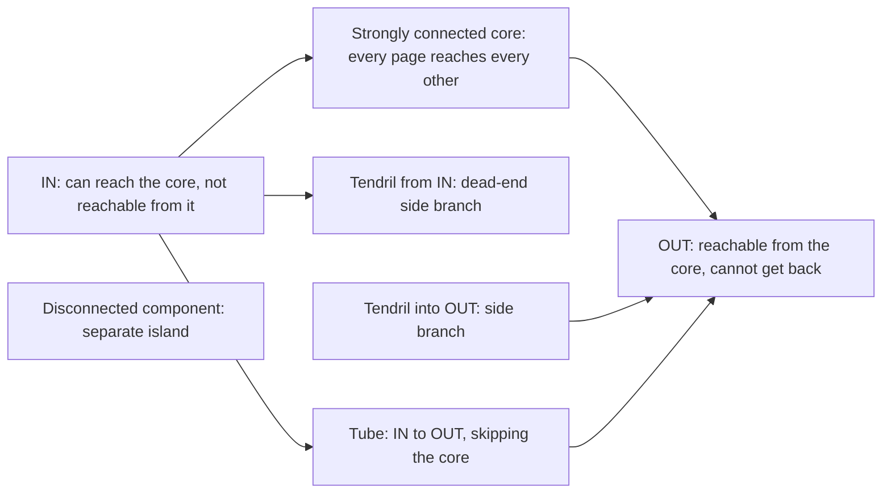
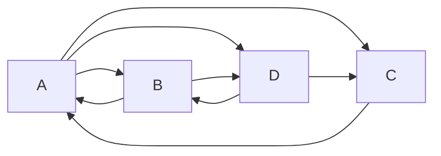
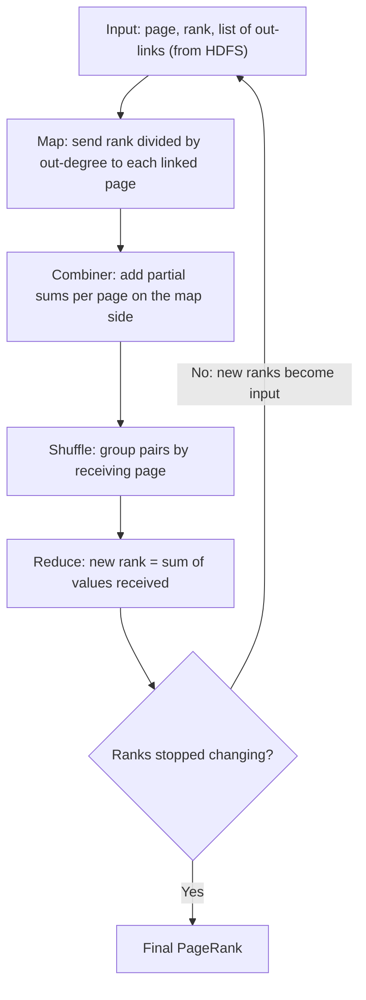
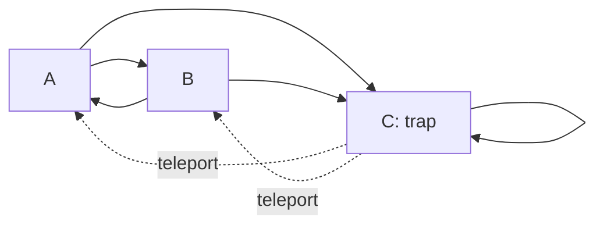

## The basics first

- A **graph** is nodes joined by edges. In a **directed graph** every edge has a direction, like a one-way street.
- On the web a **page** is a node and a **hyperlink** from page X to page Y is an edge X to Y. The links going out of a page are its **out-links**; the links coming into it are its **in-links**. The number of out-links of page $j$ is written $n_j$.
- A **vector** is a list of numbers, here one rank per page. A **matrix** is a table of numbers. Multiplying a matrix by a vector means: each new entry is a row of the matrix multiplied entry by entry with the vector and added up.
- A **probability** is a number between 0 and 1. Probabilities of all the possibilities add up to 1.

## Why we need PageRank

**The problem.** Early search engines ranked pages by counting how often the search words appear on the page. People cheated by stuffing invisible repeated words on their pages (**term spam**), so the top results were junk. <Cite id="hadoop-ecosystem-mmds" loc="§5.1.1" />

**The idea.** Do not trust what a page says about itself; trust what other pages say about it. A link is a vote. A vote from an important page is worth more than a vote from an unknown page. Larry Page and Sergey Brin built Google on this idea, and Stanford holds the patent. <Cite id="pagerank-patent" /> <Cite id="mapreduce-algorithms-wiki-pagerank" />

**Everyday analogy.** A research paper is important if many important papers cite it. Citations are votes, and a citation from a famous paper counts more.

This note covers syllabus <Syl m="6" />: "PageRank overview, efficient computation of PageRank, PageRank iteration using MapReduce, use of combiners to consolidate the result vector".

## Structure of the web

**What it is.** The web is a very large **directed graph**: each page is a node and each hyperlink is a directed edge. Studies of the web found that it is not a random tangle but has a clear shape, often drawn as a **bow-tie**. <Cite id="hadoop-ecosystem-mmds" loc="§5.1.3" /> <Cite id="pagerank-wiki-webgraph" />

**The parts of the bow-tie.**

- **Strongly connected core (SCC).** A large set of pages in which you can get from any page to any other by following links. This is the heart of the web.
- **IN.** Pages from which you can reach the core, but which the core cannot reach back (for example a new page that links to popular pages that nobody links to yet).
- **OUT.** Pages that the core can reach but that cannot reach the core (for example company sites whose links only point inward to their own pages).
- **Tendrils.** Pages hanging off IN or OUT: they are reachable from IN without leading into the core, or lead into OUT without being reachable from the core.
- **Tubes.** Paths that go from IN straight to OUT without passing through the core.
- **Disconnected components.** Small islands of pages with no link path to or from the main web.

Redrawn from the usual bow-tie pictures. <Cite id="pagerank-cs246-pagerank" loc="diagram" />

**Why it matters for PageRank.** Rank can only flow along links, so in OUT and in dead-end tendrils it piles up or leaks, while IN gets little. Those are exactly the problems called dead ends and spider traps below.

<Box kind="exam">

PYQ: <PYQ id="2023-12/q6b" /> asks to explain the structure of the web with a diagram. Write: web = directed graph, the bow-tie diagram above, one line on each of the six parts, and a closing line that links decide how rank flows.

</Box>

## PageRank: the idea

**Definition.** The **PageRank** of a page is a number that measures how important it is, found from the link structure of the whole web. Equivalently, it is the long-run chance that a **random surfer** is on that page, where the surfer starts anywhere and at every step clicks one of the current page's out-links chosen at random. <Cite id="mapreduce-algorithms-wiki-pagerank" /> <Cite id="pagerank-neo4j-pagerank" />

**Why the surfer picture works.** A page with many in-links from busy pages is visited often, so it gets a high PageRank. A page that links to many others splits its visits, so each target gets only a small share.

**How the rank is shared.** If page $j$ has rank $r_j$ and $n_j$ out-links, it gives $r_j / n_j$ to each page it links to. The new rank of a page is the total it receives.

**The transition matrix.** Number the pages $1 \ldots n$. The **transition matrix** $M$ has $m_{ij} = 1/n_j$ if page $j$ links to page $i$, and $0$ otherwise. Each column of $M$ adds up to 1 (a page with out-links gives away all its rank). Let $r$ be the rank vector. The surfer rule says
$r = M r$.
In words: the rank you end with is the rank you get after one more step. This is the same as saying $r$ is the **principal eigenvector** of $M$ (the vector that $M$ only stretches, here by exactly 1), and also that $r$ is the stationary distribution of the surfer's Markov chain. <Cite id="hadoop-ecosystem-mmds" loc="§5.1.2" /> <Cite id="pagerank-wiki-markov" /> <Cite id="pagerank-wiki-eigen" />

**How it is computed: power iteration.**

1. Start with the same rank for every page: $r = (1/n, \ldots, 1/n)$.
2. Compute $r \leftarrow M r$.
3. Repeat step 2 until $r$ stops changing (the change is tiny).

For the real web, about 50 to 75 rounds are enough. The method works when the graph is strongly connected and has no dead ends; the sections below handle the web where this is not true. <Cite id="hadoop-ecosystem-mmds" loc="§5.1.2" /> <Cite id="pagerank-wiki-power" />

Redrawn from the standard small-web PageRank example. <Cite id="mapreduce-algorithms-gfg-pagerank" loc="diagram" />

<Sum>

<Given>

The four-page web in the diagram: A links to B, C, D; B links to A, D; C links to A; D links to B, C. Start with $r_0 = (\frac14, \frac14, \frac14, \frac14)$ for $(A, B, C, D)$.

</Given>

<Find>

the transition matrix $M$, the ranks after three iterations, and the final PageRank.

</Find>

<Steps>

1. **Build $M$ column by column.** Column A: A has 3 out-links, so B, C, D each get $\frac13$. Column B: 2 out-links, so A and D get $\frac12$. Column C: 1 out-link, so A gets $1$. Column D: 2 out-links, so B and C get $\frac12$. *Reason: each column shows how a page splits its rank.*

   | to \ from | A | B | C | D |
   |---|---|---|---|---|
   | A | 0 | 1/2 | 1 | 0 |
   | B | 1/3 | 0 | 0 | 1/2 |
   | C | 1/3 | 0 | 0 | 1/2 |
   | D | 1/3 | 1/2 | 0 | 0 |

2. **Iteration 1, $r_1 = M r_0$.** A $= \frac12 \cdot \frac14 + 1 \cdot \frac14 = \frac38 = \frac{9}{24}$. B $= \frac13 \cdot \frac14 + \frac12 \cdot \frac14 = \frac{1}{12} + \frac18 = \frac{5}{24}$. C $= \frac{5}{24}$ (same links in). D $= \frac13 \cdot \frac14 + \frac12 \cdot \frac14 = \frac{5}{24}$. So $r_1 = (\frac{9}{24}, \frac{5}{24}, \frac{5}{24}, \frac{5}{24})$.
3. **Iteration 2.** A $= \frac12 \cdot \frac{5}{24} + \frac{5}{24} = \frac{15}{48}$. B $= \frac13 \cdot \frac{9}{24} + \frac12 \cdot \frac{5}{24} = \frac{6}{48} + \frac{5}{48} = \frac{11}{48}$. C and D are also $\frac{11}{48}$. So $r_2 = (\frac{15}{48}, \frac{11}{48}, \frac{11}{48}, \frac{11}{48})$.
4. **Iteration 3.** A $= \frac12 \cdot \frac{11}{48} + \frac{11}{48} = \frac{33}{96} = \frac{11}{32}$. B $= \frac13 \cdot \frac{15}{48} + \frac12 \cdot \frac{11}{48} = \frac{10}{96} + \frac{11}{96} = \frac{21}{96} = \frac{7}{32}$. C and D are also $\frac{7}{32}$. So $r_3 = (\frac{11}{32}, \frac{7}{32}, \frac{7}{32}, \frac{7}{32})$, about $(0.344, 0.219, 0.219, 0.219)$.
5. **Final rank.** The values keep settling (A went $0.375$, $0.3125$, $0.344$, so it swings around a limit). At the limit $r = Mr$, so A $= \frac12 B + C$ and B $= \frac13 A + \frac12 D$. By symmetry B $=$ C $=$ D. Then B $= \frac13 A + \frac12 B$ gives $B = \frac23 A$. The total is $A + 3 \cdot \frac23 A = 3A = 1$, so $A = \frac13$ and $B = C = D = \frac29$.

</Steps>

<Answer>

After 3 rounds $r_3 = (\frac{11}{32}, \frac{7}{32}, \frac{7}{32}, \frac{7}{32})$. Final PageRank $= (\frac39, \frac29, \frac29, \frac29)$, so A is the most important page.

</Answer>

<Box kind="verify">

Every $r$ must add to 1: $\frac{9 + 5 + 5 + 5}{24} = 1$, $\frac{15 + 33}{48} = 1$, $\frac{11 + 21}{32} = 1$. Final check with $r = Mr$: A $= \frac12 \cdot \frac29 + \frac29 = \frac39$ yes; B $= \frac13 \cdot \frac39 + \frac12 \cdot \frac29 = \frac19 + \frac19 = \frac29$ yes. The iterates $0.344$ move towards $0.333$ for A, and $0.219$ towards $0.222$ for the others.

</Box>

</Sum>

<Box kind="exam">

PYQ: <PYQ id="2024-05/q6a" /> asks to explain the PageRank algorithm. Write: the idea (links are votes, random surfer), the matrix $M$ and $r = Mr$, the power-iteration steps, the four-page example above, dead ends, spider traps and taxation, and one line on how it is computed at scale.

</Box>

## Efficient computation of PageRank

**The problem.** The real web has billions of pages, so $M$ has billions of rows and columns: far too big to store as a full table. But each page links to only a handful of others, so almost every entry is 0. The vector $r$ alone has one number per page. <Cite id="hadoop-ecosystem-mmds" loc="§5.2" />

**Step 1: store only what exists (sparse form).** Keep, for each page, its **out-degree** and the **list of pages it links to**. The value $\frac{1}{\text{degree}}$ is not stored for each entry because it is the same for the whole column. For our four-page web:

| Source page | Out-degree | Destinations |
|---|---|---|
| A | 3 | B, C, D |
| B | 2 | A, D |
| C | 1 | A |
| D | 2 | B, C |

This stores 8 links instead of a full $4 \times 4 = 16$ entries; for the real web the saving is enormous. <Cite id="hadoop-ecosystem-mmds" loc="§5.2.1" />

**Step 2: spread the work.** Even the sparse table and the vector can be too big for one machine, so each iteration is run as a **MapReduce** job over many machines (next section). <Cite id="hadoop-ecosystem-dean2004" />

**Step 3: if the vector does not fit in memory.** Cut the vector into **stripes** and the matrix into matching **blocks**, so each map task only needs one piece of the vector in memory. A block form of the link table also keeps all the links for one stripe together. <Cite id="hadoop-ecosystem-mmds" loc="§5.2.4" />

## PageRank iteration using MapReduce

**What it is.** One power-iteration round $r \leftarrow M r$ is a matrix-vector product, which MapReduce already does well. So each round is one MapReduce job and we run the job again and again until the ranks settle. <Cite id="hadoop-ecosystem-mmds" loc="§5.2.2" /> <Cite id="mapreduce-algorithms-gfg-pagerank" />

**Map.** The input is one record per page: the page, its current rank $r_j$ and its list of destinations. For every destination $i$, emit the pair $(i, r_j / n_j)$. (The map also re-emits the page's link list under its own key so the structure is passed on to the next round.)

**Shuffle.** The framework groups all pairs by the key $i$, the receiving page.

**Reduce.** For each page $i$, add all the values received. The sum is the new rank $r_i$.

Redrawn from the usual PageRank-on-MapReduce pictures. <Cite id="mapreduce-algorithms-gfg-pagerank" loc="diagram" />

<Sum>

<Given>

The four-page web (A to B, C, D; B to A, D; C to A; D to B, C) with $r_0 = \frac14$ for every page. Suppose one mapper holds the records of A and B, and another holds C and D.

</Given>

<Find>

the map output, shuffle and reduce output of one round, and the effect of a combiner.

</Find>

<Steps>

1. **Map.** A has rank $\frac14$ and 3 out-links, so it emits $\frac14 \div 3 = \frac1{12}$ to each of B, C, D. B has rank $\frac14$ and 2 out-links, so it emits $\frac18$ to A and $\frac18$ to D. C emits $\frac14$ to A. D emits $\frac18$ to B and $\frac18$ to C. *Reason: a page gives its rank divided equally among its out-links.*

   | Mapper | Emitted pairs |
   |---|---|
   | 1 (A, B) | (B, 1/12), (C, 1/12), (D, 1/12), (A, 1/8), (D, 1/8) |
   | 2 (C, D) | (A, 1/4), (B, 1/8), (C, 1/8) |

2. **Combiner (optional, per mapper).** Mapper 1 adds its own values for the same key: D gets $\frac1{12} + \frac18 = \frac{5}{24}$, the other keys stay. It now sends 4 pairs instead of 5. *Reason: addition can be done in parts, so adding early shrinks the data sent over the network.*
3. **Shuffle (group by receiving page).**

   | Key | Values |
   |---|---|
   | A | 1/8, 1/4 |
   | B | 1/12, 1/8 |
   | C | 1/12, 1/8 |
   | D | 1/12, 1/8 (or 5/24 after combining) |

4. **Reduce (add per key).** A $= \frac18 + \frac14 = \frac38$. B $= \frac1{12} + \frac18 = \frac{5}{24}$. C $= \frac{5}{24}$. D $= \frac{5}{24}$.

</Steps>

<Answer>

New ranks $r_1 = (\frac38, \frac5{24}, \frac5{24}, \frac5{24}) = (\frac{9}{24}, \frac5{24}, \frac5{24}, \frac5{24})$. These are the same numbers as the matrix method, so the next round uses them as input.

</Answer>

<Box kind="verify">

The matrix-vector method above gave the same $r_1$. The total is $\frac{9 + 5 + 5 + 5}{24} = 1$, so no rank was lost. With the combiner, D still receives $\frac{5}{24}$, only as one pre-added value.

</Box>

</Sum>

### Combiners to consolidate the result vector

**What it is.** A **combiner** is a mini-reduce run on each mapper's output before the shuffle. For PageRank it adds all the values the same mapper produced for the same destination page, so one pair per destination leaves the mapper. <Cite id="hadoop-ecosystem-mmds" loc="§5.2.3" /> <Cite id="hadoop-ecosystem-dean2004" />

**Why it is allowed.** Addition is associative and commutative: adding in parts and then adding the parts gives the same total. So the final rank does not change.

**What it saves.** Many pages on one mapper link to the same popular page; without a combiner every one of those values crosses the network. With it, only one partial sum per popular page leaves the mapper.

## Problems with real webs

The simple $r = Mr$ rule assumes every page has an out-link and rank can circulate everywhere. The real web breaks this in two ways. <Cite id="hadoop-ecosystem-mmds" loc="§5.1.4" />

### Dead ends

**What it is.** A **dead end** is a page with no out-links. Its column in $M$ is all zeros, so the rank it receives has nowhere to go. After each round some rank disappears, and the total falls towards 0. <Cite id="pagerank-neo4j-pagerank" />

**Fixes.** (1) **Drop** dead ends (and the pages that become dead ends after dropping), compute ranks on the rest, then give the dropped pages a rank from their in-links. (2) **Teleport:** treat a dead end as if it linked to every page equally. (3) Use taxation (below) together with one of these.

<Sum>

<Given>

A links to B and C; B links to D; C links to D; D has no out-links. $r_0 = (\frac14, \frac14, \frac14, \frac14)$ for $(A, B, C, D)$.

</Given>

<Find>

the ranks for three rounds (a) with D as a dead end, and (b) the first round when D teleports to all pages equally.

</Find>

<Steps>

1. **(a) Round 1.** A has no in-links, so it gets 0. A sends $\frac14 \div 2 = \frac18$ to B and to C. B sends all $\frac14$ to D, and C sends all $\frac14$ to D. D sends nothing. So B $= \frac18$, C $= \frac18$, D $= \frac14 + \frac14 = \frac12$. $r_1 = (0, \frac18, \frac18, \frac12)$, total $\frac34$.
2. **(a) Round 2.** A is 0 and gets 0. A sends nothing, so B and C get 0. B sends $\frac18$ and C sends $\frac18$ to D. D's own $\frac12$ is lost. $r_2 = (0, 0, 0, \frac14)$, total $\frac14$.
3. **(a) Round 3.** Only D has rank and D sends nothing. $r_3 = (0, 0, 0, 0)$.
4. **(b) Round 1 with teleport.** D's rank $\frac14$ is shared over 4 pages: $\frac1{16}$ each. A $= 0 + \frac1{16} = \frac1{16}$. B $= \frac18 + \frac1{16} = \frac3{16}$. C $= \frac3{16}$. D $= \frac12 + \frac1{16} = \frac9{16}$.

</Steps>

<Answer>

(a) Totals fall $1 \to \frac34 \to \frac14 \to 0$: all rank leaks out through D. (b) With teleport $r_1 = (\frac1{16}, \frac3{16}, \frac3{16}, \frac9{16})$, which still adds to 1.

</Answer>

<Box kind="verify">

(a) The rank lost each round equals the rank that sat on D: $1 - \frac34 = \frac14$ (D's $r_0$), $\frac34 - \frac14 = \frac12$ (D's $r_1$), $\frac14 - 0 = \frac14$ (D's $r_2$). (b) $\frac{1 + 3 + 3 + 9}{16} = 1$, so nothing leaks.

</Box>

</Sum>

### Spider traps

**What it is.** A **spider trap** is a set of pages whose out-links all stay inside the set. The smallest one is a page that links only to itself. Rank flows in but never out, so in the end the trap holds all the rank and every other page gets 0. Nothing leaks, but the answer is useless. (This is a different thing from a "crawler trap" in web crawling, which is a page set that makes a crawler loop forever.) <Cite id="hadoop-ecosystem-mmds" loc="§5.1.5" /> <Cite id="pagerank-wiki-spidertrap" />

**Fix: taxation (teleportation).** At each step the surfer follows a link with probability $\beta$ (a good value is 0.8 to 0.9; the usual choice in practice is 0.85) and jumps to a page chosen at random with probability $1 - \beta$. The update is
$r' = \beta M r + \frac{1 - \beta}{n} \mathbf{e}$,
where $n$ is the number of pages and $\mathbf{e}$ is a vector of ones, so $\frac{1 - \beta}{n}$ is added to every page. This is called **taxation** because every page pays a small tax that is shared equally. Rank can no longer be trapped, and the total stays at 1. <Cite id="hadoop-ecosystem-mmds" loc="§5.1.5" /> <Cite id="pagerank-networkx-pagerank" /> <Cite id="pagerank-gfg-impl" />

Redrawn from the usual spider-trap pictures. <Cite id="pagerank-cs246-pagerank" loc="diagram" />

<Sum>

<Given>

Three pages: A links to B and C; B links to A and C; C links only to itself (a spider trap). Start with $r_0 = (\frac13, \frac13, \frac13)$. Taxation with $\beta = 0.8$, so $\frac{1 - \beta}{n} = \frac{0.2}{3} = \frac1{15}$.

</Given>

<Find>

(a) the ranks without taxation after one round, (b) the ranks with taxation for three rounds, and (c) the final PageRank with taxation.

</Find>

<Steps>

1. **Matrix.** Column A: B and C get $\frac12$ each. Column B: A and C get $\frac12$ each. Column C: C gets 1. So $Mr$ gives A $= \frac12 B$, B $= \frac12 A$, C $= \frac12 A + \frac12 B + C$.
2. **(a) No taxation, round 1.** A $= \frac12 \cdot \frac13 = \frac16$, B $= \frac16$, C $= \frac16 + \frac16 + \frac13 = \frac23$. Each round A and B halve, so they go to 0 and C goes to 1.
3. **(b) Taxation, round 1.** From $Mr_0 = (\frac16, \frac16, \frac23)$, multiply by 0.8 and add $\frac1{15}$: A $= \frac{2}{15} + \frac1{15} = \frac3{15}$, B $= \frac3{15}$, C $= \frac{8}{15} + \frac1{15} = \frac9{15}$. So $r_1 = (0.2, 0.2, 0.6)$.
4. **(b) Round 2.** $M r_1 = (0.1, 0.1, 0.8)$. Times 0.8 gives $(0.08, 0.08, 0.64)$. Add $\frac1{15} \approx 0.0667$: $r_2 = (\frac{11}{75}, \frac{11}{75}, \frac{53}{75}) \approx (0.147, 0.147, 0.707)$.
5. **(b) Round 3.** $M r_2 = (\frac{5.5}{75}, \frac{5.5}{75}, \frac{64}{75})$. Times 0.8: $(\frac{4.4}{75}, \frac{4.4}{75}, \frac{51.2}{75})$. Add $\frac{5}{75}$: $r_3 = (\frac{9.4}{75}, \frac{9.4}{75}, \frac{56.2}{75}) \approx (0.125, 0.125, 0.749)$.
6. **(c) Final.** At the limit $r = 0.8 Mr + \frac1{15}$. By symmetry A $=$ B, so A $= 0.8 \cdot \frac12 A + \frac1{15} = 0.4 A + \frac1{15}$, giving $0.6 A = \frac1{15}$ and $A = \frac19$. Then C $= 1 - \frac29 = \frac79$.

</Steps>

<Answer>

(a) Without taxation C grabs everything: $(\frac16, \frac16, \frac23)$ after one round and $(0, 0, 1)$ in the limit. (b) With taxation $r_1 = (0.2, 0.2, 0.6)$, $r_2 \approx (0.147, 0.147, 0.707)$, $r_3 \approx (0.125, 0.125, 0.749)$. (c) Final PageRank $= (\frac19, \frac19, \frac79) \approx (0.111, 0.111, 0.778)$: the trap is still the highest but A and B keep a fair share.

</Answer>

<Box kind="verify">

Each $r$ adds to 1: $\frac{3 + 3 + 9}{15} = 1$, $\frac{11 + 11 + 53}{75} = 1$, $\frac{9.4 + 9.4 + 56.2}{75} = 1$. Check the final answer in the C equation: $0.8 \cdot (\frac12 \cdot \frac19 + \frac12 \cdot \frac19 + \frac79) + \frac1{15} = 0.8 \cdot \frac89 + \frac1{15} = 0.7111 + 0.0667 = 0.7778 = \frac79$ yes. The round values $0.2, 0.147, 0.125$ move down towards $0.111$.

</Box>

</Sum>

| Problem | What goes wrong | Cause | Fix |
|---|---|---|---|
| Dead end | Total rank leaks towards 0 | A page with no out-links | Drop dead ends, or teleport from them, or tax |
| Spider trap | One group takes all the rank, others get 0 | A group whose links stay inside the group | Taxation: jump at random with probability $1 - \beta$ |

**Taxation in MapReduce.** The map step is unchanged. The reducer for page $i$ computes $\beta \times (\text{sum received}) + \frac{1 - \beta}{n}$. Nothing else changes in the job.

<Box kind="exam">

PYQ: <PYQ id="2024-12/q5b" /> and <PYQ id="2025-05/q5a" /> ask to explain PageRank using MapReduce, with spider traps and dead ends. Write: the idea and matrix form $r = Mr$, map and reduce of one round (with the combiner), a small traced example (the four-page sums above), what a dead end does (rank leaks), what a spider trap does (rank is absorbed), and the taxation fix $r' = \beta M r + \frac{1 - \beta}{n}\mathbf{e}$.

</Box>

## Using PageRank in a search engine

PageRank does not depend on the search words, so it is computed ahead of time for all pages. When a user searches, the engine first finds pages that match the words, then orders them using PageRank together with many other signals such as how well the text matches. <Cite id="hadoop-ecosystem-mmds" loc="§5.1.6" /> Tools for graphs include a ready-made PageRank in Spark's GraphX library, in Neo4j's graph library and in NetworkX. <Cite id="pagerank-spark-graphx" /> <Cite id="pagerank-neo4j-pagerank" /> <Cite id="pagerank-networkx-pagerank" />

## Advantages and limitations

| Advantages | Limitations |
|---|---|
| Hard to cheat by changing your own page text, because the votes come from other pages | Link farms (many fake pages linking to one page) can still raise a score |
| Computed once ahead of time, so searching is fast | Needs many rounds over the whole web graph, so it is expensive |
| One simple rule, easy to run in parallel with MapReduce | Plain MapReduce re-reads the graph from disk every round; in-memory engines such as Spark avoid this <Cite id="mapreduce-algorithms-spark-rdd" /> |
| Fixes for dead ends and spider traps are simple | Old, popular pages gain more links, so new good pages rank low at first |

## Exam summary

- PageRank = importance of a page from the links to it; random surfer; $r = Mr$ with $m_{ij} = 1/n_j$.
- Compute by power iteration: start at $1/n$, repeat $r \leftarrow Mr$ until stable.
- Store only non-zero links; use stripes or blocks when the vector is too big.
- MapReduce: map gives $r_j / n_j$ to each linked page; reduce adds; a combiner adds early.
- Dead end: rank leaks. Spider trap: rank is absorbed. Taxation $r' = \beta M r + \frac{1 - \beta}{n}\mathbf{e}$, $\beta \approx 0.8$ to $0.9$.
- Always check that the ranks add to 1 after every round.
- Related: the MapReduce algorithms note (matrix-vector multiplication) and the distance measures note.
