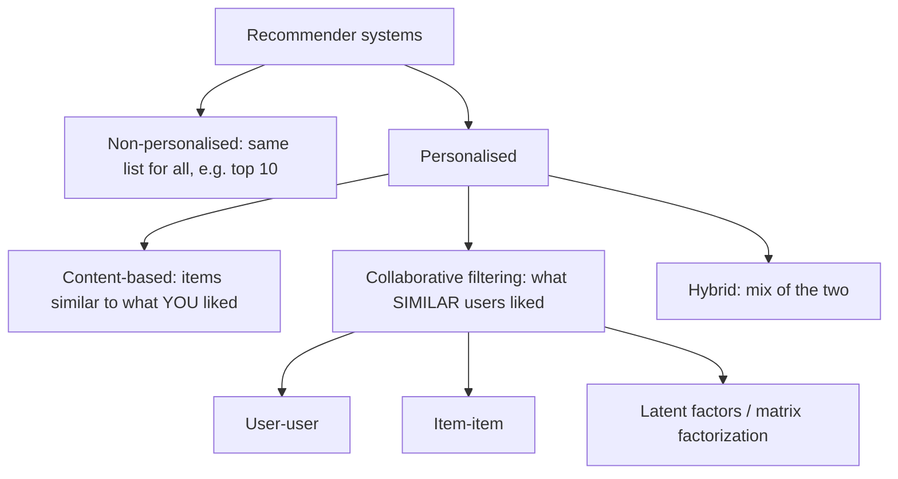
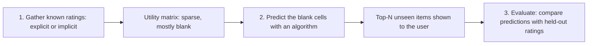
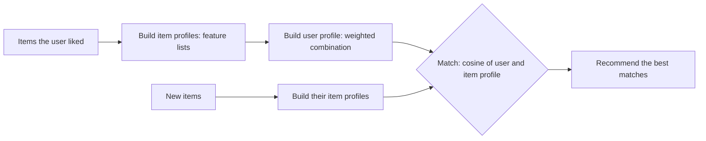
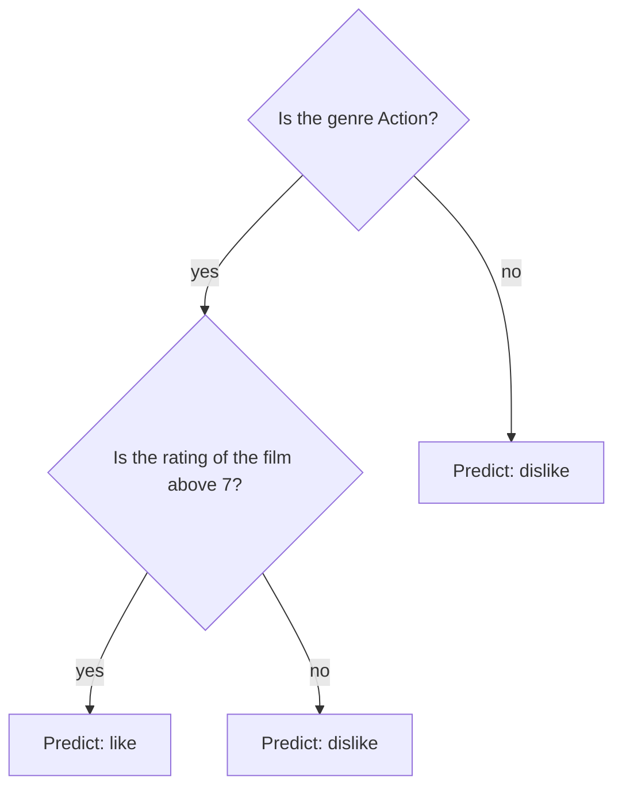
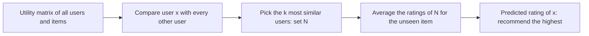

Naye ideas se pehle chhoti cheezein jo chahiye. Agar aati hain to next section pe jao.

## Pehle basics

- **User** ek insaan hai (customer, viewer). **Item** wo cheez hai jo recommend hoti hai: movie, book, song, product, news article.
- **Rating** wo number hai jo user item ko deta hai, jaise 1 se 5 stars.
- **Vector** numbers ki list hai. Ek user ki sab items pe ratings ek vector banati hain, aur item ki properties bhi. **Sparse** vector ya matrix wo hai jisme zyadatar entries khaali (ya zero) hoti hain. <Cite id="recommendation-systems-wiki-sparse" />
- **Cosine similarity** batati hai ki do vectors ki direction kitni paas hai: $\cos\theta = \dfrac{x \cdot y}{\lVert x \rVert \, \lVert y \rVert}$, jahan $x \cdot y$ dot product hai (matching numbers multiply karke add karo) aur $\lVert x \rVert$ length hai (squares ke sum ka square root). Same direction ke liye $1$, unrelated ke liye $0$, opposite ke liye negative. Ye distance measures mein detail se aa chuka hai. <Cite id="distance-measures-wiki-cosine" /> <Cite id="distance-measures-gfg-cosine" />
- Do sets ki **Jaccard similarity** = (common part ka size) divided by (dono mein se kisi mein bhi jo hai uska size). <Cite id="distance-measures-wiki-jaccard" />

## Recommender system kya hai

**Ye kya hai.** **Recommender system** (recommendation engine) ek software hai jo predict karta hai ki user ko wo items kitne pasand aayenge jo usne abhi try nahi kiye, aur phir top kuch dikhata hai. Ye syllabus <Syl m="6" /> hai, "A model for recommendation systems, content-based recommendations, collaborative filtering". <Cite id="recommendation-systems-wiki-recsys" /> <Cite id="recommendation-systems-ibm" /> <Cite id="recommendation-systems-mmds-book" />

**Ye kyun zaroori hai.** Physical shop mein shelf space kam hoti hai, isliye wo sirf popular items rakhti hai. Online shop almost zero cost pe millions items list kar sakti hai, to itna choice hota hai ki koi browse nahi kar sakta. Kuch popular items sales curve ka "head" hain aur millions kam bikne wale items **long tail** hain. Madad ke bina customer tail tak kabhi nahi pahunchta aur shop ki sales jaati hain. Recommender wo filter hai jo har insaan ko tail ke wo items dikhata hai jo use pasand aayenge. <Cite id="recommendation-systems-mmds-slides" /> <Cite id="recommendation-systems-wiki-longtail" />

**Roz ka example.** Ek achha dost jo tumhara taste jaanta hai bolta hai, "Tumhe wo film pasand aayi thi, ye bhi pasand aayegi." Recommender system millions logon ke liye wahi dost hai.

**Real examples.** Amazon ("customers who bought this also bought"), Netflix aur YouTube (aage kya dekhein), Spotify aur Pandora (songs), Flipkart (products), news sites aur social feeds. Amazon ke hisaab se uska personalized store untargeted banners ya top-seller lists se bahut zyada click-through aur conversion deta hai. <Cite id="recommendation-systems-linden2003" /> <Cite id="recommendation-systems-nvidia" />

**Bina learning ke tareeke.** Hand-picked lists ("editor's picks") aur simple aggregates ("top 10", "most popular") sabke liye same hote hain. Recommender system alag isliye hai ki wo **har user ke hisaab se tailored** hota hai. <Cite id="recommendation-systems-mmds-slides" />

## Recommender system ke types

Teen main approaches hain. Pehle do syllabus topics hain, aur teesra modern improvement. <Cite id="recommendation-systems-google-types" /> <Cite id="recommendation-systems-av" /> <Cite id="recommendation-systems-ibm" />

<Cite id="recommendation-systems-ibm" loc="diagram" /> <Cite id="recommendation-systems-google-types" />

| Type | Recommends because | Uses | Typical example |
| --- | --- | --- | --- |
| Content-based | "This is like items you liked" | Item properties and the user's own history | Movies of the same genre and actors |
| Collaborative filtering | "People like you liked this" | Only the ratings of many users | "Customers who bought this also bought" |
| Hybrid | Both reasons | Properties and ratings together | Netflix, YouTube |

<Box kind="exam">

PYQ: <PYQ id="2023-12/q5a" /> poochta hai "What is a recommender system? Explain the types" (10 marks). Definition aur kyun zaroori (long tail) likho, phir upar ki table, content-based aur collaborative ka idea diagrams ke saath thoda thoda, aur hybrid ki line. <PYQ id="2025-05-ce/q6b" /> wahi definition poochta hai aur phir classification kaise use hota hai, jo neeche content-based section mein hai.

</Box>

## Recommendation systems ka model: utility matrix

**Ye kya hai.** Book ke model mein do sets hain, **users** aur **items**, aur ek **utility function** jo user ki item ke liye preference ki degree deta hai (jaise 1 se 5 stars). Ise table mein likhte hain, **utility matrix**: har user ki ek row, har item ka ek column. Cell mein rating hoti hai agar user ne item rate kiya, warna **khaali**. <Cite id="recommendation-systems-mmds-slides" /> <Cite id="recommendation-systems-mmds-book" />

| | Avatar | LOTR | Matrix | Pirates |
| --- | --- | --- | --- | --- |
| Alice | 5 | | 4 | |
| Bob | | 3 | | 2 |
| Carol | 4 | | 5 | |
| David | | | | 4 |

Star ratings ke saath ek bana hua example. 16 cells mein se sirf 7 bhari hain.

Khaali cells hi asli baat hain. Recommender ka kaam hai **khaali cells guess karna** (kaun se high honge) aur sabse high guess wale items dikhana. Humein ye jaanna nahi ki user ko kya pasand nahi, sirf ye ki kya pasand aayega. <Cite id="recommendation-systems-mmds-slides" />

<Cite id="recommendation-systems-mmds-slides" loc="diagram" />

**1. Ratings jama karna.** Do tareeke hain. <Cite id="recommendation-systems-mmds-slides" />

- **Explicit:** logon se rate karne ko bolo. Accurate hota hai, par practice mein achha nahi chalta kyunki log bother nahi karte.
- **Implicit:** actions se seekho. Purchase ya watch ka matlab high rating. Problem low ratings ki hai: kuch na kharidne ka matlab ye nahi ki user ko wo pasand nahi.

**2. Khaali cells predict karna** agle sections ka main subject hai.

**3. Evaluate karna** is note ke end mein hai.

**Do built-in mushkilein.** Matrix **sparse** hai (zyadatar logon ne bahut kam items rate kiye hain) aur **cold start** problem hai: naye item ki koi rating nahi, naye user ki koi history nahi. <Cite id="recommendation-systems-mmds-slides" /> <Cite id="recommendation-systems-wiki-coldstart" />

## Content-based recommendation

**Ye kya hai.** Main idea: user $x$ ko wo items recommend karo jo **un items jaise hain jinhe $x$ ne pehle high rate kiya**, jahan "jaise" ka matlab item ki apni **properties** se judge hota hai. Movie ke liye properties genre, actors, director, year hain. News article ke liye uske important words. Song ke liye tempo, instrument aur mood. <Cite id="recommendation-systems-mmds-slides" /> <Cite id="recommendation-systems-google-cb" />

**Roz ka analogy.** Tumhe teen crime thrillers pasand aaye. Ek shopkeeper jo kisi aur se kabhi mila nahi, tumhe crime thrillers ki shelf pe le jaata hai. Wo sirf books dekhta hai, doosre customers nahi.

<Cite id="recommendation-systems-mmds-slides" loc="diagram" /> <Cite id="recommendation-systems-gfg-cb" /> <Cite id="recommendation-systems-google-cb" />

### Step 1: Item profiles

**Item profile** item ke features ki list (vector) hai. <Cite id="recommendation-systems-mmds-slides" />

- **Movies:** author, title, actors, director, genre. Simple Boolean vector mein har genre ya actor ki ek position hoti hai, aur movie mein ho to 1.
- **Text (news, blogs, documents):** "important" words ka set. Inhe chunne ka usual tareeka **TF-IDF** hai: koi word document mein important tab hai jab wo **us document mein frequent** ho par **doosre documents mein rare**. "the" jaisa word har jagah hai, isliye uska score zero.
- **Tags:** bahut sites users ko tag lagane deti hain, aur tags features ban jaate hain.
- **Mushkil cases:** images, music aur video ke features dhundhna mushkil hai. Pandora ka Music Genome Project isse aise solve karta hai ki trained analysts har song ko kai musical characteristics pe score karte hain. <Cite id="recommendation-systems-koren2009" /> <Cite id="recommendation-systems-wiki-genome" />

Document $j$ mein term $i$ ka TF-IDF score term frequency ko inverse document frequency se multiply karke aata hai. Book ka version: <Cite id="recommendation-systems-mmds-slides" /> <Cite id="recommendation-systems-wiki-tfidf" />

$$
\text{TF}_{ij} = \frac{f_{ij}}{\max_k f_{kj}}, \qquad \text{IDF}_i = \log_2 \frac{N}{n_i}, \qquad w_{ij} = \text{TF}_{ij} \times \text{IDF}_i
$$

Yahan $f_{ij}$ ye hai ki term $i$ document $j$ mein kitni baar aaya, $\max_k f_{kj}$ $j$ ke sabse frequent term ki count hai (isse document ki length cancel ho jaati hai), $N$ documents ki total sankhya hai aur $n_i$ un documents ki sankhya jinme term $i$ hai. Doosri sites TF aur IDF ke thode alag versions use karti hain, isliye likho ki tum kaun sa use kar rahe ho.

<Sum>

<Given>

$N = 8$ news articles ka collection. Article 1 mein word counts: "robot" 6 baar, "space" 3 baar, "movie" 4 baar. "robot" 8 mein se 2 articles mein aata hai, "space" 4 mein, aur "movie" sabhi 8 mein.

</Given>

<Find>

article 1 mein har word ka TF-IDF score, aur kaun sa word use sabse achha describe karta hai.

</Find>

<Steps>

1. Article 1 mein sabse badi count $6$ ("robot") hai. To $\text{TF}$ = robot $6/6 = 1$, space $3/6 = 0.5$, movie $4/6 \approx 0.667$. *Reason: sabse badi count se divide karne se article ki length ka effect hat jaata hai.*
2. IDF: robot $\log_2(8/2) = \log_2 4 = 2$, space $\log_2(8/4) = \log_2 2 = 1$, movie $\log_2(8/8) = \log_2 1 = 0$. *Reason: jo word kam articles mein mile wo zyada special hai.*
3. Multiply: robot $1 \times 2 = 2$, space $0.5 \times 1 = 0.5$, movie $0.667 \times 0 = 0$.

</Steps>

<Answer>

TF-IDF: robot $= 2$, space $= 0.5$, movie $= 0$. "Robot" article 1 ko sabse achha describe karta hai, aur "movie" bekaar hai kyunki har article mein hai.

</Answer>

<Box kind="verify">

Logs ko powers of two se check karo: $2^2 = 4 = 8/2$, $2^1 = 2 = 8/4$, $2^0 = 1 = 8/8$. Dhyan do ki "movie" article 1 ka doosra sabse frequent word hai, phir bhi uska score $0$ hai, isse dikhta hai ki sirf TF kaafi nahi.

</Box>

</Sum>

### Step 2: User profile

**User profile** user ke taste ko wahi feature space mein summarize karta hai jisme items hain. Sabse simple tareeka hai **user ke rate kiye items ke profiles ka weighted average**. Better variant mein har item ko uski **rating minus user ki average rating** se weight karte hain, taaki liked items profile ko apne features ki taraf kheenchein aur disliked items door dhakelein. <Cite id="recommendation-systems-mmds-slides" />

### Step 3: Match aur recommend

User profile $x$ aur item profile $i$ ke liye predicted preference unki cosine similarity hai, $u(x, i) = \cos(x, i) = \dfrac{x \cdot i}{\lVert x \rVert \, \lVert i \rVert}$. Sabse high cosine wale items recommend hote hain. <Cite id="recommendation-systems-mmds-slides" />

<Sum>

<Given>

Features ke order mein: (Action, Comedy, Romance, Sci-Fi), movie mein ho to 1. User ne M1 = (1, 0, 0, 1) ko 5 stars, M2 = (1, 0, 0, 0) ko 4 stars aur M3 = (0, 0, 1, 0) ko 1 star diya. Teen unseen movies: N1 = (1, 0, 0, 1) Action aur Sci-Fi, N2 = (0, 1, 1, 0) Comedy aur Romance, N3 = (1, 1, 0, 0) Action aur Comedy.

</Given>

<Find>

user profile (weights = rating minus user ka average) aur har unseen movie ka uske saath cosine. Kaun si recommend hogi?

</Find>

<Steps>

1. User ki average rating $(5 + 4 + 1)/3 = 10/3 \approx 3.333$. To weights: M1 ke liye $5 - 10/3 = 5/3$, M2 ke liye $4 - 10/3 = 2/3$, M3 ke liye $1 - 10/3 = -7/3$. *Reason: average se upar ki rating movie ke features ki taraf kheenchti hai, neeche ki door dhakelti hai.*
2. Weighted profiles add karo. Pehle sab weights ko 3 se multiply karo (cosine scale ignore karta hai): weights $5, 2, -7$. Action $= 5 + 2 = 7$, Comedy $= 0$, Romance $= -7$, Sci-Fi $= 5$. To user profile $x = (7, 0, -7, 5)$. *Reason: cosine ke liye sirf direction matter karti hai, to scale hata sakte hain.*
3. $x$ ki length: $\sqrt{49 + 0 + 49 + 25} = \sqrt{123} \approx 11.091$. Har $N$ mein do 1 hain, to uski length $\sqrt{2} \approx 1.414$.
4. Dot products: $x \cdot N1 = 7 + 5 = 12$; $x \cdot N2 = 0 - 7 = -7$; $x \cdot N3 = 7 + 0 = 7$.
5. Cosines (denominator $11.091 \times 1.414 = 15.684$): N1 $= 12 / 15.684 \approx 0.765$; N2 $= -7 / 15.684 \approx -0.446$; N3 $= 7 / 15.684 \approx 0.446$.

</Steps>

<Answer>

User profile $\propto (7, 0, -7, 5)$. Cosines: N1 $\approx 0.765$, N3 $\approx 0.446$, N2 $\approx -0.446$. N1 (Action aur Sci-Fi) recommend karo, phir N3. N2 (Romance) wo hai jo user ko pasand nahi aayegi.

</Answer>

<Box kind="verify">

Ranking common sense se match karti hai: user ko Action aur Sci-Fi movie bahut pasand aayi, Action se khush tha, aur Romance ko 1 star diya. Saath hi N1, M1 ke barabar hai jiski 5-star rating hai, isliye sabse similar. Ek dot product dobara check karo: $x \cdot N1 = 7 \times 1 + 0 \times 0 + (-7) \times 0 + 5 \times 1 = 12$.

</Box>

</Sum>

### Product ki properties se recommendation kaise hota hai

Exam question "how is recommendation done based on properties of the product?" bilkul content-based method hi hai. Mobile phones bechne wali online shop ka worked example: <PYQ id="2022-12-ce/q6b" /> <PYQ id="2023-12-ce/q6b" />

1. Har phone ki **properties list karo**: brand, price band, RAM, screen size, camera, battery.
2. **Har phone ka profile banao** (ek vector). Yes/no features 0 ya 1, price aur RAM jaise numbers ek similar range mein scale karo.
3. **Dekho customer ne kya kharida ya dekha** aur un phones se customer profile banao, jaise "6 GB RAM, mid-price, achha camera wala phone".
4. Catalogue ke **har phone ko customer profile se compare karo** (cosine) aur wo **sabse paas wale dikhao** jo customer ne nahi dekhe.

Kyunki sirf phone ki properties use hoti hain, system tab bhi chalta hai jab customer us type ka akela buyer ho aur phone bilkul naya ho. <Cite id="recommendation-systems-gfg-cb" /> <Cite id="recommendation-systems-av" />

### Recommendation mein classification algorithms

Match step ka doosra tareeka recommendation ko **classification** ki tarah dekhna hai. Har user ke liye, jo items usne rate kiye hain wo **training examples** hain: item ke features input hain aur "liked / not liked" label. In pe classifier train karo, phir kisi unseen item ke features dekar predict karo ki user ko pasand aayega ya nahi. Har user ke liye ek classifier seekha jaata hai, isliye recommender ek *user-specific* classification problem hai. <Cite id="recommendation-systems-wiki-recsys" /> <Cite id="recommendation-systems-gfg-cb" /> <Cite id="recommendation-systems-mmds-book" />

Aam classifiers: **decision trees**, **k-nearest neighbours**, **Naive Bayes** aur logistic regression. <Cite id="recommendation-systems-ibm" />

<Cite id="recommendation-systems-gfg-cb" loc="diagram" />

Recommendation mein classification kahan use hota hai: upar ka content-based method (har user ka ek classifier), user aur item features se "user click ya buy karega kya" predict karna, aur items ko "recommend" aur "do not recommend" mein baantna. Kharcha ye hai ki har user ko kaafi rated examples chahiye aur uske liye train kiya hua classifier. <Cite id="recommendation-systems-ibm" />

<Box kind="exam">

PYQ: <PYQ id="2025-05-ce/q6b" /> poochta hai recommender system kya hai aur classification kaise use hota hai. Definition likho, phir: har user ke liye labelled items (liked ya nahi) training set hain, item features input hain, aur decision tree, k-NN ya Naive Bayes naye items ke liye like ya dislike predict karne ko train hota hai. Upar ka decision-tree figure banao.

</Box>

### Content-based filtering se movie recommendation

<PYQ id="2025-05/q5b" /> aur <PYQ id="2024-12-ce/q6b" /> ka case study upar ke steps follow karte hain. Movies ke liye: (1) features lo genre, cast, director, plot keywords (plot words pe TF-IDF), (2) har movie ka vector banao, (3) rated movies se user profile banao (rating minus average se weighted), (4) unseen movies ko profile se cosine ke hisaab se rank karo, (5) top dikhao. Upar ka worked sum yahi karta hai. <Cite id="recommendation-systems-gfg-cb" /> <Cite id="recommendation-systems-gfg-python" />

### Content-based ke advantages aur disadvantages

| Advantages | Disadvantages |
| --- | --- |
| Doosre users ka data nahi chahiye, to items ke liye cold start nahi aur sparsity problem nahi | Achhe features dhundhna mushkil, khaaskar images, music aur video ke liye |
| Unusual taste wale user ko bhi serve kar sakta hai | **Over-specialization:** user ke existing profile ke bahar kabhi recommend nahi karta, aur logon ki kai interests hoti hain |
| Naye aur unpopular items recommend kar sakta hai (first-rater problem nahi) | Doosre users ke quality judgments use nahi kar sakta |
| Recommendation explain kar sakta hai, un features ka naam lekar jinki wajah se wo aaya | Naye user ka profile abhi nahi hota, to kuch recommend nahi ho sakta |

<Cite id="recommendation-systems-mmds-slides" /> <Cite id="recommendation-systems-google-cb" /> <Cite id="recommendation-systems-gfg-cb" />

## Collaborative filtering

**Ye kya hai.** Collaborative filtering (CF) items ko recommend karta hai **sirf bahut saare users ki ratings** se, bina ye jaane ki items kya hain. Idea: jo log pehle agree karte the wo aage bhi agree karenge. User $x$ ko wo items milte hain jo **$x$ jaise users** ko pasand aaye. <Cite id="recommendation-systems-wiki-cf" /> <Cite id="recommendation-systems-google-cf" /> <Cite id="recommendation-systems-mmds-slides" />

**Roz ka analogy.** Tum aur tumhari dost Riya ko wahi chaar films bahut pasand aayi thi. Usne ab paanchvi dekhi aur use pasand aayi. Tum uske taste pe bharosa karte ho, to tum bhi dekhte ho. Content-based wali kahani mein shopkeeper books dekhta tha. Yahan dost ne sirf dekha *kisko kya pasand aaya*.

**Kaise chalta hai (user-user).** User $x$ ke liye: <Cite id="recommendation-systems-mmds-slides" />

1. Doosre users ka set $N$ dhundho jinki ratings $x$ ki ratings se **similar** hain.
2. $x$ ki rating ka estimate $N$ ke users ki us item pe ratings se lagao.
3. Sabse high estimates wale items recommend karo.

<Cite id="recommendation-systems-mmds-slides" loc="diagram" /> <Cite id="recommendation-systems-av" /> <Cite id="recommendation-systems-google-cf" />

### Users ki similarity naapna

$r_x$ user $x$ ki ratings ka vector hai (khaali = missing). Do users ko compare karne ke teen standard tareeke: <Cite id="recommendation-systems-mmds-slides" /> <Cite id="recommendation-systems-wiki-pearson" />

| Measure | How | Problem |
| --- | --- | --- |
| Jaccard | Har user ko rate kiye items ka **set** maano aur intersection over union lo | Rating ki **value** ignore karta hai (1 aur 5 ek jaise dikhte hain) |
| Cosine | $\cos(r_x, r_y)$, missing ratings $0$ maan kar | Missing rating bahut low rating (ek "negative") ginti jaati hai |
| Centered cosine (Pearson idea) | **Har user ka average rating subtract karo**, phir cosine | Dono fix karta hai: average se upar ki ratings positive, neeche ki negative, aur missing $0$ rehti hai matlab "koi opinion nahi" |

Centering "easy marker" problem bhi fix karti hai: ek user sab ko 4 ya 5 deta hai aur doosra 1 se 3, par apne averages subtract karne ke baad unka *pattern* compare ho sakta hai. Centered cosine Pearson correlation coefficient ka hi idea hai (Pearson sirf un items pe centre karta hai jo dono users ne rate kiye, isliye dono numbers thode alag ho sakte hain). <Cite id="recommendation-systems-wiki-pearson" />

<Sum>

<Given>

Teen users aur saat items (HP1, HP2, HP3 = Harry Potter ke parts, TW = Twilight, SW1, SW2, SW3 = Star Wars ke parts). Ratings (khaali = rate nahi kiya):

| User | HP1 | HP2 | HP3 | TW | SW1 | SW2 | SW3 |
| --- | --- | --- | --- | --- | --- | --- | --- |
| A | 4 | | | 5 | 1 | | |
| B | 5 | 5 | 4 | | | | |
| C | | | | 2 | 4 | 5 | |

</Given>

<Find>

pairs (A, B) aur (A, C) ke liye Jaccard, plain cosine aur centered cosine similarity. A ke asal mein kaun paas hai?

</Find>

<Steps>

1. **Jaccard.** A ne rate kiya $\{\text{HP1, TW, SW1}\}$, B ne $\{\text{HP1, HP2, HP3}\}$, C ne $\{\text{TW, SW1, SW2}\}$. A aur B ka 1 item common, 5 alag items mein se: $1/5 = 0.2$. A aur C ke 2 items common, 4 mein se: $2/4 = 0.5$.
2. **Plain cosine**, missing ko $0$ maan kar. $A \cdot B = 4 \times 5 = 20$, $\lVert A \rVert = \sqrt{16 + 25 + 1} = \sqrt{42} \approx 6.481$, $\lVert B \rVert = \sqrt{25 + 25 + 16} = \sqrt{66} \approx 8.124$, to $\cos(A, B) = 20 / 52.65 \approx 0.380$. Phir $A \cdot C = 5 \times 2 + 1 \times 4 = 14$, $\lVert C \rVert = \sqrt{4 + 16 + 25} = \sqrt{45} \approx 6.708$, to $\cos(A, C) = 14 / 43.47 \approx 0.322$.
3. **Averages.** A: $(4 + 5 + 1)/3 = 3.333$. B: $(5 + 5 + 4)/3 = 4.667$. C: $(2 + 4 + 5)/3 = 3.667$.
4. **Centered vectors** (rating minus apna average, khaali $0$ hi rehta hai). A: HP1 $0.667$, TW $1.667$, SW1 $-2.333$. B: HP1 $0.333$, HP2 $0.333$, HP3 $-0.667$. C: TW $-1.667$, SW1 $0.333$, SW2 $1.333$.
5. **Centered cosine (A, B).** Sirf HP1 common hai: dot $= 0.667 \times 0.333 = 0.222$. Lengths: $\lVert A \rVert = \sqrt{0.444 + 2.778 + 5.444} = 2.944$, $\lVert B \rVert = \sqrt{0.111 + 0.111 + 0.444} = 0.816$. To $0.222 / (2.944 \times 0.816) \approx 0.092$.
6. **Centered cosine (A, C).** Common TW aur SW1: dot $= 1.667 \times (-1.667) + (-2.333) \times 0.333 = -2.778 - 0.778 = -3.556$. $\lVert C \rVert = \sqrt{2.778 + 0.111 + 1.778} = 2.160$. To $-3.556 / (2.944 \times 2.160) \approx -0.559$.

</Steps>

<Answer>

| Pair | Jaccard | Cosine | Centered cosine |
| --- | --- | --- | --- |
| (A, B) | 0.2 | 0.380 | 0.092 |
| (A, C) | 0.5 | 0.322 | -0.559 |

Jaccard kehta hai C paas hai, plain cosine kehta hai B paas hai, aur centered cosine kehta hai A aur C asal mein *disagree* karte hain (negative). Centered cosine hi sensible hai: A ko Twilight pasand aayi aur Star Wars 1 nahi, jabki C ne ulta kiya.

</Answer>

<Box kind="verify">

Centered vectors check karo: har ek un items pe jo user ne rate kiye, sum zero deta hai, A: $0.667 + 1.667 - 2.333 = 0$, B: $0.333 + 0.333 - 0.667 = 0$, C: $-1.667 + 0.333 + 1.333 = 0$. (A, C) ka sign raw ratings se check karo: A TW ko high (5) aur SW1 ko low (1) deta hai, C TW ko low (2) aur SW1 ko high (4), ulta taste, to negative value sahi hai. Ye book ke example ke numbers hain. <Cite id="recommendation-systems-mmds-slides" />

</Box>

</Sum>

### Similarity se prediction tak

$N$ ko un $k$ users ka set maano jo **$x$ ke sabse similar hain aur jinhone item $i$ rate kiya hai**, aur $s_{xy}$ ko $x$ aur $y$ ki similarity. Prediction unki ratings ka simple ya similarity-weighted average hai: <Cite id="recommendation-systems-mmds-slides" />

$$
r_{xi} = \frac{1}{k} \sum_{y \in N} r_{yi}, \qquad\qquad r_{xi} = \frac{\sum_{y \in N} s_{xy}\, r_{yi}}{\sum_{y \in N} s_{xy}}
$$

Doosra form zyada similar users ko zyada weight deta hai. Negative similarity wale users ko aam taur pe $N$ se bahar rakhte hain.

<Sum>

<Given>

Ratings (khaali = rate nahi kiya). Alice ki M4 ke liye rating predict karni hai. $k = 2$ neighbours aur centered-cosine similarity use karo.

| User | M1 | M2 | M3 | M4 |
| --- | --- | --- | --- | --- |
| Alice | 5 | 3 | 4 | ? |
| Bob | 5 | 2 | 4 | 5 |
| Carol | 1 | 5 | 3 | 3 |
| Dan | 4 | 3 | 5 | 4 |

</Given>

<Find>

Alice ki M4 ke liye predicted rating.

</Find>

<Steps>

1. Averages: Alice $(5 + 3 + 4)/3 = 4$; Bob $(5 + 2 + 4 + 5)/4 = 4$; Carol $(1 + 5 + 3 + 3)/4 = 3$; Dan $(4 + 3 + 5 + 4)/4 = 4$. *Reason: centering ke liye har user ka apna average chahiye.*
2. Centered rows (M1, M2, M3, M4): Alice $(1, -1, 0, \text{blank})$; Bob $(1, -2, 0, 1)$; Carol $(-2, 2, 0, 0)$; Dan $(0, -1, 1, 0)$. Alice ka blank $0$ rehta hai.
3. Alice ke saath similarity. Bob: dot $= 1 \times 1 + (-1)(-2) + 0 = 3$; lengths $\sqrt{2}$ aur $\sqrt{6}$; $s = 3/\sqrt{12} \approx 0.866$. Carol: dot $= -2 - 2 = -4$; lengths $\sqrt{2}$ aur $\sqrt{8}$; $s = -4/4 = -1$. Dan: dot $= 0 + 1 + 0 = 1$; lengths $\sqrt{2}$ aur $\sqrt{2}$; $s = 1/2 = 0.5$.
4. $k = 2$ sabse similar users chuno jinhone M4 rate kiya: Bob $(0.866)$ aur Dan $(0.5)$. Carol sabse opposite hai, use bahar rakho. *Reason: sirf similar users ko vote karne do.*
5. Weighted average: $r = \dfrac{0.866 \times 5 + 0.5 \times 4}{0.866 + 0.5} = \dfrac{4.330 + 2}{1.366} = \dfrac{6.330}{1.366} \approx 4.63$.

</Steps>

<Answer>

Alice ki M4 ke liye predicted rating $\approx 4.63$, to M4 ek strong recommendation hai.

</Answer>

<Box kind="verify">

Jawab neighbours ki ratings $4$ aur $5$ ke beech hona chahiye, aur Bob ke $5$ ke zyada paas kyunki Bob zyada similar hai: $4.63$ aisa hi hai. Plain (unweighted) average $(5 + 4)/2 = 4.5$ hai, thoda kam, jaisa expected tha. Carol (opposite taste, $s = -1$) ko step mein hi bahar rakha gaya, isliye M4 pe uski rating answer ko neeche nahi kheenchti.

</Box>

</Sum>

### Item-item collaborative filtering

Wahi idea ulta bhi chal sakta hai. Similar users dhundhne ke bajay, **item $i$ ke liye similar items dhundho** (jinke rating columns ek jaise hon), aur $x$ ki $i$ pe rating ka estimate **$x$ ki un similar items pe apni ratings** se lagao. Wahi similarity measures aur averages kaam karte hain: <Cite id="recommendation-systems-mmds-slides" />

$$
r_{xi} = \frac{\sum_{j \in N(i;x)} s_{ij}\, r_{xj}}{\sum_{j \in N(i;x)} s_{ij}}
$$

jahan $s_{ij}$ items $i$ aur $j$ ki similarity hai, aur $N(i;x)$ $x$ ke rate kiye un items ka set hai jo $i$ ke sabse similar hain. Practice mein item-item aam taur pe user-user se **better** chalta hai, kyunki **items users se simple hote hain**: item kuch genres ka hota hai, par insaan ke kai tastes hote hain. <Cite id="recommendation-systems-mmds-slides" />

**Amazon ka approach.** Amazon ne apna recommender isi idea pe banaya. Wo **similar-items table offline** banata hai, un items ko dhundhkar jo customers saath kharidte hain, aur similarity jaise cosine, un customers ke vector pe jinhone har item kharida. Run time pe sirf user ki basket ke items lookup karta hai, to online kaam **customers ki sankhya ya catalogue size ke saath nahi badhta**, aur results real time mein aate hain. <Cite id="recommendation-systems-linden2003" />

<Sum>

<Given>

User-user sum wali hi ratings. Alice ki M4 pe rating predict karo, **items ke beech** centered-cosine similarity se (har item ka average rating un users pe subtract karo jinhone use rate kiya).

| User | M1 | M2 | M3 | M4 |
| --- | --- | --- | --- | --- |
| Alice | 5 | 3 | 4 | ? |
| Bob | 5 | 2 | 4 | 5 |
| Carol | 1 | 5 | 3 | 3 |
| Dan | 4 | 3 | 5 | 4 |

</Given>

<Find>

Alice ki M4 ke liye predicted rating.

</Find>

<Steps>

1. Item averages: M1 $(5 + 5 + 1 + 4)/4 = 3.75$; M2 $(3 + 2 + 5 + 3)/4 = 3.25$; M3 $(4 + 4 + 3 + 5)/4 = 4$; M4 $(5 + 3 + 4)/3 = 4$ (teen raters).
2. (Alice, Bob, Carol, Dan) pe centered columns: M1 $(1.25, 1.25, -2.75, 0.25)$; M2 $(-0.25, -1.25, 1.75, -0.25)$; M3 $(0, 0, -1, 1)$; M4 $(0, 1, -1, 0)$ (Alice blank $= 0$).
3. M4 aur M1 ki similarity: dot $= 1.25 \times 1 + (-2.75)(-1) = 4.0$; lengths $\sqrt{10.75} = 3.279$ aur $\sqrt{2} = 1.414$; $s_{41} = 4/(3.279 \times 1.414) \approx 0.863$.
4. M4 aur M2: dot $= -1.25 \times 1 + 1.75 \times (-1) = -3.0$; M2 ki length $= \sqrt{4.75} = 2.179$; $s_{42} = -3/(2.179 \times 1.414) \approx -0.973$.
5. M4 aur M3: dot $= (-1)(-1) = 1$; lengths $\sqrt{2}$ aur $\sqrt{2}$; $s_{43} = 1/2 = 0.5$.
6. M2 negatively similar hai, to use bahar rakho. Alice ne M1 $= 5$ aur M3 $= 4$ rate kiya. Prediction $= \dfrac{0.863 \times 5 + 0.5 \times 4}{0.863 + 0.5} = \dfrac{4.315 + 2}{1.363} \approx 4.63$.

</Steps>

<Answer>

Alice ki M4 ke liye predicted rating $\approx 4.63$ (yahan user-user jaisa hi).

</Answer>

<Box kind="verify">

Dono methods agree karte hain (rounding se pehle $4.634$ aur $4.633$), jo itni chhoti table ke liye achha sign hai. Result Alice ki apni do similar items pe ratings ($5$ aur $4$) ke beech hai aur $5$ ke paas kyunki M1, M4 ke zyada similar hai. M2, jise M4 pasand karne wale log aam taur pe dislike karte hain, ko sahi negative weight mila aur use nahi liya gaya.

</Box>

</Sum>

### E-commerce site mein collaborative filtering

Flipkart ya Amazon jaisi site ke liye: <PYQ id="2023-05-ce/q6b" /> <PYQ id="2024-05-ce/q6b" />

1. **Jama karo** purchases, ratings, clicks aur add-to-cart ko user-by-item matrix mein. Purchase ko high implicit rating maano.
2. **Similar users dhundho** (jinhone same products bahut kharide aur rate kiye) ya **similar items** (jo products aksar saath bikte hain).
3. **Predict karo:** shopper ke liye, wo lo jo similar users ne kharida aur shopper ne nahi, ya wo products jo basket ke items jaise hain.
4. Top results ko **dikhao** "Customers who bought this also bought" aur "Recommended for you" ki tarah.

Example: Asha ne phone, back cover aur earphones kharide. Wahi phone aur cover kharidne wale bahut doosre customers ne screen guard bhi kharida, to Asha ko screen guard recommend hota hai. Kisi ko screen guard ke features describe nahi karne pade. <Cite id="recommendation-systems-linden2003" /> <Cite id="recommendation-systems-wiki-cf" /> <Cite id="recommendation-systems-ibm" />

### Collaborative filtering se movie recommendation

<PYQ id="2024-12/q6b" /> aur <PYQ id="2024-05-ce/q6b" /> movie version poochte hain. Steps: (1) user-by-movie rating matrix banao, (2) target user chuno, (3) us user ki baaki sab users se similarity centered cosine se nikalo, (4) wo $k$ sabse paas wale users lo jinhone movie dekhi hai, (5) rating ko unki similarity-weighted average se predict karo, (6) sabse high predictions wali unseen movies recommend karo. Upar ka user-user sum yahi hai. <Cite id="recommendation-systems-gfg-python" /> <Cite id="recommendation-systems-av" />

### Collaborative filtering ke advantages aur disadvantages

| Advantages | Disadvantages |
| --- | --- |
| Kisi bhi type ke item ke liye chalta hai; **feature selection nahi** chahiye | **Cold start:** match dhundhne ke liye system mein kaafi users chahiye |
| Surprising items recommend kar sakta hai jo user kabhi search nahi karta | **Sparsity:** common ratings kam, to same items rate karne wale users dhundhna mushkil |
| Jaise jaise log judte hain, behtar hota hai | **First-rater problem:** wo item recommend nahi kar sakta jise kisi ne rate nahi kiya (naye ya esoteric items) |
| | **Popularity bias:** popular items recommend karta hai aur unusual taste ko serve nahi kar paata |

<Cite id="recommendation-systems-mmds-slides" /> <Cite id="recommendation-systems-wiki-recsys" /> <Cite id="recommendation-systems-google-cf" />

**Speed.** Har request ke liye $k$ sabse similar users dhundhna bahut slow hai ($O(|X|)$ per query, $X$ = users ka set), isliye ise pre-compute karte hain ya near-neighbour search, clustering ya dimensionality reduction se karte hain. <Cite id="recommendation-systems-mmds-slides" />

## Collaborative versus content-based

<PYQ id="2024-05/q5a" /> collaborative filtering aur content-based system se uska difference poochta hai.

| Point | Content-based | Collaborative filtering |
| --- | --- | --- |
| Uses | Item **properties** aur user ki apni history | Sirf bahut users ki **ratings** |
| Idea | Wo items jo tumhe pasand aaye items jaise | Similar rating pattern wale users (ya items) |
| Needs item features | Haan, aur banana mushkil ho sakta hai | Nahi |
| Needs other users | Nahi | Haan, bahut saare |
| New item | Features pata ho to turant recommend ho sakta hai | Jab tak koi rate na kare tab tak nahi |
| New user | Nahi (profile nahi) jab tak kuch rate na kare | Nahi (history nahi) |
| Variety | Kam: over-specializes | Zyada: unexpected items recommend kar sakta hai |
| Explains itself | Aasaani se (features list karta hai) | Mushkil ("people like you") |
| Example | Pandora song attributes match karta hai | Amazon "customers who bought this also bought" |

<Cite id="recommendation-systems-mmds-slides" /> <Cite id="recommendation-systems-gfg-cb" /> <Cite id="recommendation-systems-google-types" /> <Cite id="recommendation-systems-av" />

### Hybrid methods

Har method doosre ki kamzori cover karta hai, isliye real systems dono mix karte hain. Ek tareeka: do ya zyada recommenders chalao aur unki predictions combine karo (jaise linear weighted sum se). Doosra: collaborative filtering mein content-based profiles jodo: new-item problem ke liye item profiles aur new-user problem ke liye user demographics. <Cite id="recommendation-systems-mmds-slides" /> <Cite id="recommendation-systems-ibm" />

### Latent-factor models (chhoti si jhalak)

Book ka teesra approach. Users ya items ko seedha compare karne ke bajay, **matrix factorization** har user aur har item ko chhoti si hidden **factors** ki list se describe karta hai (movies ke liye kuch aisa jaise "serious versus escapist"). Predicted rating user aur item ki factor lists ka dot product hai. Ye models Netflix Prize contest ke winning solutions ka central hissa the aur plain nearest-neighbour methods se behtar nikle. <Cite id="recommendation-systems-koren2009" /> <Cite id="recommendation-systems-wiki-mf" /> <Cite id="recommendation-systems-wiki-netflix" />

## Recommender ko evaluate karna

**Kuch known ratings chhupao, unhe predict karo, aur compare karo.** Known ratings ko training part aur hidden test part mein baanto, test ratings predict karo aur error naapo. Usual measure **root-mean-square error (RMSE)** hai: har error ka square, average, phir square root. Chhota better hai. Doosre checks: top-10 list ki precision aur coverage (kitne users aur items ke liye predict kar sakta hai). Sirf accuracy kabhi point miss kar deti hai: diversity, context aur list ka order bhi matter karte hain. <Cite id="recommendation-systems-mmds-slides" /> <Cite id="recommendation-systems-wiki-rmse" />

$$
\text{RMSE} = \sqrt{\frac{1}{n} \sum_{(x,i)} \left( r_{xi} - r^{*}_{xi} \right)^2}
$$

jahan $r_{xi}$ predicted rating hai, $r^{*}_{xi}$ asli hidden rating aur $n$ test ratings ki sankhya.

<Sum>

<Given>

Chaar hidden ratings aur system ki predictions: true $= (4, 3, 5, 2)$, predicted $= (3.5, 3, 4, 2.5)$.

</Given>

<Find>

RMSE.

</Find>

<Steps>

1. Errors (predicted minus true): $-0.5,\ 0,\ -1,\ +0.5$. *Reason: har test rating ka error.*
2. Squares: $0.25,\ 0,\ 1,\ 0.25$. Sum $= 1.5$.
3. Mean: $1.5 / 4 = 0.375$. Square root: $\sqrt{0.375} \approx 0.612$.

</Steps>

<Answer>

$\text{RMSE} \approx 0.612$ stars.

</Answer>

<Box kind="verify">

$0.612$ ka RMSE sabse chhote error ($0$) aur sabse bade ($1$) ke beech hai, jaisa hona chahiye. Mean absolute error $(0.5 + 0 + 1 + 0.5)/4 = 0.5$ hai, aur RMSE kabhi usse chhota nahi hota, to $0.612 \ge 0.5$ sahi hai. RMSE bada isliye hai ki squaring $1$ ke ek error ko zyada saza deti hai.

</Box>

</Sum>

## Exam-ready summary

Recommender system predict karta hai ki user ko kya pasand aayega aur sabse achhe items dikhata hai, jo bahut saare items ki long-tail problem solve karta hai. Ye **utility matrix** (users by items, zyadatar khaali) pe kaam karta hai, jiski ratings explicitly ya implicitly jama hoti hain, aur kaam khaali jagah bharna hai. **Content-based** systems properties se item profiles banate hain (text ke liye TF-IDF), liked items se user profile, aur wo items recommend karte hain jinka us profile se cosine sabse high ho; doosre users nahi chahiye par over-specialize karte hain. **Collaborative filtering** sirf ratings use karta hai: user-user similar users dhundhta hai (centered cosine ya Pearson), item-item similar items, aur prediction similarity-weighted average hai; features nahi chahiye par cold start, sparsity aur first-rater problem hote hain. **Hybrid** dono combine karta hai, aur matrix factorization models Netflix Prize winners ka central hissa the.

<Box kind="key">

Content-based poochta hai "ye **item** kis jaisa hai?", collaborative filtering poochta hai "is **user** jaise aur kaun hai?". Users compare karne se pehle har user ka average rating subtract karo, warna missing rating low rating samjhi jaayegi.

</Box>
