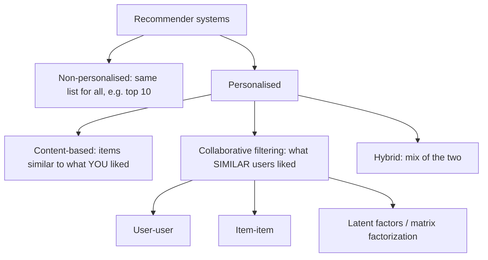
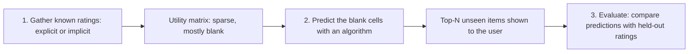
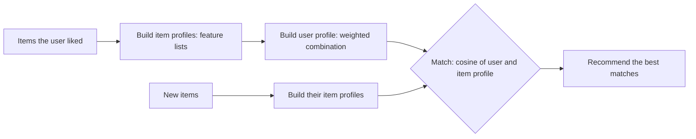
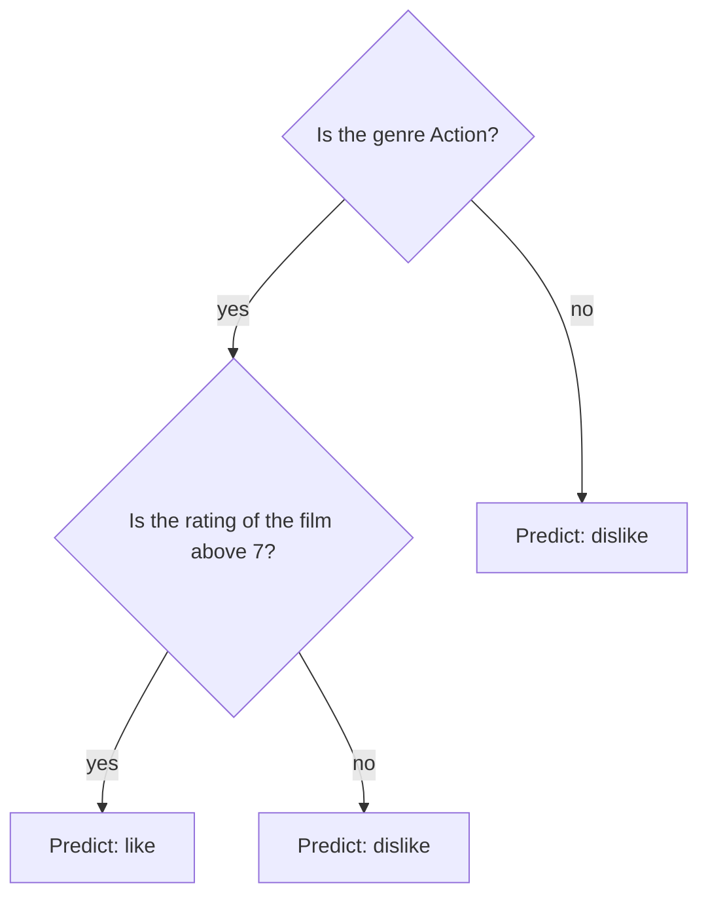
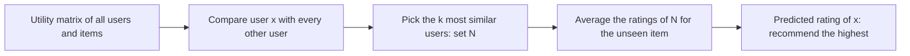

Before the new ideas, here are the small ones you need. If you know them, skip to the next section.

## The basics first

- A **user** is a person (a customer, a viewer). An **item** is the thing being recommended: a movie, a book, a song, a product, a news article.
- A **rating** is a number a user gives an item, for example 1 to 5 stars.
- A **vector** is a list of numbers. A user's ratings for all items form a vector, and so do the properties of an item. A **sparse** vector or matrix is one where most entries are empty (or zero). <Cite id="recommendation-systems-wiki-sparse" />
- **Cosine similarity** tells how close the direction of two vectors is: $\cos\theta = \dfrac{x \cdot y}{\lVert x \rVert \, \lVert y \rVert}$, where $x \cdot y$ is the dot product (multiply matching numbers, add) and $\lVert x \rVert$ is the length (square root of the sum of squares). It is $1$ for the same direction, $0$ for unrelated and negative for opposite. It was covered in detail under distance measures. <Cite id="distance-measures-wiki-cosine" /> <Cite id="distance-measures-gfg-cosine" />
- **Jaccard similarity** of two sets is (size of the common part) divided by (size of everything in either). <Cite id="distance-measures-wiki-jaccard" />

## What a recommender system is

**What it is.** A **recommender system** (recommendation engine) is software that predicts how much a user will like items they have not tried yet, and then shows the top few. This is syllabus <Syl m="6" />, "A model for recommendation systems, content-based recommendations, collaborative filtering". <Cite id="recommendation-systems-wiki-recsys" /> <Cite id="recommendation-systems-ibm" /> <Cite id="recommendation-systems-mmds-book" />

**Why it is needed.** A physical shop has limited shelf space, so it stocks only the popular items. An online shop can list millions of items at almost no cost, so there is more choice than anyone can browse. The few popular items are the "head" of a sales curve and the millions of rarely bought ones are the **long tail**. Without help, the customer never finds the tail, and the shop loses sales. A recommender is the filter that connects each person to the items in the tail they would like. <Cite id="recommendation-systems-mmds-slides" /> <Cite id="recommendation-systems-wiki-longtail" />

**Everyday analogy.** A good friend who knows your taste says, "You liked that film, you will like this one." A recommender system is that friend for millions of people at once.

**Real examples.** Amazon ("customers who bought this also bought"), Netflix and YouTube (what to watch next), Spotify and Pandora (songs), Flipkart (products), news sites and social feeds. Amazon says its personalized store gets much higher click-through and conversion than untargeted banners or top-seller lists. <Cite id="recommendation-systems-linden2003" /> <Cite id="recommendation-systems-nvidia" />

**Ways without any learning.** Hand-picked lists ("editor's picks") and simple aggregates ("top 10", "most popular") are the same for everyone. A recommender system is different because it is **tailored to each user**. <Cite id="recommendation-systems-mmds-slides" />

## Types of recommender system

There are three main approaches. The first two are the syllabus topics, and the third is the modern improvement. <Cite id="recommendation-systems-google-types" /> <Cite id="recommendation-systems-av" /> <Cite id="recommendation-systems-ibm" />

<Cite id="recommendation-systems-ibm" loc="diagram" /> <Cite id="recommendation-systems-google-types" />

| Type | Recommends because | Uses | Typical example |
| --- | --- | --- | --- |
| Content-based | "This is like items you liked" | Item properties and the user's own history | Movies of the same genre and actors |
| Collaborative filtering | "People like you liked this" | Only the ratings of many users | "Customers who bought this also bought" |
| Hybrid | Both reasons | Properties and ratings together | Netflix, YouTube |

<Box kind="exam">

PYQ: <PYQ id="2023-12/q5a" /> asks "What is a recommender system? Explain the types" (10 marks). Write the definition and why it is needed (long tail), then the table above, the content-based and collaborative ideas in a few lines each with the diagrams, and the hybrid line. <PYQ id="2025-05-ce/q6b" /> asks the same definition and then how classification is used, which is in the content-based section below.

</Box>

## A model for recommendation systems: the utility matrix

**What it is.** The book's model has two sets, **users** and **items**, and a **utility function** that gives the degree of preference of a user for an item (for example 1 to 5 stars). We write it as a table, the **utility matrix**: one row per user, one column per item. A cell holds the rating if the user rated the item and is **blank** if not. <Cite id="recommendation-systems-mmds-slides" /> <Cite id="recommendation-systems-mmds-book" />

| | Avatar | LOTR | Matrix | Pirates |
| --- | --- | --- | --- | --- |
| Alice | 5 | | 4 | |
| Bob | | 3 | | 2 |
| Carol | 4 | | 5 | |
| David | | | | 4 |

A made-up example with star ratings. Only 7 of the 16 cells are filled.

The blanks are the point. The recommender's job is to **guess the blanks** (which would be high) and show the items with the highest guesses. We do not need to know what the user dislikes, only what they will like. <Cite id="recommendation-systems-mmds-slides" />

<Cite id="recommendation-systems-mmds-slides" loc="diagram" />

**1. Gathering ratings.** There are two ways. <Cite id="recommendation-systems-mmds-slides" />

- **Explicit:** ask people to rate. It is accurate, but it does not work well in practice because people cannot be bothered.
- **Implicit:** learn from actions. A purchase or a watch implies a high rating. The problem is low ratings: not buying something does not mean the user dislikes it.

**2. Predicting the blanks** is the main subject of the next sections.

**3. Evaluating** is covered at the end of this note.

**Two built-in difficulties.** The matrix is **sparse** (most people have rated very few items) and there is the **cold start** problem: a new item has no ratings and a new user has no history. <Cite id="recommendation-systems-mmds-slides" /> <Cite id="recommendation-systems-wiki-coldstart" />

## Content-based recommendation

**What it is.** The main idea is: recommend to user $x$ the items **similar to the items $x$ rated highly before**, where "similar" is judged from the item's own **properties**. For a movie the properties are genre, actors, director, year. For a news article they are its important words. For a song, its tempo, instrument and mood. <Cite id="recommendation-systems-mmds-slides" /> <Cite id="recommendation-systems-google-cb" />

**Everyday analogy.** You liked three crime thrillers. A shopkeeper who has never met anyone else walks you to the shelf of other crime thrillers. He looks only at the books, not at other customers.

<Cite id="recommendation-systems-mmds-slides" loc="diagram" /> <Cite id="recommendation-systems-gfg-cb" /> <Cite id="recommendation-systems-google-cb" />

### Step 1: Item profiles

An **item profile** is a list (vector) of the item's features. <Cite id="recommendation-systems-mmds-slides" />

- **Movies:** author, title, actors, director, genre. A simple Boolean vector has one position per genre or actor, with 1 if the movie has it.
- **Text (news, blogs, documents):** the set of "important" words. The usual way to pick them is **TF-IDF**: a word is important in a document if it is **frequent in that document** but **rare in the other documents**. A word like "the" is everywhere, so it scores zero.
- **Tags:** many sites let users tag items, and the tags become features.
- **Hard cases:** for images, music and video, finding features is hard. Pandora's Music Genome Project solves this by having trained analysts score each song on many musical characteristics. <Cite id="recommendation-systems-koren2009" /> <Cite id="recommendation-systems-wiki-genome" />

The TF-IDF score of term $i$ in document $j$ is the term frequency times the inverse document frequency. In the book's version: <Cite id="recommendation-systems-mmds-slides" /> <Cite id="recommendation-systems-wiki-tfidf" />

$$
\text{TF}_{ij} = \frac{f_{ij}}{\max_k f_{kj}}, \qquad \text{IDF}_i = \log_2 \frac{N}{n_i}, \qquad w_{ij} = \text{TF}_{ij} \times \text{IDF}_i
$$

Here $f_{ij}$ is how many times term $i$ appears in document $j$, $\max_k f_{kj}$ is the count of the most frequent term in $j$ (this divides out the document length), $N$ is the number of documents and $n_i$ is the number of documents that contain term $i$. Other sites use slightly different TF and IDF versions, so write which one you use.

<Sum>

<Given>

A collection of $N = 8$ news articles. In article 1 the word counts are: "robot" 6 times, "space" 3 times, "movie" 4 times. The word "robot" appears in 2 of the 8 articles, "space" in 4, and "movie" in all 8.

</Given>

<Find>

the TF-IDF score of each word in article 1, and which word best describes it.

</Find>

<Steps>

1. The largest count in article 1 is $6$ ("robot"). So $\text{TF}$ = robot $6/6 = 1$, space $3/6 = 0.5$, movie $4/6 \approx 0.667$. *Reason: dividing by the largest count removes the effect of article length.*
2. IDF: robot $\log_2(8/2) = \log_2 4 = 2$, space $\log_2(8/4) = \log_2 2 = 1$, movie $\log_2(8/8) = \log_2 1 = 0$. *Reason: a word found in fewer articles is more special.*
3. Multiply: robot $1 \times 2 = 2$, space $0.5 \times 1 = 0.5$, movie $0.667 \times 0 = 0$.

</Steps>

<Answer>

TF-IDF: robot $= 2$, space $= 0.5$, movie $= 0$. "Robot" best describes article 1, and "movie" is useless because every article has it.

</Answer>

<Box kind="verify">

Check the logs by powers of two: $2^2 = 4 = 8/2$, $2^1 = 2 = 8/4$, $2^0 = 1 = 8/8$. Note that "movie" is the second most frequent word in article 1, yet scores $0$, which shows why TF alone is not enough.

</Box>

</Sum>

### Step 2: User profile

The **user profile** summarizes the user's taste in the same feature space as the items. The simplest way is a **weighted average of the profiles of the items the user rated**. A better variant weights each item by its rating **minus the user's average rating**, so liked items push the profile towards their features and disliked items push it away. <Cite id="recommendation-systems-mmds-slides" />

### Step 3: Match and recommend

For a user profile $x$ and an item profile $i$, the predicted preference is their cosine similarity, $u(x, i) = \cos(x, i) = \dfrac{x \cdot i}{\lVert x \rVert \, \lVert i \rVert}$. The items with the highest cosine are recommended. <Cite id="recommendation-systems-mmds-slides" />

<Sum>

<Given>

Features in order: (Action, Comedy, Romance, Sci-Fi), each 1 if the movie has it. A user rated M1 = (1, 0, 0, 1) with 5 stars, M2 = (1, 0, 0, 0) with 4 stars and M3 = (0, 0, 1, 0) with 1 star. Three unseen movies: N1 = (1, 0, 0, 1) Action and Sci-Fi, N2 = (0, 1, 1, 0) Comedy and Romance, N3 = (1, 1, 0, 0) Action and Comedy.

</Given>

<Find>

the user profile (weights = rating minus the user's average) and the cosine of each unseen movie with it. Which one is recommended?

</Find>

<Steps>

1. The user's average rating is $(5 + 4 + 1)/3 = 10/3 \approx 3.333$. So the weights are $5 - 10/3 = 5/3$ for M1, $4 - 10/3 = 2/3$ for M2 and $1 - 10/3 = -7/3$ for M3. *Reason: above-average ratings pull towards a movie's features, below-average push away.*
2. Add the weighted profiles. Multiply all weights by 3 first (cosine ignores scale): weights $5, 2, -7$. Action $= 5 + 2 = 7$, Comedy $= 0$, Romance $= -7$, Sci-Fi $= 5$. So the user profile is $x = (7, 0, -7, 5)$. *Reason: only the direction matters for cosine, so the scale can be removed.*
3. Length of $x$: $\sqrt{49 + 0 + 49 + 25} = \sqrt{123} \approx 11.091$. Every $N$ has two 1s, so its length is $\sqrt{2} \approx 1.414$.
4. Dot products: $x \cdot N1 = 7 + 5 = 12$; $x \cdot N2 = 0 - 7 = -7$; $x \cdot N3 = 7 + 0 = 7$.
5. Cosines (denominator $11.091 \times 1.414 = 15.684$): N1 $= 12 / 15.684 \approx 0.765$; N2 $= -7 / 15.684 \approx -0.446$; N3 $= 7 / 15.684 \approx 0.446$.

</Steps>

<Answer>

User profile $\propto (7, 0, -7, 5)$. Cosines: N1 $\approx 0.765$, N3 $\approx 0.446$, N2 $\approx -0.446$. Recommend N1 (Action and Sci-Fi), then N3. N2 (Romance) is the one the user would dislike.

</Answer>

<Box kind="verify">

The ranking matches common sense: the user loved the Action and Sci-Fi movie, was happy with Action, and gave Romance 1 star. Also N1 equals M1, whose 5-star rating makes it the most similar. Re-check a dot product: $x \cdot N1 = 7 \times 1 + 0 \times 0 + (-7) \times 0 + 5 \times 1 = 12$.

</Box>

</Sum>

### Properties of the product: how the recommendation is done

The exam question "how is recommendation done based on properties of the product?" is exactly the content-based method. A worked example for an online shop selling mobile phones: <PYQ id="2022-12-ce/q6b" /> <PYQ id="2023-12-ce/q6b" />

1. **List the properties** of each phone: brand, price band, RAM, screen size, camera, battery.
2. **Make each phone's profile** (a vector). Yes/no features are 0 or 1, numbers like price and RAM are scaled to a similar range.
3. **Look at what the customer bought or viewed** and make a customer profile from those phones, for example "a 6 GB RAM, mid-price, good camera phone".
4. **Compare** every phone in the catalogue with the customer profile (cosine) and **show the closest** ones the customer has not seen.

Because only the phone properties are used, the system works even if the customer is the only buyer of that type and even if the phone is brand new. <Cite id="recommendation-systems-gfg-cb" /> <Cite id="recommendation-systems-av" />

### Classification algorithms in recommendation

A second way to do the match step is to treat recommendation as **classification**. For each user, take the items the user has already rated as **training examples**: the item features are the input and "liked / not liked" is the label. Train a classifier on them, and then give it the features of an unseen item to predict whether the user will like it. One classifier is learned for every user, so the recommender is a *user-specific* classification problem. <Cite id="recommendation-systems-wiki-recsys" /> <Cite id="recommendation-systems-gfg-cb" /> <Cite id="recommendation-systems-mmds-book" />

Classifiers commonly used are **decision trees**, **k-nearest neighbours**, **Naive Bayes** and logistic regression. <Cite id="recommendation-systems-ibm" />

<Cite id="recommendation-systems-gfg-cb" loc="diagram" />

Where classification is used in recommendation: the content-based method above (one classifier per user), predicting "will the user click or buy" from user and item features, and splitting items into "recommend" and "do not recommend". The cost is that every user needs enough rated examples and a classifier trained for them. <Cite id="recommendation-systems-ibm" />

<Box kind="exam">

PYQ: <PYQ id="2025-05-ce/q6b" /> asks what a recommender system is and how classification is used. Write the definition, then: for each user, labelled items (liked or not) are the training set, item features are the input, and a decision tree, k-NN or Naive Bayes is trained to predict like or dislike for new items. Draw the decision-tree figure above.

</Box>

### Movie recommendation using content-based filtering

<PYQ id="2025-05/q5b" /> and the case study in <PYQ id="2024-12-ce/q6b" /> follow the steps above. For movies: (1) take the features genre, cast, director, plot keywords (TF-IDF on the plot words), (2) make each movie's vector, (3) build the user profile from the rated movies (weighted by rating minus average), (4) rank unseen movies by cosine to the profile, (5) show the top ones. The worked sum above does exactly this. <Cite id="recommendation-systems-gfg-cb" /> <Cite id="recommendation-systems-gfg-python" />

### Advantages and disadvantages of content-based

| Advantages | Disadvantages |
| --- | --- |
| Needs no data from other users, so no cold start for items and no sparsity problem | Finding good features is hard, especially for images, music and video |
| Can serve a user with unusual tastes | **Over-specialization:** never recommends outside the user's existing profile, and people have several interests |
| Can recommend new and unpopular items (no first-rater problem) | Cannot use the quality judgments of other users |
| Can explain a recommendation by naming the features that caused it | A new user has no profile yet, so nothing can be recommended |

<Cite id="recommendation-systems-mmds-slides" /> <Cite id="recommendation-systems-google-cb" /> <Cite id="recommendation-systems-gfg-cb" />

## Collaborative filtering

**What it is.** Collaborative filtering (CF) recommends items using **only the ratings of many users**, with no information about what the items are. The idea: people who agreed in the past will agree in future. User $x$ gets the items that users **similar to $x$** liked. <Cite id="recommendation-systems-wiki-cf" /> <Cite id="recommendation-systems-google-cf" /> <Cite id="recommendation-systems-mmds-slides" />

**Everyday analogy.** You and your friend Riya both loved the same four films. She has now watched a fifth and loved it. You trust her taste, so you watch it too. The shopkeeper in the content-based story looked at the books. Here the friend only looked at *who liked what*.

**How it works (user-user).** For user $x$: <Cite id="recommendation-systems-mmds-slides" />

1. Find the set $N$ of other users whose ratings are **similar** to $x$'s ratings.
2. Estimate $x$'s rating of an item from the ratings of the users in $N$ for that item.
3. Recommend the items with the highest estimates.

<Cite id="recommendation-systems-mmds-slides" loc="diagram" /> <Cite id="recommendation-systems-av" /> <Cite id="recommendation-systems-google-cf" />

### Measuring similarity of users

Let $r_x$ be the vector of user $x$'s ratings (blank = missing). The three standard ways to compare two users are: <Cite id="recommendation-systems-mmds-slides" /> <Cite id="recommendation-systems-wiki-pearson" />

| Measure | How | Problem |
| --- | --- | --- |
| Jaccard | Treat each user as the **set** of items rated and take intersection over union | Ignores the **value** of the rating (a 1 and a 5 look the same) |
| Cosine | $\cos(r_x, r_y)$ with missing ratings as $0$ | A missing rating counts as a very low rating (a "negative") |
| Centered cosine (Pearson idea) | **Subtract each user's average rating**, then cosine | Fixes both: ratings above average become positive, below average negative, and missing stays $0$ meaning "no opinion" |

Centering also fixes the "easy marker" problem: one user rates everything 4 or 5 and another 1 to 3, but after subtracting their averages their *pattern* can be compared. The centered cosine is the idea behind the Pearson correlation coefficient (Pearson centres on the items both users rated, so the two numbers can differ a little). <Cite id="recommendation-systems-wiki-pearson" />

<Sum>

<Given>

Three users and seven items (HP1, HP2, HP3 = Harry Potter parts, TW = Twilight, SW1, SW2, SW3 = Star Wars parts). Ratings (blank = not rated):

| User | HP1 | HP2 | HP3 | TW | SW1 | SW2 | SW3 |
| --- | --- | --- | --- | --- | --- | --- | --- |
| A | 4 | | | 5 | 1 | | |
| B | 5 | 5 | 4 | | | | |
| C | | | | 2 | 4 | 5 | |

</Given>

<Find>

Jaccard, plain cosine and centered cosine similarity for the pairs (A, B) and (A, C). Which user is really closer to A?

</Find>

<Steps>

1. **Jaccard.** A rated $\{\text{HP1, TW, SW1}\}$, B rated $\{\text{HP1, HP2, HP3}\}$, C rated $\{\text{TW, SW1, SW2}\}$. A and B share 1 item out of 5 different items: $1/5 = 0.2$. A and C share 2 items out of 4: $2/4 = 0.5$.
2. **Plain cosine**, missing as $0$. $A \cdot B = 4 \times 5 = 20$, $\lVert A \rVert = \sqrt{16 + 25 + 1} = \sqrt{42} \approx 6.481$, $\lVert B \rVert = \sqrt{25 + 25 + 16} = \sqrt{66} \approx 8.124$, so $\cos(A, B) = 20 / 52.65 \approx 0.380$. Then $A \cdot C = 5 \times 2 + 1 \times 4 = 14$, $\lVert C \rVert = \sqrt{4 + 16 + 25} = \sqrt{45} \approx 6.708$, so $\cos(A, C) = 14 / 43.47 \approx 0.322$.
3. **Averages.** A: $(4 + 5 + 1)/3 = 3.333$. B: $(5 + 5 + 4)/3 = 4.667$. C: $(2 + 4 + 5)/3 = 3.667$.
4. **Centered vectors** (rating minus own average, blank stays $0$). A: HP1 $0.667$, TW $1.667$, SW1 $-2.333$. B: HP1 $0.333$, HP2 $0.333$, HP3 $-0.667$. C: TW $-1.667$, SW1 $0.333$, SW2 $1.333$.
5. **Centered cosine (A, B).** Only HP1 is common: dot $= 0.667 \times 0.333 = 0.222$. Lengths: $\lVert A \rVert = \sqrt{0.444 + 2.778 + 5.444} = 2.944$, $\lVert B \rVert = \sqrt{0.111 + 0.111 + 0.444} = 0.816$. So $0.222 / (2.944 \times 0.816) \approx 0.092$.
6. **Centered cosine (A, C).** Common TW and SW1: dot $= 1.667 \times (-1.667) + (-2.333) \times 0.333 = -2.778 - 0.778 = -3.556$. $\lVert C \rVert = \sqrt{2.778 + 0.111 + 1.778} = 2.160$. So $-3.556 / (2.944 \times 2.160) \approx -0.559$.

</Steps>

<Answer>

| Pair | Jaccard | Cosine | Centered cosine |
| --- | --- | --- | --- |
| (A, B) | 0.2 | 0.380 | 0.092 |
| (A, C) | 0.5 | 0.322 | -0.559 |

Jaccard says C is closer, plain cosine says B is closer, and centered cosine says A and C actually *disagree* (negative). The centered cosine is the sensible one: A liked Twilight and disliked Star Wars 1, while C did the opposite.

</Answer>

<Box kind="verify">

Check the centered vectors: each sums to zero over the items the user rated, A: $0.667 + 1.667 - 2.333 = 0$, B: $0.333 + 0.333 - 0.667 = 0$, C: $-1.667 + 0.333 + 1.333 = 0$. Check the sign of (A, C) from the raw ratings: A rates TW high (5) and SW1 low (1), C rates TW low (2) and SW1 high (4), opposite taste, so a negative value is right. These are the numbers of the book's example. <Cite id="recommendation-systems-mmds-slides" />

</Box>

</Sum>

### From similarity to a prediction

Let $N$ be the $k$ users **most similar to $x$ who have rated item $i$**, and $s_{xy}$ the similarity of $x$ and $y$. The prediction is a simple or a similarity-weighted average of their ratings: <Cite id="recommendation-systems-mmds-slides" />

$$
r_{xi} = \frac{1}{k} \sum_{y \in N} r_{yi}, \qquad\qquad r_{xi} = \frac{\sum_{y \in N} s_{xy}\, r_{yi}}{\sum_{y \in N} s_{xy}}
$$

The second form gives more weight to more similar users. Users with a negative similarity are normally left out of $N$.

<Sum>

<Given>

Ratings (blank = not rated). Alice's rating for M4 is to be predicted. Use $k = 2$ neighbours and centered-cosine similarity.

| User | M1 | M2 | M3 | M4 |
| --- | --- | --- | --- | --- |
| Alice | 5 | 3 | 4 | ? |
| Bob | 5 | 2 | 4 | 5 |
| Carol | 1 | 5 | 3 | 3 |
| Dan | 4 | 3 | 5 | 4 |

</Given>

<Find>

Alice's predicted rating of M4.

</Find>

<Steps>

1. Averages: Alice $(5 + 3 + 4)/3 = 4$; Bob $(5 + 2 + 4 + 5)/4 = 4$; Carol $(1 + 5 + 3 + 3)/4 = 3$; Dan $(4 + 3 + 5 + 4)/4 = 4$. *Reason: centering needs each user's own average.*
2. Centered rows (M1, M2, M3, M4): Alice $(1, -1, 0, \text{blank})$; Bob $(1, -2, 0, 1)$; Carol $(-2, 2, 0, 0)$; Dan $(0, -1, 1, 0)$. Alice's blank stays $0$.
3. Similarity with Alice. Bob: dot $= 1 \times 1 + (-1)(-2) + 0 = 3$; lengths $\sqrt{2}$ and $\sqrt{6}$; $s = 3/\sqrt{12} \approx 0.866$. Carol: dot $= -2 - 2 = -4$; lengths $\sqrt{2}$ and $\sqrt{8}$; $s = -4/4 = -1$. Dan: dot $= 0 + 1 + 0 = 1$; lengths $\sqrt{2}$ and $\sqrt{2}$; $s = 1/2 = 0.5$.
4. Pick the $k = 2$ most similar users who rated M4: Bob $(0.866)$ and Dan $(0.5)$. Carol is the most opposite and is left out. *Reason: only similar users should vote.*
5. Weighted average: $r = \dfrac{0.866 \times 5 + 0.5 \times 4}{0.866 + 0.5} = \dfrac{4.330 + 2}{1.366} = \dfrac{6.330}{1.366} \approx 4.63$.

</Steps>

<Answer>

Alice's predicted rating for M4 $\approx 4.63$, so M4 is a strong recommendation.

</Answer>

<Box kind="verify">

The answer must lie between the neighbours' ratings, $4$ and $5$, and closer to Bob's $5$ because Bob is more similar: $4.63$ does. The plain (unweighted) average is $(5 + 4)/2 = 4.5$, a little lower, as expected. Carol (opposite taste, $s = -1$) is left out, as the step said, so her rating of M4 does not pull the answer down.

</Box>

</Sum>

### Item-item collaborative filtering

The same idea can be turned around. Instead of finding similar users, **for item $i$ find similar items** (items whose rating columns are alike), and estimate $x$'s rating of $i$ from **$x$'s own ratings of those similar items**. The same similarity measures and averages work: <Cite id="recommendation-systems-mmds-slides" />

$$
r_{xi} = \frac{\sum_{j \in N(i;x)} s_{ij}\, r_{xj}}{\sum_{j \in N(i;x)} s_{ij}}
$$

where $s_{ij}$ is the similarity of items $i$ and $j$, and $N(i;x)$ is the set of items rated by $x$ that are most similar to $i$. In practice item-item usually works **better** than user-user, because **items are simpler than users**: an item belongs to a few genres, but a person has many tastes. <Cite id="recommendation-systems-mmds-slides" />

**Amazon's approach.** Amazon built its recommender on this idea. It builds a **similar-items table offline** by finding items customers tend to buy together, with a similarity such as cosine over the vector of customers who bought each item. At run time it only looks up the items in the user's basket, so the online work **does not grow with the number of customers or the catalogue size**, and results come in real time. <Cite id="recommendation-systems-linden2003" />

<Sum>

<Given>

The same ratings as the user-user sum. Predict Alice's rating of M4, using centered-cosine similarity **between items** (subtract each item's average rating over the users who rated it).

| User | M1 | M2 | M3 | M4 |
| --- | --- | --- | --- | --- |
| Alice | 5 | 3 | 4 | ? |
| Bob | 5 | 2 | 4 | 5 |
| Carol | 1 | 5 | 3 | 3 |
| Dan | 4 | 3 | 5 | 4 |

</Given>

<Find>

Alice's predicted rating of M4.

</Find>

<Steps>

1. Item averages: M1 $(5 + 5 + 1 + 4)/4 = 3.75$; M2 $(3 + 2 + 5 + 3)/4 = 3.25$; M3 $(4 + 4 + 3 + 5)/4 = 4$; M4 $(5 + 3 + 4)/3 = 4$ (three raters).
2. Centered columns over (Alice, Bob, Carol, Dan): M1 $(1.25, 1.25, -2.75, 0.25)$; M2 $(-0.25, -1.25, 1.75, -0.25)$; M3 $(0, 0, -1, 1)$; M4 $(0, 1, -1, 0)$ (Alice blank $= 0$).
3. Similarity of M4 with M1: dot $= 1.25 \times 1 + (-2.75)(-1) = 4.0$; lengths $\sqrt{10.75} = 3.279$ and $\sqrt{2} = 1.414$; $s_{41} = 4/(3.279 \times 1.414) \approx 0.863$.
4. M4 with M2: dot $= -1.25 \times 1 + 1.75 \times (-1) = -3.0$; length of M2 $= \sqrt{4.75} = 2.179$; $s_{42} = -3/(2.179 \times 1.414) \approx -0.973$.
5. M4 with M3: dot $= (-1)(-1) = 1$; lengths $\sqrt{2}$ and $\sqrt{2}$; $s_{43} = 1/2 = 0.5$.
6. M2 is negatively similar, so it is left out. Alice rated M1 $= 5$ and M3 $= 4$. Prediction $= \dfrac{0.863 \times 5 + 0.5 \times 4}{0.863 + 0.5} = \dfrac{4.315 + 2}{1.363} \approx 4.63$.

</Steps>

<Answer>

Alice's predicted rating of M4 $\approx 4.63$ (same as user-user here).

</Answer>

<Box kind="verify">

The two methods agree ($4.634$ and $4.633$ before rounding), which is a good sign for a table this small. The result is between Alice's own ratings of the two similar items ($5$ and $4$) and nearer $5$ because M1 is more similar to M4. M2, which people who like M4 tend to dislike, is correctly given a negative weight and not used.

</Box>

</Sum>

### Collaborative filtering in an e-commerce site

For a site like Flipkart or Amazon: <PYQ id="2023-05-ce/q6b" /> <PYQ id="2024-05-ce/q6b" />

1. **Collect** purchases, ratings, clicks and adds-to-cart into a user-by-item matrix. A purchase counts as a high implicit rating.
2. **Find similar users** (those who bought and rated many of the same products) or **similar items** (products often bought together).
3. **Predict:** for a shopper, take what the similar users bought that the shopper has not, or take products similar to what is in the basket.
4. **Show** the top results as "Customers who bought this also bought" and "Recommended for you".

Example: Asha bought a phone, a back cover and earphones. Many other customers who bought the same phone and cover also bought a screen guard, so the screen guard is recommended to Asha. Nobody had to describe the screen guard's features. <Cite id="recommendation-systems-linden2003" /> <Cite id="recommendation-systems-wiki-cf" /> <Cite id="recommendation-systems-ibm" />

### Movie recommendation using collaborative filtering

<PYQ id="2024-12/q6b" /> and <PYQ id="2024-05-ce/q6b" /> ask for the movie version. The steps are: (1) make the user-by-movie rating matrix, (2) pick the target user, (3) compute the similarity of that user to all others with centered cosine, (4) take the $k$ closest users who have seen the movie, (5) predict the rating as their similarity-weighted average, (6) recommend the unseen movies with the highest predictions. The user-user sum above is this. <Cite id="recommendation-systems-gfg-python" /> <Cite id="recommendation-systems-av" />

### Advantages and disadvantages of collaborative filtering

| Advantages | Disadvantages |
| --- | --- |
| Works for any kind of item; **no feature selection** needed | **Cold start:** needs enough users in the system to find a match |
| Can recommend surprising items the user would never have searched for | **Sparsity:** few common ratings, so it is hard to find users who rated the same items |
| Gets better as more people join | **First-rater problem:** cannot recommend an item nobody has rated (new or esoteric items) |
| | **Popularity bias:** tends to recommend popular items and cannot serve unusual tastes |

<Cite id="recommendation-systems-mmds-slides" /> <Cite id="recommendation-systems-wiki-recsys" /> <Cite id="recommendation-systems-google-cf" />

**Speed.** Finding the $k$ most similar users for every request is too slow ($O(|X|)$ per query, $X$ = set of users), so it is pre-computed or done with near-neighbour search, clustering or dimensionality reduction. <Cite id="recommendation-systems-mmds-slides" />

## Collaborative versus content-based

<PYQ id="2024-05/q5a" /> asks for collaborative filtering and its difference from the content-based system.

| Point | Content-based | Collaborative filtering |
| --- | --- | --- |
| Uses | Item **properties** and the user's own history | **Ratings of many users** only |
| Idea | Items similar to what you liked | Users (or items) with similar rating patterns |
| Needs item features | Yes, and building them can be hard | No |
| Needs other users | No | Yes, many |
| New item | Can be recommended at once if its features are known | Cannot be recommended until someone rates it |
| New user | Cannot (no profile) until they rate something | Cannot (no history) |
| Variety | Low: over-specializes | Higher: can recommend unexpected items |
| Explains itself | Easily (lists the features) | Hard ("people like you") |
| Example | Pandora matching song attributes | Amazon "customers who bought this also bought" |

<Cite id="recommendation-systems-mmds-slides" /> <Cite id="recommendation-systems-gfg-cb" /> <Cite id="recommendation-systems-google-types" /> <Cite id="recommendation-systems-av" />

### Hybrid methods

Each method covers the other's weakness, so real systems mix them. One way is to run two or more recommenders and combine their predictions (for example with a linear weighted sum). Another is to add content-based profiles to collaborative filtering: item profiles for the new-item problem and user demographics for the new-user problem. <Cite id="recommendation-systems-mmds-slides" /> <Cite id="recommendation-systems-ibm" />

### Latent-factor models (a short look)

The third approach in the book. Instead of comparing users or items directly, **matrix factorization** describes each user and each item by a short list of hidden **factors** (for movies, something like "serious versus escapist"). A predicted rating is the dot product of the user's and the item's factor lists. These models were central to the winning solutions in the Netflix Prize contest and did better than the plain nearest-neighbour methods. <Cite id="recommendation-systems-koren2009" /> <Cite id="recommendation-systems-wiki-mf" /> <Cite id="recommendation-systems-wiki-netflix" />

## Evaluating a recommender

**Hide some known ratings, predict them, and compare.** Split the known ratings into a training part and a hidden test part, predict the test ratings and measure the error. The usual measure is the **root-mean-square error (RMSE)**: square each error, average, then take the square root. Smaller is better. Other checks are precision of the top-10 list and coverage (for how many users and items it can predict). Accuracy alone can miss the point: diversity, context and order of the list matter too. <Cite id="recommendation-systems-mmds-slides" /> <Cite id="recommendation-systems-wiki-rmse" />

$$
\text{RMSE} = \sqrt{\frac{1}{n} \sum_{(x,i)} \left( r_{xi} - r^{*}_{xi} \right)^2}
$$

where $r_{xi}$ is the predicted rating, $r^{*}_{xi}$ the true hidden rating and $n$ the number of test ratings.

<Sum>

<Given>

Four hidden ratings and the system's predictions: true $= (4, 3, 5, 2)$, predicted $= (3.5, 3, 4, 2.5)$.

</Given>

<Find>

the RMSE.

</Find>

<Steps>

1. Errors (predicted minus true): $-0.5,\ 0,\ -1,\ +0.5$. *Reason: the error of each test rating.*
2. Squares: $0.25,\ 0,\ 1,\ 0.25$. Sum $= 1.5$.
3. Mean: $1.5 / 4 = 0.375$. Square root: $\sqrt{0.375} \approx 0.612$.

</Steps>

<Answer>

$\text{RMSE} \approx 0.612$ stars.

</Answer>

<Box kind="verify">

An RMSE of $0.612$ lies between the smallest error ($0$) and the largest ($1$), as it must. The mean absolute error is $(0.5 + 0 + 1 + 0.5)/4 = 0.5$, and RMSE is never smaller than that, so $0.612 \ge 0.5$ holds. RMSE is larger because squaring punishes the one error of $1$ more.

</Box>

</Sum>

## Exam-ready summary

A recommender system predicts what a user will like and shows the best items, which solves the long-tail problem of too many items. It works on the **utility matrix** (users by items, mostly blank), whose ratings are collected explicitly or implicitly, and its job is to fill the blanks. **Content-based** systems build item profiles from properties (TF-IDF for text), a user profile from liked items, and recommend items with the highest cosine to it; they need no other users but over-specialize. **Collaborative filtering** uses only ratings: user-user finds similar users (centered cosine or Pearson), item-item finds similar items, and the prediction is a similarity-weighted average; it needs no features but suffers from cold start, sparsity and the first-rater problem. A **hybrid** combines both, and matrix factorization models were central to the Netflix Prize winners.

<Box kind="key">

Content-based asks "what is this **item** like?", collaborative filtering asks "who else is like this **user**?". Before comparing users, subtract each user's average rating, or a missing rating will be read as a low one.

</Box>
