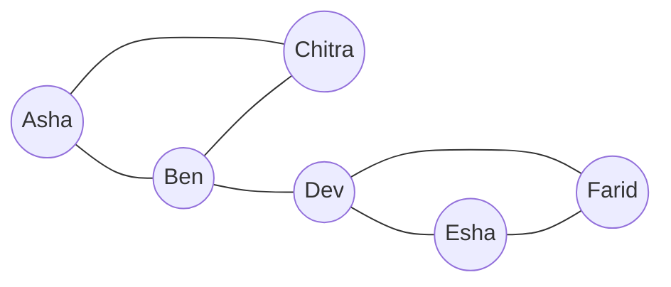
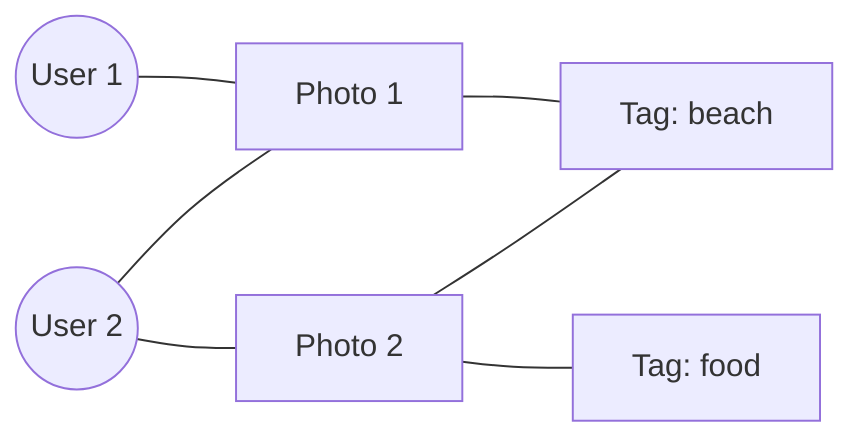
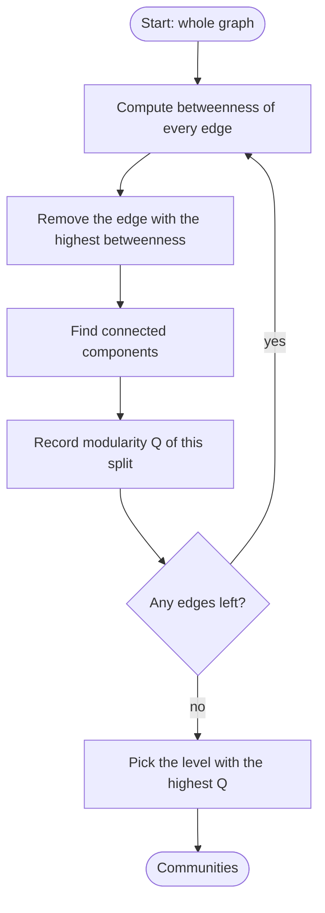
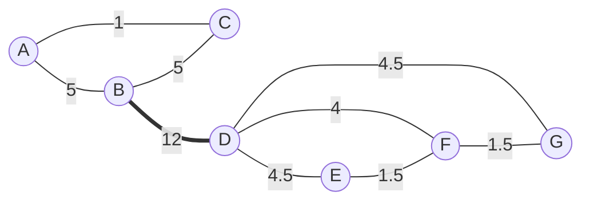
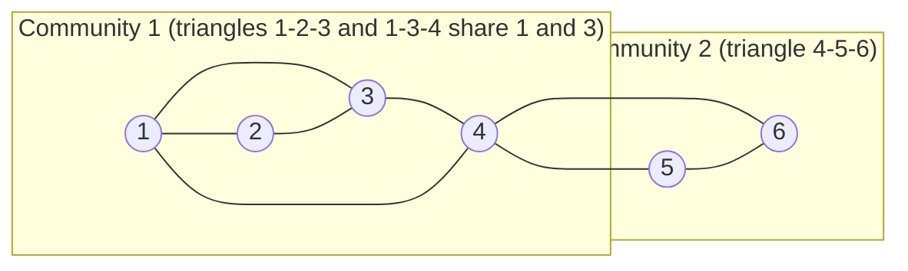

Ye note syllabus <Syl m="6" /> hai: "Social networks as graphs, clustering of social-network graphs, direct discovery of communities in a social graph". Isme batate hain ki social network kya hai aur use graph kyun banate hain, phir Girvan-Newman algorithm aur Clique Percolation Method se communities kaise dhundte hain.

## Pehle basics

- **Graph** **nodes** (dots, jinhe vertices bhi kehte hain) aur unhe jodne wali **edges** (lines) ka drawing hai. Yahan node = insaan aur edge = relationship, jaise "is friends with".
- Edge se jude do nodes **neighbours** hain. Node ki **degree** = us se kitni edges judi hain.
- **Path** edges pe chalke ek node se doosre tak jaana hai. **Shortest path** wo hai jisme sabse kam edges hon. Uski length un nodes ke beech ki **distance** hai.
- Graph **connected** hai agar kisi bhi node se kisi bhi node tak ja sako. **Connected component** ek aisa hissa hai jo andar se connected hai aur baaki se koi edge nahi.
- **Triangle** teen nodes hain jo sab aapas mein jude hain. **Clique** wahi idea kisi bhi size ke liye: node set jisme har pair jura ho. $k$ nodes ki clique **$k$-clique** hai, to triangle = 3-clique.
- **Undirected** edge dono taraf chalti hai (friendship). **Directed** edge mein arrow hota hai (A follows B). **Weighted** edge pe number hota hai (kitni calls).

## Social network kya hai

**Ye kya hai.** Social network **actors** (log, accounts, companies) aur unke beech **relationships** ka set hai. <Cite id="social-network-graphs-wiki-social-network" /> <Cite id="social-network-graphs-mmds-book" /> Do cheezein sach honi chahiye: ek type ki bahut saari entities hon, aur unke pairs ke beech kam se kam ek relationship ho. Lagbhag har asli social network ki ek aur khaasiyat hai **locality** (ya **homophily**): agar A, B ko jaanta hai aur A, C ko jaanta hai, to B aur C ke ek-doosre ko jaanne ke chance random do logon se kahin zyada hain. Graph ki bhasha mein, bahut saare triangles hote hain. <Cite id="social-network-graphs-wiki-homophily" /> <Cite id="social-network-graphs-wiki-clustering-coefficient" />

**Everyday analogy.** Aapke phone ke contacts. Aap ek dot ho. Family, classmates aur cricket team teen clumps hain. Clump ke andar lines bahut hain (sab ek-doosre ko jaante hain), aur clumps ke beech sirf kuch lines. Inhi clumps ko program se dhundhwana hai.

<Cite id="social-network-graphs-wiki-social-graph" loc="diagram" /> <Cite id="social-network-graphs-ibm-sna" />

## Social networks ki varieties

Har network friends list nahi hota. Mukhya kinds aur har ek graph mein kaise banta hai: <Cite id="social-network-graphs-mmds-book" /> <Cite id="social-network-graphs-wiki-sna" />

| Variety | Nodes | Edge ka matlab | Edge type |
| --- | --- | --- | --- |
| Friendship network (Facebook, Instagram friends) | People | Do log friends hain | Undirected |
| Follower network (Twitter/X, Instagram follow) | Accounts | Ek account doosre ko follow karta hai | Directed |
| Telephone network | Phone numbers | Dono ke beech call hui | Undirected, calls ki ginti se weighted |
| Email network | Email addresses | Email bheji gayi | Directed |
| Collaboration network | Authors, actors, programmers | Saath paper likha, film ki ya code pe kaam kiya | Undirected, joint works ki ginti se weighted |
| Kai node types (photo site) | Users, photos aur tags | User ne photo upload ki, photo pe tag hai | Edges alag-alag type ke nodes ko jodti hain |

<Cite id="social-network-graphs-ibm-sna" loc="diagram" />

## Social-network graph ki zaroorat kyun

**Ye kyun zaroori hai.** "Kaun kisko jaanta hai" ki list bas data ki rows hain. Graph ke roop mein hum poore structure ke baare mein sawaal pooch sakte hain, aur graphs ke liye bahut algorithms pehle se hain. <Cite id="social-network-graphs-ibm-sna" /> <Cite id="social-network-graphs-wiki-sna" />

1. **Communities dhundna.** Tightly connected logon ke groups: classmates, fan group, fraud ring. Is note ka mukhya topic yahi hai.
2. **Influential log dhundna.** Jin nodes ki edges bahut hain, ya jo bahut saare shortest paths par baithe hain, wo news sabse tez phailate hain. Ooncha edge ya node betweenness bridge person batata hai. <Cite id="social-network-graphs-wiki-betweenness" />
3. **Recommend karna.** "People you may know" friend ke friend ko suggest karta hai, yaani aisa triangle jisme ek edge kam hai.
4. **Targeted advertising.** Advert us community ko dikhao jise us mein interest ho.
5. **Information ya bimari ka phailna.** Dekho ki rumour ya virus edges ke saath kaise chalta hai.
6. **Fake accounts aur spam pakadna.** Fake accounts ajeeb dense blobs banate hain ya unki edge patterns alag hoti hain.
7. **Duniya kitni chhoti hai samajhna.** Zyadatar pairs sirf kuch steps door hote hain (small-world effect). <Cite id="social-network-graphs-wiki-small-world" />

<Box kind="exam">

PYQ: <PYQ id="2023-12/q5b" /> (10 marks) poochta hai "What is a social network, give varieties of social networks and the need for social network graph". Likho: definition (actors aur relationships, locality), graph model (nodes, edges, directed ya undirected, weighted), upar wali varieties table, upar wali need list, aur ek diagram.

</Box>

## Social-network graphs ki clustering

**Ye kya hai.** Social graph ko cluster karne ka matlab nodes ko groups (**communities**) mein baantna hai taaki group ke andar bahut edges hon aur groups ke beech kam. <Cite id="social-network-graphs-wiki-community" /> <Cite id="social-network-graphs-fortunato2010" /> <PYQ id="2025-05/q6c" /> bilkul yahi heading poochta hai.

**Normal clustering kyun struggle karti hai.**

- **Coordinates nahi.** k-means ko space mein points aur ek average point chahiye. Social graph mein insaan ke paas sirf neighbours hote hain, average karne ko kuch nahi. <Cite id="social-network-graphs-mmds-book" />
- **Distance bahut crude hai.** Sirf do facts hain: "edge" ya "no edge". Edge ke liye distance 1 aur no edge ke liye 2 (ya bada number) rakh sakte hain, lekin tab zyadatar pairs tie ho jaate hain aur hierarchical clustering ko pata nahi chalta ki kaun se clusters merge karein.
- **Communities overlap karti hain.** Ek insaan ek saath family, class aur hobby group mein hota hai, lekin k-means aur hierarchical clustering har node ko sirf ek cluster mein daalte hain. <Cite id="social-network-graphs-mmds-slides1" />
- **Size.** Asli graphs mein millions of nodes hote hain, to slow methods bahar.

Isliye special methods graph ke structure ka hi use karte hain. Syllabus ke sawaalon mein do aate hain: Girvan-Newman (bridges kaato) aur Clique Percolation Method (tight cliques se badho).

| Idea | Girvan-Newman | Clique Percolation |
| --- | --- | --- |
| Direction | Divisive: ek bade graph se shuru karke kaato | Agglomerative: chhoti cliques se shuru karke jodo |
| Kya use karta hai | Edge betweenness | $k$-cliques jo $k-1$ nodes share karein |
| Communities overlap? | Nahi, har node ek hi group mein | Haan, node kai mein ho sakta hai |
| Har node place hota hai? | Haan | Nahi, jo node kisi $k$-clique mein nahi wo bahar |
| Aapko kaun sa number dena hai | Kahan rukna hai (modularity use karo) | $k$ |
| Speed | Slow (har round mein har node se shortest paths) | Worst case mein slow (cliques dhundna mushkil), sparse graphs pe theek |

## Betweenness: Girvan-Newman ke peeche ka idea

**Ye kya hai.** Edge ki **betweenness** = saare node pairs ke un shortest paths ki ginti jo us edge se guzarte hain. Agar kisi pair ke kai barabar chhote paths hon, to har path fraction ginta hai taaki wo pair kul milake bilkul 1 jode. <Cite id="social-network-graphs-wiki-girvan-newman" /> <Cite id="social-network-graphs-wiki-betweenness" /> <Cite id="social-network-graphs-networkx-edge-betweenness" />

**Ye communities kyun dhundta hai.** Do shehron ke beech ki sadkon ko socho. City 1 se city 2 ka har trip ek hi bridge se jaata hai, to bridge pe bahut saare shortest trips hote hain. Shehar ke andar ki sadkon pe sirf local trips. Graph mein jo edges do communities ko jodti hain, unse un communities ke beech ke saare shortest paths guzarte hain, isliye unki **betweenness sabse zyada** hoti hai. Unhe hatao to communities alag ho jaati hain. <Cite id="social-network-graphs-girvan-newman2002" />

**Chhote graph ke liye kaise nikalein (exam method).** Har node pair ke liye shortest path(s) dhundo aur path ki har edge pe 1 jodo (agar do barabar paths hain to har path ki har edge pe $1/2$, aur aise hi). Saare pairs pe jodo, har unordered pair ek baar ginke. **Check:** saari edges ki betweenness ka total = saare pairs ki shortest-path lengths ka sum, kyunki length $L$ ka path edges pe kul $L$ daalta hai.

**Computer kaise karta hai (BFS method).** Ek start node $s$ ke liye breadth-first search chalao aur levels lo, har node tak shortest paths gino, phir neeche ke level se upar ki taraf kaam karo: har node ko flow $1$ plus uske children ka flow milta hai, aur ye flow parent edges mein us hisaab se baantta hai jitne shortest paths us parent se aate hain. Har start node ke liye repeat karo, flows jodo, aur result ko aadha karo (har pair dono sirson se count hua). <Cite id="social-network-graphs-gfg-girvan-newman" /> <Cite id="social-network-graphs-networkx-girvan-newman" /> <Cite id="social-network-graphs-neo4j-betweenness" />

## Girvan-Newman algorithm

**Ye kya hai.** Ek **divisive hierarchical** clustering method (upar se neeche: sab kuch saath se shuru, phir split). <Cite id="social-network-graphs-girvan-newman2002" /> <Cite id="social-network-graphs-wiki-girvan-newman" />

<Box kind="definition">

**Algorithm (Girvan-Newman).**

1. Graph ki har edge ki betweenness nikalo.
2. Sabse zyada betweenness wali edge hatao (agar kai tie hon to sab hatao, ya ek-ek karke kisi bhi order mein; batao ki kaun sa rule use kiya).
3. Bachi hui edges ki betweenness **dobara nikalo**.
4. Steps 2 aur 3 tab tak repeat karo jab tak koi edge na bache. Har removal ke baad connected components note karo.
5. Chuni hui level ke connected components hi communities hain. Wo level chuno jahan modularity sabse zyada ho.

</Box>

<Cite id="social-network-graphs-gfg-girvan-newman" loc="diagram" /> <Cite id="social-network-graphs-mmds-slides1" />

**Har baar dobara kyun nikalein.** Edge hatane ke baad jin shortest paths ne wo edge use ki thi unhe naya raasta dhundna padta hai, to doosri edges pe achanak zyada load aa jaata hai. Agar do communities do edges se judi hain, to unme se sirf ek ke top pe hone ki guarantee hai. Wo jaane ke baad doosri agle round mein top pe aa jaati hai. Dobara na nikalo to splits galat aate hain. <Cite id="social-network-graphs-wiki-girvan-newman" />

**Kahan rukna hai: modularity.** Agar tab tak hatate raho jab tak koi edge na bache, to har node akela ho jaata hai, jo bekaar hai. **Modularity** $Q$ nodes ke groups mein ek split ko score deta hai. <Cite id="social-network-graphs-newman-girvan2004" /> <Cite id="social-network-graphs-wiki-modularity" />

<Box kind="definition">

$$Q = \sum_{c} \left[ \frac{e_c}{m} - \left( \frac{d_c}{2m} \right)^2 \right]$$

$m$ poore graph ki kul edges hain. Har group $c$ ke liye: $e_c$ wo edges hain jinke dono sire group ke andar hain, aur $d_c$ group ke nodes ki degrees ka sum. Pehla term group ke andar girne wali edges ka fraction hai. Doosra wo fraction hai jo aap random edges (same degrees ke saath) se group ke andar expect karte. Achhe split mein andar ki edges chance se kahin zyada hoti hain, isliye $Q$ bada aata hai. $Q$ $-1$ aur $1$ ke beech hota hai, aur lagbhag $0.3$ se $0.7$ saaf community structure batata hai. <Cite id="social-network-graphs-mmds-slides1" />

</Box>

**Advantages.** Samjhana aasan; dendrogram kai levels pe structure dikhata hai; communities ki ginti pehle se guess nahi karni padti. **Limitations.** Slow: har round mein har node se shortest paths chahiye (lagbhag $n \cdot m$ kaam) aur $m$ rounds tak lag sakte hain, isliye millions of edges wale graphs ke liye bahut slow; ties ki wajah se result order pe depend karta hai; har node bas ek community mein jaata hai. Louvain method jaise tez methods modularity ko seedha optimise karte hain. <Cite id="social-network-graphs-newman2004-fast" /> <Cite id="social-network-graphs-wiki-louvain" />

### Worked example 1: nau-edge wala graph

<Sum>

<Given>

7 nodes aur 9 edges ka graph: A-B, A-C, B-C, B-D, D-E, D-F, D-G, E-F, F-G. (Ye <PYQ id="2022-12-ce/q5a" /> aur <PYQ id="2023-12-ce/q5a" /> ka graph hai.) Triangle A, B, C, B-D se group D, E, F, G se juda hai.

</Given>

<Find>

Girvan-Newman algorithm se communities.

</Find>

<Steps>

1. Pairs gino: $n = 7$ nodes, to $\binom{7}{2} = 21$ pairs. E se G ke alawa har pair ka shortest path unique hai; E-G ke do hain, length 2 ke (E-D-G aur E-F-G). *Reason: sirf us pair mein tie hai, isliye sirf wahi aadhe credits deta hai.*
2. B-D ki betweenness: \{A, B, C\} ka ek node aur \{D, E, F, G\} ka ek node wala har pair B-D se guzarta hai, to $3 \times 4 = 12$.
3. A-B: pairs A-B, A-D, A-E, A-F, A-G sab A-B se shuru hote hain, to $5$. B-C: pairs B-C, C-D, C-E, C-F, C-G, to $5$. A-C: sirf pair A-C (A, D tak B se jaata hai jo C se chhota hai), to $1$.
4. D-E: pairs D-E, B-E, A-E, C-E se $4$, plus E-G ka aadha, to $4.5$. D-G symmetry se $4.5$. D-F: pairs D-F, A-F, B-F, C-F, to $4$.
5. E-F: pair E-F plus E-G ka aadha, to $1.5$. F-G: $1.5$.
6. Sabse zyada B-D, $12$. B-D hatao. Graph do components mein tootta hai: \{A, B, C\} aur \{D, E, F, G\}.
7. Tukdon ke andar dobara nikalo. \{A, B, C\} mein har edge sirf apne pair se use hoti hai, to har ek $1$. \{D, E, F, G\} mein: D-E $= 1 + 0.5 = 1.5$, D-G $= 1.5$, E-F $= 1.5$, F-G $= 1.5$, D-F $= 1$.
8. Ab chaar edges $1.5$ pe tie hain. Unhe hatane se chaar-node group chhote tukdon mein tootta hai, to aage jaana hai ya nahi ye modularity se dekho (neeche check mein).
9. Do-community split ki modularity ($m = 9$). Group \{A, B, C\}: $e = 3$, degrees $2 + 3 + 2 = 7$, to $3/9 - (7/18)^2 = 0.3333 - 0.1512 = 0.1821$. Group \{D, E, F, G\}: $e = 5$, degrees $4 + 2 + 3 + 2 = 11$, to $5/9 - (11/18)^2 = 0.5556 - 0.3735 = 0.1821$. Total $Q = 0.364$.

</Steps>

<Answer>

Do communities: \{A, B, C\} aur \{D, E, F, G\}, bridge B-D (betweenness 12) hatane se mili. $Q \approx 0.364$.

</Answer>

<Box kind="verify">

Betweenness values (round 1): A-B 5, A-C 1, B-C 5, B-D 12, D-E 4.5, D-F 4, D-G 4.5, E-F 1.5, F-G 1.5. Inka sum $39$ hai. Saare 21 pairs ki shortest-path lengths ka sum: \{A, B, C\} ke andar $1 + 1 + 1 = 3$; \{D, E, F, G\} ke andar $1 + 1 + 1 + 1 + 1 + 2 = 7$; cross pairs: A se D, E, F, G tak $2 + 3 + 3 + 3 = 11$, B ke liye $1 + 2 + 2 + 2 = 7$, C ke liye $2 + 3 + 3 + 3 = 11$, yaani $29$. Total $3 + 7 + 29 = 39$. Match ho gaya. Aage jaane pe: $1.5$ pe tie wali chaaron edges hatao to \{A, B, C\}, \{D, F\}, \{E\}, \{G\} bachte hain aur $Q = 0.117$ aata hai, jo $0.364$ se kam hai, to do-community split sabse achhi level hai.

</Box>

</Sum>

<Cite id="social-network-graphs-mmds-slides1" loc="diagram" />

### Worked example 2: do triangles aur ek bridge

<Sum>

<Given>

6 nodes aur 7 edges ka graph: A-B, A-C, B-C, C-D, D-E, D-F, E-F. (Ye <PYQ id="2023-05-ce/q5a" /> ka graph hai.)

</Given>

<Find>

Girvan-Newman algorithm se communities.

</Find>

<Steps>

1. Har pair ka ek hi shortest path hai, to aadhe nahi. $\binom{6}{2} = 15$ pairs.
2. C-D: \{A, B, C\} aur \{D, E, F\} ke beech ka har pair isse guzarta hai, to $3 \times 3 = 9$.
3. A-C: pairs A-C, A-D, A-E, A-F, to $4$. B-C: B-C, B-D, B-E, B-F, to $4$. D-E: D-E, C-E, A-E, B-E, to $4$. D-F: symmetry se $4$.
4. A-B: sirf pair A-B, to $1$. E-F: sirf E-F, to $1$.
5. Sabse zyada C-D, $9$. Hatao. Components: \{A, B, C\} aur \{D, E, F\}.
6. Dobara nikalo: bachi chhe edges triangle edges hain jo sirf apne pair se use hoti hain, to sab $1$. Ab koi edge alag nahi dikhti, to aage koi natural split nahi.
7. Modularity ($m = 7$): har triangle mein $e = 3$ aur degree sum $2 + 2 + 3 = 7$, to har ek se $3/7 - (7/14)^2 = 0.4286 - 0.25 = 0.1786$. Total $Q = 0.357$.

</Steps>

<Answer>

Do communities: \{A, B, C\} aur \{D, E, F\}. Bridge C-D (betweenness 9) hatai gayi. $Q \approx 0.357$.

</Answer>

<Box kind="verify">

Betweenness ka sum: $1 + 4 + 4 + 9 + 4 + 4 + 1 = 27$. Shortest-path lengths ka sum: har triangle ke andar $3$ (to $6$); cross pairs mein, A se D, E, F tak $2 + 3 + 3 = 8$, B ke liye $8$, C ke liye $1 + 2 + 2 = 5$, yaani $21$. Total $6 + 21 = 27$. Match ho gaya.

</Box>

</Sum>

### Worked example 3: ties wala graph

<Sum>

<Given>

6 nodes aur 7 edges ka graph: A-B, B-C, A-D, B-E, C-F, D-E, E-F. (Ye <PYQ id="2024-05-ce/q5a" /> ka graph hai.) Ye ek ladder hai: upar ki row A-B-C, neeche ki row D-E-F, rungs A-D, B-E, C-F.

</Given>

<Find>

Girvan-Newman algorithm se communities.

</Find>

<Steps>

1. Distance 3 wale pairs A-F aur C-D hain, aur har ek ke teen shortest paths hain (har path ab $1/3$ ginta hai). A-E jaise pairs ke do shortest paths hain (har ek $1/2$). Baaki har pair ka ek hi shortest path hai.
2. A-B: pair A-B $1$, A-C $1$, A-E $\tfrac12$, B-D $\tfrac12$, A-F $\tfrac23$ (uske teen mein se do paths A-B use karte hain), C-D $\tfrac13$ (teen mein se ek). Total $4$.
3. Isi tarah ginte hue: B-C $= 4$, D-E $= 4$, E-F $= 4$ (ladder left-right aur upar-neeche symmetric hai). A-D $= 1 + \tfrac12 + \tfrac12 + \tfrac13 + \tfrac13 = \tfrac83$, aur C-F $= \tfrac83$. B-E $= 1 + 4 \times \tfrac12 + \tfrac13 + \tfrac13 = \tfrac{11}{3}$.
4. Maximum $4$ pe chaar edges tie hain: A-B, B-C, D-E, E-F. Unhe hatao (tie rule: saari tied edges hatao).
5. Bachi hain teen rungs: components \{A, D\}, \{B, E\}, \{C, F\}.
6. Modularity ($m = 7$): \{A, D\} mein $e = 1$ aur degree sum $2 + 2 = 4$, to $1/7 - (4/14)^2 = 0.1429 - 0.0816 = 0.0612$. \{C, F\} se bhi wahi $0.0612$. \{B, E\} ka degree sum $3 + 3 = 6$, to $0.1429 - 0.1837 = -0.0408$. Total $Q = 0.082$.

</Steps>

<Answer>

Tie rule "saari tied edges hatao" ke saath: communities \{A, D\}, \{B, E\}, \{C, F\}. Kam $Q \approx 0.08$ batata hai ki is ladder mein strong community structure nahi hai. Tied edges ko doosre order mein ek-ek karke hatao to alag lekin utna hi valid split aa sakta hai; apna rule likh do.

</Answer>

<Box kind="verify">

Betweenness ka sum: $4 + 4 + 4 + 4 + \tfrac83 + \tfrac83 + \tfrac{11}{3} = 16 + 9 = 25$. 15 pairs ki shortest-path lengths ka sum: 7 adjacent pairs se $7$; distance 2 ke 6 pairs (A-C, D-F, A-E, B-D, B-F, C-E) se $12$; distance 3 ke 2 pairs (A-F, C-D) se $6$. Total $25$. Match ho gaya.

</Box>

</Sum>

<Box kind="exam">

PYQ: <PYQ id="2022-12-ce/q5a" />, <PYQ id="2023-05-ce/q5a" />, <PYQ id="2023-12-ce/q5a" />, <PYQ id="2024-05-ce/q5a" /> aur <PYQ id="2025-05-ce/q5a" /> (har ek 10 marks) sab poochte hain "Determine communities for the given social network graph using Girvan-Newman". Sirf graph badalta hai. Answer ka method: (1) algorithm 4 lines mein likho, (2) har edge ki betweenness ki table, (3) sabse zyada wali hatao, (4) dobara nikalo aur components dikhao, (5) communities batao. Pichle papers ke graphs ke results:

| Paper | Edges | Sabse zyada betweenness (round 1) | Communities |
| --- | --- | --- | --- |
| 2022-12-ce, 2023-12-ce | A-B, A-C, B-C, B-D, D-E, D-F, D-G, E-F, F-G | B-D $= 12$ | \{A, B, C\} aur \{D, E, F, G\} |
| 2023-05-ce | A-B, A-C, B-C, C-D, D-E, D-F, E-F | C-D $= 9$ | \{A, B, C\} aur \{D, E, F\} |
| 2024-05-ce | A-B, B-C, A-D, B-E, C-F, D-E, E-F | A-B, B-C, D-E, E-F $4$ pe tie | \{A, D\}, \{B, E\}, \{C, F\} (weak, $Q = 0.08$) |
| 2025-05-ce | A-B, A-C, B-D, C-D, B-E, D-E | A-B aur C-D $3$ pe tie | \{A, C\} aur \{B, D, E\} ($Q = 0.11$) |

2025-05-ce ke liye betweenness values A-B $3$, C-D $3$, A-C $2$, B-D $2$, B-E $2$, D-E $2$ hain (sum $14$, jo uske 10 pairs ki shortest-path lengths ke total ke barabar hai). Paper mein graph ek picture hota hai, isliye shuru karne se pehle edge list ko figure se match zaroor karo.

</Box>

## Communities ki direct discovery

Graph ko kaatne ki jagah hum dense spots seedha bhi dhundh sakte hain. <Cite id="social-network-graphs-mmds-book" />

- **Cliques.** Clique aisa node set hai jisme har pair jura ho, sabse tight group. Sabse badi clique dhundna mushkil hai (time nodes ki ginti ke saath exponentially badh sakta hai), lekin saari maximal cliques (jinhe aur bada nahi kar sakte) list ki ja sakti hain, jaise Bron-Kerbosch algorithm se. <Cite id="social-network-graphs-wiki-clique" /> <Cite id="social-network-graphs-wiki-bron-kerbosch" />
- **Complete bipartite subgraphs.** Do groups jahan pehle group ka har member doosre group ke har member se jura hai, aur group ke andar edges zaroori nahi. Example: fans ka set jo celebrities ke ek hi set ko follow karte hain, ya accounts jo sab ek hi sites ke group ko link karte hain. Ye interest ki community ya coordinated spam ka typical sign hai. Ye frequent itemsets jaisa hi pattern hai, isliye wahi algorithms ise dhundh sakte hain. <Cite id="social-network-graphs-mmds-book" />

Strict cliques ki kamzori ye hai ki asli communities kam hi perfect hoti hain: ek dosti kam ho to clique toot jaati hai. Clique Percolation Method chhoti cliques ko chain karke ise dheela karta hai.

## Clique Percolation Method (CPM)

**Ye kya hai.** CPM communities ko $k$-cliques se banata hai, jahan $k$ aapka chuna hua number hai (3 = triangles, 4 = 4 logon ke groups jo sab ek-doosre ko jaante hain). Do $k$-cliques **adjacent** hain agar wo $k-1$ nodes share karein. **Community** wo sab kuch hai jahan adjacent $k$-cliques ke beech kood-kood ke pahunch sako. <Cite id="social-network-graphs-palla2005" /> <Cite id="social-network-graphs-wiki-cpm" />

**Ye kyun zaroori hai.** Girvan-Newman har insaan ko ek group mein rakhta hai. Asli zindagi mein aap kai groups mein ho (ghar, college, hobby). CPM overlap allow karta hai, kyunki jo node do alag chains ki cliques mein baitha hai wo dono communities mein aata hai. <Cite id="social-network-graphs-cs224w-overlap" />

**Everyday analogy.** Graph pe ek triangle wala stamp roll karo: use kisi bhi triangle pe rakh sakte ho, phir do corners fix rakhke teesre corner ko naye node pe ghuma ke aage badho (yahi hai "share $k-1$ nodes" ka matlab). Stamp jahan tak pahunch sake wo ek community. Jo node do alag rolling areas se pahunchne layak hai wo dono mein hai. <Cite id="social-network-graphs-wiki-cpm" />

<Box kind="definition">

**Algorithm (CPM).** Input: graph $G$, integer $k \ge 3$.

1. $G$ ki saari $k$-cliques dhundo ($k$ nodes ke saare sets jinme har pair jura ho).
2. **Clique graph** banao: har $k$-clique ke liye ek node, aur do nodes ke beech edge agar wo cliques theek $k-1$ nodes share karein (yaani kam se kam $k-1$).
3. Clique graph ke connected components dhundo.
4. Har component ke liye, uski $k$-cliques ke nodes ka **union** ek community hai.
5. Communities output karo. Jo node kai components ki cliques mein hai wo **overlap** node hai; jo node kisi $k$-clique mein nahi wo kisi community mein nahi.

</Box>

<Cite id="social-network-graphs-wiki-cpm" loc="diagram" /> <Cite id="social-network-graphs-cs224w-overlap" />

**$k$ kaise chunein.** Bada $k$ zyada strict hai: kam, chhoti, dense communities. Chhota $k$ dheeli, badi communities dhundta hai. Aksar kai values try karte hain aur wo rakhte hain jisme community sizes ka sabse richest spread mile. Exam graphs ke liye $k = 3$ aam starting point hai. <Cite id="social-network-graphs-cs224w-overlap" /> <Cite id="social-network-graphs-networkx-kclique" />

**Advantages.** Overlap allow karta hai; local hai (door ka badlav community nahi badalta); community ko dense maanne ke idea se match karta hai. **Limitations.** Worst case mein cliques dhundne mein exponential time lag sakta hai; achhe $k$ ki zaroorat; graph ke sparse hisse chhoot jaate hain (jin nodes ki koi $k$-clique nahi); ek extra shared node do communities ko merge kar sakta hai. <Cite id="social-network-graphs-wiki-cpm" />

### Worked example 4: nau nodes, k = 3

<Sum>

<Given>

Nodes 1 se 9 aur edges: 1-2, 1-3, 1-4, 2-3, 3-4, 4-5, 4-6, 5-6, 5-7, 5-8, 6-7, 6-8, 7-8, 7-9. $k = 3$ lo. (Ye <PYQ id="2024-05/q5b" /> ka graph hai.)

</Given>

<Find>

3-cliques aur CPM se mili communities.

</Find>

<Steps>

1. Har triangle (teen nodes, teeno edges maujood) list karo: \{1, 2, 3\} (edges 1-2, 2-3, 1-3), \{1, 3, 4\} (1-3, 3-4, 1-4), \{4, 5, 6\} (4-5, 4-6, 5-6), \{5, 6, 7\}, \{5, 6, 8\}, \{5, 7, 8\}, \{6, 7, 8\}. Kul $7$ triangles. *Reason: 3-clique matlab triangle.* Node 9 ki sirf ek edge hai (7-9), to wo kisi triangle mein nahi.
2. Un triangles ko jodo jo $k - 1 = 2$ nodes share karte hain. \{1, 2, 3\} aur \{1, 3, 4\} 1 aur 3 share karte hain: linked.
3. \{4, 5, 6\} aur \{5, 6, 7\} 5 aur 6 share karte hain: linked. \{5, 6, 7\} aur \{5, 6, 8\} 5 aur 6 share karte hain: linked. \{5, 6, 7\} aur \{5, 7, 8\} 5 aur 7 share karte hain: linked. \{6, 7, 8\} \{5, 6, 7\} ke saath 6 aur 7 share karta hai: linked. To ye paanchon ek chain hain.
4. \{1, 3, 4\} aur \{4, 5, 6\} sirf node 4 share karte hain (ek node, do nahi): linked nahi.
5. Clique graph ke components: pehla \{1, 2, 3\} aur \{1, 3, 4\}; doosra \{4, 5, 6\}, \{5, 6, 7\}, \{5, 6, 8\}, \{5, 7, 8\}, \{6, 7, 8\}.
6. Nodes ka union: community 1 $= \{1, 2, 3, 4\}$; community 2 $= \{4, 5, 6, 7, 8\}$.

</Steps>

<Answer>

Do communities: \{1, 2, 3, 4\} aur \{4, 5, 6, 7, 8\}. Node 4 dono mein hai (overlap). Node 9 kisi mein nahi.

</Answer>

<Box kind="verify">

Triangles ko ek aur tareeke se ginte hain: group \{5, 6, 7, 8\} mein saari 6 possible edges hain (5-6, 5-7, 5-8, 6-7, 6-8, 7-8), to ye 4-clique hai, aur 4-clique mein $\binom{4}{3} = 4$ triangles hote hain: \{5, 6, 7\}, \{5, 6, 8\}, \{5, 7, 8\}, \{6, 7, 8\}. Isme \{4, 5, 6\}, \{1, 2, 3\} aur \{1, 3, 4\} jodo to $7$ hote hain. Match ho gaya. Agar $k = 4$ lo to akeli 4-clique \{5, 6, 7, 8\} hai, to ek hi community \{5, 6, 7, 8\} milti hai.

</Box>

</Sum>

### Worked example 5: aath nodes, k = 3

<Sum>

<Given>

<PYQ id="2024-12-ce/q5a" /> ka graph. Figure mein nodes ke naam nahi hain, isliye yahan naam diye hain: upar ki row P1, P2, P3; beech ki row Q1, Q2, Q3; neeche ki row R2, R3. Edges: P1-P2, P2-P3, P1-Q1, P2-Q1, P2-Q2, P3-Q3, Q1-Q2, Q2-Q3, Q2-R2, Q2-R3, Q3-R2, Q3-R3, R2-R3. $k = 3$ lo.

</Given>

<Find>

CPM se mili communities.

</Find>

<Steps>

1. Triangles list karo: \{P1, P2, Q1\} (P1-P2, P2-Q1, P1-Q1), \{P2, Q1, Q2\} (P2-Q1, Q1-Q2, P2-Q2), \{Q2, Q3, R2\}, \{Q2, Q3, R3\}, \{Q2, R2, R3\}, \{Q3, R2, R3\}. Kul $6$ triangles. P3 ki edges sirf P2 aur Q3 se hain, aur P2-Q3 edge nahi hai, to P3 kisi triangle mein nahi.
2. 2 nodes share karne wale triangles jodo. \{P1, P2, Q1\} aur \{P2, Q1, Q2\} P2 aur Q1 share karte hain: linked.
3. Q2, Q3, R2, R3 pe bane chaaron triangles aapas mein do nodes share karte hain (jaise \{Q2, Q3, R2\} aur \{Q2, Q3, R3\} Q2 aur Q3 share karte hain), to chaaron linked hain.
4. \{P2, Q1, Q2\} aur \{Q2, Q3, R2\} sirf Q2 share karte hain: linked nahi.
5. Do components, yaani communities: \{P1, P2, Q1, Q2\} aur \{Q2, Q3, R2, R3\}.

</Steps>

<Answer>

Do communities: \{P1, P2, Q1, Q2\} aur \{Q2, Q3, R2, R3\}. Q2 dono mein hai (overlap). P3 kisi mein nahi.

</Answer>

<Box kind="verify">

\{Q2, Q3, R2, R3\} mein saari 6 edges hain (Q2-Q3, Q2-R2, Q2-R3, Q3-R2, Q3-R3, R2-R3), to ye 4-clique hai jisme $\binom{4}{3} = 4$ triangles hote hain, jo mile huye chaar se match karte hain. $k = 4$ ke saath akeli community \{Q2, Q3, R2, R3\} hogi. Ye naam use karne se pehle edge list ko paper ki figure se match kar lo.

</Box>

</Sum>

<Box kind="exam">

PYQ: <PYQ id="2024-05/q5b" /> aur <PYQ id="2024-12-ce/q5a" /> (har ek 10 marks) poochte hain: CPM kya hai, algorithm likho, aur diye gaye graph ki communities nikalo. Is order mein answer likho: $k$-clique aur "adjacent" ki definition, algorithm (upar ke 5 steps), $k$-cliques list karo, dikhao kaun se pairs $k-1$ nodes share karte hain, components aur communities batao, aur kaun sa node overlap karta hai. <PYQ id="2025-05/q6c" /> ("Clustering of social-network graphs", 10 marks) mein clustering wala upar ka section chahiye: normal clustering kyun struggle karti hai, phir betweenness aur modularity ke saath Girvan-Newman, aur overlapping alternative ke roop mein CPM.

</Box>

## Girvan-Newman aur CPM ka comparison, aur conclusion

| Point | Girvan-Newman | CPM |
| --- | --- | --- |
| Mukhya idea | Ooncha betweenness wali edges kaato | $k-1$ nodes share karne wali $k$-cliques ko chain karo |
| Type | Divisive, hierarchical (dendrogram) | Local, neeche se banata hai |
| Overlap | Nahi | Haan |
| Chunna kya hai | Stopping level (modularity use karo) | $k$ |
| Unassigned nodes | Koi nahi | Jin nodes ki koi $k$-clique nahi |
| Kya dhundta hai | Bridges se alag huye loosely joined groups | Dense groups, overlapping bhi |
| Mukhya cost | Har round mein har node se shortest paths | Saari cliques list karna |

**Conclusion.** Social network natural taur pe ek graph hai, aur uski communities wo groups hain jinke andar bahut edges aur beech mein kam. Girvan-Newman sabse busy bridge ko baar baar kaatke unhe dhundta hai aur best level modularity se chunta hai; CPM cliques roll karke dhundta hai, jisse log ek se zyada communities mein bhi aa sakte hain. Exam mein hamesha graph draw karo, har number table mein dikhao, aur check karo ki tumhari betweenness values ka sum shortest-path lengths ke total ke barabar hai. <Cite id="social-network-graphs-girvan-newman2002" /> <Cite id="social-network-graphs-palla2005" /> <Cite id="social-network-graphs-fortunato2010" />

Exam mein English mein likho: "Girvan-Newman is a divisive hierarchical algorithm that repeatedly removes the edge with the highest betweenness and recomputes betweenness until the graph splits into communities."
