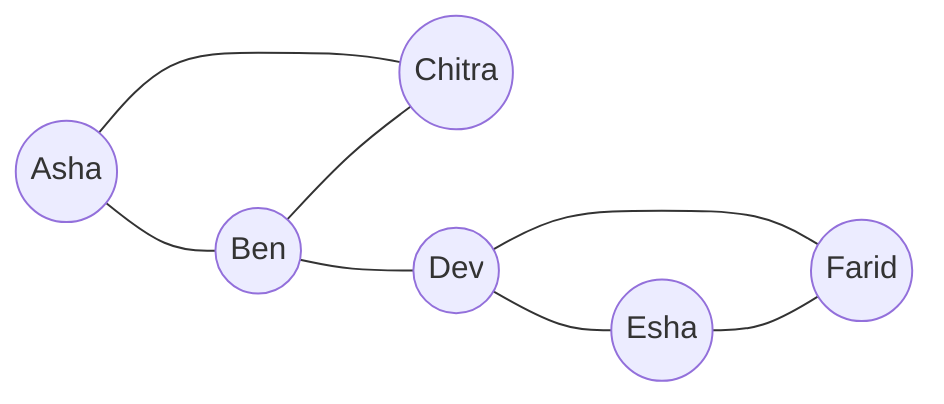
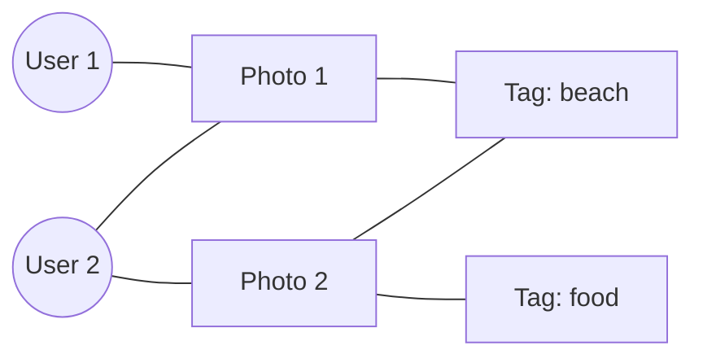
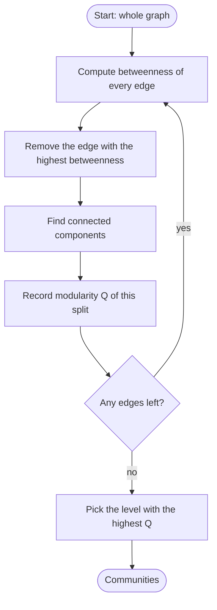
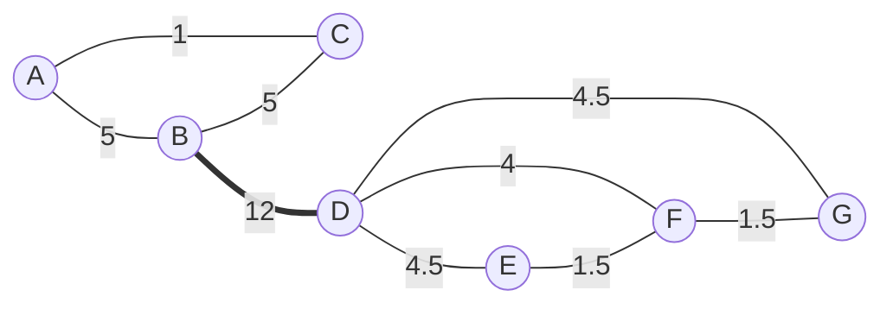
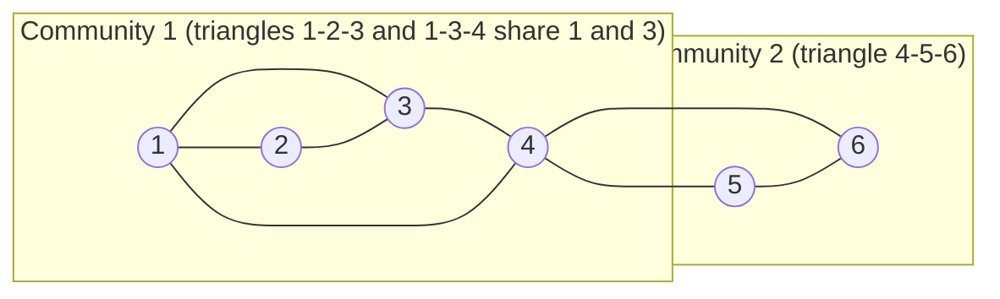

This note is syllabus <Syl m="6" />: "Social networks as graphs, clustering of social-network graphs, direct discovery of communities in a social graph". It answers what a social network is and why we draw it as a graph, then how to find communities with the Girvan-Newman algorithm and the Clique Percolation Method.

## The basics first

- A **graph** is a drawing of **nodes** (dots, also called vertices) joined by **edges** (lines). Here a node is a person and an edge is a relationship such as "is friends with".
- Two nodes joined by an edge are **neighbours**. The **degree** of a node is how many edges touch it.
- A **path** is a walk along edges from one node to another. The **shortest path** is the one with the fewest edges. Its length is the **distance** between the nodes.
- A graph is **connected** if you can get from any node to any other. A **connected component** is a piece that is connected inside and has no edge to the rest.
- A **triangle** is three nodes that are all joined to each other. A **clique** is the same idea for any size: a set of nodes where every pair is joined. A clique of $k$ nodes is a **$k$-clique**, so a triangle is a 3-clique.
- **Undirected** edges work both ways (friendship). **Directed** edges have an arrow (A follows B). **Weighted** edges carry a number (how many calls).

## What a social network is

**What it is.** A social network is a set of **actors** (people, accounts, companies) together with the **relationships** between them. <Cite id="social-network-graphs-wiki-social-network" /> <Cite id="social-network-graphs-mmds-book" /> Two things must be true for something to count: there are many entities of one kind, and there is at least one relationship between pairs of them. A second feature that nearly all real social networks show is **locality** (also called **homophily**): if A knows B and A knows C, then B and C are far more likely to know each other than two random people. In graph words, there are many triangles. <Cite id="social-network-graphs-wiki-homophily" /> <Cite id="social-network-graphs-wiki-clustering-coefficient" />

**Everyday analogy.** Your phone contacts. You are one dot. Your family, your classmates and your cricket team are three clumps. Lines inside a clump are dense (everyone knows everyone), and only a few lines go between clumps. Those clumps are what we want a program to find.

<Cite id="social-network-graphs-wiki-social-graph" loc="diagram" /> <Cite id="social-network-graphs-ibm-sna" />

## Varieties of social networks

Not every network is a friends list. The main kinds, and how each is drawn as a graph: <Cite id="social-network-graphs-mmds-book" /> <Cite id="social-network-graphs-wiki-sna" />

| Variety | Nodes | Edge means | Edge type |
| --- | --- | --- | --- |
| Friendship network (Facebook, Instagram friends) | People | Two people are friends | Undirected |
| Follower network (Twitter/X, Instagram follow) | Accounts | One account follows the other | Directed |
| Telephone network | Phone numbers | A call was made between them | Undirected, weighted by number of calls |
| Email network | Email addresses | An email was sent | Directed |
| Collaboration network | Authors, actors, programmers | They wrote a paper, acted in a film or worked on code together | Undirected, weighted by number of joint works |
| Several node types (photo site) | Users, photos and tags | A user uploaded a photo, a tag is on a photo | Edges join nodes of different types |

<Cite id="social-network-graphs-ibm-sna" loc="diagram" />

## Why we need a social-network graph

**Why it is needed.** A list of "who knows whom" is just rows of data. As a graph we can ask questions about the whole structure, and many algorithms already exist for graphs. <Cite id="social-network-graphs-ibm-sna" /> <Cite id="social-network-graphs-wiki-sna" />

1. **Find communities.** Groups of tightly connected people: classmates, a fan group, a fraud ring. This is the main topic of this note.
2. **Find influential people.** Nodes with many edges, or sitting on many shortest paths, spread news fastest. A high edge or node betweenness marks a bridge person. <Cite id="social-network-graphs-wiki-betweenness" />
3. **Recommend.** "People you may know" suggests a friend of a friend, which is a triangle that is missing one edge.
4. **Targeted advertising.** Show an advert to a community that cares about it.
5. **Spread of information or disease.** Follow how a rumour or virus travels along edges.
6. **Detect fake accounts and spam.** Fake accounts form unusual dense blobs or have strange edge patterns.
7. **Understand how big the world is.** Most pairs of people are only a few steps apart (the small-world effect). <Cite id="social-network-graphs-wiki-small-world" />

<Box kind="exam">

PYQ: <PYQ id="2023-12/q5b" /> (10 marks) asks "What is a social network, give varieties of social networks and the need for social network graph". Write: definition (actors and relationships, locality), the graph model (nodes, edges, directed or undirected, weighted), the varieties table above, the need list above, and one diagram.

</Box>

## Clustering of social-network graphs

**What it is.** Clustering a social graph means splitting the nodes into groups (**communities**) so that there are many edges inside a group and few edges between groups. <Cite id="social-network-graphs-wiki-community" /> <Cite id="social-network-graphs-fortunato2010" /> <PYQ id="2025-05/q6c" /> asks for exactly this heading.

**Why ordinary clustering struggles.**

- **No coordinates.** k-means needs points in space and an average point. A person in a social graph has only neighbours, so there is nothing to average. <Cite id="social-network-graphs-mmds-book" />
- **Distance is crude.** The only facts are "edge" or "no edge". One can set the distance to 1 for an edge and 2 (or a large number) for no edge, but then most pairs tie and hierarchical clustering has no good way to choose which clusters to merge.
- **Communities overlap.** One person belongs to a family, a class and a hobby group at once, but k-means and hierarchical clustering put each node in exactly one cluster. <Cite id="social-network-graphs-mmds-slides1" />
- **Size.** Real graphs have millions of nodes, so slow methods are out.

So special methods use the graph structure itself. Two are in the syllabus questions: Girvan-Newman (cut the bridges) and the Clique Percolation Method (grow from tight cliques).

| Idea | Girvan-Newman | Clique Percolation |
| --- | --- | --- |
| Direction | Divisive: start with one big graph and cut | Agglomerative: start from small cliques and join |
| What it uses | Edge betweenness | $k$-cliques that share $k-1$ nodes |
| Communities overlap? | No, each node ends in one group | Yes, a node can be in several |
| Every node placed? | Yes | No, nodes in no $k$-clique stay outside |
| Needs a number from you | Where to stop (use modularity) | $k$ |
| Speed | Slow (shortest paths from every node, every round) | Slow in the worst case (finding cliques is hard), fine on sparse graphs |

## Betweenness: the idea behind Girvan-Newman

**What it is.** The **betweenness** of an edge is the number of shortest paths, between all pairs of nodes, that run along that edge. If a pair has several equally short paths, each path counts as a fraction so that the pair adds up to exactly 1. <Cite id="social-network-graphs-wiki-girvan-newman" /> <Cite id="social-network-graphs-wiki-betweenness" /> <Cite id="social-network-graphs-networkx-edge-betweenness" />

**Why it finds communities.** Think of the roads between two cities. Every trip from city 1 to city 2 must use the one bridge, so the bridge carries a huge number of shortest trips. Roads inside a city carry only local trips. In a graph, edges that join two communities carry all the shortest paths between those communities, so they have the **highest betweenness**. Remove them and the communities fall apart. <Cite id="social-network-graphs-girvan-newman2002" />

**How to compute it for a small graph (the exam method).** For each pair of nodes, find the shortest path(s) and add 1 to every edge on the path (add $1/2$ to each edge of each path if two equal paths exist, and so on). Add up over all pairs, counting each unordered pair once. **Check:** the total of all edge betweenness values must equal the sum of the shortest-path lengths over all pairs, because a path of length $L$ puts a total of $L$ on the edges.

**How computers do it (BFS method).** For one start node $s$, run a breadth-first search to get levels, count the shortest paths to each node, then work upwards from the bottom level: each node gets flow $1$ plus the flow of its children, and this flow is split among its parent edges in proportion to the number of shortest paths coming through each parent. Repeat for every start node, add the flows, and halve the result (each pair was counted from both ends). <Cite id="social-network-graphs-gfg-girvan-newman" /> <Cite id="social-network-graphs-networkx-girvan-newman" /> <Cite id="social-network-graphs-neo4j-betweenness" />

## The Girvan-Newman algorithm

**What it is.** A **divisive hierarchical** clustering method (top-down: start with everything together, then split). <Cite id="social-network-graphs-girvan-newman2002" /> <Cite id="social-network-graphs-wiki-girvan-newman" />

<Box kind="definition">

**Algorithm (Girvan-Newman).**

1. Compute the betweenness of every edge in the graph.
2. Remove the edge with the highest betweenness (if several tie, remove them all, or one at a time in any order; say which rule you used).
3. **Recompute** the betweenness of the edges that remain.
4. Repeat steps 2 and 3 until no edges are left. After each removal note the connected components.
5. The connected components at the chosen level are the communities. Choose the level with the highest modularity.

</Box>

<Cite id="social-network-graphs-gfg-girvan-newman" loc="diagram" /> <Cite id="social-network-graphs-mmds-slides1" />

**Why recompute every time.** Once an edge is removed, the shortest paths that used it must find new routes, so other edges suddenly carry more. If two communities are joined by two edges, only one of them is guaranteed to be at the top. After it goes, the other one rises to the top in the next round. Without recomputing, you get wrong splits. <Cite id="social-network-graphs-wiki-girvan-newman" />

**Choosing where to stop: modularity.** If you keep removing until no edges are left, every node is alone, which is useless. **Modularity** $Q$ scores one split into groups. <Cite id="social-network-graphs-newman-girvan2004" /> <Cite id="social-network-graphs-wiki-modularity" />

<Box kind="definition">

$$Q = \sum_{c} \left[ \frac{e_c}{m} - \left( \frac{d_c}{2m} \right)^2 \right]$$

$m$ is the total number of edges in the whole graph. For each group $c$: $e_c$ is the number of edges with both ends inside the group, and $d_c$ is the sum of the degrees of the nodes in the group. The first term is the fraction of edges that fall inside the group. The second is the fraction you would expect inside it if edges were thrown at random with the same degrees. A good split has far more inside edges than chance, so $Q$ is large. $Q$ is between $-1$ and $1$, and about $0.3$ to $0.7$ means clear community structure. <Cite id="social-network-graphs-mmds-slides1" />

</Box>

**Advantages.** Easy to explain; the dendrogram shows structure at several levels; no need to guess the number of communities beforehand. **Limitations.** Slow: each round needs shortest paths from every node (about $n \cdot m$ work) and up to $m$ rounds are needed, so it is too slow for graphs with millions of edges; ties make the result depend on the order; each node lands in exactly one community. Faster methods such as the Louvain method optimise modularity directly. <Cite id="social-network-graphs-newman2004-fast" /> <Cite id="social-network-graphs-wiki-louvain" />

### Worked example 1: the nine-edge graph

<Sum>

<Given>

A graph with 7 nodes and 9 edges: A-B, A-C, B-C, B-D, D-E, D-F, D-G, E-F, F-G. (This is the graph of <PYQ id="2022-12-ce/q5a" /> and <PYQ id="2023-12-ce/q5a" />.) Triangle A, B, C is joined by B-D to the group D, E, F, G.

</Given>

<Find>

the communities by the Girvan-Newman algorithm.

</Find>

<Steps>

1. Count pairs: $n = 7$ nodes, so $\binom{7}{2} = 21$ pairs. All shortest paths are unique except E to G, which has two of length 2 (E-D-G and E-F-G). *Reason: only that pair has a tie, so only it gives half-credits.*
2. Betweenness of B-D: every pair with one node in \{A, B, C\} and one in \{D, E, F, G\} must cross B-D, so $3 \times 4 = 12$.
3. A-B: the pairs A-B, A-D, A-E, A-F, A-G all start along A-B, so $5$. B-C: the pairs B-C, C-D, C-E, C-F, C-G, so $5$. A-C: only the pair A-C (A reaches D through B, which is shorter than through C), so $1$.
4. D-E: pairs D-E, B-E, A-E, C-E give $4$, plus half of E-G, so $4.5$. D-G by symmetry $4.5$. D-F: pairs D-F, A-F, B-F, C-F, so $4$.
5. E-F: pair E-F plus half of E-G, so $1.5$. F-G: $1.5$.
6. Highest is B-D with $12$. Remove B-D. The graph splits into two components: \{A, B, C\} and \{D, E, F, G\}.
7. Recompute inside the pieces. In \{A, B, C\} each edge is used by only its own pair, so $1$ each. In \{D, E, F, G\}: D-E $= 1 + 0.5 = 1.5$, D-G $= 1.5$, E-F $= 1.5$, F-G $= 1.5$, D-F $= 1$.
8. Now four edges tie at $1.5$. Removing them breaks the four-node group into small pieces, so check modularity to decide whether to go on (see the check below).
9. Modularity of the two-community split ($m = 9$). Group \{A, B, C\}: $e = 3$, degrees $2 + 3 + 2 = 7$, so $3/9 - (7/18)^2 = 0.3333 - 0.1512 = 0.1821$. Group \{D, E, F, G\}: $e = 5$, degrees $4 + 2 + 3 + 2 = 11$, so $5/9 - (11/18)^2 = 0.5556 - 0.3735 = 0.1821$. Total $Q = 0.364$.

</Steps>

<Answer>

Two communities: \{A, B, C\} and \{D, E, F, G\}, found by removing the bridge B-D (betweenness 12). $Q \approx 0.364$.

</Answer>

<Box kind="verify">

Betweenness values (round 1): A-B 5, A-C 1, B-C 5, B-D 12, D-E 4.5, D-F 4, D-G 4.5, E-F 1.5, F-G 1.5. Their sum is $39$. The sum of shortest-path lengths over all 21 pairs: inside \{A, B, C\} $1 + 1 + 1 = 3$; inside \{D, E, F, G\} $1 + 1 + 1 + 1 + 1 + 2 = 7$; across: A to D, E, F, G is $2 + 3 + 3 + 3 = 11$, B is $1 + 2 + 2 + 2 = 7$, C is $2 + 3 + 3 + 3 = 11$, giving $29$. Total $3 + 7 + 29 = 39$. It matches. Going further: removing all four edges tied at 1.5 leaves \{A, B, C\}, \{D, F\}, \{E\}, \{G\} with $Q = 0.117$, which is lower than $0.364$, so the two-community split is the best level.

</Box>

</Sum>

<Cite id="social-network-graphs-mmds-slides1" loc="diagram" />

### Worked example 2: two triangles and a bridge

<Sum>

<Given>

A graph with 6 nodes and 7 edges: A-B, A-C, B-C, C-D, D-E, D-F, E-F. (This is the graph of <PYQ id="2023-05-ce/q5a" />.)

</Given>

<Find>

the communities by the Girvan-Newman algorithm.

</Find>

<Steps>

1. Every pair has one shortest path, so no halves. $\binom{6}{2} = 15$ pairs.
2. C-D: all pairs between \{A, B, C\} and \{D, E, F\} cross it, so $3 \times 3 = 9$.
3. A-C: pairs A-C, A-D, A-E, A-F, so $4$. B-C: B-C, B-D, B-E, B-F, so $4$. D-E: D-E, C-E, A-E, B-E, so $4$. D-F: $4$ by symmetry.
4. A-B: only the pair A-B, so $1$. E-F: only E-F, so $1$.
5. Highest is C-D with $9$. Remove it. Components: \{A, B, C\} and \{D, E, F\}.
6. Recompute: each of the six remaining edges is a triangle edge used only by its own pair, so all are $1$. No edge stands out any more, so there is no further natural split.
7. Modularity ($m = 7$): each triangle has $e = 3$ and degree sum $2 + 2 + 3 = 7$, so each contributes $3/7 - (7/14)^2 = 0.4286 - 0.25 = 0.1786$. Total $Q = 0.357$.

</Steps>

<Answer>

Two communities: \{A, B, C\} and \{D, E, F\}. The bridge C-D (betweenness 9) is removed. $Q \approx 0.357$.

</Answer>

<Box kind="verify">

Sum of betweenness: $1 + 4 + 4 + 9 + 4 + 4 + 1 = 27$. Sum of shortest-path lengths: inside each triangle $3$ (so $6$); across, A to D, E, F is $2 + 3 + 3 = 8$, B is $8$, C is $1 + 2 + 2 = 5$, giving $21$. Total $6 + 21 = 27$. It matches.

</Box>

</Sum>

### Worked example 3: a graph with ties

<Sum>

<Given>

A graph with 6 nodes and 7 edges: A-B, B-C, A-D, B-E, C-F, D-E, E-F. (This is the graph of <PYQ id="2024-05-ce/q5a" />.) It is a ladder: top row A-B-C, bottom row D-E-F, rungs A-D, B-E, C-F.

</Given>

<Find>

the communities by the Girvan-Newman algorithm.

</Find>

<Steps>

1. Pairs at distance 3 are A-F and C-D, and each has three shortest paths (each path then counts $1/3$). Pairs like A-E have two shortest paths (each $1/2$). Every other pair has a single shortest path.
2. A-B: pair A-B $1$, A-C $1$, A-E $\tfrac12$, B-D $\tfrac12$, A-F $\tfrac23$ (two of its three paths use A-B), C-D $\tfrac13$ (one of three). Total $4$.
3. By the same counting: B-C $= 4$, D-E $= 4$, E-F $= 4$ (the ladder is symmetric left to right and top to bottom). A-D $= 1 + \tfrac12 + \tfrac12 + \tfrac13 + \tfrac13 = \tfrac83$, and C-F $= \tfrac83$. B-E $= 1 + 4 \times \tfrac12 + \tfrac13 + \tfrac13 = \tfrac{11}{3}$.
4. Four edges tie at the maximum $4$: A-B, B-C, D-E, E-F. Remove them (tie rule: remove all tied edges).
5. What is left is the three rungs: components \{A, D\}, \{B, E\}, \{C, F\}.
6. Modularity ($m = 7$): \{A, D\} has $e = 1$ and degree sum $2 + 2 = 4$, giving $1/7 - (4/14)^2 = 0.1429 - 0.0816 = 0.0612$. \{C, F\} gives the same $0.0612$. \{B, E\} has degree sum $3 + 3 = 6$, giving $0.1429 - 0.1837 = -0.0408$. Total $Q = 0.082$.

</Steps>

<Answer>

With the tie rule "remove all tied edges": communities \{A, D\}, \{B, E\}, \{C, F\}. The low $Q \approx 0.08$ says this ladder has no strong community structure. Removing the tied edges one at a time in another order gives a different but equally valid split; write down your rule.

</Answer>

<Box kind="verify">

Sum of betweenness: $4 + 4 + 4 + 4 + \tfrac83 + \tfrac83 + \tfrac{11}{3} = 16 + 9 = 25$. Sum of shortest-path lengths over the 15 pairs: 7 adjacent pairs give $7$; 6 pairs at distance 2 (A-C, D-F, A-E, B-D, B-F, C-E) give $12$; 2 pairs at distance 3 (A-F, C-D) give $6$. Total $25$. It matches.

</Box>

</Sum>

<Box kind="exam">

PYQ: <PYQ id="2022-12-ce/q5a" />, <PYQ id="2023-05-ce/q5a" />, <PYQ id="2023-12-ce/q5a" />, <PYQ id="2024-05-ce/q5a" /> and <PYQ id="2025-05-ce/q5a" /> (10 marks each) all say "Determine communities for the given social network graph using Girvan-Newman". Only the graph changes. Method for the answer: (1) write the algorithm in 4 lines, (2) table of betweenness for every edge, (3) remove the highest, (4) recompute and show the components, (5) state the communities. Results for the graphs seen in past papers:

| Paper | Edges | Highest betweenness (round 1) | Communities |
| --- | --- | --- | --- |
| 2022-12-ce, 2023-12-ce | A-B, A-C, B-C, B-D, D-E, D-F, D-G, E-F, F-G | B-D $= 12$ | \{A, B, C\} and \{D, E, F, G\} |
| 2023-05-ce | A-B, A-C, B-C, C-D, D-E, D-F, E-F | C-D $= 9$ | \{A, B, C\} and \{D, E, F\} |
| 2024-05-ce | A-B, B-C, A-D, B-E, C-F, D-E, E-F | A-B, B-C, D-E, E-F tie at $4$ | \{A, D\}, \{B, E\}, \{C, F\} (weak, $Q = 0.08$) |
| 2025-05-ce | A-B, A-C, B-D, C-D, B-E, D-E | A-B and C-D tie at $3$ | \{A, C\} and \{B, D, E\} ($Q = 0.11$) |

For 2025-05-ce the betweenness values are A-B $3$, C-D $3$, A-C $2$, B-D $2$, B-E $2$, D-E $2$ (sum $14$ equals the total of shortest-path lengths of its 10 pairs). Since the graph in the paper is a picture, always check the edge list against the figure before you start.

</Box>

## Direct discovery of communities

Instead of cutting a graph apart, we can look for dense spots directly. <Cite id="social-network-graphs-mmds-book" />

- **Cliques.** A clique is a set of nodes where every pair is joined, the tightest possible group. Finding the largest clique is hard (the time can grow exponentially with the number of nodes), but all maximal cliques (cliques you cannot make larger) can be listed, for example with the Bron-Kerbosch algorithm. <Cite id="social-network-graphs-wiki-clique" /> <Cite id="social-network-graphs-wiki-bron-kerbosch" />
- **Complete bipartite subgraphs.** Two groups where every member of the first is joined to every member of the second, with no required edges inside a group. Example: a set of fans who all follow the same set of celebrities, or a group of accounts that all link to the same group of sites. It is a typical sign of a community of interest or of coordinated spam. This is the same pattern as frequent itemsets, so the same algorithms can find it. <Cite id="social-network-graphs-mmds-book" />

The weakness of strict cliques is that real communities are rarely perfect: one missing friendship breaks a clique. The Clique Percolation Method relaxes this by chaining small cliques together.

## Clique Percolation Method (CPM)

**What it is.** CPM builds communities out of $k$-cliques, where $k$ is a number you choose (3 means triangles, 4 means groups of 4 who all know each other). Two $k$-cliques are **adjacent** if they share $k-1$ nodes. A **community** is everything you can reach by hopping between adjacent $k$-cliques. <Cite id="social-network-graphs-palla2005" /> <Cite id="social-network-graphs-wiki-cpm" />

**Why it is needed.** Girvan-Newman puts each person in one group. In real life you are in several (home, college, hobby). CPM allows overlap, because a node that sits in cliques of two different chains belongs to both communities. <Cite id="social-network-graphs-cs224w-overlap" />

**Everyday analogy.** Roll a triangular stamp on the graph: you may place it on any triangle and then move it by keeping two corners fixed and swinging the third corner to a new node (that is what "share $k-1$ nodes" means). Everything the stamp can reach is one community. A node reachable from two separate rolling areas is in both. <Cite id="social-network-graphs-wiki-cpm" />

<Box kind="definition">

**Algorithm (CPM).** Input: graph $G$, integer $k \ge 3$.

1. Find all $k$-cliques of $G$ (all sets of $k$ nodes in which every pair is joined).
2. Build a **clique graph**: one node for each $k$-clique, and an edge between two of them if they share exactly $k-1$ nodes (that is, at least $k-1$ nodes).
3. Find the connected components of the clique graph.
4. For each component, the **union of the nodes** of its $k$-cliques is one community.
5. Output the communities. A node in cliques of several components is an **overlap** node; a node in no $k$-clique belongs to no community.

</Box>

<Cite id="social-network-graphs-wiki-cpm" loc="diagram" /> <Cite id="social-network-graphs-cs224w-overlap" />

**Choosing $k$.** A bigger $k$ is stricter: fewer, smaller, denser communities. A smaller $k$ finds looser, bigger communities. Often several values are tried and the one that gives the richest spread of community sizes is kept. $k = 3$ is the usual start for exam graphs. <Cite id="social-network-graphs-cs224w-overlap" /> <Cite id="social-network-graphs-networkx-kclique" />

**Advantages.** Allows overlap; local (a change far away does not change a community); matches the idea that a community is dense. **Limitations.** Finding cliques can take exponential time in the worst case; needs a good $k$; sparse parts of the graph are left out (nodes with no $k$-clique); one extra shared node can merge two communities. <Cite id="social-network-graphs-wiki-cpm" />

### Worked example 4: nine nodes, k = 3

<Sum>

<Given>

A graph with nodes 1 to 9 and edges: 1-2, 1-3, 1-4, 2-3, 3-4, 4-5, 4-6, 5-6, 5-7, 5-8, 6-7, 6-8, 7-8, 7-9. Take $k = 3$. (This is the graph of <PYQ id="2024-05/q5b" />.)

</Given>

<Find>

the 3-cliques and the communities found by CPM.

</Find>

<Steps>

1. List every triangle (three nodes, all three edges present): \{1, 2, 3\} (edges 1-2, 2-3, 1-3), \{1, 3, 4\} (1-3, 3-4, 1-4), \{4, 5, 6\} (4-5, 4-6, 5-6), \{5, 6, 7\}, \{5, 6, 8\}, \{5, 7, 8\}, \{6, 7, 8\}. That is $7$ triangles. *Reason: a 3-clique is a triangle.* Node 9 has only one edge (7-9), so it is in no triangle.
2. Link triangles that share $k - 1 = 2$ nodes. \{1, 2, 3\} and \{1, 3, 4\} share 1 and 3: linked.
3. \{4, 5, 6\} and \{5, 6, 7\} share 5 and 6: linked. \{5, 6, 7\} with \{5, 6, 8\} share 5 and 6: linked. \{5, 6, 7\} with \{5, 7, 8\} share 5 and 7: linked. \{6, 7, 8\} shares 6 and 7 with \{5, 6, 7\}: linked. So these five are one chain.
4. \{1, 3, 4\} and \{4, 5, 6\} share only node 4 (one node, not two): not linked.
5. Components of the clique graph: first \{1, 2, 3\} and \{1, 3, 4\}; second \{4, 5, 6\}, \{5, 6, 7\}, \{5, 6, 8\}, \{5, 7, 8\}, \{6, 7, 8\}.
6. Union of nodes: community 1 $= \{1, 2, 3, 4\}$; community 2 $= \{4, 5, 6, 7, 8\}$.

</Steps>

<Answer>

Two communities: \{1, 2, 3, 4\} and \{4, 5, 6, 7, 8\}. Node 4 is in both (overlap). Node 9 is in none.

</Answer>

<Box kind="verify">

Count of triangles in another way: the group \{5, 6, 7, 8\} has all 6 possible edges (5-6, 5-7, 5-8, 6-7, 6-8, 7-8), so it is a 4-clique, and a 4-clique holds $\binom{4}{3} = 4$ triangles: \{5, 6, 7\}, \{5, 6, 8\}, \{5, 7, 8\}, \{6, 7, 8\}. Add \{4, 5, 6\}, \{1, 2, 3\} and \{1, 3, 4\} to get $7$. It matches. If you try $k = 4$ instead, the only 4-clique is \{5, 6, 7, 8\}, so you get one community \{5, 6, 7, 8\}.

</Box>

</Sum>

### Worked example 5: eight nodes, k = 3

<Sum>

<Given>

The graph of <PYQ id="2024-12-ce/q5a" />. The figure has unlabelled nodes, so they are named here: top row P1, P2, P3; middle row Q1, Q2, Q3; bottom row R2, R3. Edges: P1-P2, P2-P3, P1-Q1, P2-Q1, P2-Q2, P3-Q3, Q1-Q2, Q2-Q3, Q2-R2, Q2-R3, Q3-R2, Q3-R3, R2-R3. Take $k = 3$.

</Given>

<Find>

the communities found by CPM.

</Find>

<Steps>

1. List the triangles: \{P1, P2, Q1\} (P1-P2, P2-Q1, P1-Q1), \{P2, Q1, Q2\} (P2-Q1, Q1-Q2, P2-Q2), \{Q2, Q3, R2\}, \{Q2, Q3, R3\}, \{Q2, R2, R3\}, \{Q3, R2, R3\}. That is $6$ triangles. P3 has edges to P2 and Q3 only, and P2-Q3 is not an edge, so P3 is in no triangle.
2. Link triangles sharing 2 nodes. \{P1, P2, Q1\} and \{P2, Q1, Q2\} share P2 and Q1: linked.
3. The four triangles on Q2, Q3, R2, R3 share two nodes with each other (for example \{Q2, Q3, R2\} and \{Q2, Q3, R3\} share Q2 and Q3), so all four are linked.
4. \{P2, Q1, Q2\} and \{Q2, Q3, R2\} share only Q2: not linked.
5. Two components, giving the communities: \{P1, P2, Q1, Q2\} and \{Q2, Q3, R2, R3\}.

</Steps>

<Answer>

Two communities: \{P1, P2, Q1, Q2\} and \{Q2, Q3, R2, R3\}. Q2 is in both (overlap). P3 is in neither.

</Answer>

<Box kind="verify">

\{Q2, Q3, R2, R3\} has all 6 edges (Q2-Q3, Q2-R2, Q2-R3, Q3-R2, Q3-R3, R2-R3), so it is a 4-clique with $\binom{4}{3} = 4$ triangles, matching the four found. With $k = 4$ the only community would be \{Q2, Q3, R2, R3\}. Check the edge list against the figure in the paper before you use these names.

</Box>

</Sum>

<Box kind="exam">

PYQ: <PYQ id="2024-05/q5b" /> and <PYQ id="2024-12-ce/q5a" /> (10 marks each) ask: what is CPM, write the algorithm, and find the communities of the given graph. Answer in this order: definition of $k$-clique and "adjacent", the algorithm (5 steps above), list the $k$-cliques, show which pairs share $k-1$ nodes, give the components and communities, and say which node overlaps. <PYQ id="2025-05/q6c" /> ("Clustering of social-network graphs", 10 marks) wants the section above on clustering: why ordinary clustering struggles, then Girvan-Newman with betweenness and modularity, and CPM as the overlapping alternative.

</Box>

## Girvan-Newman against CPM, and conclusion

| Point | Girvan-Newman | CPM |
| --- | --- | --- |
| Main idea | Cut high-betweenness edges | Chain together $k$-cliques that share $k-1$ nodes |
| Type | Divisive, hierarchical (dendrogram) | Local, builds up |
| Overlap | No | Yes |
| Input to choose | Stopping level (use modularity) | $k$ |
| Unassigned nodes | None | Nodes with no $k$-clique |
| Finds | Loosely joined groups separated by bridges | Dense groups, even overlapping ones |
| Main cost | Shortest paths from every node, every round | Listing all cliques |

**Conclusion.** A social network is naturally a graph, and its communities are groups with many edges inside and few between. Girvan-Newman finds them by repeatedly cutting the busiest bridge, using modularity to pick the best level; CPM finds them by rolling cliques, which also allows people to be in more than one community. In the exam, always draw the graph, show every number in a table, and check that your betweenness values add up to the total of the shortest-path lengths. <Cite id="social-network-graphs-girvan-newman2002" /> <Cite id="social-network-graphs-palla2005" /> <Cite id="social-network-graphs-fortunato2010" />
