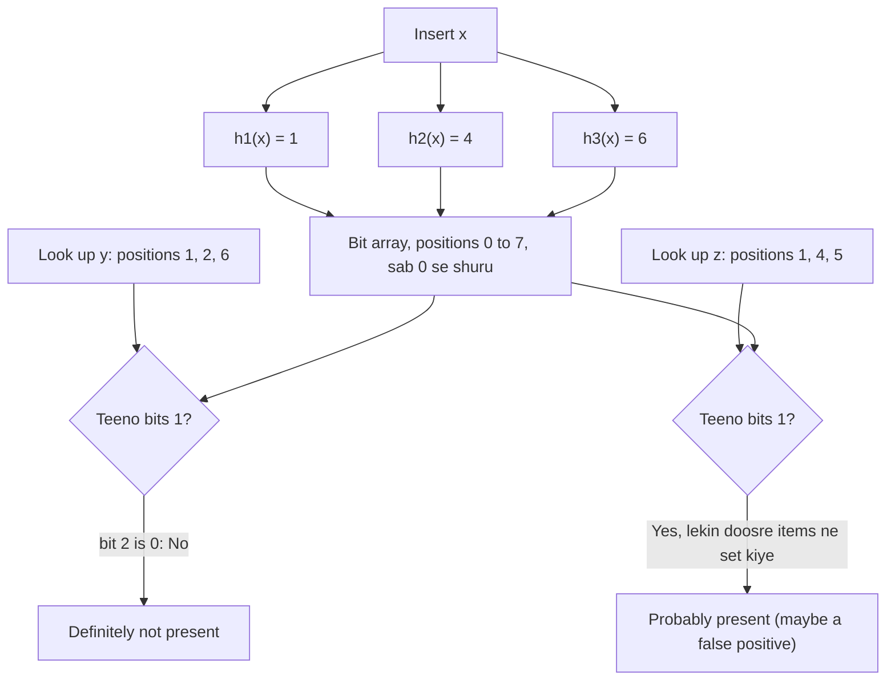
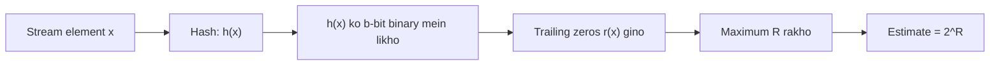
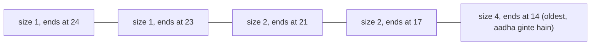
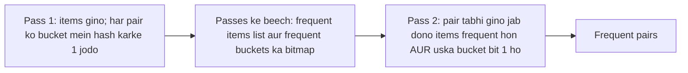

Ye note syllabus <Syl m="4" /> ke doosre half ka hai: "Filtering streams: Bloom filter with analysis", "Counting distinct elements: Flajolet-Martin, combining estimates, space requirements", "Counting frequent items, frequent itemsets in decaying windows" aur "Counting ones in a window: the DGIM algorithm, decaying windows". Stream model aur sampling is module ke pehle note mein hain.

## Pehle basics

- **Data stream** items ka kabhi na khatam hone wala flow hai (clicks, tweets, sensor readings, bank transactions) jo tezi se aata hai. Hum har item ko sirf **ek baar** dekhte hain, aur sab kuch store nahi kar sakte. <Cite id="stream-counting-mmds-home" loc="§4.1" /> <Cite id="stream-counting-aws-streaming" /> <Cite id="stream-counting-ibm-streaming" />
- Memory chhoti hoti hai, isliye hum exact jawab nahi dete. Hum stream ke ek chhote **summary** (jise sketch bhi kehte hain) se **approximate** jawab dete hain jo bahut paas hota hai. <Cite id="stream-counting-wiki-streaming" />
- **Hash function** $h$ kisi bhi item ko ek fixed range ke number mein badal deta hai, jaise $h(x) = 3x + 7 \bmod 32$ 0 se 31 tak ka number deta hai. Same item ko hamesha same number milta hai, aur alag items ko aam taur par alag numbers. **Bit** matlab 0 ya 1. **Bit array** bits ki ek row hai.
- Binary number ke **trailing zeros** uske right end ke zeros hain. Jaise `10100` mein 2 trailing zeros hain, aur `01001` mein 0.
- **False positive** galat "yes" hai. **False negative** galat "no" hai.

Is note ki teen problems aur har ek ka tool:

| Question about the stream | Tool | Answer you get |
|---|---|---|
| Kya ye item pehle dekha hai? (filtering) | Bloom filter | "Definitely not" ya "probably yes" |
| Ab tak kitne alag items? (distinct count) | Flajolet-Martin | Ek estimate jaise 8 |
| Last N bits mein kitne 1s? (window count) | DGIM | 50 percent ke andar ka estimate |

## Bloom filter

<PYQ id="2022-12-ce/q1d" /> <PYQ id="2024-05-ce/q1d" /> <PYQ id="2024-05/q1d" /> <PYQ id="2025-05/q6a" /> <PYQ id="2024-12-ce/q3b" />

**Definition.** Bloom filter (Burton Bloom, 1970) ek chhota bit array hai jiske saath $k$ hash functions hote hain. Ye batata hai ki koi item set $S$ ka member hai ya nahi, jo usse diya gaya tha. Ye kabhi kabhi aise item ke liye "yes" bol sakta hai jo $S$ mein nahi hai (false positive), lekin **$S$ ke item ke liye kabhi "no" nahi bolta** (no false negatives). <Cite id="stream-counting-mmds-home" loc="§4.3" /> <Cite id="stream-counting-wiki-bloom" /> <Cite id="stream-counting-gfg-bloom" />

**Ye kyun zaroori hai.** Maan lo ek mail server ke paas one billion good email addresses ki list hai aur har aane wale mail ke liye decide karna hai ki sender list mein hai ya nahi. Har baar disk dekhna slow hai, aur poori list memory mein rakhna bahut bada hai. Bloom filter har address ke liye sirf kuch bits memory mein rakhta hai. Zyadatar baar jawab sahi aur fast hota hai. Jab wo "probably yes" kehta hai, hum slow exact list check kar sakte hain. Jab wo "no" kehta hai, hum sure hain aur check karne ki zaroorat nahi. <Cite id="stream-counting-mmds-home" loc="§4.3" />

**Roz ki analogy.** School ke gate ka guard har student ke kuch features yaad rakhta hai, jaise "lamba, red bag, blue shoes". Jis ajnabi mein koi feature nahi hai wo pakka student nahi hai. Doosra ajnabi jo kisi student ke saare features se match kar jaye, galti se andar ja sakta hai. Wo galti false positive hai. Student ko kabhi mana nahi kiya jaata, kyunki uske features list mein hain.

**Ye kaise kaam karta hai.**

1. $m$ bits ka bit array lo, sab 0, aur $k$ hash functions chuno, har ek 0 se $m-1$ ke beech position deta hai.
2. Item $x$ **insert** karo: $h_1(x), \dots, h_k(x)$ nikalo aur un $k$ bits ko 1 kar do.
3. Item $y$ **look up** karo: wahi $k$ positions nikalo. Agar **saare** 1 hain to jawab "possibly in the set". Agar **koi bhi** 0 hai to jawab "definitely not in the set".

<Cite id="stream-counting-gfg-bloom" loc="diagram" /> <Cite id="stream-counting-wiki-bloom" loc="diagram" />

**False negative kyun nahi hota.** Inserted item ne apne $k$ bits 1 kiye, aur bits kabhi wapas 0 nahi hote. Isliye look-up ke time wahi $k$ bits abhi bhi 1 hain. **False positive kyun hota hai.** Doosre items ne naye item ke theek wahi $k$ bits set kar diye ho sakte hain.

<Box kind="definition">

**Yaad rakhne wali properties.** Space $m$ bits hai, items kitne bhi lambe hon. Insert aur look-up dono mein $k$ hash computations lagti hain ($O(k)$ time). Same size aur same hash functions wale do filters ko bitwise OR se merge kar sakte hain. Stored items ki **list nahi** bana sakte aur item **delete nahi** kar sakte, kyunki bit doosre items ke saath shared ho sakta hai. <Cite id="stream-counting-wiki-bloom" />

</Box>

### Bloom filter with analysis (false-positive rate)

Syllabus analysis maangta hai. Maan lo $m$ = bits, $n$ = inserted items, $k$ = hash functions. Idea ye hai: pehle chance nikalo ki ek bit abhi bhi 0 hai, phir chance ki naye item ke saare $k$ bits 1 hain. <Cite id="stream-counting-mmds-home" loc="§4.3" />

1. Ek hash ek khaas bit ko $1/m$ probability se set karta hai. To ek hash ke baad bit 0 rehne ki probability $1 - 1/m$ hai.
2. Kul $kn$ hashes hain, isliye bit ke abhi bhi 0 hone ka chance $(1 - 1/m)^{kn} \approx e^{-kn/m}$ hai. (Bade $m$ ke liye $(1 - 1/m)^m$ lagbhag $e^{-1}$ hota hai.)
3. To 1 wale bits ka fraction lagbhag $1 - e^{-kn/m}$ hai.
4. Naya item jo set mein **nahi** hai, tab galti se accept hota hai jab uske saare $k$ bits 1 hon. $k$ bits ko independent maan kar:

$$
\text{false-positive rate} \approx \left(1 - e^{-kn/m}\right)^k
$$

5. Bahut kam hash functions se filtering kamzor hoti hai. Bahut zyada se array 1s se bhar jaata hai. Best value $k = \dfrac{m}{n}\ln 2 \approx 0.693\,\dfrac{m}{n}$ hai, jisse lagbhag aadhe bits 1 hote hain. Chaahe gaye false-positive rate $p$ ke liye zaroori size $m = -\dfrac{n \ln p}{(\ln 2)^2}$ hai, $p = 1\%$ ke liye lagbhag 9.6 bits per item. <Cite id="stream-counting-wiki-bloom" />

**Pitfall.** Formula maanta hai ki $k$ hash functions independent random choices ki tarah behave karte hain. $m = 8$ jaise chhote array ke liye asli rate formula se alag ho sakta hai (pehle sum ka verify box dekho).

<Sum>

<Given>

Ek Bloom filter mein $m = 8$ bits (positions 0 se 7) hain, shuru mein sab 0, aur teen hash functions $h_1(x) = x \bmod 8$, $h_2(x) = (2x + 1) \bmod 8$, $h_3(x) = (3x + 2) \bmod 8$. 12, 25, 30, 5 insert karo. Phir 6 aur 55 check karo. (Ye bilkul <PYQ id="2024-12-ce/q3b" /> ka question hai.)

</Given>

<Find>

inserts ke baad bit array, 6 aur 55 present bataye jaate hain ya nahi, aur kaun sa jawab true ya false positive ya negative hai.

</Find>

<Steps>

1. **12 insert.** $h_1 = 12 \bmod 8 = 4$. $h_2 = 25 \bmod 8 = 1$. $h_3 = 38 \bmod 8 = 6$. Bits 4, 1, 6 set karo. *Reason: insert saari k positions set karta hai.*
2. **25 insert.** $h_1 = 25 \bmod 8 = 1$. $h_2 = 51 \bmod 8 = 3$. $h_3 = 77 \bmod 8 = 5$. Bits 1, 3, 5 set karo (bit 1 pehle se 1 tha).
3. **30 insert.** $h_1 = 30 \bmod 8 = 6$. $h_2 = 61 \bmod 8 = 5$. $h_3 = 92 \bmod 8 = 4$. Bits 6, 5, 4 set karo (sab pehle se 1).
4. **5 insert.** $h_1 = 5 \bmod 8 = 5$. $h_2 = 11 \bmod 8 = 3$. $h_3 = 17 \bmod 8 = 1$. Bits 5, 3, 1 set karo (sab pehle se 1).
5. **Saare inserts ke baad array.** Bits 1, 3, 4, 5, 6 ek hain.

   | Position | 0 | 1 | 2 | 3 | 4 | 5 | 6 | 7 |
   |---|---|---|---|---|---|---|---|---|
   | Bit | 0 | 1 | 0 | 1 | 1 | 1 | 1 | 0 |

6. **6 check.** $h_1 = 6 \bmod 8 = 6$. $h_2 = 13 \bmod 8 = 5$. $h_3 = 20 \bmod 8 = 4$. Bits 6, 5, 4 teeno 1 hain, isliye filter "present" kehta hai. *Reason: saare k bits 1 hain.*
7. **55 check.** $h_1 = 55 \bmod 8 = 7$. $h_2 = 111 \bmod 8 = 7$. $h_3 = 167 \bmod 8 = 7$. Bit 7 0 hai, isliye filter "absent" kehta hai.
8. **Jawabon ko judge karo.** 6 kabhi insert nahi hua (inserted set 12, 25, 30, 5 hai), isliye "present" galat hai: **false positive**. 55 insert nahi hua aur filter absent kehta hai: **true negative**.

</Steps>

<Answer>

Final array `0 1 0 1 1 1 1 0`. Element 6 present bataya gaya lekin set mein nahi hai, isliye **false positive**. Element 55 absent bataya gaya aur sach mein absent hai, isliye **true negative**. In do checks mein koi true positive nahi aaya, kyunki 6 aur 55 dono insert nahi hue the. (Inserted item jaise 12 check karte, jiske bits 4, 1, 6 sab 1 hain, to true positive milta.)

</Answer>

<Box kind="verify">

Check 1: 1s ginte hain. Kam se kam ek baar set hue bits 1, 3, 4, 5, 6 hain, yaani 5 bits, array se match. Har inserted item "present" aana chahiye: 12 bits 4, 1, 6 use karta hai; 25 bits 1, 3, 5; 30 bits 6, 5, 4; 5 bits 5, 3, 1. Sab 1 hain, isliye false negative nahi.

Check 2: asli 1-bits ke fraction se ek random naya item lagbhag $(5/8)^3 = 0.244$ chance se false positive hoga, isliye itne chhote array mein 6 jaisa false positive kaafi likely hai. Formula $(1 - e^{-kn/m})^k = (1 - e^{-1.5})^3 \approx 0.469$ bada hai, kyunki sirf 8 bits ke saath hash positions independent nahi hote.

</Box>

</Sum>

<Sum>

<Given>

$n = 1000$ items ek $m = 8000$ bits ke Bloom filter mein stored hain.

</Given>

<Find>

$k = 1$, $k = 2$ aur $k = 6$ ke liye false-positive rate, aur best $k$.

</Find>

<Steps>

1. Items per bit: $kn/m = k \times 1000 / 8000 = k/8$. *Reason: ye formula ka exponent hai.*
2. $k = 1$: $kn/m = 0.125$, $e^{-0.125} = 0.8825$, to $1 - 0.8825 = 0.1175$, aur $0.1175^1 = 0.1175$, lagbhag 11.75 percent.
3. $k = 2$: $kn/m = 0.25$, $e^{-0.25} = 0.7788$, to $1 - 0.7788 = 0.2212$, aur $0.2212^2 = 0.0489$, lagbhag 4.9 percent.
4. $k = 6$: $kn/m = 0.75$, $e^{-0.75} = 0.4724$, to $1 - 0.4724 = 0.5276$, aur $0.5276^6 = 0.0216$, lagbhag 2.2 percent.
5. Best $k = (m/n)\ln 2 = 8 \times 0.6931 = 5.55$. Nearest whole numbers 5 aur 6 hain: $k = 5$ se $(1 - e^{-0.625})^5 = 0.02168$ aur $k = 6$ se $0.02158$, isliye $k = 6$ lo.

</Steps>

<Answer>

False-positive rate $k = 1$ ke liye lagbhag 11.8 percent, $k = 2$ ke liye 4.9 percent, aur $k = 6$ ke liye 2.2 percent. Best $k$ 6 hai (rounding se pehle 5.55).

</Answer>

<Box kind="verify">

Check 1: $k = 7$ se $(1 - e^{-0.875})^7 = 0.0229$ aata hai, jo $k = 6$ se bada hai, isliye $k = 6$ sach mein minimum hai. Check 2: $k = 6$ par 1 bits ka fraction $1 - e^{-0.75} = 0.528$ hai, jo best $k$ ke target aadhe ke paas hai. Check 3: $p = 0.0216$ ke liye size formula se $m/n = -\ln 0.0216 / (\ln 2)^2 = 3.835 / 0.4805 = 7.98$ aata hai, jo wahi 8 bits per item hai jisse hum shuru hue the.

</Box>

</Sum>

**Advantages.** Bahut kam memory. Constant-time insert aur look-up. False negative nahi. Streams par chalta hai, kyunki item ek baar process hota hai. **Disadvantages.** False positives. Deletion nahi (**counting Bloom filter** har bit ki jagah chhota counter rakhta hai taaki deletion ho sake, zyada memory ke saath). Stored items ko list ya count nahi kar sakte. <Cite id="stream-counting-gfg-counting-bloom" /> <Cite id="stream-counting-wiki-bloom" />

**Applications.** Spam aur blacklist filtering (book ka example), aur databases jo bekaar disk reads bachate hain: Cassandra aur HBase har data file ke liye ek Bloom filter rakhte hain aur filter "definitely not here" kahe to file skip kar dete hain. Redis mein ready Bloom filter type milta hai. <Cite id="stream-counting-mmds-home" loc="§4.3" /> <Cite id="stream-counting-cass-bloom" /> <Cite id="stream-counting-hbase-bloom" /> <Cite id="stream-counting-redis-bloom" /> <Cite id="stream-counting-gfg-bloom-java" />

**Conclusion.** Bloom filter ek chhote, control mein rehne wale false "yes" ke chance ke badle memory mein bahut badi bachat deta hai, aur wo kisi stored item ko kabhi nahi bhoolta.

## Counting distinct elements: Flajolet-Martin

<PYQ id="2022-12-ce/q3a" /> <PYQ id="2023-05-ce/q3a" /> <PYQ id="2023-12-ce/q3a" /> <PYQ id="2024-05-ce/q3a" /> <PYQ id="2024-12-ce/q4a" /> <PYQ id="2025-05-ce/q3a" />

**Count-distinct problem.** Ginna hai ki stream mein kitne **alag** items aaye, jaise website ke unique visitors. Exact tareeka har dekha gaya item yaad rakhna hai (set ya table), jismein memory distinct items ke barabar lagti hai, billions users ke liye bahut zyada. <Cite id="stream-counting-mmds-home" loc="§4.4" /> <Cite id="stream-counting-wiki-countdistinct" />

**Flajolet-Martin (1985) ka idea.** Har item ko ek lambi random-jaisi bit string mein hash karo. Jo bit string bahut zeros par end hoti hai wo rare hai: kam se kam $r$ trailing zeros ka chance $1/2^r$ hai. To agar humne dekhi hui trailing zeros ki sabse lambi run $R$ hai, to humne lagbhag $2^R$ alag items dekhe honge. Hame sirf number $R$ yaad rakhna hai, items nahi. Repeated items wahi hash dobara dete hain, isliye wo $R$ kabhi nahi badalte. <Cite id="stream-counting-fm1985" /> <Cite id="stream-counting-mmds-home" loc="§4.4" /> <Cite id="stream-counting-wiki-fm" />

**Roz ki analogy.** Sikka tab tak uchhalo jab tak head na aaye. Agar kisi ko lagatar 10 tails milte dekho, to tum andaza lagaoge ki bahut log sikka uchhal rahe the. Sabse lambi lucky streak batati hai ki lagbhag kitni koshishen hui.

**Algorithm.**

1. Ek hash function $h$ chuno jo items ko $b$-bit numbers mein map kare.
2. Har stream element $x$ ke liye $h(x)$ nikalo, binary mein likho, aur trailing zeros gino. Ye count **tail length** $r(x)$ hai.
3. $R$ = ab tak dekhi gayi maximum tail length rakho.
4. Distinct elements ka estimate $2^R$ hai. (Original paper ek correction factor $\varphi \approx 0.77351$ se bhi divide karta hai; exam textbook seedha $2^R$ use karti hai.)

<Cite id="stream-counting-gfg-fm" loc="diagram" />

**Agar hash value 0 ho?** Binary string `00000` mein koi 1 hai hi nahi. Textbooks uski tail length ko saare $b$ bits maante hain (ya use skip karte hain). Exam mein apni choice likho. Neeche ke sums mein ye case jahan aaya hai wahan bataya gaya hai.

<Box kind="pitfall">

Hash function values ko barabar failaana chahiye. $h(x) = 4x + 1 \bmod 16$ jaisa function hamesha **odd** number deta hai, isliye har hash 1 par end hota hai, har tail length 0 hai aur estimate hamesha $2^0 = 1$ aata hai, stream kuch bhi ho. Question jaisa pucha hai waisa solve karo, aur likho ki ye hash kharab hai.

</Box>

<Sum>

<Given>

Stream $S = \{10, 12, 8, 15, 6, 9, 14, 7\}$, hash function $h(x) = 5x + 11 \bmod 32$, result 5-bit binary number maana gaya. (Ye <PYQ id="2025-05-ce/q3a" /> hai.)

</Given>

<Find>

Flajolet-Martin algorithm se distinct elements ka estimate.

</Find>

<Steps>

1. Har $x$ ke liye $5x + 11$ nikalo, phir mod 32 lo, 5-bit binary likho, aur trailing zeros $r$ gino. *Reason: algorithm sirf hash ki tail length yaad rakhta hai.*

   | $x$ | $5x + 11$ | $h(x)$ mod 32 | 5-bit binary | Trailing zeros $r$ |
   |---|---|---|---|---|
   | 10 | 61 | 29 | 11101 | 0 |
   | 12 | 71 | 7 | 00111 | 0 |
   | 8 | 51 | 19 | 10011 | 0 |
   | 15 | 86 | 22 | 10110 | 1 |
   | 6 | 41 | 9 | 01001 | 0 |
   | 9 | 56 | 24 | 11000 | 3 |
   | 14 | 81 | 17 | 10001 | 0 |
   | 7 | 46 | 14 | 01110 | 1 |

2. Maximum tail length $R = 3$ hai, $x = 9$ se (hash 24 = `11000`).
3. Estimate $= 2^R = 2^3 = 8$.

</Steps>

<Answer>

$R = 3$, isliye distinct elements ka estimate $2^3 = 8$ hai.

</Answer>

<Box kind="verify">

Check 1: stream mein 8 alag numbers hain, isliye estimate 8 yahan true count ke barabar hai. Check 2: hash value mein kam se kam 3 trailing zeros tabhi hote hain jab wo 8 ka multiple ho; 29, 7, 19, 22, 9, 24, 17, 14 mein sirf 24 hai, isliye $R = 3$ hai, usse zyada nahi. Check 3: mod 32 ka hisaab dobara: $61 - 32 = 29$, $71 - 64 = 7$, $51 - 32 = 19$, $86 - 64 = 22$, $41 - 32 = 9$, $56 - 32 = 24$, $81 - 64 = 17$, $46 - 32 = 14$.

</Box>

</Sum>

**Baaki past-paper streams** bilkul wahi steps use karte hain. Har ek ko usi tarah solve karne par (hash, 5-bit ya diya gaya width, trailing zeros, maximum):

| Question | Hash and width | Hash values | $R$ | Estimate $2^R$ | True distinct count |
|---|---|---|---|---|---|
| <PYQ id="2023-12-ce/q3a" /> stream 4, 2, 5, 9, 1, 6, 3, 7 | $x + 6 \bmod 32$, 5 bits | 10, 8, 11, 15, 7, 12, 9, 13 (8 = `01000` mein 3 zeros, sabse achha) | 3 | 8 | 8 |
| <PYQ id="2024-05-ce/q3a" /> same stream | $3x + 7 \bmod 32$, 5 bits | 19, 13, 22, 2, 10, 25, 16, 28 (16 = `10000` mein 4 zeros) | 4 | 16 | 8 |
| <PYQ id="2024-12-ce/q4a" /> stream 9, 8, 7, 6, 5, 4, 3, 2 | $2x + 1 \bmod 32$, 5 bits | 19, 17, 15, 13, 11, 9, 7, 5 (sab odd) | 0 | 1 | 8 |
| <PYQ id="2023-05-ce/q3a" /> stream 2, 1, 6, 1, 5, 9, 2, 3, 5 | $4x + 1 \bmod 16$, 4 bits | 9, 5, 9, 5, 5, 5, 9, 13, 5 (sab odd) | 0 | 1 | 6 |
| <PYQ id="2022-12-ce/q3a" /> stream 1, 3, 2, 1, 2, 3, 4, 3, 1, 2, 3, 1 | $6x + 1 \bmod 5$, 3 bits | 2, 4, 3, 2, 3, 4, 0, 4, 2, 3, 4, 2 (stream order mein; 0 ko 3 zeros maana) | 3 | 8 | 4 |

2022 paper ke liye: $h(1) = 7 \bmod 5 = 2$ (`010`, 1 zero), $h(3) = 19 \bmod 5 = 4$ (`100`, 2 zeros), $h(2) = 13 \bmod 5 = 3$ (`011`, 0 zeros), $h(4) = 25 \bmod 5 = 0$ (`000`, 3 zeros maana). Isliye $R = 3$ aur estimate 8. Agar all-zero hash ko skip karo to $R = 2$ aur estimate 4, jo true count ke barabar hai; jo convention use karo wo likho. 2023-05 aur 2024-12 wali rows mein har hash odd hai, isliye method 1 deta hai: estimate kharab isliye hai kyunki hash function kharab hai, working galat nahi hai.

**Combining estimates.** Ek hash function noisy jawab deta hai, kyunki $2^R$ sirf power of 2 ho sakta hai aur ek lucky hash estimate ko bahut bada bana sakta hai. Fix: kai hash functions use karo. Agar estimates ka seedha **average** lo, to ek bada outlier average bigaad deta hai. Agar **median** lo, to hamesha powers of 2 hi milte hain. Isliye dono milate hain: hash functions ko chhote groups mein baanto, **har group ke andar average** lo, aur **group averages ka median** lo. Groups itne bade hone chahiye jitna $\log_2 m$ taaki outliers hat jayein. <Cite id="stream-counting-mmds-home" loc="§4.4" /> <Cite id="stream-counting-wiki-fm" />

<Sum>

<Given>

Nau hash functions, teen groups mein teen teen, ye estimates $2^R$ dete hain. Group A: 4, 8, 16. Group B: 8, 8, 32. Group C: 4, 4, 8.

</Given>

<Find>

distinct elements ka combined estimate.

</Find>

<Steps>

1. Har group ke andar average lo. A: $(4 + 8 + 16)/3 = 28/3 = 9.33$. B: $(8 + 8 + 32)/3 = 48/3 = 16$. C: $(4 + 4 + 8)/3 = 16/3 = 5.33$. *Reason: average chhote noise ko smooth karta hai.*
2. Teen group averages ka median lo. Sorted: 5.33, 9.33, 16. Beech wala 9.33 hai. *Reason: median ek extreme group ko ignore karta hai.*

</Steps>

<Answer>

combined estimate lagbhag 9.33 distinct elements (round karke 9).

</Answer>

<Box kind="verify">

Check 1: saare nau estimates ka plain average $(28 + 48 + 16)/9 = 92/9 = 10.2$ hai, jo akele 32 se upar kheencha gaya hai; median-of-averages 9.33 par kam asar padta hai. Check 2: 5.33, 9.33, 16 ki beech wali value 9.33 hai, isliye median step sahi hai.

</Box>

</Sum>

**Space requirement.** Har hash function ke liye hum sirf number $R$ store karte hain, jo $b$-bit hashes ke liye $\log_2 b$ bits mein aa jaata hai, isliye memory bahut chhoti hai: $m$ possible distinct items ke liye har hash function par lagbhag $\log \log m$ bits. Memory distinct elements ki sankhya ke saath nahi badhti. <Cite id="stream-counting-mmds-home" loc="§4.4" /> <Cite id="stream-counting-fm1985" />

**Aaj ka use.** HyperLogLog Flajolet-Martin ko behtar banata hai: stream ko kai buckets mein baantta hai aur buckets ke $R$ values ko harmonic mean se milata hai. Ye Redis (`PFCOUNT`), Spark (`approx_count_distinct`) aur BigQuery mein built-in hai. <Cite id="stream-counting-hll2007" /> <Cite id="stream-counting-wiki-hll" /> <Cite id="stream-counting-redis-hll" /> <Cite id="stream-counting-spark-approx" /> <Cite id="stream-counting-bq-hll" />

**Conclusion.** Flajolet-Martin sirf dekhe gaye sabse rare hash pattern ko yaad rakhkar kuch bytes mein distinct items ginta hai, aur kai aise guesses milane se jawab bharosemand ho jaata hai.

## Counting ones in a window: the DGIM algorithm

<PYQ id="2023-12/q3b" /> <PYQ id="2023-12-ce/q4b" /> <PYQ id="2024-05-ce/q4b" /> <PYQ id="2024-05/q4b" /> <PYQ id="2025-05/q4b" />

**Problem.** Humare paas 0 aur 1 ki stream hai aur last $N$ bits ki ek **window** (jaise $N = 1$ billion). Kisi bhi time par jawab dena hai: "last $k$ bits mein kitne 1s hain?" kisi bhi $k \le N$ ke liye. (Example: agar 1 ka matlab "bika" hai, to last $k$ sales mein ek product kitni baar bika.) <Cite id="stream-counting-mmds-home" loc="§4.6" />

**Exact counts ki cost.** Har $k \le N$ ke liye exact jawab dene ke liye poori $N$ bits ki window store karni padegi, kyunki jab sabse purana bit window se bahar jaata hai to hame jaanna padta hai ki wo 1 tha ya nahi. To exact counting ko $N$ bits memory chahiye, jo $N$ billion ho aur kai streams hon to bahut zyada hai. <Cite id="stream-counting-mmds-home" loc="§4.6" />

**DGIM ka idea (Datar, Gionis, Indyk, Motwani, 2002).** Bits store mat karo. Sirf kuch **buckets** store karo, har ek 1s ke ek group ka summary. Har bucket do numbers rakhta hai: **apne right (sabse recent) end ka timestamp** aur uska **size**, yaani usmein kitne 1s hain. Sizes power of 2 hote hain. Memory lagbhag $O(\log^2 N)$ bits hai, aur count 50 percent ke andar sahi hota hai. Timestamps modulo $N$ store hote hain, isliye har ek ko sirf $\log_2 N$ bits chahiye, aur zyada se zyada lagbhag $\log_2 N$ alag sizes hote hain, har ek zyada se zyada do baar. <Cite id="stream-counting-mmds-home" loc="§4.6" /> <Cite id="stream-counting-wiki-dsm" /> <Cite id="stream-counting-cs246-slides" />

<Box kind="definition">

**Buckets ke chhe rules (DGIM constraints).** Ye wahi points hain jo <PYQ id="2023-12-ce/q1d" />, <PYQ id="2024-12-ce/q1d" /> aur <PYQ id="2025-05-ce/q1d" /> mein pooche gaye hain.

1. Bucket ka **right end** hamesha aisi position par hota hai jahan 1 ho. (Bucket kabhi 0 par end nahi hota.)
2. Window ka **har 1** kisi na kisi bucket mein hota hai.
3. **Koi position** ek se zyada bucket mein nahi hoti (buckets overlap nahi karte).
4. Har size ke **ek ya do buckets** hote hain, kisi maximum size tak.
5. Saare bucket **sizes power of 2** hain (1, 2, 4, 8, ...).
6. Peeche jaate hue buckets **chhote nahi ho sakte**: sabse naye se sabse purane bucket tak sizes same rehte hain ya badhte hain.

Saath hi, jab bucket ka right end last $N$ bits ki window se bahar chala jaye to bucket hata diya jaata hai. <Cite id="stream-counting-mmds-home" loc="§4.6" />

</Box>

**Rules ka example.** Ek valid bucket list, newest se oldest, ke sizes 1, 1, 2, 2, 4 hain: size 1 ke do, size 2 ke do aur size 4 ka ek (rule 4 poora), peeche jaate hue sizes kabhi kam nahi hote (rule 6), aur har bucket ka right end 1 hai (rule 1). Size 2 ke teen buckets wali list rule 4 todti hai aur use merge karke theek karna padega.

**Naya bit aane par update (timestamp $t$).**

1. Pehle, agar sabse purane bucket ka right-end timestamp ab window se bahar hai ($t - N$ se purana), to wo bucket delete karo.
2. Agar naya bit **0** hai, aur kuch nahi karna.
3. Agar naya bit **1** hai, to size 1 ka naya bucket banao, timestamp $t$.
4. Agar ab ek hi size ke **teen buckets** hain, to unmein se **do sabse purane** ko **double size** ke ek bucket mein merge karo; uska timestamp un do mein se zyada recent wale ka timestamp hota hai. Is merge se agle size ke teen buckets ban sakte hain, isliye step 4 sizes mein upar tak dohrao. <Cite id="stream-counting-mmds-home" loc="§4.6" />

**"Last $k$ bits mein kitne 1s" ka jawab.**

1. Sabse purana bucket $B$ dhundo jo abhi bhi last $k$ positions se overlap karta hai (uska right end last $k$ bits ke andar hai).
2. $B$ se **naye** saare buckets ke sizes jodo.
3. **$B$ ke size ka aadha** jodo (hame nahi pata ki uske kitne 1s window mein hain).

Asli jawab "newer buckets + 1" aur "newer buckets + $B$ ka size" ke beech hota hai, isliye estimate zyada se zyada $B$ ke aadhe se galat hota hai, aur asli count $B$ ke size ke lagbhag barabar ya usse bada hota hai, isliye **error zyada se zyada 50 percent** hai. Har size ke 2 ki jagah $r$ tak buckets allow karne se error lagbhag $1/(r-1)$ ho jaata hai. <Cite id="stream-counting-mmds-home" loc="§4.6" />

<Cite id="stream-counting-mmds-home" loc="diagram" />

<Sum>

<Given>

Bits ki stream (timestamp 1 pehle): `1 0 1 1 0 1 1 0 0 0 1 0 1 1 1 0 1 1 0 0 1 0 1 1 0` (25 bits). Window size $N = 16$. Dikhao ki DGIM buckets kaise badalte hain aur 25th bit ke baad last 16 bits mein 1s ka estimate nikalo.

</Given>

<Find>

har 1 ke baad buckets, aur last 16 bits mein 1s ka estimate, true count se compare karke.

</Find>

<Steps>

1. Har bucket ko (size, right end ka timestamp) likho, newest pehle. 1 se (1, t) banta hai. 0 se kuch nahi badalta. Ek size ke teen buckets merge hote hain: do sabse purane double size ka ek bucket ban jaate hain, unmein se naye wale ke timestamp ke saath. Bucket tab hata dete hain jab uska timestamp $\le t - 16$ ho. *Reason: ye DGIM ke update rules hain.*

   | $t$ | Bit | Buckets after this bit (newest first) | Comment |
   |---|---|---|---|
   | 1 | 1 | (1,1) | naya bucket |
   | 2 | 0 | (1,1) | zero, koi change nahi |
   | 3 | 1 | (1,3) (1,1) | size 1 ke do allowed hain |
   | 4 | 1 | (1,4) (2,3) | size 1 ke teen, (1,3) aur (1,1) ko (2,3) mein merge |
   | 5 | 0 | (1,4) (2,3) | |
   | 6 | 1 | (1,6) (1,4) (2,3) | |
   | 7 | 1 | (1,7) (2,6) (2,3) | (1,6) aur (1,4) ko (2,6) mein merge |
   | 8 to 10 | 0 | (1,7) (2,6) (2,3) | zeros |
   | 11 | 1 | (1,11) (1,7) (2,6) (2,3) | |
   | 12 | 0 | same | |
   | 13 | 1 | (1,13) (2,11) (4,6) | size 1: 11 aur 7 ko (2,11) mein merge; phir size 2 ke teen: (2,6) aur (2,3) ko (4,6) mein merge |
   | 14 | 1 | (1,14) (1,13) (2,11) (4,6) | |
   | 15 | 1 | (1,15) (2,14) (2,11) (4,6) | (1,14) aur (1,13) ko (2,14) mein merge |
   | 16 | 0 | same | |
   | 17 | 1 | (1,17) (1,15) (2,14) (2,11) (4,6) | |
   | 18 | 1 | (1,18) (2,17) (4,14) (4,6) | (2,17) mein merge, phir (2,14) aur (2,11) ko (4,14) mein merge |
   | 19, 20 | 0 | same | |
   | 21 | 1 | (1,21) (1,18) (2,17) (4,14) (4,6) | |
   | 22 | 0 | (1,21) (1,18) (2,17) (4,14) | bucket (4,6) hata diya: $6 \le 22 - 16$ |
   | 23 | 1 | (1,23) (2,21) (2,17) (4,14) | (1,21) aur (1,18) ko (2,21) mein merge |
   | 24 | 1 | (1,24) (1,23) (2,21) (2,17) (4,14) | |
   | 25 | 0 | same | |

2. Query: last 16 bits positions 10 se 25 hain. Overlap karne wala sabse purana bucket $B = $ (4, 14) hai. $B$ se naye buckets ke sizes $1 + 1 + 2 + 2 = 6$ hain.
3. $B$ ka aadha jodo: $4 / 2 = 2$. Estimate $= 6 + 2 = 8$.

</Steps>

<Answer>

Final buckets (1,24) (1,23) (2,21) (2,17) (4,14). Last 16 bits mein 1s ka estimate $= 8$. True count 9 hai, isliye error $1/9$, lagbhag 11 percent, jo 50 percent ki limit ke andar hai.

</Answer>

<Box kind="verify">

Check 1: positions 10 se 25 mein 1s seedhe ginte hain: 11, 13, 14, 15, 17, 18, 21, 23, 24, yaani 9. Check 2: sabse purane bucket (4,14) mein positions 14, 13, 11 aur 7 ke 1s hain. Window ke andar sirf 14, 13 aur 11 hain, isliye exact jawab $6 + 3 = 9$ hai, seedhe count ke barabar. DGIM ne bucket ka 3 ki jagah aadha (2) maana. Check 3: har bucket list rules follow karti hai: har size ke zyada se zyada do, sizes 1, 1, 2, 2, 4 peeche jaate hue kam nahi hote, right ends 24, 23, 21, 17, 14 sab 1 hain.

</Box>

</Sum>

**Advantages.** Bahut kam memory ($O(\log^2 N)$ bits), fast update, aur guaranteed error bound. **Disadvantages.** Jawab sirf approximate hai (agar har size ke zyada buckets na rakho to error 50 percent tak). Ye 0/1 streams ke liye hai; chhote integers ke sums ke liye extension chahiye (book integers ke har bit position ko alag se treat karti hai). <Cite id="stream-counting-mmds-home" loc="§4.6" />

**Conclusion.** DGIM $N$ bits ki window ko lagbhag $\log N$ buckets se badal deta hai aur phir bhi window counts ko bounded error ke saath batata hai.

## Teeno tools ki comparison

| | Bloom filter | Flajolet-Martin | DGIM |
|---|---|---|---|
| Question | Kya ye item set mein hai? | Kitne alag items? | Last $k$ bits mein kitne 1s? |
| Memory | $m$ bits | kuch chhote numbers $R$ | $O(\log^2 N)$ bits |
| Answer | yes (galat ho sakta hai) ya no (hamesha sahi) | estimate $2^R$ | estimate, error zyada se zyada 50 percent |
| Main idea | $k$ hash bits 1 kiye jaate hain | trailing zeros ki sabse lambi run | power-of-2 size ke buckets |
| Cannot do | items delete ya list karna | batana ki kaun se items dekhe | exact count dena |

## Frequent items aur decaying windows

**Frequent items ginna.** Distinct counts ke alawa aksar wo items chahiye hote hain jo sabse zyada aate hain (trending hashtags, popular movies). Har item ka counter rakhna bahut memory leta hai, isliye counters sirf unhi items ke rakhte hain jo popular lagte hain, ya stream ka sample lekar sample par kaam karte hain. Ek related structure, count-min sketch, kai hash functions se address hone wali counters ki chhoti table rakhta hai taaki har item ki frequency estimate ho. <Cite id="stream-counting-mmds-home" loc="§4.5" /> <Cite id="stream-counting-wiki-countmin" />

**Decaying window.** Normal window last $N$ items ko barabar important aur baaki ko bekaar maanti hai. **Decaying window** har item ko aisa weight deti hai jo umar ke saath dheere dheere ghatta hai. Agar stream $a_1, a_2, \dots, a_t$ hai (sabse naya aakhir mein) aur $c$ ek bahut chhota constant hai (jaise $10^{-6}$), to decayed sum

$$
\sum_{i=0}^{t-1} a_{t-i}\,(1 - c)^i
$$

Sabse naye item ka weight 1, usse pehle wale ka $(1-c)$, phir $(1-c)^2$, aur aise hi. Bada fayda ye hai ki ye ek hi step mein update hota hai: jab naya item $a_{t+1}$ aaye, **current sum ko $(1 - c)$ se multiply karo aur $a_{t+1}$ jod do**. Purana kuch store nahi karna padta. Ye ek exponential moving average hai. <Cite id="stream-counting-mmds-home" loc="§4.7" /> <Cite id="stream-counting-wiki-expsmooth" />

**Decaying window mein sabse popular items.** Har item ko uski apni 0/1 stream maano (jab wo item aaye to 1, warna 0) aur har item ka ek decayed score rakho. Naya element aane par: **saare** scores ko $(1 - c)$ se multiply karo, aane wale item ke score mein 1 jodo (naya ho to 1 se banao), aur **1/2 se kam score hata do**. Saare scores ka total zyada se zyada $1/c$ hai, isliye zyada se zyada $2/c$ items 1/2 ke upar reh sakte hain, jisse memory bounded rehti hai. Yahi trick frequent-itemset problem mein "itemsets" ke liye bhi chalti hai: chuna hua itemset tab "aata" hai jab koi basket usse contain kare. <Cite id="stream-counting-mmds-home" loc="§4.7" />

<Sum>

<Given>

Decay constant $c = 0.1$ (isliye multiplier $1 - c = 0.9$). Items ki stream x, y, x, z, x, y hai. Score 0.5 se neeche gire to hata do.

</Given>

<Find>

chhe arrivals ke baad har item ka decayed score.

</Find>

<Steps>

1. Har arrival par saare current scores ko 0.9 se multiply karo, phir aane wale item mein 1 jodo. *Reason: ye one-step update hai.*

   | Arrival | x | y | z |
   |---|---|---|---|
   | 1: x | 1 | | |
   | 2: y | 0.9 | 1 | |
   | 3: x | 0.81 + 1 = 1.81 | 0.9 | |
   | 4: z | 1.629 | 0.81 | 1 |
   | 5: x | 1.4661 + 1 = 2.4661 | 0.729 | 0.9 |
   | 6: y | 2.2195 | 0.6561 + 1 = 1.6561 | 0.81 |

2. Koi score 0.5 se kam nahi hai, isliye koi item drop nahi hota.

</Steps>

<Answer>

Chhathe arrival ke baad: x $\approx 2.22$, y $\approx 1.66$, z $= 0.81$. x sabse popular hai.

</Answer>

<Box kind="verify">

Formula se check: x times 1, 3, 5 par aaya aur stream mein 6 items hain, isliye uske weights $0.9^5 + 0.9^3 + 0.9^1 = 0.5905 + 0.729 + 0.9 = 2.2195$. y times 2 aur 6 par aaya: $0.9^4 + 1 = 0.6561 + 1 = 1.6561$. z time 4 par aaya: $0.9^2 = 0.81$. Teeno table se match karte hain.

</Box>

</Sum>

## Related question: PCY algorithm

<PYQ id="2024-12/q3a" />

Ye past-paper question is topic se isliye jodha gaya hai kyunki PCY bhi bade data par ek pass mein memory bachane ke liye hash table use karta hai, lekin ye **market baskets mein frequent itemsets** ke baare mein hai, streams ke baare mein nahi. Frequent pair wo pair hai jo kam se kam $s$ baskets mein saath aata hai ($s$ support threshold hai). <Cite id="stream-counting-mmds-home" /> <Cite id="stream-counting-wiki-apriori" />

**A-Priori ki problem.** Pass 1 mein A-Priori single items ginta hai. Pass 2 mein frequent items ke pairs ginta hai. Pass 1 mein zyadatar main memory khaali padi rehti hai, aur pass 2 mein candidate pairs bahut hone se memory khatam ho sakti hai.

**PCY ka idea (Park, Chen, Yu).** Pass 1 ki khaali memory se **counts ke buckets ki hash table** banao.

1. **Pass 1.** Har basket ke liye har item gino (A-Priori ki tarah). Saath hi basket ke har **pair** ko ek bucket mein hash karo aur us bucket ke count mein 1 jodo. (Pairs store nahi hote, sirf bucket counts.)
2. **Passes ke beech.** Wo items rakho jinka count kam se kam $s$ hai (frequent items). Bucket counts ko **bitmap** mein badlo: bucket count kam se kam $s$ ho to 1 (frequent bucket), warna 0. Bitmap counts ki jagah ka lagbhag 1/32 leta hai.
3. **Pass 2.** Pair $\{i, j\}$ ko tabhi gino jab $i$ aur $j$ **dono** frequent items hon **aur** pair ek aise bucket mein hash ho jiska bit 1 hai. Baaki saare pairs skip.

Jis bucket ka total count $s$ se kam hai, usmein koi pair khud $s$ tak nahi pahunch sakta, isliye use skip karna safe hai. Isse bahut saare candidate pairs hat jaate hain.

<Cite id="stream-counting-mmds-home" loc="diagram" />

**Types (improvements).** **Multistage:** extra passes jodo, har ek naye hash function ke saath jo sirf unhi pairs ko hash karta hai jo pichhle bitmaps se nikal chuke hain, taaki galat candidates kam bachein. **Multihash:** pass 1 mein hi do ya zyada hash tables alag hash functions ke saath use karo (har ek mein aadhe buckets), aur pass 2 mein pair tabhi gino jab wo **saari** tables ke frequent bucket mein ho. <Cite id="stream-counting-mmds-home" />

**Advantage.** Pass 2 mein ginne ke liye kam pairs, isliye kam memory. **Disadvantage.** Bitmap aur hash tables pass 1 mein memory leti hain, aur kharab hash se saare buckets frequent ho sakte hain, jisse koi bachat nahi hoti.

## Exam tips

<Box kind="exam">

Flajolet-Martin sum ke liye: columns $x$, $h(x)$, binary aur trailing zeros wali table likho, $R$ aur $2^R$ do, aur hash value 0 ke liye apni convention likho. Bloom filter sum ke liye: har element ke liye har $h_i(x)$ dikhao, har insert ke baad bit array banao, aur true ya false positives aur negatives ka naam likho. DGIM ke liye: buckets ko (size, timestamp) likho, chhe rules list karo, jab ek size ke teen buckets aayein to merge dikhao, aur end mein "newer buckets plus half the oldest" likho. 5-mark question ke liye definition, steps, ek chhota diagram aur ek example likho.

</Box>
