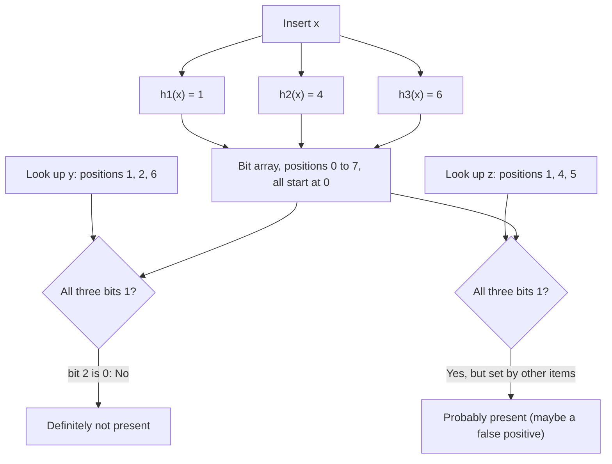
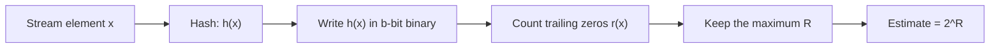
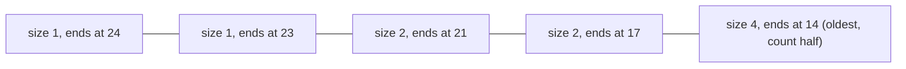
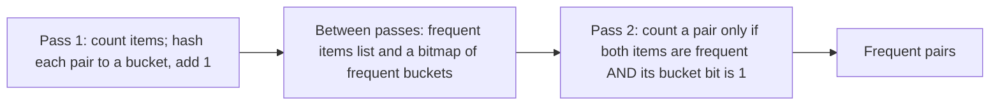

This note covers the second half of syllabus <Syl m="4" />: "Filtering streams: Bloom filter with analysis", "Counting distinct elements: Flajolet-Martin, combining estimates, space requirements", "Counting frequent items, frequent itemsets in decaying windows" and "Counting ones in a window: the DGIM algorithm, decaying windows". The stream model and sampling are in the earlier note of this module.

## The basics first

- A **data stream** is a never-ending flow of items (clicks, tweets, sensor readings, bank transactions) that arrives fast. We see each item **once**, and we cannot store it all. <Cite id="stream-counting-mmds-home" loc="§4.1" /> <Cite id="stream-counting-aws-streaming" /> <Cite id="stream-counting-ibm-streaming" />
- Because memory is small, we do not give the exact answer. We give an **approximate** answer that is very close, using a tiny **summary** (also called a sketch) of the stream. <Cite id="stream-counting-wiki-streaming" />
- A **hash function** $h$ turns any item into a number in a fixed range, for example $h(x) = 3x + 7 \bmod 32$ gives a number from 0 to 31. The same item always gives the same number, and different items usually give different numbers. A **bit** is a 0 or a 1. A **bit array** is a row of bits.
- **Trailing zeros** of a binary number are the zeros at its right end. For example `10100` has 2 trailing zeros, and `01001` has 0.
- A **false positive** is a wrong "yes". A **false negative** is a wrong "no".

The three problems of this note, and the tool for each:

| Question about the stream | Tool | Answer you get |
|---|---|---|
| Have I seen this item before? (filtering) | Bloom filter | "Definitely not" or "probably yes" |
| How many different items so far? (distinct count) | Flajolet-Martin | An estimate such as 8 |
| How many 1s in the last N bits? (window count) | DGIM | An estimate within 50 percent |

## Bloom filter

<PYQ id="2022-12-ce/q1d" /> <PYQ id="2024-05-ce/q1d" /> <PYQ id="2024-05/q1d" /> <PYQ id="2025-05/q6a" /> <PYQ id="2024-12-ce/q3b" />

**Definition.** A Bloom filter (Burton Bloom, 1970) is a small bit array together with $k$ hash functions. It tells whether an item is a member of a set $S$ that was fed to it. It may say "yes" for an item that is not in $S$ (false positive), but it **never says "no" for an item that is in $S$** (no false negatives). <Cite id="stream-counting-mmds-home" loc="§4.3" /> <Cite id="stream-counting-wiki-bloom" /> <Cite id="stream-counting-gfg-bloom" />

**Why it is needed.** Suppose a mail server has a list of one billion good email addresses and must decide for each arriving mail whether the sender is on the list. Looking up a disk each time is slow, and holding the whole list in memory is huge. A Bloom filter keeps only a few bits per address in memory. Most of the time it answers correctly and fast. When it says "probably yes", we can check the slow, exact list. When it says "no", we are sure and need not check at all. <Cite id="stream-counting-mmds-home" loc="§4.3" />

**Everyday analogy.** A school gate guard remembers only a few features of every student, such as "tall, red bag, blue shoes". A stranger who has none of the features is surely not a student. Another stranger who happens to match all the features of some student may be let in by mistake. That mistake is the false positive. A student is never refused, because his features are on the list.

**How it works.**

1. Start with a bit array of $m$ bits, all 0, and choose $k$ hash functions, each giving a position from 0 to $m-1$.
2. **Insert** an item $x$: compute $h_1(x), \dots, h_k(x)$ and set those $k$ bits to 1.
3. **Look up** an item $y$: compute the same $k$ positions. If **all** are 1, answer "possibly in the set". If **any** is 0, answer "definitely not in the set".

<Cite id="stream-counting-gfg-bloom" loc="diagram" /> <Cite id="stream-counting-wiki-bloom" loc="diagram" />

**Why there is no false negative.** An inserted item set its $k$ bits to 1, and bits are never turned back to 0. So the same $k$ bits are still 1 at look-up time. **Why there are false positives.** Other items may have set exactly the $k$ bits of a new item.

<Box kind="definition">

**Properties to remember.** Space is $m$ bits, no matter how long the items are. Insert and look-up both take $k$ hash computations ($O(k)$ time). Two filters of the same size and hash functions can be merged by bitwise OR. You **cannot list** the stored items and you **cannot delete** an item, because a bit may be shared with other items. <Cite id="stream-counting-wiki-bloom" />

</Box>

### Bloom filter with analysis (false-positive rate)

The syllabus asks for the analysis. Let $m$ = bits, $n$ = items inserted, $k$ = hash functions. The idea is to find the chance that a bit is still 0, then the chance that all $k$ bits of a new item are 1. <Cite id="stream-counting-mmds-home" loc="§4.3" />

1. One hash sets one particular bit with probability $1/m$. So a bit stays 0 after one hash with probability $1 - 1/m$.
2. There are $kn$ hashes in all, so the chance a bit is still 0 is $(1 - 1/m)^{kn} \approx e^{-kn/m}$. (For large $m$, $(1 - 1/m)^m$ is about $e^{-1}$.)
3. So the fraction of bits that are 1 is about $1 - e^{-kn/m}$.
4. A new item that is **not** in the set is wrongly accepted when all its $k$ bits are 1. Treating the $k$ bits as independent:

$$
\text{false-positive rate} \approx \left(1 - e^{-kn/m}\right)^k
$$

5. Using too few hash functions gives weak filtering. Using too many fills the array with 1s. The best value is $k = \dfrac{m}{n}\ln 2 \approx 0.693\,\dfrac{m}{n}$, which makes about half the bits 1. For a wanted false-positive rate $p$, the size needed is $m = -\dfrac{n \ln p}{(\ln 2)^2}$, about 9.6 bits per item for $p = 1\%$. <Cite id="stream-counting-wiki-bloom" />

**Pitfall.** The formula assumes the $k$ hash functions behave like independent random choices. For a tiny array such as $m = 8$ the real rate can differ from the formula (see the verify box of the first sum).

<Sum>

<Given>

A Bloom filter has $m = 8$ bits (positions 0 to 7), all 0 at the start, and three hash functions $h_1(x) = x \bmod 8$, $h_2(x) = (2x + 1) \bmod 8$, $h_3(x) = (3x + 2) \bmod 8$. Insert 12, 25, 30, 5. Then check 6 and 55. (This is the exact question of <PYQ id="2024-12-ce/q3b" />.)

</Given>

<Find>

the bit array after the inserts, whether 6 and 55 are reported present, and which answer is a true or false positive or negative.

</Find>

<Steps>

1. **Insert 12.** $h_1 = 12 \bmod 8 = 4$. $h_2 = 25 \bmod 8 = 1$. $h_3 = 38 \bmod 8 = 6$. Set bits 4, 1, 6. *Reason: insert sets all k positions.*
2. **Insert 25.** $h_1 = 25 \bmod 8 = 1$. $h_2 = 51 \bmod 8 = 3$. $h_3 = 77 \bmod 8 = 5$. Set bits 1, 3, 5 (bit 1 was already 1).
3. **Insert 30.** $h_1 = 30 \bmod 8 = 6$. $h_2 = 61 \bmod 8 = 5$. $h_3 = 92 \bmod 8 = 4$. Set bits 6, 5, 4 (all already 1).
4. **Insert 5.** $h_1 = 5 \bmod 8 = 5$. $h_2 = 11 \bmod 8 = 3$. $h_3 = 17 \bmod 8 = 1$. Set bits 5, 3, 1 (all already 1).
5. **Array after all inserts.** Bits 1, 3, 4, 5, 6 are 1.

   | Position | 0 | 1 | 2 | 3 | 4 | 5 | 6 | 7 |
   |---|---|---|---|---|---|---|---|---|
   | Bit | 0 | 1 | 0 | 1 | 1 | 1 | 1 | 0 |

6. **Check 6.** $h_1 = 6 \bmod 8 = 6$. $h_2 = 13 \bmod 8 = 5$. $h_3 = 20 \bmod 8 = 4$. Bits 6, 5, 4 are all 1, so the filter says "present". *Reason: all k bits are 1.*
7. **Check 55.** $h_1 = 55 \bmod 8 = 7$. $h_2 = 111 \bmod 8 = 7$. $h_3 = 167 \bmod 8 = 7$. Bit 7 is 0, so the filter says "absent".
8. **Judge the answers.** 6 was never inserted (the inserted set is 12, 25, 30, 5), so "present" is wrong: a **false positive**. 55 was never inserted and the filter says absent: a **true negative**.

</Steps>

<Answer>

Final array `0 1 0 1 1 1 1 0`. Element 6 is reported present but is not in the set, so it is a **false positive**. Element 55 is reported absent and truly is absent, so it is a **true negative**. No true positive appears in these two checks, because neither 6 nor 55 was inserted. (Checking an inserted item such as 12, whose bits 4, 1, 6 are all 1, would give a true positive.)

</Answer>

<Box kind="verify">

Check 1: count the 1s. Bits set at least once are 1, 3, 4, 5, 6, which is 5 bits, matching the array. Every inserted item must test "present": 12 uses bits 4, 1, 6; 25 uses 1, 3, 5; 30 uses 6, 5, 4; 5 uses 5, 3, 1. All are 1, so there is no false negative.

Check 2: a random new item would be a false positive with chance about $(5/8)^3 = 0.244$ using the real fraction of 1 bits, so a false positive like 6 is quite likely in such a tiny array. The formula $(1 - e^{-kn/m})^k = (1 - e^{-1.5})^3 \approx 0.469$ is larger, because with only 8 bits the hash positions are not independent.

</Box>

</Sum>

<Sum>

<Given>

$n = 1000$ items are stored in a Bloom filter of $m = 8000$ bits.

</Given>

<Find>

the false-positive rate for $k = 1$, $k = 2$ and $k = 6$, and the best $k$.

</Find>

<Steps>

1. Items per bit: $kn/m = k \times 1000 / 8000 = k/8$. *Reason: this is the exponent in the formula.*
2. $k = 1$: $kn/m = 0.125$, $e^{-0.125} = 0.8825$, so $1 - 0.8825 = 0.1175$, and $0.1175^1 = 0.1175$, about 11.75 percent.
3. $k = 2$: $kn/m = 0.25$, $e^{-0.25} = 0.7788$, so $1 - 0.7788 = 0.2212$, and $0.2212^2 = 0.0489$, about 4.9 percent.
4. $k = 6$: $kn/m = 0.75$, $e^{-0.75} = 0.4724$, so $1 - 0.4724 = 0.5276$, and $0.5276^6 = 0.0216$, about 2.2 percent.
5. Best $k = (m/n)\ln 2 = 8 \times 0.6931 = 5.55$. The nearest whole numbers are 5 and 6: $k = 5$ gives $(1 - e^{-0.625})^5 = 0.02168$ and $k = 6$ gives $0.02158$, so use $k = 6$.

</Steps>

<Answer>

False-positive rate about 11.8 percent for $k = 1$, 4.9 percent for $k = 2$, and 2.2 percent for $k = 6$. The best $k$ is 6 (about 5.55 before rounding).

</Answer>

<Box kind="verify">

Check 1: $k = 7$ gives $(1 - e^{-0.875})^7 = 0.0229$, which is larger than for $k = 6$, so $k = 6$ really is the minimum. Check 2: at $k = 6$ the fraction of 1 bits is $1 - e^{-0.75} = 0.528$, close to the half that the best $k$ aims for. Check 3: the size formula for $p = 0.0216$ gives $m/n = -\ln 0.0216 / (\ln 2)^2 = 3.835 / 0.4805 = 7.98$, which is the 8 bits per item we started with.

</Box>

</Sum>

**Advantages.** Very small memory. Constant-time insert and look-up. No false negatives. Works on streams, since an item is processed once. **Disadvantages.** False positives. No deletion (a **counting Bloom filter** replaces each bit by a small counter to allow deletion, at more memory). Cannot list or count the stored items. <Cite id="stream-counting-gfg-counting-bloom" /> <Cite id="stream-counting-wiki-bloom" />

**Applications.** Spam and blacklist filtering (the book's example), and databases that avoid useless disk reads: Cassandra and HBase keep a Bloom filter per data file and skip the file when the filter says "definitely not here". Redis ships a ready Bloom filter type. <Cite id="stream-counting-mmds-home" loc="§4.3" /> <Cite id="stream-counting-cass-bloom" /> <Cite id="stream-counting-hbase-bloom" /> <Cite id="stream-counting-redis-bloom" /> <Cite id="stream-counting-gfg-bloom-java" />

**Conclusion.** A Bloom filter trades a small, controllable chance of a false "yes" for a huge saving in memory, and it never forgets a stored item.

## Counting distinct elements: Flajolet-Martin

<PYQ id="2022-12-ce/q3a" /> <PYQ id="2023-05-ce/q3a" /> <PYQ id="2023-12-ce/q3a" /> <PYQ id="2024-05-ce/q3a" /> <PYQ id="2024-12-ce/q4a" /> <PYQ id="2025-05-ce/q3a" />

**The count-distinct problem.** Count how many **different** items have appeared in a stream, for example the number of unique visitors of a website. The exact way is to remember every item seen (a set or a table), which needs memory proportional to the number of distinct items, too much for billions of users. <Cite id="stream-counting-mmds-home" loc="§4.4" /> <Cite id="stream-counting-wiki-countdistinct" />

**Idea of Flajolet-Martin (1985).** Hash every item to a long random-looking bit string. A bit string that ends in many zeros is rare: the chance of at least $r$ trailing zeros is $1/2^r$. So if the longest run of trailing zeros we have seen is $R$, then we have probably looked at about $2^R$ different items. We need to remember only the number $R$, not the items. Repeated items give the same hash again, so they never change $R$. <Cite id="stream-counting-fm1985" /> <Cite id="stream-counting-mmds-home" loc="§4.4" /> <Cite id="stream-counting-wiki-fm" />

**Everyday analogy.** Toss a coin until you get a head. If you saw somebody get 10 tails in a row, you would guess that many people were tossing. The longest lucky streak tells you roughly how many tries were made.

**Algorithm.**

1. Pick a hash function $h$ that maps items to $b$-bit numbers.
2. For each stream element $x$, compute $h(x)$, write it in binary, and count the trailing zeros. This count is the **tail length** $r(x)$.
3. Keep $R$ = the maximum tail length seen so far.
4. The estimate of the number of distinct elements is $2^R$. (The original paper also divides by a correction factor $\varphi \approx 0.77351$; the exam textbook uses plain $2^R$.)

<Cite id="stream-counting-gfg-fm" loc="diagram" />

**What if the hash value is 0?** The binary string `00000` has no 1 at all. Textbooks treat its tail length as all $b$ bits (or skip it). State your choice in the exam. In the sums below, the only case where this arises is noted.

<Box kind="pitfall">

The hash function must spread values evenly. A function such as $h(x) = 4x + 1 \bmod 16$ always gives an **odd** number, so every hash ends in 1, every tail length is 0 and the estimate is always $2^0 = 1$, whatever the stream. Solve the question as asked, and say that this hash is poor.

</Box>

<Sum>

<Given>

Stream $S = \{10, 12, 8, 15, 6, 9, 14, 7\}$, hash function $h(x) = 5x + 11 \bmod 32$, result treated as a 5-bit binary number. (This is <PYQ id="2025-05-ce/q3a" />.)

</Given>

<Find>

the estimate of the number of distinct elements by the Flajolet-Martin algorithm.

</Find>

<Steps>

1. For each $x$ compute $5x + 11$, then take it mod 32, write 5-bit binary, and count the trailing zeros $r$. *Reason: the tail length of the hash is all the algorithm remembers.*

   | $x$ | $5x + 11$ | $h(x)$ mod 32 | 5-bit binary | Trailing zeros $r$ |
   |---|---|---|---|---|
   | 10 | 61 | 29 | 11101 | 0 |
   | 12 | 71 | 7 | 00111 | 0 |
   | 8 | 51 | 19 | 10011 | 0 |
   | 15 | 86 | 22 | 10110 | 1 |
   | 6 | 41 | 9 | 01001 | 0 |
   | 9 | 56 | 24 | 11000 | 3 |
   | 14 | 81 | 17 | 10001 | 0 |
   | 7 | 46 | 14 | 01110 | 1 |

2. The maximum tail length is $R = 3$, from $x = 9$ (hash 24 = `11000`).
3. Estimate $= 2^R = 2^3 = 8$.

</Steps>

<Answer>

$R = 3$, so the estimated number of distinct elements is $2^3 = 8$.

</Answer>

<Box kind="verify">

Check 1: the stream has 8 different numbers, so the estimate 8 equals the true count here. Check 2: a hash value has at least 3 trailing zeros only if it is a multiple of 8; among 29, 7, 19, 22, 9, 24, 17, 14 only 24 is, so $R = 3$ and not more. Check 3: the arithmetic mod 32 again: $61 - 32 = 29$, $71 - 64 = 7$, $51 - 32 = 19$, $86 - 64 = 22$, $41 - 32 = 9$, $56 - 32 = 24$, $81 - 64 = 17$, $46 - 32 = 14$.

</Box>

</Sum>

**The other past-paper streams** use exactly the same steps. Working each one the same way (hash, 5-bit or stated width, trailing zeros, maximum):

| Question | Hash and width | Hash values | $R$ | Estimate $2^R$ | True distinct count |
|---|---|---|---|---|---|
| <PYQ id="2023-12-ce/q3a" /> stream 4, 2, 5, 9, 1, 6, 3, 7 | $x + 6 \bmod 32$, 5 bits | 10, 8, 11, 15, 7, 12, 9, 13 (8 = `01000` has 3 zeros, the best) | 3 | 8 | 8 |
| <PYQ id="2024-05-ce/q3a" /> same stream | $3x + 7 \bmod 32$, 5 bits | 19, 13, 22, 2, 10, 25, 16, 28 (16 = `10000` has 4 zeros) | 4 | 16 | 8 |
| <PYQ id="2024-12-ce/q4a" /> stream 9, 8, 7, 6, 5, 4, 3, 2 | $2x + 1 \bmod 32$, 5 bits | 19, 17, 15, 13, 11, 9, 7, 5 (all odd) | 0 | 1 | 8 |
| <PYQ id="2023-05-ce/q3a" /> stream 2, 1, 6, 1, 5, 9, 2, 3, 5 | $4x + 1 \bmod 16$, 4 bits | 9, 5, 9, 5, 5, 5, 9, 13, 5 (all odd) | 0 | 1 | 6 |
| <PYQ id="2022-12-ce/q3a" /> stream 1, 3, 2, 1, 2, 3, 4, 3, 1, 2, 3, 1 | $6x + 1 \bmod 5$, 3 bits | 2, 4, 3, 2, 3, 4, 0, 4, 2, 3, 4, 2 (in stream order; 0 counted as 3 zeros) | 3 | 8 | 4 |

For the 2022 paper: $h(1) = 7 \bmod 5 = 2$ (`010`, 1 zero), $h(3) = 19 \bmod 5 = 4$ (`100`, 2 zeros), $h(2) = 13 \bmod 5 = 3$ (`011`, 0 zeros), $h(4) = 25 \bmod 5 = 0$ (`000`, taken as 3 zeros). So $R = 3$ and the estimate is 8. If you skip the all-zero hash instead, $R = 2$ and the estimate is 4, which equals the true count; write the convention you use. In the 2023-05 and 2024-12 rows every hash is odd, so the method gives 1: the estimate is poor because the hash function is poor, not because the working is wrong.

**Combining estimates.** One hash function gives a noisy answer, because $2^R$ can only be a power of 2 and one lucky hash can make it much too big. The fix is to use many hash functions. If we simply **average** the estimates, one huge outlier ruins the average. If we take the **median**, we only ever get powers of 2. So we combine both: divide the hash functions into small groups, **average inside each group**, and take the **median of the group averages**. The groups should be as large as $\log_2 m$ so that outliers are removed. <Cite id="stream-counting-mmds-home" loc="§4.4" /> <Cite id="stream-counting-wiki-fm" />

<Sum>

<Given>

Nine hash functions, in three groups of three, give these estimates $2^R$. Group A: 4, 8, 16. Group B: 8, 8, 32. Group C: 4, 4, 8.

</Given>

<Find>

the combined estimate of the number of distinct elements.

</Find>

<Steps>

1. Average inside each group. A: $(4 + 8 + 16)/3 = 28/3 = 9.33$. B: $(8 + 8 + 32)/3 = 48/3 = 16$. C: $(4 + 4 + 8)/3 = 16/3 = 5.33$. *Reason: averaging smooths out small noise.*
2. Take the median of the three group averages. Sorted: 5.33, 9.33, 16. The middle one is 9.33. *Reason: the median ignores one extreme group.*

</Steps>

<Answer>

combined estimate about 9.33 distinct elements (round to 9).

</Answer>

<Box kind="verify">

Check 1: all nine estimates together have a plain average of $(28 + 48 + 16)/9 = 92/9 = 10.2$, which is pulled up by the single 32; the median-of-averages 9.33 is less affected. Check 2: the middle value of 5.33, 9.33, 16 is 9.33, so the median step is right.

</Box>

</Sum>

**Space requirement.** For each hash function we store only the number $R$, which fits in $\log_2 b$ bits for $b$-bit hashes, so the memory is tiny: about $\log \log m$ bits per hash function for $m$ possible distinct items. The memory does not grow with the number of distinct elements. <Cite id="stream-counting-mmds-home" loc="§4.4" /> <Cite id="stream-counting-fm1985" />

**Modern use.** HyperLogLog improves Flajolet-Martin by splitting the stream into many buckets and combining the buckets' $R$ values with a harmonic mean. It is built into Redis (`PFCOUNT`), Spark (`approx_count_distinct`) and BigQuery. <Cite id="stream-counting-hll2007" /> <Cite id="stream-counting-wiki-hll" /> <Cite id="stream-counting-redis-hll" /> <Cite id="stream-counting-spark-approx" /> <Cite id="stream-counting-bq-hll" />

**Conclusion.** Flajolet-Martin counts distinct items with a few bytes by remembering only the rarest hash pattern seen, and combining many such guesses makes the answer reliable.

## Counting ones in a window: the DGIM algorithm

<PYQ id="2023-12/q3b" /> <PYQ id="2023-12-ce/q4b" /> <PYQ id="2024-05-ce/q4b" /> <PYQ id="2024-05/q4b" /> <PYQ id="2025-05/q4b" />

**The problem.** We have a stream of 0s and 1s and a **window** of the last $N$ bits (for example $N = 1$ billion). At any time we must answer: "how many 1s are in the last $k$ bits?" for any $k \le N$. (Example: how many of the last $k$ sales were of one product, if 1 means "sold".) <Cite id="stream-counting-mmds-home" loc="§4.6" />

**The cost of exact counts.** To answer exactly for every $k \le N$ we must store the whole window of $N$ bits, because when the oldest bit leaves the window we need to know whether it was a 1. So exact counting needs $N$ bits of memory, too much when $N$ is a billion and there are many streams. <Cite id="stream-counting-mmds-home" loc="§4.6" />

**The DGIM idea (Datar, Gionis, Indyk, Motwani, 2002).** Do not store the bits. Store only a few **buckets**, each summarising a group of 1s. Each bucket records two numbers: the **timestamp of its right (most recent) end** and its **size**, which is the number of 1s it holds. Sizes are powers of 2. The memory is about $O(\log^2 N)$ bits, and the count is correct to within 50 percent. Timestamps are stored modulo $N$, so each needs only $\log_2 N$ bits, and there are at most about $\log_2 N$ different sizes, each used at most twice. <Cite id="stream-counting-mmds-home" loc="§4.6" /> <Cite id="stream-counting-wiki-dsm" /> <Cite id="stream-counting-cs246-slides" />

<Box kind="definition">

**The six rules for the buckets (DGIM constraints).** These are the points asked in <PYQ id="2023-12-ce/q1d" />, <PYQ id="2024-12-ce/q1d" /> and <PYQ id="2025-05-ce/q1d" />.

1. The **right end** of a bucket is always a position with a 1. (A bucket never ends in 0.)
2. **Every 1** in the window belongs to some bucket.
3. **No position** belongs to more than one bucket (buckets do not overlap).
4. There are **one or two buckets of each size**, up to some maximum size.
5. All bucket **sizes are powers of 2** (1, 2, 4, 8, ...).
6. Buckets **cannot get smaller** as we go back in time: going from the newest to the oldest bucket the sizes only stay the same or grow.

Also, a bucket is dropped when its right end falls outside the window of the last $N$ bits. <Cite id="stream-counting-mmds-home" loc="§4.6" />

</Box>

**Example for the rules.** A valid bucket list, newest to oldest, has sizes 1, 1, 2, 2, 4: two of size 1, two of size 2 and one of size 4 (rule 4 satisfied), sizes never decrease going back (rule 6), and each bucket's right end is a 1 (rule 1). A list with three buckets of size 2 would break rule 4 and must be fixed by merging.

**Updating when a new bit arrives (timestamp $t$).**

1. First, if the oldest bucket's right-end timestamp is now outside the window (older than $t - N$), delete that bucket.
2. If the new bit is **0**, do nothing more.
3. If the new bit is **1**, create a new bucket of size 1 with timestamp $t$.
4. If there are now **three buckets of the same size**, merge the **two oldest** of them into one bucket of **double size**; its timestamp is the timestamp of the more recent of the two. This merge may create three buckets of the next size, so repeat step 4 up the sizes. <Cite id="stream-counting-mmds-home" loc="§4.6" />

**Answering "how many 1s in the last $k$ bits".**

1. Find the oldest bucket $B$ that still overlaps the last $k$ positions (its right end is within the last $k$ bits).
2. Sum the sizes of all buckets **newer** than $B$.
3. Add **half the size of $B$** (we do not know how many of its 1s are inside the window).

The true answer lies between "newer buckets + 1" and "newer buckets + size of $B$", so the estimate is wrong by at most half of $B$, and $B$ is never larger than about half of the true count, so the **error is at most 50 percent**. Allowing up to $r$ buckets of each size (instead of 2) cuts the error to about $1/(r-1)$. <Cite id="stream-counting-mmds-home" loc="§4.6" />

<Cite id="stream-counting-mmds-home" loc="diagram" />

<Sum>

<Given>

Stream of bits (timestamp 1 first): `1 0 1 1 0 1 1 0 0 0 1 0 1 1 1 0 1 1 0 0 1 0 1 1 0` (25 bits). Window size $N = 16$. Show how the DGIM buckets change and estimate the number of 1s in the last 16 bits after the 25th bit.

</Given>

<Find>

the buckets after every 1, and the estimate of the 1s in the last 16 bits, compared with the true count.

</Find>

<Steps>

1. Write each bucket as (size, timestamp of right end), newest first. A 1 creates (1, t). A 0 changes nothing. Three buckets of one size are merged: the two oldest become one bucket of double size with the newer of the two timestamps. A bucket is dropped when its timestamp is $\le t - 16$. *Reason: these are the DGIM update rules.*

   | $t$ | Bit | Buckets after this bit (newest first) | Comment |
   |---|---|---|---|
   | 1 | 1 | (1,1) | new bucket |
   | 2 | 0 | (1,1) | zero, no change |
   | 3 | 1 | (1,3) (1,1) | two of size 1 is allowed |
   | 4 | 1 | (1,4) (2,3) | three of size 1, merge (1,3) and (1,1) into (2,3) |
   | 5 | 0 | (1,4) (2,3) | |
   | 6 | 1 | (1,6) (1,4) (2,3) | |
   | 7 | 1 | (1,7) (2,6) (2,3) | merge (1,6) and (1,4) into (2,6) |
   | 8 to 10 | 0 | (1,7) (2,6) (2,3) | zeros |
   | 11 | 1 | (1,11) (1,7) (2,6) (2,3) | |
   | 12 | 0 | same | |
   | 13 | 1 | (1,13) (2,11) (4,6) | size 1: merge 11 and 7 into (2,11); then three of size 2: merge (2,6) and (2,3) into (4,6) |
   | 14 | 1 | (1,14) (1,13) (2,11) (4,6) | |
   | 15 | 1 | (1,15) (2,14) (2,11) (4,6) | merge (1,14) and (1,13) into (2,14) |
   | 16 | 0 | same | |
   | 17 | 1 | (1,17) (1,15) (2,14) (2,11) (4,6) | |
   | 18 | 1 | (1,18) (2,17) (4,14) (4,6) | merge to (2,17), then merge (2,14) and (2,11) into (4,14) |
   | 19, 20 | 0 | same | |
   | 21 | 1 | (1,21) (1,18) (2,17) (4,14) (4,6) | |
   | 22 | 0 | (1,21) (1,18) (2,17) (4,14) | bucket (4,6) dropped: $6 \le 22 - 16$ |
   | 23 | 1 | (1,23) (2,21) (2,17) (4,14) | merge (1,21) and (1,18) into (2,21) |
   | 24 | 1 | (1,24) (1,23) (2,21) (2,17) (4,14) | |
   | 25 | 0 | same | |

2. Query: the last 16 bits are positions 10 to 25. The oldest bucket that overlaps is $B = $ (4, 14). The buckets newer than $B$ have sizes $1 + 1 + 2 + 2 = 6$.
3. Add half of $B$: $4 / 2 = 2$. Estimate $= 6 + 2 = 8$.

</Steps>

<Answer>

Final buckets (1,24) (1,23) (2,21) (2,17) (4,14). Estimated number of 1s in the last 16 bits $= 8$. The true count is 9, so the error is $1/9$, about 11 percent, inside the 50 percent bound.

</Answer>

<Box kind="verify">

Check 1: count the 1s directly in positions 10 to 25: 11, 13, 14, 15, 17, 18, 21, 23, 24, which is 9. Check 2: the oldest bucket (4,14) holds the 1s at positions 14, 13, 11 and 7. Only 14, 13 and 11 are inside the window, so the exact answer is $6 + 3 = 9$, the same as the direct count. DGIM guessed half (2) of the bucket instead of 3. Check 3: every bucket list obeys the rules: at most two of each size, sizes 1, 1, 2, 2, 4 never decrease backwards, right ends 24, 23, 21, 17, 14 are all 1s.

</Box>

</Sum>

**Advantages.** Very small memory ($O(\log^2 N)$ bits), fast update, and a guaranteed error bound. **Disadvantages.** The answer is only approximate (error up to 50 percent unless more buckets per size are kept). It works for 0/1 streams; sums of small integers need an extension (the book treats each bit position of the integers separately). <Cite id="stream-counting-mmds-home" loc="§4.6" />

**Conclusion.** DGIM replaces a window of $N$ bits by about $\log N$ buckets and still answers window counts within a bounded error.

## Comparing the three tools

| | Bloom filter | Flajolet-Martin | DGIM |
|---|---|---|---|
| Question | Is this item in the set? | How many different items? | How many 1s in the last $k$ bits? |
| Memory | $m$ bits | a few small numbers $R$ | $O(\log^2 N)$ bits |
| Answer | yes (maybe wrong) or no (always right) | estimate $2^R$ | estimate, error at most 50 percent |
| Main idea | $k$ hash bits set to 1 | longest run of trailing zeros | buckets of power-of-2 sizes |
| Cannot do | delete or list items | say which items were seen | count exactly |

## Frequent items and decaying windows

**Counting frequent items.** Besides distinct counts, we often need the items that occur most often (the trending hashtags, the popular movies). Keeping a counter for every item is too much memory, so we keep counters only for items that look popular, or sample the stream and work on the sample. A related structure, the count-min sketch, keeps a small table of counters addressed by several hash functions to estimate each item's frequency. <Cite id="stream-counting-mmds-home" loc="§4.5" /> <Cite id="stream-counting-wiki-countmin" />

**Decaying window.** A normal window treats the last $N$ items as equally important and the rest as worthless. A **decaying window** gives each item a weight that shrinks smoothly with age. If the stream is $a_1, a_2, \dots, a_t$ (newest last) and $c$ is a tiny constant (for example $10^{-6}$), the decayed sum is

$$
\sum_{i=0}^{t-1} a_{t-i}\,(1 - c)^i
$$

The newest item has weight 1, the one before it $(1-c)$, then $(1-c)^2$ and so on. The big advantage is that it is updated in one step: when a new item $a_{t+1}$ arrives, **multiply the current sum by $(1 - c)$ and add $a_{t+1}$**. Nothing old needs to be stored. It is an exponential moving average. <Cite id="stream-counting-mmds-home" loc="§4.7" /> <Cite id="stream-counting-wiki-expsmooth" />

**Most popular items in a decaying window.** Treat each item as its own 0/1 stream (1 when that item arrives, else 0) and keep one decayed score per item. When a new element arrives: multiply **all** scores by $(1 - c)$, add 1 to the score of the arriving item (create it at 1 if new), and **drop any score below 1/2**. The total of all scores is at most $1/c$, so at most $2/c$ items can stay above 1/2, which keeps memory bounded. The same trick works for "itemsets" in the frequent-itemset problem: treat a chosen itemset as an item that "arrives" when a basket contains it. <Cite id="stream-counting-mmds-home" loc="§4.7" />

<Sum>

<Given>

Decay constant $c = 0.1$ (so the multiplier is $1 - c = 0.9$). The stream of items is x, y, x, z, x, y. Drop a score if it falls below 0.5.

</Given>

<Find>

the decayed score of each item after the six arrivals.

</Find>

<Steps>

1. For every arrival, multiply all current scores by 0.9, then add 1 to the arriving item. *Reason: this is the one-step update.*

   | Arrival | x | y | z |
   |---|---|---|---|
   | 1: x | 1 | | |
   | 2: y | 0.9 | 1 | |
   | 3: x | 0.81 + 1 = 1.81 | 0.9 | |
   | 4: z | 1.629 | 0.81 | 1 |
   | 5: x | 1.4661 + 1 = 2.4661 | 0.729 | 0.9 |
   | 6: y | 2.2195 | 0.6561 + 1 = 1.6561 | 0.81 |

2. No score is below 0.5, so no item is dropped.

</Steps>

<Answer>

After the sixth arrival: x $\approx 2.22$, y $\approx 1.66$, z $= 0.81$. x is the most popular.

</Answer>

<Box kind="verify">

Check by the formula: x arrived at times 1, 3, 5 and the stream has 6 items, so its weights are $0.9^5 + 0.9^3 + 0.9^1 = 0.5905 + 0.729 + 0.9 = 2.2195$. y arrived at times 2 and 6: $0.9^4 + 1 = 0.6561 + 1 = 1.6561$. z arrived at time 4: $0.9^2 = 0.81$. All three match the table.

</Box>

</Sum>

## Related question: the PCY algorithm

<PYQ id="2024-12/q3a" />

This past-paper question is tagged to this topic because PCY also uses a hash table to save memory in a pass over big data, but it is about **frequent itemsets in market baskets**, not about streams. A frequent pair is a pair of items that appear together in at least $s$ baskets (the support threshold). <Cite id="stream-counting-mmds-home" /> <Cite id="stream-counting-wiki-apriori" />

**The problem in A-Priori.** In pass 1 A-Priori counts single items. In pass 2 it counts pairs of frequent items. Pass 1 leaves most main memory unused, and pass 2 can run out of memory because there are too many candidate pairs.

**The PCY idea (Park, Chen, Yu).** Use the idle memory of pass 1 for a **hash table of buckets of counts**.

1. **Pass 1.** For every basket, count each item (as in A-Priori). Also for every **pair** in the basket, hash the pair to a bucket and add 1 to that bucket's count. (Pairs are not stored, only the bucket counts.)
2. **Between passes.** Keep the items whose count is at least $s$ (frequent items). Turn the bucket counts into a **bitmap**: 1 if the bucket count is at least $s$ (frequent bucket), else 0. The bitmap takes about 1/32 of the space of the counts.
3. **Pass 2.** Count a pair $\{i, j\}$ only if **both** $i$ and $j$ are frequent items **and** the pair hashes to a bucket whose bit is 1. All other pairs are skipped.

A pair in a bucket whose total count is below $s$ can never itself reach $s$, so skipping it is safe. This removes many candidate pairs.

<Cite id="stream-counting-mmds-home" loc="diagram" />

**Types (improvements).** **Multistage:** insert extra passes, each with a new hash function that hashes only the pairs that passed the earlier bitmaps, so fewer false candidates remain. **Multihash:** use two or more hash tables with different hash functions in the same pass 1 (each with half the buckets), and count a pair in pass 2 only if it is in a frequent bucket of **all** tables. <Cite id="stream-counting-mmds-home" />

**Advantage.** Fewer pairs to count in pass 2, so less memory. **Disadvantage.** The bitmap and hash tables use memory in pass 1, and with a poor hash all buckets can become frequent, which gives no saving.

## Exam tips

<Box kind="exam">

For a Flajolet-Martin sum: write a table with columns $x$, $h(x)$, binary and trailing zeros, give $R$ and $2^R$, and state your convention for a hash value 0. For a Bloom filter sum: show each $h_i(x)$ for each element, draw the bit array after every insert, and name true or false positives and negatives. For DGIM: write buckets as (size, timestamp), list the six rules, show the merge when three buckets of one size appear, and end with "newer buckets plus half the oldest". For a 5-mark question write the definition, the steps, one small diagram and one example.

</Box>
