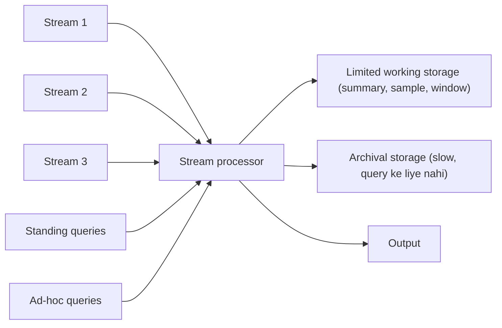
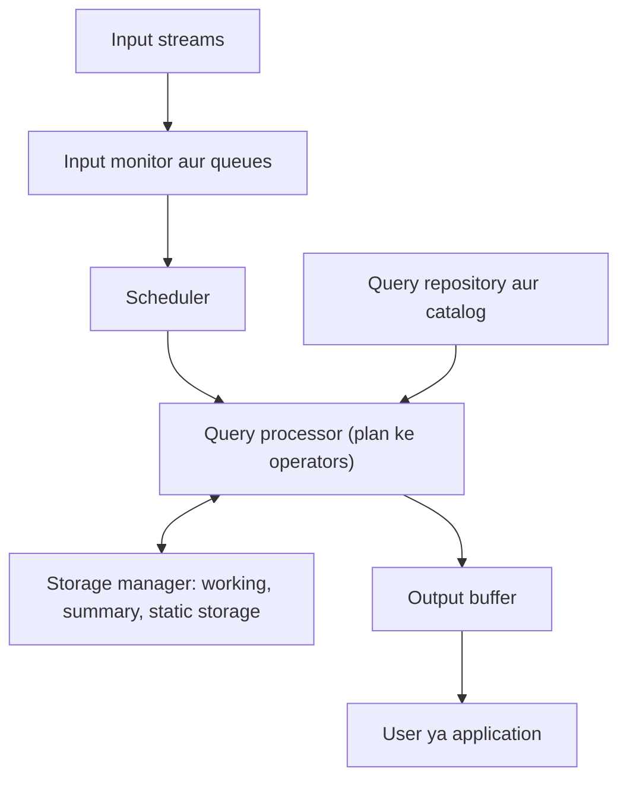
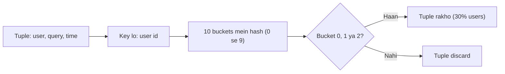
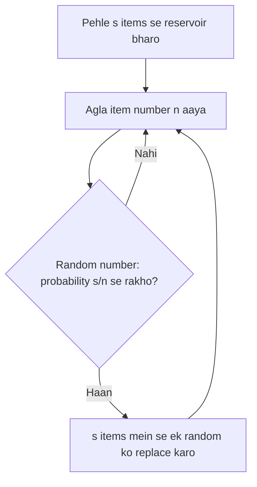

Naye ideas se pehle, purane ideas jo chahiye. Agar aapko pata hai to next section pe jao.

## Pehle basics

- **Database** (DBMS) data ko disk pe store karta hai. Aap ek sawaal (**query**) poochte ho, woh stored data mein dhundhta hai aur ek exact answer deta hai. Data wait karta rehta hai.
- **Tuple** ek row ya record hai, jaise (user, search words, time).
- **Main memory** (RAM) fast hai par chhoti. **Disk** badi hai par slow.
- **Hash function** kisi bhi value (naam, id) ko ek number bana deta hai, har baar same tarah se. "hash mod 10" 0 se 9 tak ka bucket number deta hai, barabar failaya hua.
- **Random sample**: data ka chhota hissa jo fairly chuna gaya ho, taaki woh poore data jaisa dikhe.

## Data stream kya hai

**Ye kya hai.** **Data stream** woh data hai jo lagatar, high speed se aata hai aur jiska koi end nahi pata. Har piece ek **element** (tuple) hai. Examples: website ka har click, sensor ki har reading, Google pe type kiya har search. Ye syllabus <Syl m="4" />, section 4.1, "The Stream Data Model" hai.

**Naya model kyun chahiye.** Normal database maan ke chalta hai ki data pehle se stored hai aur baar baar padh sakte hain. Stream alag hai:

- Ye **itni tez aur badi hai ki sab kuch store** nahi kar sakte jahan se fast query ho.
- Ye **endless** hai, to "padhna khatam" kabhi nahi hota.
- Elements kis **rate** pe aayenge, ye system control nahi karta.
- Element ek baar nikal gaya to **wapas dekh nahi sakte** (jab tak archive na kiya ho, aur archive itna slow hai ki queries nahi chalti).

**Rozmarra ki analogy.** Database ek library hai: kitabein shelf pe rehti hain, jo chahe padho. Stream ek nadi hai: aap kinare khade ho, paani ek hi baar bahta dikhta hai. Aap machhliyan gin sakte ho, ya ek balti paani nikaal ke study kar sakte ho, par saara paani dobara nahi dekh sakte.

<Cite id="stream-data-model-babcock2002" loc="§1" /> <Cite id="stream-data-model-wiki-ds" /> <Cite id="stream-data-model-aws" />

## Stream sources ke examples

| Source | Stream kaisi dikhti hai | Kya chahiye |
| --- | --- | --- |
| Sensor networks (temperature, GPS, wind) | Hazaaron sensors se har kuch second mein reading | Reading unusual ho to alarm |
| Image data (satellites, street cameras) | Bahut saari pictures | Changes pakdo, sirf kaam ka rakho |
| Internet aur web traffic (switch pe IP packets) | Router se guzarte packets | Attacks detect karo, better routing |
| Search queries (Google) | (user, query, time) | Kaun si queries kal se zyada frequent hain |
| Click streams (website) | (user, page, time) | Is ghante kaun se pages ko unusual hits mil rahe hain |
| Social media feeds (Twitter, Facebook) | Posts aur status updates | Trending topics dhundho |
| Telephone call records | Har call ka ek record | Billing aur settlements |
| Financial tickers (stock prices) | Price changes | Trading alerts |

<Cite id="stream-data-model-cs246-slides" loc="slides 8-9" /> <Cite id="stream-data-model-babcock2002" loc="§2.2" /> <Cite id="stream-data-model-ibm" /> <Cite id="stream-data-model-kafka" />

<PYQ id="2023-12/q1d" />

## Data stream management system (DSMS)

**Ye kya hai.** **Data Stream Management System (DSMS)** woh software hai jo ek ya zyada streams leta hai aur data ke guzarte waqt hi uske baare mein sawaalon ka answer deta hai, bahut kam memory se. Ye DBMS jaisa dikhta hai par streams ke liye bana hai. Ye syllabus <Syl m="4" /> "A Data-Stream-Management System" hai.

**Ye kaise kaam karta hai, step by step.**

1. Kai streams ek saath **stream processor** mein aati hain. Har stream elements ki sequence hai.
2. Processor thodi si **limited working storage** rakhta hai (aksar main memory, kabhi disk). Isme **summary** hoti hai (counts, sample, recent elements ki window), poori stream kabhi nahi.
3. **Standing queries** system mein stored rehti hain aur har naye element pe hamesha chalti hain. Kuch report karne layak ho to output deti hain. Example: "ab tak ka highest temperature batao".
4. **Ad-hoc queries** ek baar, user ke chune hue waqt pe poochi jaati hain. Example: "pichle 10 minute mein kitne users login hue?". Ye sirf working storage ke data se answer ho sakti hain.
5. Poori stream **archival storage** mein bhi copy ho sakti hai (badi, slow store, jaise tapes ya data warehouse). Isse **queries ka jaldi answer nahi** de sakte; ye baad ke offline analysis ke liye hai.
6. Answers **output** se bahar jaate hain.

<Cite id="stream-data-model-cs246-slides" loc="slide 7" /> <Cite id="stream-data-model-geisler" /> <Cite id="stream-data-model-jiang" /> <Cite id="stream-data-model-wiki-dsms" />

Isi system ka doosra view andar ke parts dikhata hai (Geisler aur Jiang-Chakravarthy ke hisaab se): **input monitor** (ya queue) elements receive aur buffer karta hai, **scheduler** decide karta hai ki agla operator kaun sa chalega, **query processor** query plan ke operators chalata hai, **storage manager** summary aur archive sambhalta hai, **catalog** queries aur stream definitions rakhta hai, aur **output buffer** results deta hai. Overload mein DSMS **load shedding** kar sakta hai, yaani jaan-boojh ke kuch elements drop karna taaki system pichhe na reh jaaye.

<Cite id="stream-data-model-geisler" /> <Cite id="stream-data-model-jiang" /> <Cite id="stream-data-model-wiki-dsms" />

**Real systems.** Aurora, STREAM (Stanford), TelegraphCQ, NIAGARA aur IBM Streams DSMS hain; aaj Apache Kafka (transport), Flink aur Storm (continuous processing) aur Spark Streaming (chhote batches, ab Structured Streaming ke saamne legacy API) bade scale pe yahi kaam karte hain.

<Cite id="stream-data-model-wiki-sp" /> <Cite id="stream-data-model-kafka" /> <Cite id="stream-data-model-spark" />

<PYQ id="2022-12-ce/q4b" /> <PYQ id="2023-05-ce/q4b" /> <PYQ id="2025-05/q4a" /> <PYQ id="2025-05-ce/q4b" />

## DBMS versus DSMS

| Point | DBMS | DSMS |
| --- | --- | --- |
| Data | Stable, stored (persistent) | Endless, tez moving streams |
| Access | Random access | Sequential, one pass |
| Queries | One-time queries | Continuous (standing), plus ad-hoc |
| Model | Query-driven, pull: user poochta hai | Data-driven, push: naya data results trigger karta hai |
| Query plan | Shuru mein ek baar optimise | Adaptive; stream ke saath badal sakta hai |
| Update rate | Low | Bahut high |
| Answers | Exact | Exact ya approximate |
| Real-time | Zaroori nahi | Zaroori |
| Storage | Badi secondary storage | Bounded main memory |

**Conclusion:** DBMS query ko stored data ke paas le jaata hai; DSMS data ko stored queries ke paas se guzaarta hai.

<Cite id="stream-data-model-gfg-dbms-dsms" /> <Cite id="stream-data-model-wiki-dsms" /> <Cite id="stream-data-model-babcock2002" loc="§2.1" />

<PYQ id="2023-12/q1d" />

## Stream queries

Stream pe do tarah ke sawaal poochte hain.

- **Standing (continuous) queries**: ek baar poochi, phir naya data aate hi hamesha answer. Example: "kisi bhi sensor ka temperature 40 degree se upar ho to alert do". Example: "pichle 24 ghante ki readings ka average har ghante report karo".
- **Ad-hoc queries**: ek baar poochi, abhi ke baare mein. Example: "pichle 5 minute mein max value kya thi?". Stream store nahi ho sakti, isliye usual trick hai har stream ki last N elements (ya last N minutes) ki **sliding window** working storage mein rakhna, taaki ad-hoc queries uss se answer ho sakein.

Stream pe aam taur pe ye cheezein poochte hain:

| Query type | Example |
| --- | --- |
| Sampling | Stream ka fair random sample do |
| Sliding window queries | Last k elements mein type x ke kitne items |
| Filtering | Property x wale elements chuno (jaise Bloom filter) |
| Counting distinct elements | Last k elements mein kitne alag users |
| Estimating moments | Last k elements ka average aur spread |
| Frequent elements | Sabse common items kaun se (trending topics) |

Filtering, distinct counting aur window mein ones count karna agle topic (stream counting) mein aate hain.

<Cite id="stream-data-model-cs246-slides" loc="slides 7-8" /> <Cite id="stream-data-model-babcock2002" loc="§2.1" /> <Cite id="stream-data-model-wiki-dsms" />

**Sliding window.** N length ki ek window socho jo stream pe aage chalti hai: naya element andar aata hai to sabse purana bahar jaata hai. Queries sabse recent N elements ke baare mein hoti hain.

<Sum>

<Given>

"Is transaction mein product X bika ya nahi" ki 0/1 stream, purane se naye: 1, 0, 1, 1, 0, 1, 0, 1, 1 (9 elements). Window length $N = 4$.

</Given>

<Find>

9th element aane ke baad window mein kitne 1 hain.

</Find>

<Steps>

1. Window mein 4 sabse recent elements hain, yaani elements 6 se 9. *Reason: purane slide hoke bahar chale gaye.*
2. Elements 6, 7, 8, 9 hain 1, 0, 1, 1. *Reason: stream se padhe.*
3. 1s gino: $1 + 0 + 1 + 1 = 3$. *Reason: 0/1 window ka sum ones ki ginti hai.*

</Steps>

<Answer>

last 4 elements mein 3 ones.

</Answer>

<Box kind="verify">

Check: poori stream mein $1+0+1+1+0+1+0+1+1 = 6$ ones hain. Pehle 5 elements (1, 0, 1, 1, 0) mein 3 ones. To last 4 mein $6 - 3 = 3$ ones, same.

</Box>

</Sum>

## Stream processing ke issues

Ye woh problems hain jo har DSMS ko solve karni padti hain. (Exam wording: "issues and challenges in data stream query processing".)

1. **Unbounded memory.** Stream kabhi khatam nahi hoti, to exact answer ke liye memory bina limit badh sakti hai, jabki hamari memory fixed hai. Solution: sirf summary rakho.
2. **Approximate answers.** Bounded memory mein exact answer aksar impossible hai, isliye known error wala achha approximate answer le lete hain (sample ya sketch se).
3. **Sliding windows.** Answer ko recent data ka rakhne aur memory bounded rakhne ke liye queries poori history ki jagah latest elements ki window pe chalti hain. System ko ye bhi decide karna hota hai ki "window" ka matlab kya hai (last N elements ya last T minutes) aur streams merge hone pe time stamps kaise use karein.
4. **Batch processing, sampling aur synopses.** Speed badhane ke liye system kuch elements skip kar sakta hai (sample), chhote batches mein process kar sakta hai, ya compact **synopsis** (histogram ya sketch jaisi summary) rakh sakta hai.
5. **Blocking operators.** Sort, SUM, COUNT, MAX, AVG aur kuch joins jaise operators poora input dekhe bina pehla output nahi de sakte, aur yahan input kabhi khatam nahi hota. Inhe window wale ya running results dene wale versions se replace karna padta hai.
6. **Beete data ke baare mein queries.** Baad mein poochi ad-hoc query ko aisa data chahiye ho sakta hai jo guzar chuka aur discard ho gaya. Solution: ad-hoc queries sirf window ya future ke baare mein allow karo, ya summaries rakho.
7. **Speed aur load.** Data bahut tez aur aise rate pe aata hai jo system control nahi karta. Real-time answers, achhi scheduling chahiye aur overload mein load shedding (jaan-boojh ke elements drop karna, accuracy thodi kam), aur quality of service banaye rakhni hoti hai.
8. **Out-of-order aur noisy data.** Alag sources ke elements late ya alag order mein aa sakte hain, kuch galat ya missing ho sakte hain, isliye queries robust honi chahiye.

<Cite id="stream-data-model-babcock2002" loc="§4.1" /> <Cite id="stream-data-model-babcock2002" loc="§4.2" /> <Cite id="stream-data-model-babcock2002" loc="§4.3" /> <Cite id="stream-data-model-babcock2002" loc="§4.4" /> <Cite id="stream-data-model-babcock2002" loc="§4.5" /> <Cite id="stream-data-model-babcock2002" loc="§4.6" /> <Cite id="stream-data-model-jiang" /> <Cite id="stream-data-model-aws" /> <Cite id="stream-data-model-ibm" />

<PYQ id="2023-05-ce/q1d" /> <PYQ id="2024-12/q5a" /> <PYQ id="2024-05/q3b" />

## Stream mein data sampling

**Ye kya hai.** Stream store nahi kar sakte, to ek idea hai **sample** store karna: chhota hissa jo fairly chuna gaya ho. Ye syllabus <Syl m="4" /> section 4.2, "Sampling Data techniques in a Stream" hai. Do alag problems hain:

1. Stream ka **fixed proportion** sample karna (jaise har 10 mein 1).
2. Unknown length ki stream se **fixed size ka random sample** rakhna (exactly s elements).

Jo property chahiye: **kisi bhi waqt n pe, ab tak dekhe gaye n elements mein se har ek ke sample mein hone ka chance barabar ho.**

### Problem 1: fixed proportion, aur key kyun matter karti hai

**Naive tareeka.** Har tuple ke liye 0 se 9 ka random number nikalo aur 0 aaye to rakho. Isse lagbhag 1/10 tuples milte hain. Ek tuple ke baare mein sawaalon ke liye theek hai, par **user ke behaviour ke sawaalon ka answer galat** aata hai, jaisa agle sum mein dikhega.

**Sahi tareeka: key se sample.** **Key** tuple ka woh hissa hai jiske baare mein sawaal hai, jaise (user, query, time) mein user. Stream ka a/b sample lene ke liye:

1. Har tuple ki key ko b buckets (0 se b minus 1) mein uniformly hash karo.
2. Tuple tab rakho jab uska bucket pehle a buckets mein ho.

Ab ya to user ke **saare** tuples rakhe jaate hain ya **koi nahi**, to har chuna hua user poora dikhta hai. 30% ke liye b = 10 lo aur buckets 0, 1, 2 rakho.

<Cite id="stream-data-model-cs246-slides" loc="slides 12-16" /> <Cite id="stream-data-model-wiki-dsms" />

<Sum>

<Given>

Search engine stream (user, query, time). Ek typical user ki $s = 100$ queries ek baar aur $d = 20$ queries exactly do baar poochi gayi hain. Hum stream ka 1/10 store karte hain.

</Given>

<Find>

user ki distinct queries mein se duplicates ka true fraction, 10% queries sample karne se mila answer, aur 10% users sample karne se mila answer.

</Find>

<Steps>

1. **True answer.** Distinct queries $s + d = 120$, jinme $d = 20$ repeat hui. Fraction $= d/(s+d) = 20/120 = 1/6 \approx 0.167$. *Reason: duplicates divided by distinct queries.*
2. **10% queries sample: singles.** Expected singles kept $= s/10 = 10$. *Reason: har ek 1/10 probability se rakhi jaati hai.*
3. **Dono copies rakhi gayi wale duplicate pairs.** Probability $= 1/10 \times 1/10 = 1/100$, to $20/100 = 0.2$ pairs. *Reason: dono independent copies chuni jaani chahiye.*
4. **Exactly ek copy rakhi gayi wale pairs.** Probability $= (1/10)(9/10) + (9/10)(1/10) = 18/100$, to $20 \times 18/100 = 3.6$ queries. *Reason: ek copy rakhi, doosri chhodi, kisi bhi order mein. Ye singles jaisi dikhti hain.*
5. **Sample-based fraction.** Sirf 0.2 pairs duplicate dikhte hain. Sample mein distinct queries $= 10 + 0.2 + 3.6 = 13.8$. Fraction $= 0.2/13.8 \approx 0.0145$. *Reason: dikhe duplicates divided by dikhi distinct queries.*
6. **10% users sample (user id ke hash se).** Chune hue user ki saari queries aati hain, to fraction wahi $20/120 = 1/6$. *Reason: chune hue user ki koi query nahi khoti.*

</Steps>

<Answer>

true fraction $= 1/6 \approx 16.7\%$; 10% queries sample karne se lagbhag $1.4\%$ (bahut galat); 10% users sample karne se $16.7\%$ (sahi).

</Answer>

<Box kind="verify">

Check 1, general formula $d/(10s + 19d) = 20/(1000 + 380) = 20/1380 \approx 0.0145$, step 5 jaisa hi.

Check 2, ek pair ke teen cases $0.01 + 0.18 + 0.81 = 1$ (dono rakhi, ek rakhi, koi nahi), to probabilities complete hain.

</Box>

</Sum>

<Sum>

<Given>

Users u1 se u8 ki 8 queries ki stream, har user ki ek. Hash function users ko buckets 0 se 9 mein bhejta hai: u1 ko 7, u2 ko 2, u3 ko 0, u4 ko 9, u5 ko 4, u6 ko 1, u7 ko 5, u8 ko 3. Humein 3/10 (30%) sample chahiye.

</Given>

<Find>

kaun se users rakhe jaate hain.

</Find>

<Steps>

1. $a/b = 3/10$, to $b = 10$ buckets aur hum buckets 0, 1, 2 rakhte hain (pehle $a = 3$). *Reason: key se sampling ka rule.*
2. Har bucket compare karo: u1 7 nahi, u2 2 haan, u3 0 haan, u4 9 nahi, u5 4 nahi, u6 1 haan, u7 5 nahi, u8 3 nahi. *Reason: sirf wahi bucket numbers rakho jo 2 ya usse kam hain.*

</Steps>

<Answer>

users u2, u3 aur u6 rakhe jaate hain, yaani 8 mein se 3, ya 37.5% (30% ke paas; badi stream mein 30% ke bahut kareeb ho jaata hai).

</Answer>

<Box kind="verify">

Check: buckets 0, 1, 2 u3, u6, u2 ke liye aate hain, aur list mein koi aur bucket value 0, 1 ya 2 nahi hai. To exactly teen users pass hote hain.

</Box>

</Sum>

<PYQ id="2024-12/q5a" />

### Problem 2: fixed-size sample (reservoir sampling)

**Zaroorat.** Memory mein sirf s items aate hain, aur stream kitni lambi hogi pata nahi. Humein har waqt n pe exactly s items ka sample chahiye jisme **dekhe gaye n items mein se har ek ki probability s/n** ho.

**Algorithm (reservoir sampling).** "Reservoir" woh array hai jisme sample rehta hai.

1. Pehle s elements reservoir mein store karo.
2. nth element aaye (n, s se bada): probability s/n se use **rakho**, warna discard karo.
3. Rakha gaya to woh **s purane items mein se uniformly random chune hue ek ko replace** karta hai.

(Aam code version 1 se n ka random number j nikalta hai aur $j \le s$ ho to slot j replace karta hai; ye wahi rule hai.)

**Ye kyun kaam karta hai.** Maano n elements ke baad har element sample mein s/n probability se hai. Agla element s/(n+1) probability se rakha jaata hai. Purana element tab nikalta hai jab replace ho; replace hone ki probability $\frac{s}{n+1}\cdot\frac{1}{s} = \frac{1}{n+1}$, to woh $n/(n+1)$ probability se bachta hai. Uski nayi probability $\frac{s}{n}\cdot\frac{n}{n+1} = \frac{s}{n+1}$, jaisa chahiye tha. n = s pe har element probability 1 se andar hai, to shuru se sahi hai (induction se proof).

<Cite id="stream-data-model-cs246-slides" loc="slides 17-21" /> <Cite id="stream-data-model-wiki-reservoir" /> <Cite id="stream-data-model-gfg-reservoir" />

<Sum>

<Given>

Sample size $s = 2$. Stream: a, b, c, d, e. 3rd, 4th aur 5th element ke liye 1 se $n$ ke random numbers: $j = 2$ (c ke liye, $n=3$), $j = 4$ (d ke liye, $n=4$), $j = 1$ (e ke liye, $n=5$). Element tab rakha jaata hai jab $j \le 2$, aur woh slot $j$ mein jaata hai.

</Given>

<Find>

har element ke baad reservoir, aur final sample mein element a hone ka chance.

</Find>

<Steps>

1. Pehle $s = 2$ elements: reservoir = [a, b]. *Reason: reservoir pehle bharta hai.*
2. c ($n = 3$, $j = 2 \le 2$): rakha, slot 2 mein gaya, to [a, c]. *Reason: j reservoir size ke andar hai.*
3. d ($n = 4$, $j = 4 > 2$): discard, to [a, c]. *Reason: j reservoir ke bahar hai.*
4. e ($n = 5$, $j = 1 \le 2$): rakha, slot 1 mein gaya, to [e, c]. *Reason: j reservoir size ke andar hai.*
5. a ke bachne ka chance: $n=3$ pe woh $\frac{2}{3}\cdot\frac{1}{2} = \frac{1}{3}$ se replace hota hai, to $\frac{2}{3}$ se bachta hai; $n=4$ pe $\frac{3}{4}$; $n=5$ pe $\frac{4}{5}$. Product $= \frac{2}{3}\cdot\frac{3}{4}\cdot\frac{4}{5} = \frac{24}{60} = \frac{2}{5}$. *Reason: a ko har baad ke round mein bachna hai.*

</Steps>

<Answer>

final reservoir = \{e, c\}; final sample mein a hone ki probability $2/5 = s/n$.

</Answer>

<Box kind="verify">

Check 1: formula har element ke liye $s/n = 2/5$ deta hai, aur upar ka product wahi deta hai.

Check 2: aakhri element e ke rakhe jaane ka chance seedha $s/n = 2/5$, a ke chance ke barabar. Expected sample size $5 \times 2/5 = 2 = s$.

</Box>

</Sum>

### Kaun sa sampling kab use karein

| Point | Fixed proportion (key hash se a/b) | Fixed size (reservoir) |
| --- | --- | --- |
| Sample size | Stream ke saath badhta hai | Exactly s rehta hai |
| Stream length chahiye | Nahi | Nahi |
| Kis ke liye achha | Key ke sawaal (user ka behaviour) | Fixed memory mein tuples ka uniform sample |
| Drawback | Memory bina limit badhti hai | Key-level sawaalon ka fair answer nahi |

**Sampling ke advantages:** memory aur time mein sasti, implement karna simple. **Limits:** answers approximate hain, aur rare events chhoot sakte hain.

<PYQ id="2024-12/q5a" />

## Applications

Network monitoring aur attack detection, trending topics aur click analysis, sensor alarms, payments pe fraud detection, stock tickers, aur live recommendations.

<Cite id="stream-data-model-ibm" /> <Cite id="stream-data-model-aws" /> <Cite id="stream-data-model-kafka" />

**Exam mein English mein likho:** "A data stream is an unbounded sequence of elements arriving at high speed that cannot be stored fully, so a DSMS answers standing and ad-hoc queries using limited working storage, windows and samples."

**Conclusion:** stream store ya replay nahi ho sakti, isliye DSMS chhoti summaries rakhta hai aur approximate answers manta hai. Sampling pehla tool hai: fixed fraction ke liye key hash karo, fixed size ke liye reservoir use karo.
