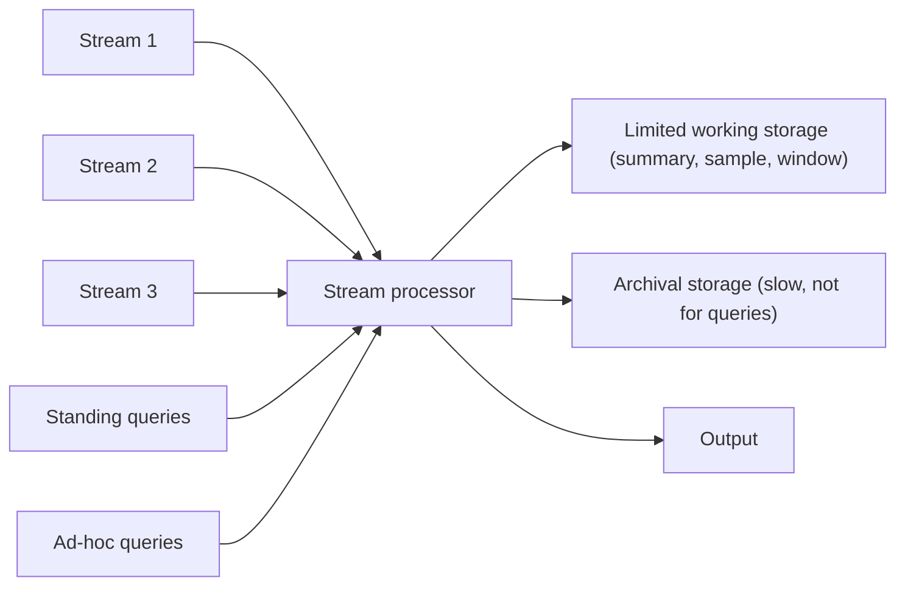
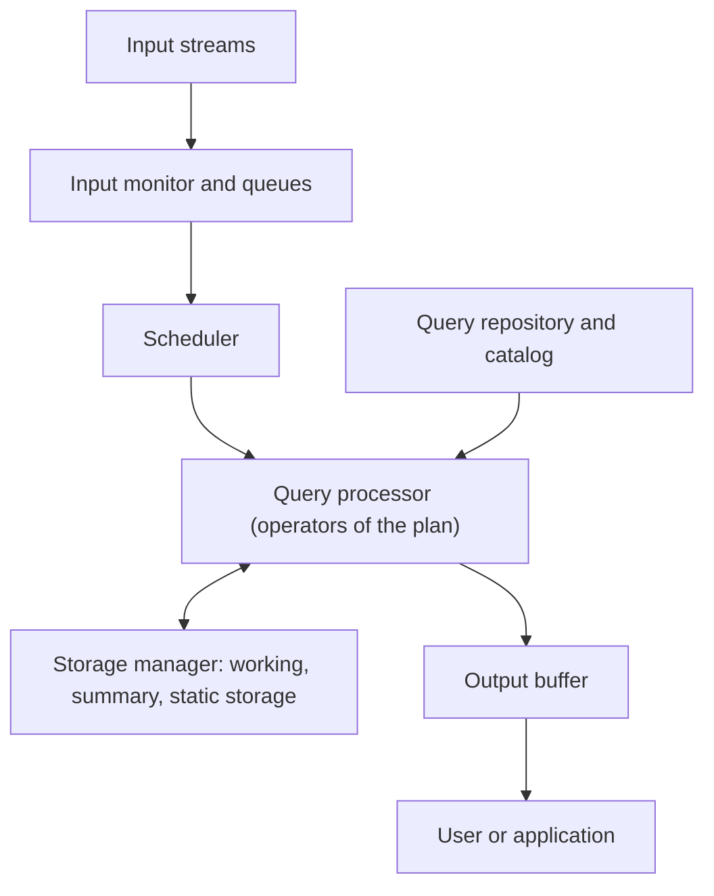
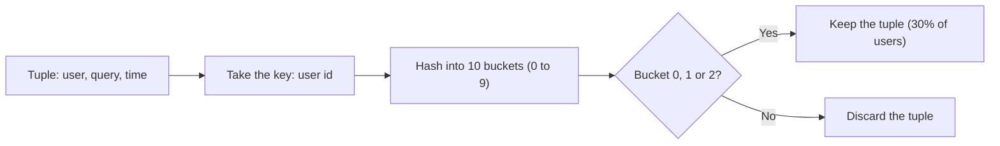
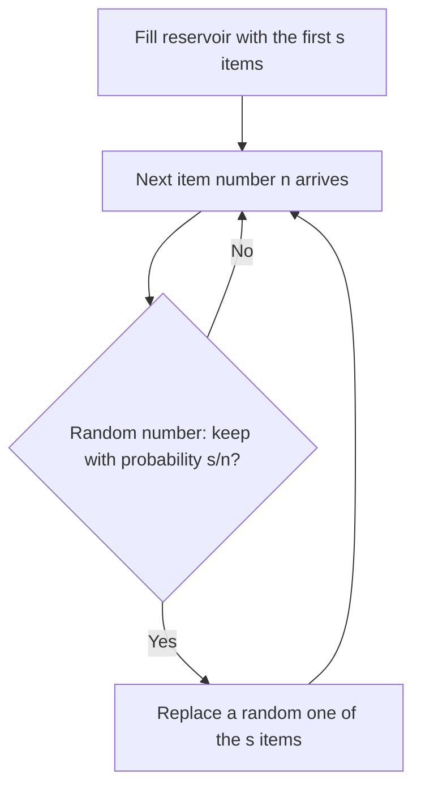

Before the new ideas, here are the old ones you need. If you already know them, skip to the next section.

## The basics first

- A **database** (DBMS) stores data on disk. You ask a question (a **query**), it looks through the stored data, and it gives one exact answer. The data waits for you.
- A **tuple** is one row or record, for example (user, search words, time).
- **Main memory** (RAM) is fast but small. **Disk** is big but slow.
- A **hash function** turns any value (a name, an id) into a number, the same way every time. "hash mod 10" gives a bucket number from 0 to 9, spread evenly.
- **Random sample**: a small part of the data picked fairly, so that it looks like the whole.

## What a data stream is

**What it is.** A **data stream** is data that arrives continuously, at a high speed, and with no known end. Each piece is an **element** (a tuple). Examples: every click on a website, every reading of a sensor, every search typed in Google. This is syllabus <Syl m="4" />, section 4.1, "The Stream Data Model".

**Why it needs a new model.** A normal database assumes the data is already there, stored, and can be read again and again. A stream is different:

- It is **too fast and too big to store** all of it where we can query it quickly.
- It is **endless**, so we never "finish reading" it.
- The system **does not control the rate** at which elements arrive.
- Once an element has gone past, **we cannot go back** to look at it again (unless we archived it, and the archive is too slow to answer queries).

**Everyday analogy.** A database is a library: books stay on the shelf and you read what you want. A stream is a river: you stand on the bank and see the water once as it flows by. You can count the fish that pass, or scoop a bucket of water to study, but you cannot see all the water again.

<Cite id="stream-data-model-babcock2002" loc="§1" /> <Cite id="stream-data-model-wiki-ds" /> <Cite id="stream-data-model-aws" />

## Examples of stream sources

| Source | The stream looks like | What we want from it |
| --- | --- | --- |
| Sensor networks (temperature, GPS, wind) | A reading every few seconds from thousands of sensors | Raise an alarm when a reading is unusual |
| Image data (satellites, street cameras) | Pictures sent down in huge numbers | Spot changes, store only what matters |
| Internet and web traffic (IP packets at a switch) | Packets passing a router | Detect attacks, route better |
| Search queries (Google) | (user, query, time) | Which queries are more frequent today than yesterday |
| Click streams (a website) | (user, page, time) | Which pages are getting unusual hits this hour |
| Social media feeds (Twitter, Facebook) | Posts and status updates | Find trending topics |
| Telephone call records | One record per call | Billing and settlements |
| Financial tickers (stock prices) | Price changes | Trading alerts |

<Cite id="stream-data-model-cs246-slides" loc="slides 8-9" /> <Cite id="stream-data-model-babcock2002" loc="§2.2" /> <Cite id="stream-data-model-ibm" /> <Cite id="stream-data-model-kafka" />

<PYQ id="2023-12/q1d" />

## Data stream management system (DSMS)

**What it is.** A **Data Stream Management System (DSMS)** is software that takes in one or more streams and answers questions about them as the data flows past, using only a small amount of memory. It looks like a DBMS but is built for streams. This is syllabus <Syl m="4" /> "A Data-Stream-Management System".

**How it works, step by step.**

1. Several streams enter the **stream processor** at the same time. Each stream is a sequence of elements.
2. The processor keeps a small amount of **limited working storage** (usually main memory, sometimes disk). It holds a **summary** (counts, a sample, a window of recent elements), never the whole stream.
3. **Standing queries** are stored in the system and run all the time on every new element. They give output whenever there is something to report. Example: "report the highest temperature seen so far".
4. **Ad-hoc queries** are asked once, at a moment the user chooses. Example: "how many users logged in during the last 10 minutes?". They can only use what is in the working storage.
5. The full stream may also be copied to **archival storage** (a big, slow store, such as tapes or a data warehouse). We **cannot answer queries from it quickly**; it is used for later offline analysis.
6. Answers leave through the **output**.

<Cite id="stream-data-model-cs246-slides" loc="slide 7" /> <Cite id="stream-data-model-geisler" /> <Cite id="stream-data-model-jiang" /> <Cite id="stream-data-model-wiki-dsms" />

A second view of the same system shows its inside parts (as described by Geisler and by Jiang and Chakravarthy): the **input monitor** (or queue) receives and buffers the elements, the **scheduler** decides which operator runs next, the **query processor** runs the operators of the query plan, the **storage manager** handles the summary and archive, a **catalog** holds the queries and stream definitions, and the **output buffer** delivers results. Under overload, a DSMS may do **load shedding**, which means deliberately dropping some elements to keep up.

<Cite id="stream-data-model-geisler" /> <Cite id="stream-data-model-jiang" /> <Cite id="stream-data-model-wiki-dsms" />

**Real systems.** Aurora, STREAM (Stanford), TelegraphCQ, NIAGARA and IBM Streams are DSMSs; today Apache Kafka (transport), Flink and Storm (continuous processing) and Spark Streaming (small batches, now a legacy API in favour of Structured Streaming) do similar jobs at scale.

<Cite id="stream-data-model-wiki-sp" /> <Cite id="stream-data-model-kafka" /> <Cite id="stream-data-model-spark" />

<PYQ id="2022-12-ce/q4b" /> <PYQ id="2023-05-ce/q4b" /> <PYQ id="2025-05/q4a" /> <PYQ id="2025-05-ce/q4b" />

## DBMS versus DSMS

| Point | DBMS | DSMS |
| --- | --- | --- |
| Data | Stable, stored (persistent) | Endless, fast-moving streams |
| Access | Random access | Sequential, one pass |
| Queries | One-time queries | Continuous (standing) queries, plus ad-hoc |
| Model | Query-driven, pull: the user asks | Data-driven, push: new data triggers results |
| Query plan | Optimised once, at the start | Adaptive; may change as the stream changes |
| Update rate | Low | Very high |
| Answers | Exact | Exact or approximate |
| Real-time | Not required | Needed |
| Storage | Large secondary storage | Bounded main memory |

**Conclusion:** a DBMS brings the query to stored data; a DSMS brings the data past stored queries.

<Cite id="stream-data-model-gfg-dbms-dsms" /> <Cite id="stream-data-model-wiki-dsms" /> <Cite id="stream-data-model-babcock2002" loc="§2.1" />

<PYQ id="2023-12/q1d" />

## Stream queries

Two kinds of question are asked of a stream.

- **Standing (continuous) queries**: asked once, then answered forever as new data arrives. Example: "alert me when the temperature of any sensor is above 40 degrees". Example: "report the average of the last 24 hours of readings, every hour".
- **Ad-hoc queries**: asked once, about now. Example: "what is the maximum value seen in the last 5 minutes?". Because the stream cannot be stored, the usual trick is to keep a **sliding window** of the last N elements (or the last N minutes) for each stream in working storage, so ad-hoc queries can be answered from it.

The common things we want to ask on a stream are:

| Query type | Example |
| --- | --- |
| Sampling | Give me a fair random sample of the stream |
| Queries over a sliding window | How many items of type x in the last k elements |
| Filtering | Select the elements that have property x (for example a Bloom filter) |
| Counting distinct elements | How many different users in the last k elements |
| Estimating moments | Average and spread of the last k elements |
| Frequent elements | Which items are most common (trending topics) |

Filtering, distinct counting and counting ones in a window belong to the next topic (stream counting).

<Cite id="stream-data-model-cs246-slides" loc="slides 7-8" /> <Cite id="stream-data-model-babcock2002" loc="§2.1" /> <Cite id="stream-data-model-wiki-dsms" />

**Sliding window.** Think of a window of fixed length N moving along the stream: when a new element enters, the oldest one leaves. Queries are about the N most recent elements.

<Sum>

<Given>

A 0/1 stream of "was product X sold in this transaction", read oldest to newest: 1, 0, 1, 1, 0, 1, 0, 1, 1 (9 elements). Window length $N = 4$.

</Given>

<Find>

how many 1s are in the window after the 9th element arrives.

</Find>

<Steps>

1. The window holds the 4 most recent elements, so elements 6 to 9. *Reason: older elements have slid out.*
2. Elements 6, 7, 8, 9 are 1, 0, 1, 1. *Reason: read them from the stream.*
3. Count the 1s: $1 + 0 + 1 + 1 = 3$. *Reason: summing a 0/1 window counts the ones.*

</Steps>

<Answer>

3 ones in the last 4 elements.

</Answer>

<Box kind="verify">

Check: the whole stream has $1+0+1+1+0+1+0+1+1 = 6$ ones. The first 5 elements (1, 0, 1, 1, 0) have 3 ones. So the last 4 have $6 - 3 = 3$ ones, the same.

</Box>

</Sum>

## Issues in stream processing

These are the problems every DSMS must solve. (Exam wording: "issues and challenges in data stream query processing".)

1. **Unbounded memory.** The stream never ends, so the memory needed for an exact answer can grow without limit, while our memory is fixed. Solution: keep only a summary.
2. **Approximate answers.** With bounded memory an exact answer is often impossible, so we accept a good approximate answer with a known error (for example from a sample or a sketch).
3. **Sliding windows.** To keep the answer about recent data and the memory bounded, queries are evaluated over a window of the latest elements instead of the whole history. The system must also decide what a "window" means (last N elements or last T minutes) and how to use time stamps when streams are merged.
4. **Batch processing, sampling and synopses.** To speed up, the system may skip some elements (sample), process them in small batches, or keep a compact **synopsis** (a summary such as a histogram or sketch).
5. **Blocking operators.** Some operators, such as sort, SUM, COUNT, MAX, AVG and some joins, cannot produce their first output until they have seen the whole input, which never ends. They must be replaced by versions that work over a window or produce running results.
6. **Queries about past data.** An ad-hoc query asked later may need data that has already gone past and was discarded. Solution: allow ad-hoc queries only about the window or the future, or keep summaries.
7. **Speed and load.** Data comes very fast and at a rate the system does not control. The system needs real-time answers, good scheduling and, if overloaded, load shedding (dropping elements on purpose, with controlled loss of accuracy), and it must keep a quality of service.
8. **Out-of-order and noisy data.** Elements from different sources may arrive late or in a different order, and some may be wrong or missing, so queries must be robust.

<Cite id="stream-data-model-babcock2002" loc="§4.1" /> <Cite id="stream-data-model-babcock2002" loc="§4.2" /> <Cite id="stream-data-model-babcock2002" loc="§4.3" /> <Cite id="stream-data-model-babcock2002" loc="§4.4" /> <Cite id="stream-data-model-babcock2002" loc="§4.5" /> <Cite id="stream-data-model-babcock2002" loc="§4.6" /> <Cite id="stream-data-model-jiang" /> <Cite id="stream-data-model-aws" /> <Cite id="stream-data-model-ibm" />

<PYQ id="2023-05-ce/q1d" /> <PYQ id="2024-12/q5a" /> <PYQ id="2024-05/q3b" />

## Sampling data in a stream

**What it is.** Because we cannot store the stream, one idea is to store a **sample**: a small piece chosen fairly. This is syllabus <Syl m="4" /> section 4.2, "Sampling Data techniques in a Stream". There are two different problems:

1. **Sample a fixed proportion** of the stream (for example 1 in 10).
2. **Keep a random sample of fixed size** (exactly s elements) from a stream of unknown length.

The property we want: **at any time n, every one of the n elements seen so far has the same chance of being in the sample.**

### Problem 1: a fixed proportion, and why the key matters

**Naive way.** For each tuple, draw a random number from 0 to 9 and keep the tuple if it is 0. This gives about 1/10 of the tuples. It is fine for questions about single tuples, but it **gives wrong answers for questions about a user's behaviour**, as the next sum shows.

**Right way: sample by key.** A **key** is the part of the tuple the question is about, for example the user in (user, query, time). To get an a/b sample of the stream:

1. Hash each tuple's key uniformly into b buckets (numbered 0 to b minus 1).
2. Keep the tuple if its bucket is among the first a buckets.

Then either **all** or **none** of a user's tuples are kept, so each kept user is seen completely. To keep 30% choose b = 10 and keep buckets 0, 1, 2.

<Cite id="stream-data-model-cs246-slides" loc="slides 12-16" /> <Cite id="stream-data-model-wiki-dsms" />

<Sum>

<Given>

A search engine stream (user, query, time). A typical user has $s = 100$ queries asked once and $d = 20$ queries asked exactly twice. We store 1/10 of the stream.

</Given>

<Find>

the true fraction of the user's distinct queries that are duplicates, the answer from sampling 10% of the queries, and the answer from sampling 10% of the users.

</Find>

<Steps>

1. **True answer.** Distinct queries are $s + d = 120$, and $d = 20$ of them are repeated. Fraction $= d/(s+d) = 20/120 = 1/6 \approx 0.167$. *Reason: duplicates divided by distinct queries.*
2. **Sample 10% of queries: singles.** Expected singles kept $= s/10 = 10$. *Reason: each is kept with probability 1/10.*
3. **Duplicate pairs with both copies kept.** Probability $= 1/10 \times 1/10 = 1/100$, so $20/100 = 0.2$ pairs. *Reason: both independent copies must be chosen.*
4. **Duplicate pairs with exactly one copy kept.** Probability $= (1/10)(9/10) + (9/10)(1/10) = 18/100$, so $20 \times 18/100 = 3.6$ queries. *Reason: one copy kept and the other dropped, in either order. These look like singles.*
5. **Sample-based fraction.** Only the 0.2 pairs look like duplicates. Distinct queries in the sample $= 10 + 0.2 + 3.6 = 13.8$. Fraction $= 0.2/13.8 \approx 0.0145$. *Reason: duplicates seen divided by distinct queries seen.*
6. **Sample 10% of users (by hash of the user id).** A kept user has all of their queries, so the fraction stays $20/120 = 1/6$. *Reason: no query of a kept user is lost.*

</Steps>

<Answer>

true fraction $= 1/6 \approx 16.7\%$; sampling 10% of queries gives about $1.4\%$ (badly wrong); sampling 10% of users gives $16.7\%$ (correct).

</Answer>

<Box kind="verify">

Check 1, the general formula $d/(10s + 19d) = 20/(1000 + 380) = 20/1380 \approx 0.0145$, the same as step 5.

Check 2, for a pair the three cases are $0.01 + 0.18 + 0.81 = 1$ (both kept, one kept, none kept), so the probabilities are complete.

</Box>

</Sum>

<Sum>

<Given>

A stream of 8 queries from users u1 to u8, one per user. A hash function sends the users to buckets 0 to 9 as: u1 gives 7, u2 gives 2, u3 gives 0, u4 gives 9, u5 gives 4, u6 gives 1, u7 gives 5, u8 gives 3. We want a 3/10 (30%) sample.

</Given>

<Find>

which users are kept.

</Find>

<Steps>

1. $a/b = 3/10$, so $b = 10$ buckets and we keep buckets 0, 1, 2 (the first $a = 3$). *Reason: the rule of sampling by key.*
2. Compare each bucket: u1 7 no, u2 2 yes, u3 0 yes, u4 9 no, u5 4 no, u6 1 yes, u7 5 no, u8 3 no. *Reason: keep only bucket numbers at most 2.*

</Steps>

<Answer>

users u2, u3 and u6 are kept, which is 3 of 8, or 37.5% (close to 30%; with a large stream it becomes very near 30%).

</Answer>

<Box kind="verify">

Check: the buckets 0, 1, 2 appear for u3, u6, u2, and no other bucket value in the list is 0, 1 or 2. So exactly three users pass.

</Box>

</Sum>

<PYQ id="2024-12/q5a" />

### Problem 2: a fixed-size sample (reservoir sampling)

**The need.** Memory can hold only s items, and we do not know how long the stream will be. We want, at every time n, a sample of exactly s items in which **each of the n items seen has probability s/n**.

**Algorithm (reservoir sampling).** The "reservoir" is the array holding the sample.

1. Store the first s elements in the reservoir.
2. When the nth element arrives (n bigger than s): with probability s/n **keep** it, else discard it.
3. If it is kept, it **replaces one of the s old items chosen uniformly at random**.

(The common code version draws a random number j from 1 to n and replaces slot j if $j \le s$; that is the same rule.)

**Why it works.** Suppose after n elements each element is in the sample with probability s/n. The next element is kept with probability s/(n+1). An old element stays if it is not replaced; it is replaced with probability $\frac{s}{n+1}\cdot\frac{1}{s} = \frac{1}{n+1}$, so it stays with probability $n/(n+1)$. Its new probability is $\frac{s}{n}\cdot\frac{n}{n+1} = \frac{s}{n+1}$, as required. At n = s every element is in with probability 1, so it holds from the start (proof by induction).

<Cite id="stream-data-model-cs246-slides" loc="slides 17-21" /> <Cite id="stream-data-model-wiki-reservoir" /> <Cite id="stream-data-model-gfg-reservoir" />

<Sum>

<Given>

Sample size $s = 2$. Stream: a, b, c, d, e. Random numbers drawn from 1 to $n$ for the 3rd, 4th and 5th elements: $j = 2$ (for c, $n=3$), $j = 4$ (for d, $n=4$), $j = 1$ (for e, $n=5$). An element is kept if $j \le 2$ and then goes into slot $j$.

</Given>

<Find>

the reservoir after each element, and the chance that element a is in the final sample.

</Find>

<Steps>

1. First $s = 2$ elements: reservoir = [a, b]. *Reason: the reservoir fills first.*
2. c ($n = 3$, $j = 2 \le 2$): kept, goes into slot 2, so [a, c]. *Reason: j is within the reservoir size.*
3. d ($n = 4$, $j = 4 > 2$): discarded, so [a, c]. *Reason: j is outside the reservoir.*
4. e ($n = 5$, $j = 1 \le 2$): kept, goes into slot 1, so [e, c]. *Reason: j is within the reservoir size.*
5. Chance that a survives: at $n=3$ it is replaced with probability $\frac{2}{3}\cdot\frac{1}{2} = \frac{1}{3}$, so it stays with $\frac{2}{3}$; at $n=4$ it stays with $\frac{3}{4}$; at $n=5$ it stays with $\frac{4}{5}$. Product $= \frac{2}{3}\cdot\frac{3}{4}\cdot\frac{4}{5} = \frac{24}{60} = \frac{2}{5}$. *Reason: a must survive every later round.*

</Steps>

<Answer>

final reservoir = \{e, c\}; the probability that a is in the final sample is $2/5 = s/n$.

</Answer>

<Box kind="verify">

Check 1: the formula gives $s/n = 2/5$ for every element, and the product above gives the same.

Check 2: the chance that the last element e is kept is $s/n = 2/5$ directly, equal to a's chance. The expected sample size is $5 \times 2/5 = 2 = s$.

</Box>

</Sum>

### Which sampling to use

| Point | Fixed proportion (a/b by key hash) | Fixed size (reservoir) |
| --- | --- | --- |
| Sample size | Grows with the stream | Stays exactly s |
| Needs the stream length | No | No |
| Good for | Questions about a key (a user's behaviour) | A uniform sample of tuples in fixed memory |
| Drawback | Memory grows without limit | Cannot answer key-level questions fairly |

**Advantages of sampling:** cheap in memory and time, simple to implement. **Limits:** answers are approximate, and rare events can be missed. 

<PYQ id="2024-12/q5a" />

## Applications

Network monitoring and attack detection, trending topics and click analysis, sensor alarms, fraud detection on payments, stock tickers, and live recommendations.

<Cite id="stream-data-model-ibm" /> <Cite id="stream-data-model-aws" /> <Cite id="stream-data-model-kafka" />

**Conclusion:** a stream cannot be stored or replayed, so a DSMS keeps small summaries and accepts approximate answers. Sampling is the first tool: hash the key for a fixed fraction, or use a reservoir for a fixed size.
