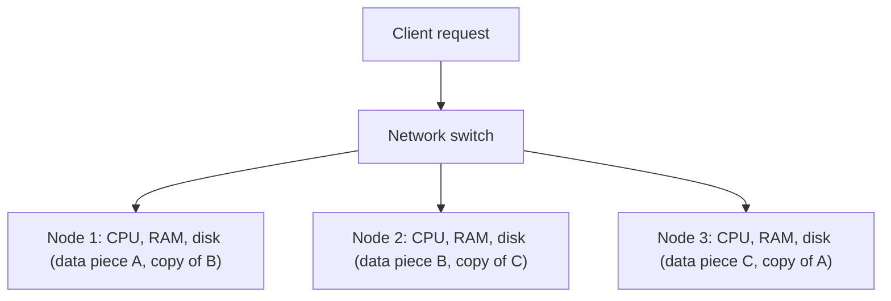

**In simple words:** mil kar kaam karne wale computers teen cheezein share kar sakte hain: memory (RAM), disk, ya kuch bhi nahi. Big data solutions **shared-nothing architecture** use karte hain, jisme har machine ka apna CPU, RAM aur disk hota hai, aur machines sirf network pe baat karti hain. <Cite id="big-data-intro-nosql" /> <Cite id="nosql-intro-wiki-sn" />

**Resources share karne ke teen tareeke**

| Way | Kya shared hai | Example | Problem |
|---|---|---|---|
| Shared RAM | Ek memory, kai CPUs | Multi-core server | Memory bus bottleneck banta hai; badhana mehnga |
| Shared disk | Ek storage, kai servers | SAN storage aur kai servers | Disk aur locking bottleneck |
| Shared nothing | Kuch nahi; har node independent | Hadoop, Cassandra, MongoDB clusters | Data ko nodes mein baantna (partition) padta hai |

**Shared-nothing architecture detail mein**

1. **Independent nodes:** har node ka apna CPU, RAM aur disk, sasti commodity hardware se bana.
2. **Partitioning (sharding):** data ke tukde hote hain aur har node kuch tukde rakhta hai.
3. **Replication:** har tukde ki copies doosre nodes pe, to node fail ho to kuch nahi khota.
4. **Local processing:** query ya task wahin chalta hai jahan data hai, sirf chhote results network pe jaate hain. <Cite id="hadoop-ecosystem-dean2004" />
5. **Scale out:** load badhe to nodes jodo, koi single bottleneck nahi.

**Advantages:** sasti hardware, lagbhag unlimited scaling, koi single point of failure nahi, fast local kaam. **Disadvantages:** nodes ke beech joins costly, data distribution aur consistency sambhalna mushkil. **Real examples:** Hadoop/HDFS, Cassandra, MongoDB sharding. <Cite id="nosql-intro-gfg-intro" />

**Conclusion:** data badhne pe shared RAM aur shared disk limit pe pahunchte hain; shared nothing scale karta rehta hai, isliye wahi big data ki architecture hai.

Exam mein English mein likho: "Big data solutions use the shared-nothing architecture."
