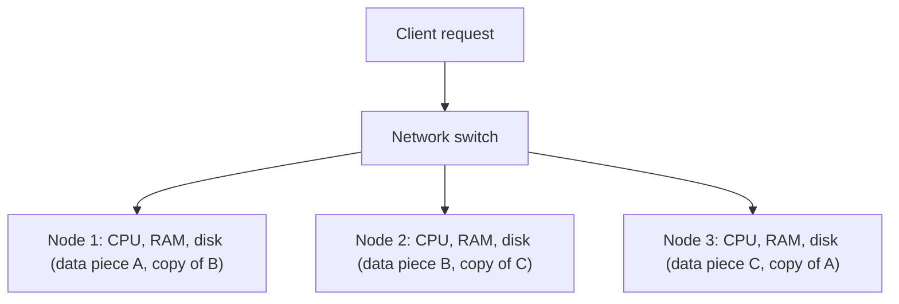

**In simple words:** computers working together can share three things: memory (RAM), disk, or nothing at all. Big data solutions use the **shared-nothing architecture**, where every machine has its own CPU, RAM and disk, and machines talk only over the network. <Cite id="big-data-intro-nosql" /> <Cite id="nosql-intro-wiki-sn" />

**Three ways to share resources**

| Way | What is shared | Example | Problem |
|---|---|---|---|
| Shared RAM | One memory, many CPUs | Multi-core server | Memory bus becomes the bottleneck; costly to grow |
| Shared disk | One storage, many servers | SAN storage with several servers | Disk and locking become the bottleneck |
| Shared nothing | Nothing; each node is independent | Hadoop, Cassandra, MongoDB clusters | Data must be split (partitioned) across nodes |

**Shared-nothing architecture in detail**

1. **Independent nodes:** each node has its own CPU, RAM and disk, built from cheap commodity hardware.
2. **Partitioning (sharding):** data is cut into pieces and each node stores some pieces.
3. **Replication:** each piece is copied to other nodes, so a failed node loses nothing.
4. **Local processing:** the query or task runs where the data is, and only small results travel over the network. <Cite id="hadoop-ecosystem-dean2004" />
5. **Scale out:** more load is handled by adding nodes, with no single bottleneck.

**Advantages:** cheap hardware, almost unlimited scaling, no single point of failure, fast local work. **Disadvantages:** joins across nodes are costly, data distribution and consistency are harder to manage. **Real examples:** Hadoop/HDFS, Cassandra, MongoDB sharding. <Cite id="nosql-intro-gfg-intro" />

**Conclusion:** shared RAM and shared disk hit limits as data grows; shared nothing keeps scaling, so it is the architecture of big data.
