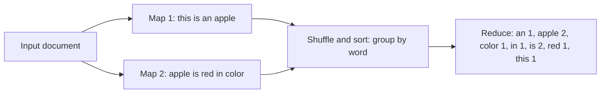

**In simple words:** word count MapReduce ka "hello world" hai. **Map** har word ke liye `(word, 1)` emit karta hai, framework same words ko group karta hai (**shuffle and sort**), aur **reduce** har word ke 1s ko add karta hai. <Cite id="mapreduce-gfg-wordcount" /> <Cite id="hadoop-ecosystem-dean2004" />

**Pseudo code**

```
map(key, value):            // key = line offset, value = one line of text
    for each word w in value:
        emit(w, 1)

reduce(key, values):        // key = a word, values = list of 1s
    sum = 0
    for each v in values:
        sum = sum + v
    emit(key, sum)
```

<Cite id="hadoop-ecosystem-apache-mr-tutorial" />

<Sum>

<Given>

Document: "This is an apple. Apple is red in color". Assumptions (justified): punctuation hata di, saare words lower case kiye, to "Apple" aur "apple" same word; har sentence apne map task ko jaata hai.

</Given>

<Find>

map output, shuffle groups aur final word counts.

</Find>

<Steps>

1. **Map.** Har word ke liye ek `(word, 1)`. *Reason: map jo word dekhta hai uske liye 1 emit karta hai.*

   | Map task | Input | Map output |
   |---|---|---|
   | M1 | this is an apple | (this,1) (is,1) (an,1) (apple,1) |
   | M2 | apple is red in color | (apple,1) (is,1) (red,1) (in,1) (color,1) |

2. **Shuffle and sort.** Key se group karo aur keys sort karo. *Reason: ek word ke saare values ek hi reducer ko pahunchne chahiye.*

   | Key | Grouped values |
   |---|---|
   | an | [1] |
   | apple | [1, 1] |
   | color | [1] |
   | in | [1] |
   | is | [1, 1] |
   | red | [1] |
   | this | [1] |

3. **Reduce.** Har key ke values add karo.

</Steps>

<Answer>

(an,1), (apple,2), (color,1), (in,1), (is,2), (red,1), (this,1).

</Answer>

<Box kind="verify">

Document mein 9 words hain, aur counts ka sum $1 + 2 + 1 + 1 + 2 + 1 + 1 = 9$, to koi word nahi khoya. Aankh se dekhne pe sirf "apple" aur "is" do baar aate hain. Agar case rakhte, to "This", "Apple" aur "apple" alag words hote (8 keys, "is" phir bhi 2).

</Box>

</Sum>



<Cite id="mapreduce-av" loc="diagram" />

**Conclusion:** programmer sirf map aur reduce likhta hai; splitting, shuffle, sorting aur failure handling framework karta hai.

Exam mein English mein likho: "Map emits (word, 1); reduce sums the counts for each word."
