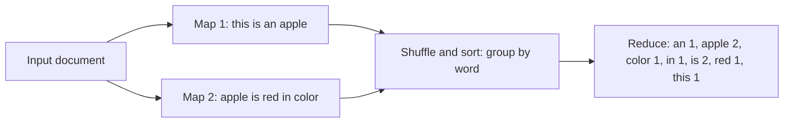

**In simple words:** word count is the "hello world" of MapReduce. **Map** emits `(word, 1)` for every word, the framework groups equal words (**shuffle and sort**), and **reduce** adds the 1s of each word. <Cite id="mapreduce-gfg-wordcount" /> <Cite id="hadoop-ecosystem-dean2004" />

**Pseudo code**

```
map(key, value):            // key = line offset, value = one line of text
    for each word w in value:
        emit(w, 1)

reduce(key, values):        // key = a word, values = list of 1s
    sum = 0
    for each v in values:
        sum = sum + v
    emit(key, sum)
```

<Cite id="hadoop-ecosystem-apache-mr-tutorial" />

<Sum>

<Given>

Document: "This is an apple. Apple is red in color". Assumptions (justified): punctuation is removed and all words are changed to lower case, so "Apple" and "apple" are the same word; each sentence goes to its own map task.

</Given>

<Find>

the map output, shuffle groups and final word counts.

</Find>

<Steps>

1. **Map.** One `(word, 1)` for each word. *Reason: map emits a 1 for every word it sees.*

   | Map task | Input | Map output |
   |---|---|---|
   | M1 | this is an apple | (this,1) (is,1) (an,1) (apple,1) |
   | M2 | apple is red in color | (apple,1) (is,1) (red,1) (in,1) (color,1) |

2. **Shuffle and sort.** Group by key and sort the keys. *Reason: all values of one word must reach the same reducer.*

   | Key | Grouped values |
   |---|---|
   | an | [1] |
   | apple | [1, 1] |
   | color | [1] |
   | in | [1] |
   | is | [1, 1] |
   | red | [1] |
   | this | [1] |

3. **Reduce.** Add the values of each key.

</Steps>

<Answer>

(an,1), (apple,2), (color,1), (in,1), (is,2), (red,1), (this,1).

</Answer>

<Box kind="verify">

The document has 9 words, and the counts add to $1 + 2 + 1 + 1 + 2 + 1 + 1 = 9$, so no word was lost. Only "apple" and "is" appear twice when read by eye. If case were kept, "This", "Apple" and "apple" would be separate words (8 keys, and "is" still 2).

</Box>

</Sum>



<Cite id="mapreduce-av" loc="diagram" />

**Conclusion:** the programmer writes only map and reduce; the framework does splitting, shuffle, sorting and failure handling.
