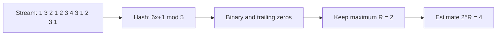

**In simple words:** Flajolet-Martin algorithm bahut kam memory mein stream ke **distinct** elements ki sankhya estimate karta hai. Har element ko binary number mein hash karo, uske **trailing zeros** gino, sabse bada count $R$ yaad rakho, aur estimate $2^R$ lo. Idea: $r$ zeros pe khatam hone wala hash value lagbhag $2^r$ mein se 1 element ka hota hai, to $R$ zeros dikhna matlab lagbhag $2^R$ alag elements. <Cite id="stream-counting-fm1985" /> <Cite id="stream-counting-mmds-home" loc="§4.4" /> <Cite id="stream-counting-gfg-fm" />

<Sum>

<Given>

Stream: 1, 3, 2, 1, 2, 3, 4, 3, 1, 2, 3, 1. Hash $h(x) = (6x + 1) \bmod 5$.

</Given>

<Find>

distinct elements ki Flajolet-Martin estimate.

</Find>

<Steps>

1. **Har element ko hash karo.** *Reason: algorithm hash values pe chalta hai, raw items pe nahi.*

   | $x$ | $6x + 1$ | $h(x)$ | binary | trailing zeros |
   |---|---|---|---|---|
   | 1 | 7 | 2 | 10 | 1 |
   | 3 | 19 | 4 | 100 | 2 |
   | 2 | 13 | 3 | 11 | 0 |
   | 4 | 25 | 0 | 0 | none (note dekho) |

2. **Stream mein aage badho.** Order mein hash values: 2, 4, 3, 2, 3, 4, 0, 4, 2, 3, 4, 2. Trailing zeros: 1, 2, 0, 1, 0, 2, -, 2, 1, 0, 2, 1. *Reason: repeats ka hash same aata hai, to maximum nahi badhta.*
3. **Sabse bade trailing zeros:** $R = 2$ ($x = 3$ se, hash 4 = binary 100).
4. **Estimate:** $2^R = 2^2 = 4$.

</Steps>

<Answer>

distinct elements ki estimate $= 2^2 = 4$.

</Answer>

<Box kind="verify">

Aankh se gino to distinct elements 1, 2, 3, 4 hain, yaani sach mein 4, estimate match karta hai. Note: hash value 0 ke trailing zeros defined nahi hote (sab zeros), isliye aam practice mein use ignore karte hain; 3-bit number mein 3 zeros gino to $2^3 = 8$ aata. Itne kam elements aur ek hash function ke saath estimate sirf rough hai; real use mein kai hash functions ka average lete hain.

</Box>

</Sum>

**Conclusion:** algorithm sirf ek number ($R$) store karta hai phir bhi distinct count estimate kar leta hai, jo store na ho sakne wale bade streams ke liye sahi hai. <Cite id="stream-counting-wiki-fm" />

Exam mein English mein likho: "Estimate = 2^R, where R is the maximum number of trailing zeros."
