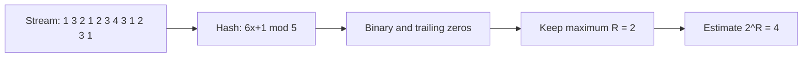

**In simple words:** the Flajolet-Martin algorithm estimates the number of **distinct** elements in a stream using very little memory. Hash every element to a binary number, count its **trailing zeros**, remember the largest count $R$, and estimate $2^R$. The idea: a hash value ending in $r$ zeros happens for about $1$ in $2^r$ elements, so seeing $R$ zeros suggests about $2^R$ different elements. <Cite id="stream-counting-fm1985" /> <Cite id="stream-counting-mmds-home" loc="§4.4" /> <Cite id="stream-counting-gfg-fm" />

<Sum>

<Given>

Stream: 1, 3, 2, 1, 2, 3, 4, 3, 1, 2, 3, 1. Hash $h(x) = (6x + 1) \bmod 5$.

</Given>

<Find>

the Flajolet-Martin estimate of the number of distinct elements.

</Find>

<Steps>

1. **Hash each element.** *Reason: the algorithm works on hash values, not on the raw items.*

   | $x$ | $6x + 1$ | $h(x)$ | binary | trailing zeros |
   |---|---|---|---|---|
   | 1 | 7 | 2 | 10 | 1 |
   | 3 | 19 | 4 | 100 | 2 |
   | 2 | 13 | 3 | 11 | 0 |
   | 4 | 25 | 0 | 0 | none (see note) |

2. **Go through the stream.** Hash values in order: 2, 4, 3, 2, 3, 4, 0, 4, 2, 3, 4, 2. Their trailing zeros are 1, 2, 0, 1, 0, 2, -, 2, 1, 0, 2, 1. *Reason: repeats give the same hash, so they never raise the maximum.*
3. **Largest trailing zeros:** $R = 2$ (from $x = 3$, hash 4 = binary 100).
4. **Estimate:** $2^R = 2^2 = 4$.

</Steps>

<Answer>

estimated number of distinct elements $= 2^2 = 4$.

</Answer>

<Box kind="verify">

Counting by eye, the distinct elements are 1, 2, 3, 4, so the true number is 4 and the estimate matches. Note: the hash value 0 has no defined trailing zeros (it is all zeros), so the usual practice is to ignore it; counting it as 3 zeros in a 3-bit number would give $2^3 = 8$. With so few elements and one hash function the estimate is only a rough guess; real use averages many hash functions.

</Box>

</Sum>

**Conclusion:** the algorithm stores only one number ($R$) yet estimates distinct counts, which suits streams too big to store. <Cite id="stream-counting-wiki-fm" />
