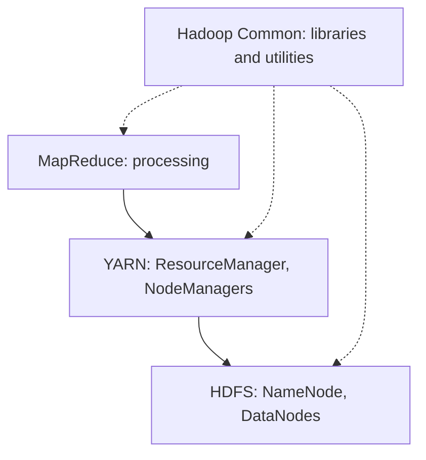

**In simple words:** Hadoop ek open-source framework hai jo sasti machines ke cluster pe bahut bada data store aur process karta hai. Iske core mein **chaar** components hain: **HDFS** (storage), **YARN** (resource management), **MapReduce** (processing) aur **Hadoop Common** (shared libraries). <Cite id="hadoop-ecosystem-apache-hadoop" /> <Cite id="hadoop-ecosystem-gfg-hadoop-arch" />

**1. HDFS (storage).** Files bade blocks (default 128 MB) mein kat-ti hain, **DataNodes** pe store hoti hain aur 3 baar copy hoti hain. Ek **NameNode** metadata rakhta hai (file names, block locations). Secondary/standby NameNode checkpoints aur recovery mein madad karta hai.

**2. YARN (resource management).** **ResourceManager** cluster ka CPU aur memory sambhalta hai aur applications ko deta hai. Har machine pe **NodeManager** containers chalata hai. Har application ka ek **ApplicationMaster** hota hai jo containers maangta hai aur apne tasks track karta hai. <Cite id="hadoop-ecosystem-apache-yarn" />

**3. MapReduce (processing).** Job **map tasks** (blocks pe chalte hain, key-value pairs emit karte hain) aur **reduce tasks** (key ke hisaab se values combine karte hain) mein baanta jaata hai, beech mein shuffle.

**4. Hadoop Common.** Java libraries, utilities aur configuration jo baaki saare modules use karte hain.

| Component | Job | Main daemons |
|---|---|---|
| HDFS | Data store karna | NameNode, DataNode |
| YARN | Cluster resources baantna | ResourceManager, NodeManager |
| MapReduce | Data process karna | ApplicationMaster, map and reduce tasks |
| Common | Shared libraries | none |

**Advantages:** sasti hardware pe scale, fault tolerant, code ko data ke paas le jaata hai. **Disadvantages:** chhote ya interactive jobs ke liye slow, bahut chhote files nuksaan karte hain. <Cite id="hadoop-ecosystem-ibm-hadoop" />

**Conclusion:** HDFS store karta hai, YARN schedule karta hai, MapReduce compute karta hai aur Common sabko support karta hai.

Exam mein English mein likho: "Core Hadoop components are HDFS, YARN, MapReduce and Hadoop Common."
