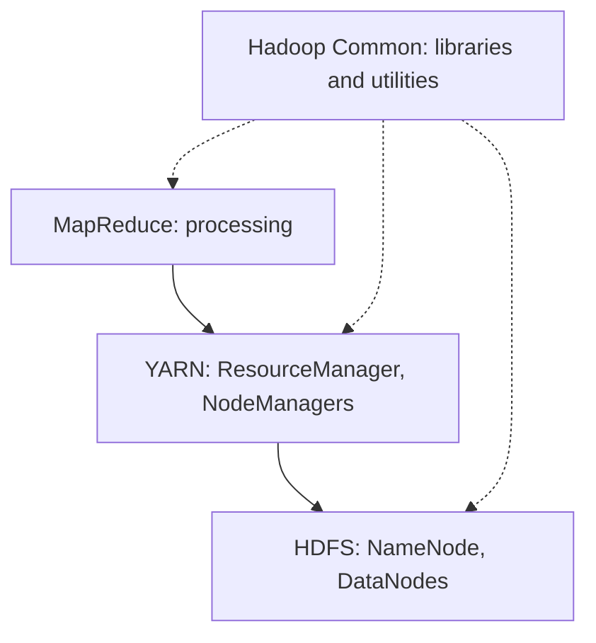

**In simple words:** Hadoop is an open-source framework that stores and processes huge data on a cluster of cheap machines. Its core has **four** components: **HDFS** (storage), **YARN** (resource management), **MapReduce** (processing) and **Hadoop Common** (shared libraries). <Cite id="hadoop-ecosystem-apache-hadoop" /> <Cite id="hadoop-ecosystem-gfg-hadoop-arch" />

**1. HDFS (storage).** Files are cut into large blocks (128 MB default), stored on **DataNodes** and copied 3 times. One **NameNode** keeps the metadata (file names, block locations). A Secondary/standby NameNode helps with checkpoints and recovery.

**2. YARN (resource management).** The **ResourceManager** owns the cluster's CPU and memory and gives them to applications. A **NodeManager** on each machine runs the containers. Each application has an **ApplicationMaster** that asks for containers and tracks its tasks. <Cite id="hadoop-ecosystem-apache-yarn" />

**3. MapReduce (processing).** The job is split into **map tasks** (run on blocks, emit key-value pairs) and **reduce tasks** (combine values by key), with a shuffle between them.

**4. Hadoop Common.** The Java libraries, utilities and configuration that all other modules use.

| Component | Job | Main daemons |
|---|---|---|
| HDFS | Store data | NameNode, DataNode |
| YARN | Share cluster resources | ResourceManager, NodeManager |
| MapReduce | Process data | ApplicationMaster, map and reduce tasks |
| Common | Shared libraries | none |

**Advantages:** scales on cheap hardware, fault tolerant, moves code to data. **Disadvantages:** slow for small or interactive jobs, many small files hurt. <Cite id="hadoop-ecosystem-ibm-hadoop" />

**Conclusion:** HDFS stores, YARN schedules, MapReduce computes and Common supports them.
