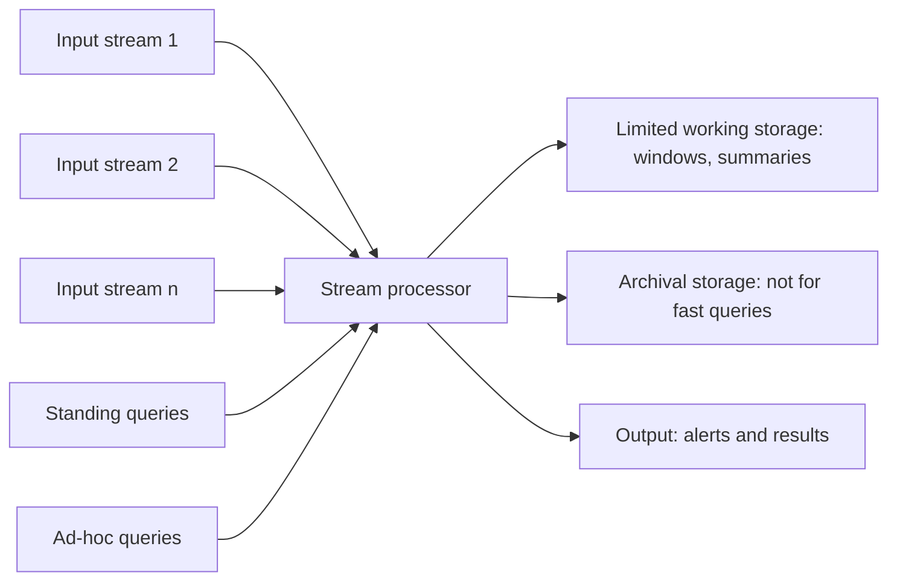

**In simple words:** Data Stream Management System (DSMS) tezi se aane wali, kabhi khatam na hone wali streams leta hai, memory mein sirf chhota summary rakhta hai, aur **standing queries** (ek baar likhi, lagataar answer deti hain) aur **ad-hoc queries** (kisi bhi time pooch sakte hain) ke jawab deta hai. Poori stream store nahi ho sakti, isliye answer window ya summary se aata hai. <Cite id="stream-data-model-babcock2002" /> <Cite id="stream-data-model-gfg-dbms-dsms" />

<Cite id="stream-counting-mmds-home" loc="§4.1" />

**Parts**

1. **Input streams:** kai sources (sensors, clicks, logs) apni speed se elements bhejte hain; system speed control nahi kar sakta.
2. **Stream processor:** engine jo har element ek baar padhta hai aur answers update karta hai.
3. **Standing queries:** permanent queries (jaise "temperature 40 se upar ho to alert") jo data aate hi evaluate hoti hain; answers output mein jaate hain.
4. **Ad-hoc queries:** kisi bhi time pooche gaye sawaal; ye sirf working storage mein rakhe data use kar sakti hain, isliye system **sliding window** ya summary (sample, sketch) rakhta hai.
5. **Limited working storage:** main memory ya fast disk jisme windows aur summaries hain.
6. **Archival storage:** bahut bada, slow storage (jaise tape ya data warehouse) jahan stream copy ho sakti hai; queries ka jawab jaldi dene ke liye use nahi hota.
7. **Output:** results, alerts ya dashboards.

**DSMS versus DBMS**

| Point | DBMS | DSMS |
|---|---|---|
| Data | Stored, finite tables | Continuous, unbounded stream |
| Queries | One-time, jab chaaho | Continuous standing queries |
| Reads | Kai passes allowed | One pass, element ek baar dikhta hai |
| Answers | Exact | Aksar approximate |

**Conclusion:** DSMS sirf windows aur summaries rakh kar real-time answers deta hai, baaki archive karta hai. <Cite id="stream-data-model-geisler" />

Exam mein English mein likho: "A DSMS answers standing and ad-hoc queries using limited working storage and archival storage."
