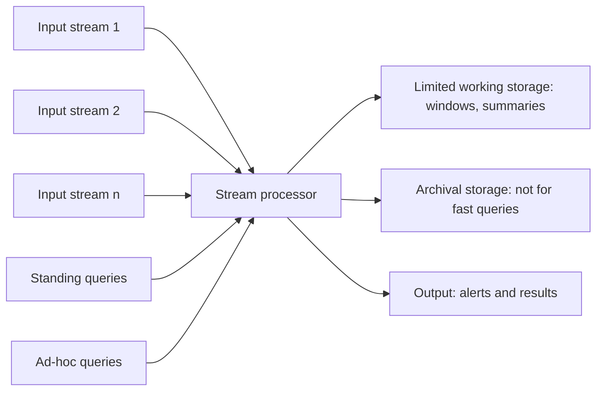

**In simple words:** a Data Stream Management System (DSMS) takes in streams that arrive fast and without end, keeps only a small summary in memory, and answers **standing queries** (asked once, answered continuously) and **ad-hoc queries** (asked at any time). It cannot store the whole stream, so it answers from a window or a summary. <Cite id="stream-data-model-babcock2002" /> <Cite id="stream-data-model-gfg-dbms-dsms" />

<Cite id="stream-counting-mmds-home" loc="§4.1" />

**Parts**

1. **Input streams:** many sources (sensors, clicks, logs) send elements at their own rate; the system cannot control the speed.
2. **Stream processor:** the engine that reads each element once and updates the answers.
3. **Standing queries:** permanent queries (for example "alert if temperature exceeds 40") evaluated as data arrives; their answers go to the output.
4. **Ad-hoc queries:** questions asked at any time; they can use only what is kept in working storage, so the system keeps a **sliding window** or a summary (sample, sketch).
5. **Limited working storage:** main memory or fast disk holding windows and summaries.
6. **Archival storage:** huge, slow storage (for example tape or a data warehouse) where the stream may be copied; it is not used to answer queries quickly.
7. **Output:** results, alerts or dashboards.

**DSMS versus DBMS**

| Point | DBMS | DSMS |
|---|---|---|
| Data | Stored, finite tables | Continuous, unbounded stream |
| Queries | One-time, run on demand | Continuous standing queries |
| Reads | Many passes allowed | One pass, element seen once |
| Answers | Exact | Often approximate |

**Conclusion:** a DSMS gives real-time answers by keeping only windows and summaries, and archives the rest. <Cite id="stream-data-model-geisler" />
