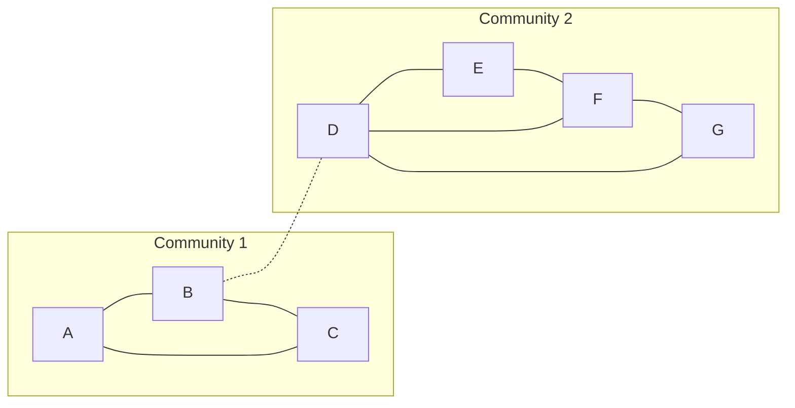

**In simple words:** Girvan-Newman algorithm communities **bridge** edges hata kar dhoondhta hai, yaani wo edges jo nodes ke beech bahut saare shortest paths pe aati hain. Kisi edge se guzarne wale shortest paths ka count uski **edge betweenness** hai. Sabse high betweenness wali edge hatao aur phir se compute karo; graph tukdon mein toote to har tukda ek community hai. <Cite id="social-network-graphs-girvan-newman2002" /> <Cite id="social-network-graphs-mmds-book" loc="§10.2" />

**Steps.** (1) Har node pair ke shortest paths dhoondo; kai hon to ek unit credit barabar baanto. (2) Edge betweenness us edge ka total credit hai. (3) Sabse high wali edge hatao. (4) Dobara compute karo aur repeat. <Cite id="social-network-graphs-gfg-girvan-newman" />

<Sum>

<Given>

Undirected graph, 7 nodes aur 9 edges: A-B, A-C, B-C, B-D, D-E, D-F, D-G, E-F, F-G.

</Given>

<Find>

Girvan-Newman se communities.

</Find>

<Steps>

1. $\binom{7}{2} = 21$ node pairs hain. Har edge ke liye gino kitne pairs ka shortest path usse guzarta hai. *Reason: betweenness ki definition yahi hai.*

   | Edge | Kaun se pairs use karte hain (credit) | Betweenness |
   |---|---|---|
   | B-D | A, B, C mein se har ek D, E, F, G mein se har ek ke saath: $3 \times 4$ | 12 |
   | A-B | A-B, aur A ke saath D, E, F, G | 5 |
   | B-C | B-C, aur C ke saath D, E, F, G | 5 |
   | A-C | sirf A-C (A-B-C lamba hai) | 1 |
   | D-E | D-E 1, E ke saath A, B, C 3, E-G 0.5 (E-D-G ya E-F-G) | 4.5 |
   | D-G | D-G 1, G ke saath A, B, C 3, E-G 0.5 | 4.5 |
   | D-F | D-F 1, F ke saath A, B, C 3 | 4 |
   | E-F | E-F 1, E-G 0.5 | 1.5 |
   | F-G | F-G 1, E-G 0.5 | 1.5 |

2. Sabse high **B-D = 12** hai. Use hatao. *Reason: do groups ke beech wahi ek link hai.*
3. Graph ab do components mein toot gaya: \{A, B, C\} aur \{D, E, F, G\}. *Reason: dono ke beech koi edge nahi bachi.*
4. Pieces ke andar dobara compute (optional, aur todne ke liye): triangle ki edges A-B, A-C, B-C sab 1 hain (barabar, kuch kaatne ko nahi), aur \{D, E, F, G\} mein D-E 1.5, D-G 1.5, E-F 1.5, F-G 1.5, D-F 1. Koi edge alag nahi dikhti, to yahin ruk jaate hain.

</Steps>

<Answer>

do communities: \{A, B, C\} aur \{D, E, F, G\}, edge B-D hatane se alag hote hain.

</Answer>

<Box kind="verify">

Check 1: nau betweenness values ka sum $12 + 5 + 5 + 1 + 4.5 + 4.5 + 4 + 1.5 + 1.5 = 39$, jo 21 shortest-path lengths ke sum ke barabar hai: A: $1+1+2+3+3+3 = 13$, B: $1+1+2+2+2 = 8$, C: $2+3+3+3 = 11$, phir D-E, D-F, D-G $= 3$ aur E-F 1, E-G 2, F-G 1 $= 4$; total $13 + 8 + 11 + 3 + 4 = 39$.

Check 2 (modularity, $m = 9$): \{A, B, C\} mein 3 edges aur degree total 7; \{D, E, F, G\} mein 5 edges aur degree total 11. $Q = (3/9 - (7/18)^2) + (5/9 - (11/18)^2) = 118/324 \approx 0.36$, saaf positive, to split sach mein community structure hai. <Cite id="social-network-graphs-wiki-girvan-newman" />

</Box>

</Sum>

**Conclusion:** B-D pe sabse zyada shortest paths hain, isliye use hatane se communities \{A, B, C\} aur \{D, E, F, G\} dikhti hain.

Exam mein English mein likho: "Remove the edge with the highest betweenness until the graph splits into communities."
