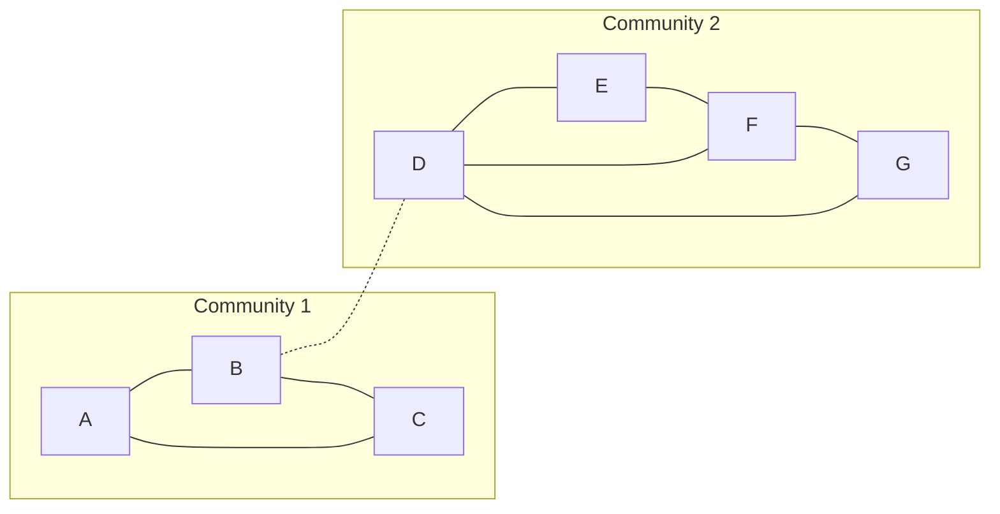

**In simple words:** the Girvan-Newman algorithm finds communities by removing **bridge** edges, the ones that lie on many shortest paths between nodes. The number of shortest paths through an edge is its **edge betweenness**. We remove the edge with the highest betweenness and recompute; when the graph falls into pieces, each piece is a community. <Cite id="social-network-graphs-girvan-newman2002" /> <Cite id="social-network-graphs-mmds-book" loc="§10.2" />

**Steps.** (1) For every pair of nodes find the shortest paths; if there are several, share one unit of credit equally. (2) Edge betweenness is the total credit of the edge. (3) Remove the highest edge. (4) Recompute and repeat. <Cite id="social-network-graphs-gfg-girvan-newman" />

<Sum>

<Given>

Undirected graph with 7 nodes and 9 edges: A-B, A-C, B-C, B-D, D-E, D-F, D-G, E-F, F-G.

</Given>

<Find>

the communities by the Girvan-Newman algorithm.

</Find>

<Steps>

1. There are $\binom{7}{2} = 21$ node pairs. Count, for each edge, the pairs whose shortest path uses it. *Reason: this is the definition of betweenness.*

   | Edge | Pairs using it (credit) | Betweenness |
   |---|---|---|
   | B-D | each of A, B, C with each of D, E, F, G: $3 \times 4$ | 12 |
   | A-B | A-B, and A with D, E, F, G | 5 |
   | B-C | B-C, and C with D, E, F, G | 5 |
   | A-C | A-C only (A-B-C is longer) | 1 |
   | D-E | D-E 1, E with A, B, C 3, E-G 0.5 (E-D-G or E-F-G) | 4.5 |
   | D-G | D-G 1, G with A, B, C 3, E-G 0.5 | 4.5 |
   | D-F | D-F 1, F with A, B, C 3 | 4 |
   | E-F | E-F 1, E-G 0.5 | 1.5 |
   | F-G | F-G 1, E-G 0.5 | 1.5 |

2. The highest is **B-D = 12**. Remove it. *Reason: it is the only link between the two groups.*
3. The graph now splits into two components: \{A, B, C\} and \{D, E, F, G\}. *Reason: no edge is left between them.*
4. Recompute inside the pieces (optional, to split further): the triangle edges A-B, A-C, B-C have 1 each (all equal, nothing to cut), and in \{D, E, F, G\} the values are D-E 1.5, D-G 1.5, E-F 1.5, F-G 1.5, D-F 1. No edge stands out, so we stop here.

</Steps>

<Answer>

two communities: \{A, B, C\} and \{D, E, F, G\}, separated by removing the edge B-D.

</Answer>

<Box kind="verify">

Check 1: the nine betweenness values add to $12 + 5 + 5 + 1 + 4.5 + 4.5 + 4 + 1.5 + 1.5 = 39$, which equals the sum of all 21 shortest-path lengths: A: $1+1+2+3+3+3 = 13$, B: $1+1+2+2+2 = 8$, C: $2+3+3+3 = 11$, then D-E, D-F, D-G $= 3$ and E-F 1, E-G 2, F-G 1 $= 4$; total $13 + 8 + 11 + 3 + 4 = 39$.

Check 2 (modularity, $m = 9$): \{A, B, C\} has 3 edges and degree total 7; \{D, E, F, G\} has 5 edges and degree total 11. $Q = (3/9 - (7/18)^2) + (5/9 - (11/18)^2) = 118/324 \approx 0.36$, clearly positive, so the split is a real community structure. <Cite id="social-network-graphs-wiki-girvan-newman" />

</Box>

</Sum>

**Conclusion:** B-D carries the most shortest paths, so removing it reveals the communities \{A, B, C\} and \{D, E, F, G\}.
