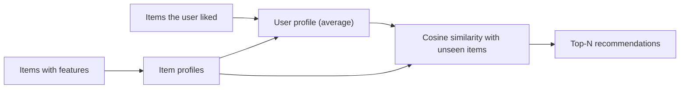

**In simple words:** this is **content-based recommendation**. The system describes every product by its properties (features), builds a profile of what the user liked, and recommends products whose properties are closest to that profile. <Cite id="recommendation-systems-mmds-book" loc="Ch. 9" /> <Cite id="recommendation-systems-gfg-cb" />

**Steps**

1. **Item profile:** list each product's features, for example a movie's genre, director, actors; for text, important words (tf-idf).
2. **User profile:** combine (average) the profiles of the products the user liked or rated high.
3. **Match:** compute the similarity (usually cosine) between the user profile and each unseen product.
4. **Recommend:** show the top-scoring products. <Cite id="recommendation-systems-google-cb" />

<Sum>

<Given>

Features (Action, Sci-fi, Romance) as 1 = has it, 0 = does not. Liked: M1 = (1, 1, 0), M2 = (1, 0, 0). Unseen: M3 = (0, 0, 1), M4 = (1, 1, 1), M5 = (0, 1, 0).

</Given>

<Find>

which unseen movie to recommend first.

</Find>

<Steps>

1. **User profile** = average of M1 and M2 $= ((1+1)/2, (1+0)/2, (0+0)/2) = (1, 0.5, 0)$. *Reason: the user likes Action fully and Sci-fi half the time.* Its length is $\sqrt{1 + 0.25 + 0} = 1.118$.
2. **M3:** dot product $= 1\cdot0 + 0.5\cdot0 + 0\cdot1 = 0$, so cosine $= 0$.
3. **M4:** dot $= 1 + 0.5 + 0 = 1.5$; length of M4 $= \sqrt3 = 1.732$; cosine $= 1.5 / (1.118 \times 1.732) = 1.5 / 1.936 = 0.775$.
4. **M5:** dot $= 0.5$; length 1; cosine $= 0.5 / 1.118 = 0.447$.
5. Rank by cosine: M4, M5, M3.

</Steps>

<Answer>

recommend M4 (0.775), then M5 (0.447); M3 (0) is not recommended.

</Answer>

<Box kind="verify">

Common sense agrees: M4 has Action and Sci-fi, both liked; M5 has only Sci-fi; M3 is pure Romance, which the user never showed interest in. Also $\sqrt{1.25} \times \sqrt{3} = \sqrt{3.75} = 1.936$.

</Box>

</Sum>

**Advantages:** needs no other users, works for new or niche items, explains why an item was recommended. **Disadvantages:** needs good features, recommends only similar things (no surprise), cold start for new users. **Real example:** Pandora's Music Genome Project describes songs by properties. <Cite id="recommendation-systems-wiki-recsys" />

**Conclusion:** content-based filtering recommends products whose properties match what the user already liked.
