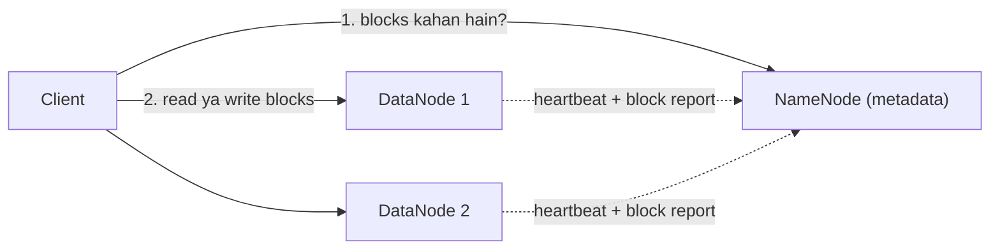

**In simple words:** HDFS ek badi file ko blocks mein kaat kar kai machines pe faila deta hai. **NameNode** manager hai jo yaad rakhta hai ki har block kahan hai. **DataNodes** workers hain jo asal mein blocks ko store karte hain. <Cite id="hdfs-apache-design" /> <Cite id="hdfs-gfg" />

**Analogy:** library socho. Catalogue (kaun si book kis shelf pe hai) NameNode hai. Books wali shelves DataNodes hain.

| Point | NameNode | DataNode |
|---|---|---|
| Role | Master | Worker (slave) |
| Stores | Metadata: file names, directory tree, block-to-DataNode map | Actual data blocks (128 MB by default) |
| Number | One active (plus a standby in HA) | Many, one on each worker machine |
| Talks to | Clients and DataNodes | NameNode, clients and other DataNodes |
| Does | Files open, close, rename karta hai; block placement aur replication decide karta hai | Reads aur writes serve karta hai; bolne par blocks banata, delete aur copy karta hai |
| Failure | Fail hua to poora cluster band (isliye standby rakhte hain) | Cluster chalta rehta hai; blocks dusri replicas se dobara copy ho jaate hain |
| Memory/disk | Bahut RAM chahiye (metadata memory mein rakhta hai) | Bahut disk chahiye |

<Cite id="hdfs-tp" /> <Cite id="big-data-intro-hdfs" />

**Conclusion:** NameNode ko pata hai data *kahan* hai; DataNodes data *rakhte* hain.

Exam mein English mein likho: "The NameNode stores the metadata and the block map; the DataNodes store the actual blocks."
