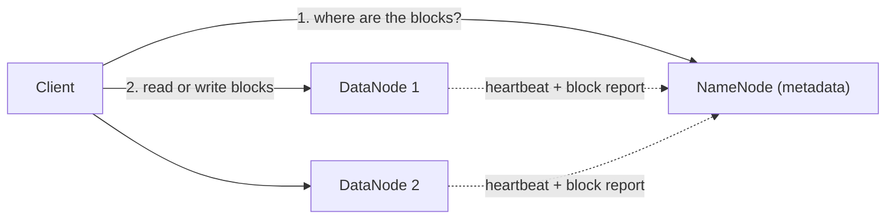

**In simple words:** HDFS stores a big file by cutting it into blocks and spreading the blocks over many machines. The **NameNode** is the manager that remembers where every block is. The **DataNodes** are the workers that actually hold the blocks. <Cite id="hdfs-apache-design" /> <Cite id="hdfs-gfg" />

**Analogy:** a library. The catalogue (which book is on which shelf) is the NameNode. The shelves holding the books are the DataNodes.

| Point | NameNode | DataNode |
|---|---|---|
| Role | Master | Worker (slave) |
| Stores | Metadata: file names, directory tree, block-to-DataNode map | Actual data blocks (128 MB by default) |
| Number | One active (plus a standby in HA) | Many, one on each worker machine |
| Talks to | Clients and DataNodes | NameNode, clients and other DataNodes |
| Does | Opens, closes, renames files; decides block placement and replication | Serves reads and writes; creates, deletes and copies blocks when told |
| Failure | Whole cluster is unusable if it fails (so a standby is kept) | The cluster carries on; blocks are re-copied from other replicas |
| Memory/disk | Needs a lot of RAM (keeps metadata in memory) | Needs a lot of disk |

<Cite id="hdfs-tp" /> <Cite id="big-data-intro-hdfs" />

**Conclusion:** the NameNode knows *where* the data is; the DataNodes *hold* the data.
