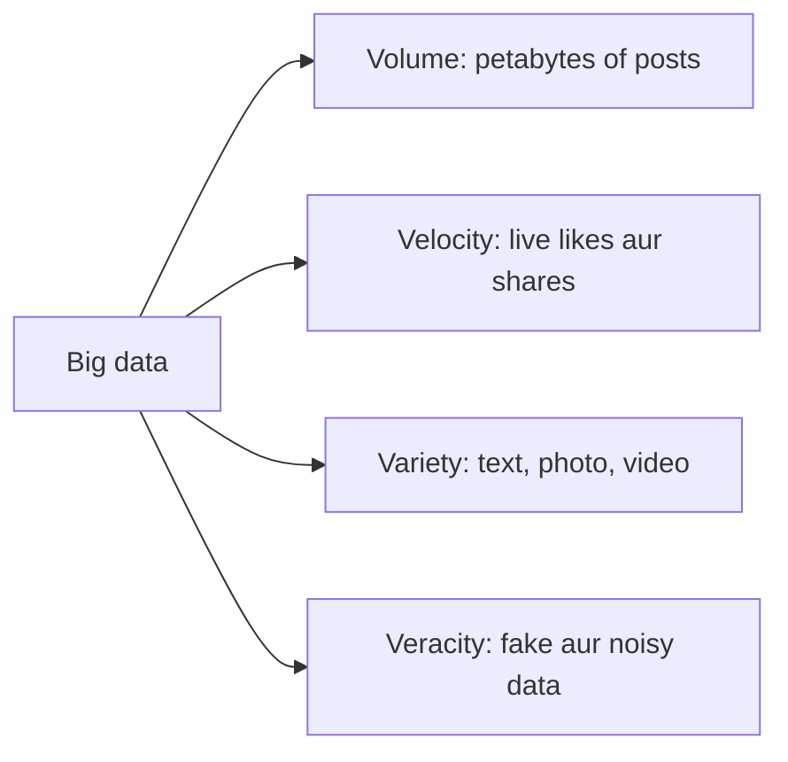

**In simple words:** big data woh data hai jo itna bada, tez aur alag-alag type ka hai ki ek normal computer ya database use store ya process nahi kar sakta. Ise **V's** se describe karte hain. Chaar main V's hain **volume, velocity, variety aur veracity** (kai books mein paanchva **value** bhi hota hai). <Cite id="big-data-intro-ibm" /> <Cite id="big-data-intro-gfg" />

| Characteristic | Meaning | On social media (Facebook, Instagram, X) |
|---|---|---|
| Volume | Bahut zyada amount of data | Billions users roz photos, videos aur messages post karte hain, to storage petabytes mein jaata hai |
| Velocity | Data kitni tezi se aata hai aur process hona hai | Har second hazaaron posts, likes, comments aate hain; trending topics real time mein nikalne padte hain |
| Variety | Kai types ka data: structured, semi-structured, unstructured | Text, images, video, audio, emojis, hashtags, location tags, friend graphs |
| Veracity | Data kitna trustworthy aur clean hai | Fake accounts, bots, spam, rumours aur sarcasm data ko noisy banate hain, isliye use se pehle clean karna padta hai |

**Value (paanchva V):** data tabhi kaam ka hai jab insight de, jaise users ko kya pasand hai ye pata karke better ads aur friend suggestions dikhana. <Cite id="big-data-intro-av" />

**Conclusion:** social media mein chaaron V's ek saath dikhte hain, isliye Hadoop, Spark aur NoSQL jaise distributed tools chahiye.

Exam mein English mein likho: "The four characteristics of big data are volume, velocity, variety and veracity."
