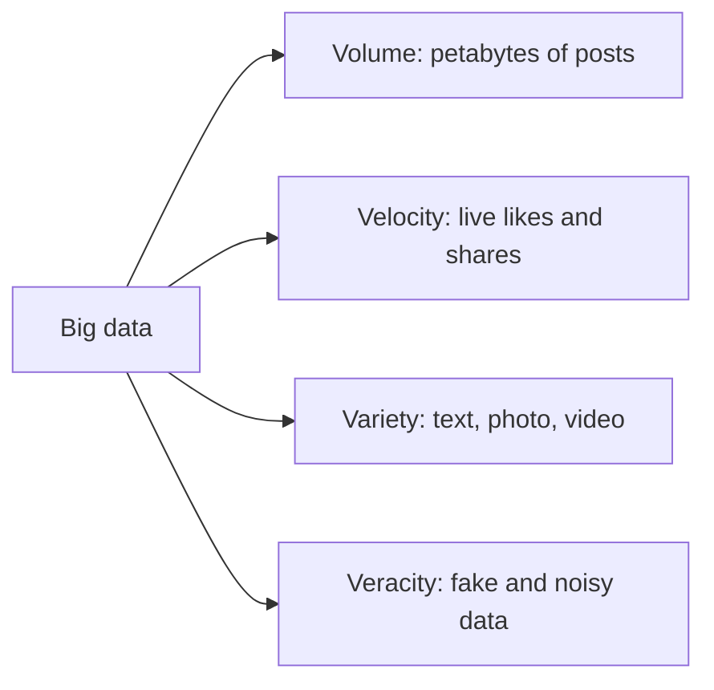

**In simple words:** big data is data so large, fast and varied that one normal computer or database cannot store or process it. It is usually described by the **V's**. Four main ones are **volume, velocity, variety and veracity** (many books add a fifth, **value**). <Cite id="big-data-intro-ibm" /> <Cite id="big-data-intro-gfg" />

| Characteristic | Meaning | On social media (Facebook, Instagram, X) |
|---|---|---|
| Volume | Very large amount of data | Billions of users post photos, videos and messages every day, so storage runs into petabytes |
| Velocity | Speed at which data arrives and must be processed | Thousands of posts, likes and comments arrive every second; trending topics must be found in real time |
| Variety | Many types of data: structured, semi-structured, unstructured | Text, images, video, audio, emojis, hashtags, location tags, friend graphs |
| Veracity | How trustworthy and clean the data is | Fake accounts, bots, spam, rumours and sarcasm make the data noisy, so it must be cleaned before use |

**Value (fifth V):** data is useful only if it gives insight, for example finding what users like so that better ads and friend suggestions can be shown. <Cite id="big-data-intro-av" />

**Conclusion:** social media shows all four V's at once, which is why it needs distributed tools such as Hadoop, Spark and NoSQL.
