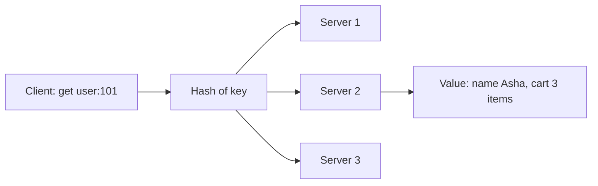

**In simple words:** key-value store NoSQL database ka sabse simple type hai. Ye data ko **(key, value)** pairs mein rakhta hai, dictionary ya coat check ki tarah: ticket (key) do aur jo rakha tha (value) wahi wapas lo. <Cite id="nosql-patterns-gfg-kv" /> <Cite id="nosql-patterns-aws-kv" />

**Kaise kaam karta hai.**

1. **Key** ek unique naam hai, jaise `user:101`. Data dhoondhne ka yahi ek tareeka hai.
2. **Value** kuch bhi ho sakti hai: number, text, JSON document, image. Database value ke andar nahi dekhta. <Cite id="nosql-patterns-wiki-kv" />
3. Bas kuch operations hote hain: `put(key, value)`, `get(key)` aur `delete(key)`.
4. Key ka hash decide karta hai ki pair kis server pe rahega, isliye data kai machines pe fail jaata hai.

**Examples:** Redis, Amazon DynamoDB, Riak, Memcached. Typical uses: shopping carts, user sessions, caches, user profiles, leaderboards. <Cite id="nosql-patterns-redis-kv" /> <Cite id="nosql-intro-dynamo" />

**Benefits.**

- **Bahut fast:** key se lookup direct hai, joins nahi, aur kai stores data memory mein rakhte hain.
- **Simple:** seekhna aur use karna easy, API chhoti hai.
- **Scalable:** keys hash hoti hain, to data badhne par servers add karte hain (scale out).
- **Flexible:** fixed schema nahi, har value ki shape alag ho sakti hai.
- **Available:** data replicate karna easy hai, to ek server fail hone par system band nahi hota.
- **Low cost:** sasti commodity machines pe chalta hai.

**Limitations.** Value pe query nahi (sirf key se lookup), joins ya complex relations nahi, aur kuch stores mein consistency kamzor.

**Conclusion:** key-value store query power ke badle speed aur easy scaling deta hai, isliye bade data pe simple lookups ke liye achha hai.

Exam mein English mein likho: "A key-value store keeps data as unique keys mapped to values and is very fast and scalable."
