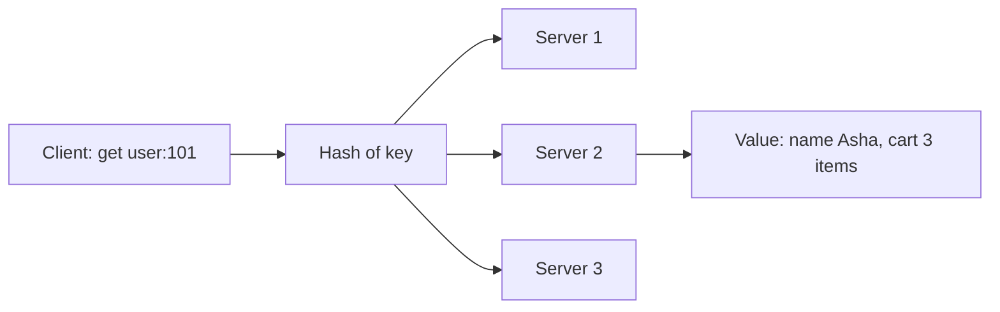

**In simple words:** a key-value store is the simplest kind of NoSQL database. It stores data as **(key, value)** pairs, like a dictionary or a coat check: you hand in a ticket (the key) and get back exactly what you stored (the value). <Cite id="nosql-patterns-gfg-kv" /> <Cite id="nosql-patterns-aws-kv" />

**How it works.**

1. The **key** is a unique name, such as `user:101`. It is the only way to find the data.
2. The **value** can be anything: a number, text, a JSON document, an image. The database does not look inside it. <Cite id="nosql-patterns-wiki-kv" />
3. Only a few operations exist: `put(key, value)`, `get(key)` and `delete(key)`.
4. Keys are hashed to decide which server holds the pair, so the data spreads over many machines.

**Examples:** Redis, Amazon DynamoDB, Riak, Memcached. Typical uses: shopping carts, user sessions, caches, user profiles, leaderboards. <Cite id="nosql-patterns-redis-kv" /> <Cite id="nosql-intro-dynamo" />

**Benefits.**

- **Very fast:** a lookup by key is direct, with no joins, and many stores keep data in memory.
- **Simple:** easy to learn and use, with a small API.
- **Scalable:** because keys are hashed, you add servers (scale out) as data grows.
- **Flexible:** no fixed schema, so each value can have a different shape.
- **Available:** data is easily replicated, so one server failing does not stop the system.
- **Low cost:** runs on cheap commodity machines.

**Limitations.** No queries on the value (only lookup by key), no joins or complex relations, and weaker consistency in some stores.

**Conclusion:** a key-value store trades query power for speed and easy scaling, so it suits simple lookups on huge data.
