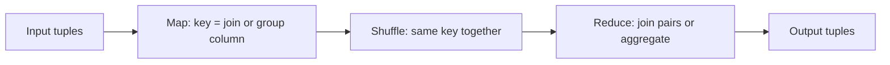

**In simple words:** MapReduce database operations bhi kar sakta hai. Trick **key** hai: map step key chunta hai, shuffle equal keys ko ek saath laata hai, aur reduce step ek key ka kaam karta hai. Join ke liye key join column hai; grouping ke liye key grouping column hai. <Cite id="big-data-intro-mmds" loc="§2.3" /> <Cite id="mapreduce-algorithms-gfg-relalg" />

**1. Natural join** $R(A, B) \bowtie S(B, C)$: un rows ko jodo jinka common column $B$ same hai.

- **Map:** $R$ ke har tuple $(a, b)$ ke liye key $b$, value $(R, a)$ emit karo. $S$ ke har tuple $(b, c)$ ke liye key $b$, value $(S, c)$ emit karo. R ya S ka label reducer ko batata hai ki value kahan se aayi.
- **Reduce:** key $b$ ke liye R ke har $a$ ko S ke har $c$ se pair karo aur $(a, b, c)$ output do.

<Sum>

<Given>

$R(A,B)$: $(a_1, b_1)$, $(a_2, b_1)$, $(a_3, b_2)$. $S(B,C)$: $(b_1, c_1)$, $(b_2, c_2)$, $(b_2, c_3)$.

</Given>

<Find>

MapReduce se $R \bowtie S$.

</Find>

<Steps>

1. **Map** deta hai $(b_1, (R,a_1))$, $(b_1, (R,a_2))$, $(b_2, (R,a_3))$, $(b_1, (S,c_1))$, $(b_2, (S,c_2))$, $(b_2, (S,c_3))$.
2. **Shuffle** key se group karta hai: $b_1 \to \{(R,a_1), (R,a_2), (S,c_1)\}$ aur $b_2 \to \{(R,a_3), (S,c_2), (S,c_3)\}$.
3. **Reduce** key $b_1$: $2 \times 1$ pairs se $(a_1,b_1,c_1)$ aur $(a_2,b_1,c_1)$. Key $b_2$: $1 \times 2$ pairs se $(a_3,b_2,c_2)$ aur $(a_3,b_2,c_3)$.

</Steps>

<Answer>

4 joined tuples: $(a_1,b_1,c_1)$, $(a_2,b_1,c_1)$, $(a_3,b_2,c_2)$, $(a_3,b_2,c_3)$.

</Answer>

<Box kind="verify">

Count: har key ke matches $2 \times 1 + 1 \times 2 = 4$, jo listed 4 tuples ke barabar hai.

</Box>

</Sum>

**2. Grouping aur aggregation** $\gamma_{A, \theta(B)}(R)$: tuples ko $A$ se group karo aur $B$ pe aggregate $\theta$ (SUM, COUNT, AVG, MAX) lagao.

- **Map:** har tuple $(a, b)$ ke liye key $a$, value $b$ emit karo.
- **Reduce:** key $a$ ke liye $b$ values ki list pe $\theta$ lagao aur $(a, \text{result})$ output do.

<Sum>

<Given>

Sales(Dept, Amount): $(D1, 10)$, $(D2, 5)$, $(D1, 20)$, $(D2, 15)$, $(D1, 30)$. Query: har department ka total amount.

</Given>

<Find>

Dept se grouped Amount ka SUM.

</Find>

<Steps>

1. **Map** emit karta hai $(D1,10)$, $(D2,5)$, $(D1,20)$, $(D2,15)$, $(D1,30)$.
2. **Shuffle:** $D1 \to [10, 20, 30]$ aur $D2 \to [5, 15]$.
3. **Reduce:** $D1: 10+20+30 = 60$. $D2: 5+15 = 20$.

</Steps>

<Answer>

$(D1, 60)$ aur $(D2, 20)$.

</Answer>

<Box kind="verify">

Dono group totals ka sum $60 + 20 = 80$, jo saare amounts ke sum $10+5+20+15+30 = 80$ ke barabar hai.

</Box>

</Sum>

| | Natural join | Grouping and aggregation |
|---|---|---|
| Map key | Common column | Grouping column |
| Map value | Tuple ka baaki part, relation ke tag ke saath | Jis column ko aggregate karna hai |
| Reduce | R ki har value ko S ki har value se pair karta hai | SUM, COUNT, AVG, MAX lagata hai |

<Cite id="mapreduce-algorithms-wiki-join" /> <Cite id="mapreduce-algorithms-tp-relalg" />

**Conclusion:** dono operations ek MapReduce job hain, bas key sahi chunni hoti hai.

Exam mein English mein likho: "In both operations, map chooses the key, shuffle groups equal keys and reduce does the join or the aggregate."
