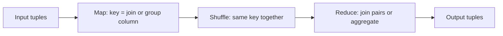

**In simple words:** MapReduce can do database operations. The trick is the **key**: the map step chooses a key, the shuffle brings equal keys together, and the reduce step does the work for one key. For a join the key is the join column; for grouping the key is the grouping column. <Cite id="big-data-intro-mmds" loc="§2.3" /> <Cite id="mapreduce-algorithms-gfg-relalg" />

**1. Natural join** $R(A, B) \bowtie S(B, C)$: join rows that have the same value of the common column $B$.

- **Map:** for each tuple $(a, b)$ of $R$ emit key $b$, value $(R, a)$. For each tuple $(b, c)$ of $S$ emit key $b$, value $(S, c)$. The label R or S tells the reducer where the value came from.
- **Reduce:** for key $b$, pair every $a$ from R with every $c$ from S and output $(a, b, c)$.

<Sum>

<Given>

$R(A,B)$: $(a_1, b_1)$, $(a_2, b_1)$, $(a_3, b_2)$. $S(B,C)$: $(b_1, c_1)$, $(b_2, c_2)$, $(b_2, c_3)$.

</Given>

<Find>

$R \bowtie S$ using MapReduce.

</Find>

<Steps>

1. **Map** gives $(b_1, (R,a_1))$, $(b_1, (R,a_2))$, $(b_2, (R,a_3))$, $(b_1, (S,c_1))$, $(b_2, (S,c_2))$, $(b_2, (S,c_3))$.
2. **Shuffle** groups by key: $b_1 \to \{(R,a_1), (R,a_2), (S,c_1)\}$ and $b_2 \to \{(R,a_3), (S,c_2), (S,c_3)\}$.
3. **Reduce** key $b_1$: $2 \times 1$ pairs give $(a_1,b_1,c_1)$ and $(a_2,b_1,c_1)$. Key $b_2$: $1 \times 2$ pairs give $(a_3,b_2,c_2)$ and $(a_3,b_2,c_3)$.

</Steps>

<Answer>

4 joined tuples: $(a_1,b_1,c_1)$, $(a_2,b_1,c_1)$, $(a_3,b_2,c_2)$, $(a_3,b_2,c_3)$.

</Answer>

<Box kind="verify">

Count: matches per key are $2 \times 1 + 1 \times 2 = 4$, the same as the 4 tuples listed.

</Box>

</Sum>

**2. Grouping and aggregation** $\gamma_{A, \theta(B)}(R)$: group tuples by $A$ and apply an aggregate $\theta$ (SUM, COUNT, AVG, MAX) to $B$.

- **Map:** for each tuple $(a, b)$ emit key $a$, value $b$.
- **Reduce:** for key $a$ apply $\theta$ to the list of $b$ values and output $(a, \text{result})$.

<Sum>

<Given>

Sales(Dept, Amount): $(D1, 10)$, $(D2, 5)$, $(D1, 20)$, $(D2, 15)$, $(D1, 30)$. Query: total amount per department.

</Given>

<Find>

SUM of Amount grouped by Dept.

</Find>

<Steps>

1. **Map** emits $(D1,10)$, $(D2,5)$, $(D1,20)$, $(D2,15)$, $(D1,30)$.
2. **Shuffle:** $D1 \to [10, 20, 30]$ and $D2 \to [5, 15]$.
3. **Reduce:** $D1: 10+20+30 = 60$. $D2: 5+15 = 20$.

</Steps>

<Answer>

$(D1, 60)$ and $(D2, 20)$.

</Answer>

<Box kind="verify">

The two group totals add to $60 + 20 = 80$, equal to the sum of all amounts $10+5+20+15+30 = 80$.

</Box>

</Sum>

| | Natural join | Grouping and aggregation |
|---|---|---|
| Map key | Common column | Grouping column |
| Map value | Rest of tuple, tagged with its relation | The column to aggregate |
| Reduce | Pairs every R value with every S value | Applies SUM, COUNT, AVG, MAX |

<Cite id="mapreduce-algorithms-wiki-join" /> <Cite id="mapreduce-algorithms-tp-relalg" />

**Conclusion:** both operations are one MapReduce job with a well-chosen key.
