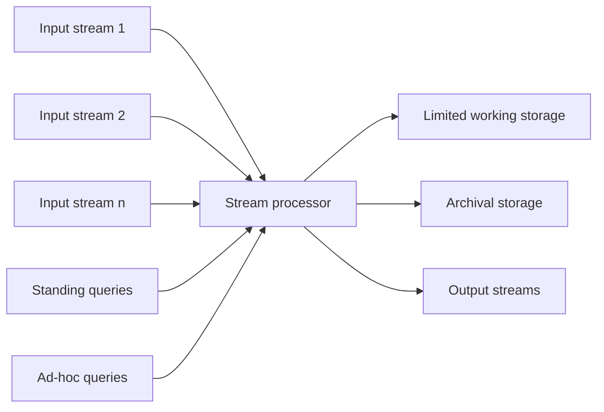

**In simple words:** Data Stream Management System (DSMS) ek software hai jo endless streams leta hai, un pe hamesha **standing queries** chalata hai, aur kabhi-kabhi **ad-hoc queries** ke answers bhi deta hai. Isme working memory chhoti hoti hai, isliye poori stream ki jagah summaries rakhta hai. <Cite id="stream-data-model-wiki-dsms" /> <Cite id="stream-data-model-gfg-dbms-dsms" />

**Ye kyun zaroori hai.** Ordinary DBMS pehle data store karta hai aur baad mein query karta hai. Streams iske liye bahut tez aur bade hain, aur answer abhi chahiye.

**Parts aur har ka kaam.**

1. **Input streams:** sensors, click logs, tweets wagairah. Ye apni speed se aati hain, rate badalta rehta hai.
2. **Stream processor (query processor):** core part. Ye aate hue items pe standing queries continuously chalata hai aur ad-hoc queries answer karta hai.
3. **Standing queries:** ek baar register hoti hain, hamesha output deti hain, jaise "temperature 40 se upar jaye to alert do".
4. **Ad-hoc queries:** ek baar poochi jaati hain, jaise "pichle ghante ka maximum kya tha?". Ye sirf wahi use kar sakti hain jo rakha gaya hai, jaise latest window ya summaries.
5. **Limited working storage:** chhota fast store (main memory ya disk) current window, samples aur sketches ke liye. <Cite id="big-data-intro-mmds" loc="§4.1.1" />
6. **Archival storage:** bada aur slow, data warehouse jaisa. Streams yahan archive ho sakti hain, par fast queries ke liye nahi hai.
7. **Output streams:** results streams, alerts ya database mein jaate hain.

Research systems mein aur parts hote hain: queries ke beech resources share karne ke liye **scheduler** aur **load shedder** jo input processing se tez ho to data drop karta hai. <Cite id="stream-data-model-babcock2002" /> <Cite id="stream-data-model-geisler" />

| | DBMS | DSMS |
|---|---|---|
| Data | Stored, finite | Continuous, endless |
| Queries | One-time | Continuous (standing) plus ad-hoc |
| Answers | Exact | Aksar approximate |
| Reading | Kai passes | Single pass |

**Conclusion:** DSMS streams ko on the fly limited memory se process karta hai, summaries rakhta hai, aur isliye standing queries real time mein answer kar sakta hai.

Exam mein English mein likho: "A DSMS has input streams, a stream processor, standing and ad-hoc queries, limited working storage, archival storage and output streams."
