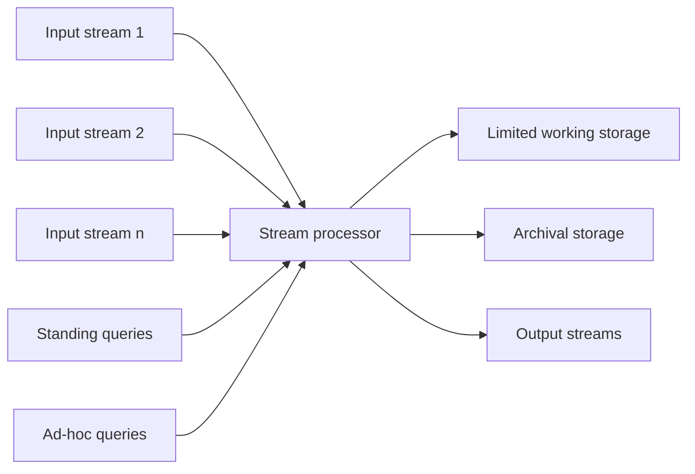

**In simple words:** a Data Stream Management System (DSMS) is software that takes in endless streams, runs **standing queries** on them all the time, and also answers occasional **ad-hoc queries**. It has only a small working memory, so it keeps summaries instead of the whole stream. <Cite id="stream-data-model-wiki-dsms" /> <Cite id="stream-data-model-gfg-dbms-dsms" />

**Why it is needed.** An ordinary DBMS stores data first and queries it later. Streams are too fast and too big for that, and answers are needed now.

**Parts and what each does.**

1. **Input streams:** sensors, click logs, tweets and so on. They arrive at their own speed, and the rate can change.
2. **Stream processor (query processor):** the core. It runs standing queries continuously on arriving items and answers ad-hoc queries.
3. **Standing queries:** registered once, they produce output all the time, for example "alert if temperature goes above 40".
4. **Ad-hoc queries:** asked once, for example "what was the maximum in the last hour?". They can only use what has been kept, such as the latest window or summaries.
5. **Limited working storage:** a small fast store (main memory or disk) for the current window, samples and sketches. <Cite id="big-data-intro-mmds" loc="§4.1.1" />
6. **Archival storage:** big and slow, like a data warehouse. Streams can be archived here, but it is not meant for fast queries.
7. **Output streams:** results go out as streams, alerts or into a database.

Further parts in research systems are a **scheduler** to share resources among queries and a **load shedder** that drops data when input is faster than processing. <Cite id="stream-data-model-babcock2002" /> <Cite id="stream-data-model-geisler" />

| | DBMS | DSMS |
|---|---|---|
| Data | Stored, finite | Continuous, endless |
| Queries | One-time | Continuous (standing) plus ad-hoc |
| Answers | Exact | Often approximate |
| Reading | Many passes | Single pass |

**Conclusion:** a DSMS processes streams on the fly with limited memory, keeping summaries, and so can answer standing queries in real time.
