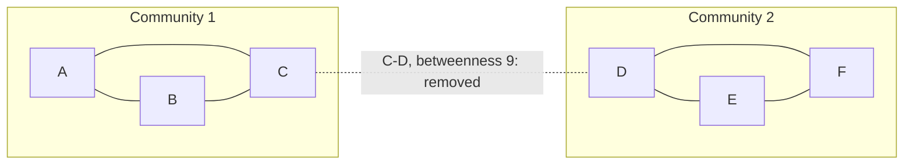

**In simple words:** Girvan-Newman algorithm communities (jo groups andar se tightly connected aur baaki se loosely connected hon) ko **bridge edges hata kar** dhoondhta hai. Bridge edge alag groups ke beech bahut saare shortest paths pe hoti hai, isliye uski **edge betweenness** high hoti hai. <Cite id="social-network-graphs-girvan-newman2002" /> <Cite id="social-network-graphs-mmds-book" loc="§10.2" />

**Steps:**

1. Har edge ki betweenness nikalo: saare node pairs ke beech jitne shortest paths us edge se guzarte hain (jis pair ke kai shortest paths hon, uska credit barabar baant dete hain).
2. Sabse zyada betweenness wali edge hata do.
3. Dobara compute karo, repeat karo. Graph tukdon mein tootta hai; connected tukde communities hain. <Cite id="social-network-graphs-gfg-girvan-newman" />

<Sum>

<Given>

6 nodes aur 7 edges ka graph: A-B, A-C, B-C, C-D, D-E, D-F, E-F. Do triangles $\{A,B,C\}$ aur $\{D,E,F\}$ edge C-D se jude hain.

</Given>

<Find>

Girvan-Newman se communities.

</Find>

<Steps>

1. **Shortest paths.** $\binom{6}{2} = 15$ pairs hain. Yahan har pair ka bilkul ek shortest path hai (to credit baantna nahi padta). Triangle ke andar shortest path seedhi edge hai. Triangles ke beech har path C-D se jaata hai.
2. **Edge betweenness** (kitne pairs ka shortest path us edge se jaata hai):

| Edge | Pairs using it | Betweenness |
|---|---|---|
| C-D | A-D, A-E, A-F, B-D, B-E, B-F, C-D, C-E, C-F | 9 |
| A-C | A-C, A-D, A-E, A-F | 4 |
| B-C | B-C, B-D, B-E, B-F | 4 |
| D-E | D-E, E-C, E-A, E-B | 4 |
| D-F | D-F, F-C, F-A, F-B | 4 |
| A-B | A-B | 1 |
| E-F | E-F | 1 |

3. **Sabse zyada wali edge hatao**, C-D (betweenness 9). Graph $\{A, B, C\}$ aur $\{D, E, F\}$ mein toot jaata hai.
4. **Dobara compute** har triangle ke andar: ab har edge ki betweenness 1 hai, sab barabar, aur aur edges hatane se triangles sirf single nodes mein toot jayenge. Isliye yahin ruk jaate hain.

</Steps>

<Answer>

do communities: $\{A, B, C\}$ aur $\{D, E, F\}$, edge C-D hata kar mile.

</Answer>

<Box kind="verify">

Check 1: total betweenness $= 9 + 4 \times 4 + 1 \times 2 = 27$. Saare 15 pairs ke shortest-path lengths ka sum: triangles ke andar 6 pairs ki length 1 (total 6), aur 9 cross pairs ki lengths $2, 3, 3, 2, 3, 3, 1, 2, 2$ (total 21). $6 + 21 = 27$, to match karta hai.

Check 2: split ki modularity. $m = 7$ edges, har triangle mein 3 internal edges aur degree sum 7, to $Q = 2 \times (3/7 - (7/14)^2) = 2 \times (0.4286 - 0.25) = 0.357$. Positive aur kaafi high value ka matlab asli community structure hai.

</Box>

</Sum>

**Note:** bade graphs pe algorithm slow hai, kyunki har edge hatane ke baad betweenness dobara compute hoti hai. <Cite id="social-network-graphs-wiki-girvan-newman" />

**Conclusion:** Girvan-Newman graph ko communities $\{A,B,C\}$ aur $\{D,E,F\}$ mein baant deta hai.

Exam mein English mein likho: "The edge C-D has the highest betweenness, so removing it gives the communities A, B, C and D, E, F."
