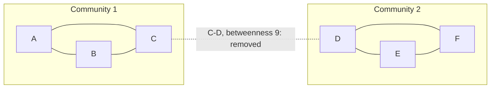

**In simple words:** the Girvan-Newman algorithm finds communities (groups that are tightly connected inside and loosely connected to the rest) by **removing the edges that act as bridges**. A bridge edge lies on many shortest paths between different groups, so it has high **edge betweenness**. <Cite id="social-network-graphs-girvan-newman2002" /> <Cite id="social-network-graphs-mmds-book" loc="§10.2" />

**Steps:**

1. Compute the betweenness of every edge: the number of shortest paths between all node pairs that pass through it (a pair with several shortest paths shares its credit equally).
2. Remove the edge with the highest betweenness.
3. Recompute, and repeat. The graph breaks into pieces; the connected pieces are the communities. <Cite id="social-network-graphs-gfg-girvan-newman" />

<Sum>

<Given>

Graph with 6 nodes and 7 edges: A-B, A-C, B-C, C-D, D-E, D-F, E-F. Two triangles $\{A,B,C\}$ and $\{D,E,F\}$ are joined by the edge C-D.

</Given>

<Find>

the communities using Girvan-Newman.

</Find>

<Steps>

1. **Shortest paths.** There are $\binom{6}{2} = 15$ pairs. Every pair has exactly one shortest path here (so no sharing of credit is needed). Inside a triangle the shortest path is the direct edge. Between the triangles every path goes through C-D.
2. **Edge betweenness** (number of pairs whose shortest path uses the edge):

| Edge | Pairs using it | Betweenness |
|---|---|---|
| C-D | A-D, A-E, A-F, B-D, B-E, B-F, C-D, C-E, C-F | 9 |
| A-C | A-C, A-D, A-E, A-F | 4 |
| B-C | B-C, B-D, B-E, B-F | 4 |
| D-E | D-E, E-C, E-A, E-B | 4 |
| D-F | D-F, F-C, F-A, F-B | 4 |
| A-B | A-B | 1 |
| E-F | E-F | 1 |

3. **Remove the highest edge**, C-D (betweenness 9). The graph splits into $\{A, B, C\}$ and $\{D, E, F\}$.
4. **Recompute** inside each triangle: every edge now has betweenness 1, all equal, and removing more would only break the triangles into single nodes. So we stop here.

</Steps>

<Answer>

two communities: $\{A, B, C\}$ and $\{D, E, F\}$, found by removing the edge C-D.

</Answer>

<Box kind="verify">

Check 1: total betweenness $= 9 + 4 \times 4 + 1 \times 2 = 27$. The sum of shortest-path lengths over all 15 pairs: 6 pairs inside triangles have length 1 (total 6), and the 9 cross pairs have lengths $2, 3, 3, 2, 3, 3, 1, 2, 2$ (total 21). $6 + 21 = 27$, so it matches.

Check 2: modularity of the split. With $m = 7$ edges, each triangle has 3 internal edges and degree sum 7, so $Q = 2 \times (3/7 - (7/14)^2) = 2 \times (0.4286 - 0.25) = 0.357$. A positive, fairly high value means a real community structure.

</Box>

</Sum>

**Note:** the algorithm is slow on big graphs, since betweenness is recomputed after every removal. <Cite id="social-network-graphs-wiki-girvan-newman" />

**Conclusion:** Girvan-Newman splits the graph into communities $\{A,B,C\}$ and $\{D,E,F\}$.
