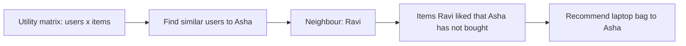

**In simple words:** collaborative filtering (CF) user ko items us basis pe recommend karta hai ki **dusre, similar users** ko kya pasand aaya. Ise items ke baare mein kuch jaanna zaroori nahi. Idea: "jo log pehle agree karte the, wo aage bhi agree karenge". <Cite id="recommendation-systems-wiki-cf" /> <Cite id="recommendation-systems-google-cf" />

**Ye kyun zaroori hai.** Flipkart ya Amazon jaisi shop lakhon products bechti hai, aur koi customer sab browse nahi kar sakta. Sahi kuch products recommend karne se sales aur satisfaction badhte hain.

**Data jo use hota hai.** **Utility matrix**: rows users hain, columns items, entries ratings ya purchases. Zyadatar entries khaali hoti hain (sparse). <Cite id="recommendation-systems-mmds-book" loc="§9.1" />

**E-commerce site pe kaise kaam karta hai.**

1. Saare users ki ratings, purchases aur clicks collect karo.
2. **User-based CF:** target user jaisi ratings wale users dhoondho (cosine similarity ya Pearson correlation se), inhe neighbours kehte hain.
3. Neighbours ko jo items pasand aaye aur target user ne nahi kharide, unhe dekho, aur user ki rating neighbours ki ratings ke (weighted) average se predict karo.
4. Top-rated items "Recommended for you" mein dikhao.
5. **Item-based CF** (Amazon use karta hai): jo items saath mein kharide ya rate kiye jaate hain wo dhoondho, "jinhone ye kharida unhone ye bhi kharida". <Cite id="recommendation-systems-linden2003" />

**Example:** (1 se 5 stars, `?` matlab rate nahi kiya)

| User | Phone | Earbuds | Power bank | Laptop bag |
|---|---|---|---|---|
| Asha | 5 | 4 | 5 | ? |
| Ravi | 5 | 5 | 4 | 5 |
| Meena | 1 | 2 | 1 | 2 |

Asha lagbhag Ravi jaisi rating deti hai (5, 4, 5 vs 5, 5, 4), aur Meena se bahut alag. To Ravi Asha ka neighbour hai. Ravi ne laptop bag ko 5 diya, to site Asha ke liye high rating predict karti hai aur use laptop bag dikhati hai. Meena ki opinion ko kam weight milta hai.

| Advantages | Limitations |
|---|---|
| Item details nahi chahiye | **Cold start:** naye users aur items ki ratings nahi hoti |
| Surprising, naye interests dhoondhta hai | **Sparsity:** har user ki kam ratings |
| Kisi bhi type ke items ke liye chalta hai | Bahut data chahiye; bade matrices pe slow |

<Cite id="recommendation-systems-gfg-python" />

**Conclusion:** collaborative filtering crowd ki ratings se predict karta hai ki user ko kya pasand aayega, aur e-commerce sites products suggest karne ke liye ise use karti hain.

Exam mein English mein likho: "Collaborative filtering recommends items to a user based on the ratings of similar users."
