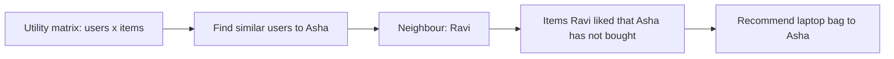

**In simple words:** collaborative filtering (CF) recommends items to a user based on what **other, similar users** liked. It does not need to know anything about the items themselves. The idea: "people who agreed in the past will agree in the future". <Cite id="recommendation-systems-wiki-cf" /> <Cite id="recommendation-systems-google-cf" />

**Why it is needed.** A shop like Flipkart or Amazon sells millions of products, and no customer can browse them all. Recommending the right few increases sales and satisfaction.

**Data used.** A **utility matrix**: rows are users, columns are items, entries are ratings or purchases. Most entries are empty (sparse). <Cite id="recommendation-systems-mmds-book" loc="§9.1" />

**How it works on an e-commerce site.**

1. Collect ratings, purchases and clicks of all users.
2. **User-based CF:** find users whose ratings are similar to the target user (using cosine similarity or Pearson correlation), called neighbours.
3. Look at items the neighbours liked that the target user has not bought, and predict the user's rating as the (weighted) average of the neighbours' ratings.
4. Show the top-rated items as "Recommended for you".
5. **Item-based CF** (used by Amazon): find items that are bought or rated alike, so "customers who bought this also bought that". <Cite id="recommendation-systems-linden2003" />

**Example:** (1 to 5 stars, `?` means not rated)

| User | Phone | Earbuds | Power bank | Laptop bag |
|---|---|---|---|---|
| Asha | 5 | 4 | 5 | ? |
| Ravi | 5 | 5 | 4 | 5 |
| Meena | 1 | 2 | 1 | 2 |

Asha rates almost like Ravi (5, 4, 5 against 5, 5, 4), and very differently from Meena. So Ravi is Asha's neighbour. Ravi gave the laptop bag 5, so the site predicts a high rating for Asha and shows her the laptop bag. Meena's opinion is given little weight.

| Advantages | Limitations |
|---|---|
| No item details needed | **Cold start:** new users and new items have no ratings |
| Finds surprising, new interests | **Sparsity:** few ratings per user |
| Works for any kind of item | Needs a lot of data; slow on huge matrices |

<Cite id="recommendation-systems-gfg-python" />

**Conclusion:** collaborative filtering uses the crowd's ratings to predict what a user will like, and e-commerce sites use it to suggest products.
