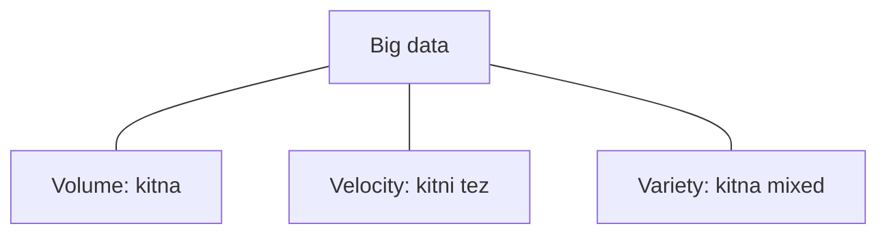

**In simple words:** **3 V's** wo teen properties hain jo data ko "big" banati hain: **Volume** (kitna), **Velocity** (kitni tez) aur **Variety** (kitna mixed). Jab data itna bada, tez ya mixed ho jaye, to ek traditional database kaam nahi karta. <Cite id="big-data-intro-wiki" /> <Cite id="big-data-intro-ibm" />

| V | Meaning | Kaunsa sawal |
|---|---|---|
| Volume | Data ki matra, terabytes se petabytes | Kitna? |
| Velocity | Data kitni speed se aata hai aur process hona chahiye | Kitni tez? |
| Variety | Bahut formats: tables, text, images, video, logs, sensor data | Kitne type? |

<Cite id="big-data-intro-gfg" loc="diagram" />

**Case study 1: stock exchange (Velocity).** Har second bahut saare buy aur sell orders aate hain. Ek minute late price signal ka koi fayda nahi, isliye data ko stream ki tarah real time mein process karna padta hai. Ye velocity hai. **Justification:** problem data ke aane ki speed hai, file size nahi. <Cite id="big-data-intro-tp" />

**Case study 2: hospital ya health records (Variety).** Ek patient ka table data (age, test values), doctor ke free-text notes, X-ray images aur sensor readings hote hain. Ek fixed table in sabko hold nahi kar sakti, to system ko mixed formats store karne padte hain. Ye variety hai. **Justification:** problem formats ki sankhya hai.

Volume ka example: social network jo apne users ki har photo aur video store karta hai.

**Conclusion:** volume, velocity aur variety milkar decide karte hain ki data "big" hai ya nahi, aur har ek ke liye HDFS, Spark ya NoSQL jaise distributed tool chahiye.

Exam mein English mein likho: "The 3 V's of big data are volume (amount), velocity (speed of arrival) and variety (different formats)."
