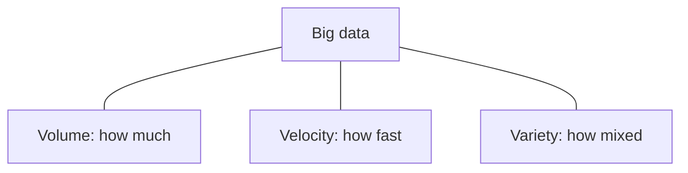

**In simple words:** the **3 V's** are the three properties that make data "big": **Volume** (how much), **Velocity** (how fast) and **Variety** (how mixed). Data that is large, fast or mixed enough breaks a single traditional database. <Cite id="big-data-intro-wiki" /> <Cite id="big-data-intro-ibm" />

| V | Meaning | Question it answers |
|---|---|---|
| Volume | The amount of data, terabytes to petabytes | How much? |
| Velocity | The speed at which data arrives and must be processed | How fast? |
| Variety | Many formats: tables, text, images, video, logs, sensor data | How many kinds? |

<Cite id="big-data-intro-gfg" loc="diagram" />

**Case study 1: stock exchange (Velocity).** Buy and sell orders arrive in huge numbers every second. A price signal that is one minute late is worth little, so the data must be processed as a stream in real time. This is velocity. **Justification:** the problem is speed of arrival, not file size. <Cite id="big-data-intro-tp" />

**Case study 2: hospital or health records (Variety).** One patient has table data (age, test values), free-text doctor notes, X-ray images and sensor readings. A single fixed table cannot hold all of these, so the system must store mixed formats. This is variety. **Justification:** the problem is the number of formats.

A volume example is a social network storing every photo and video of its users.

**Conclusion:** volume, velocity and variety together decide whether data is "big", and each one needs a distributed tool such as HDFS, Spark or NoSQL.
